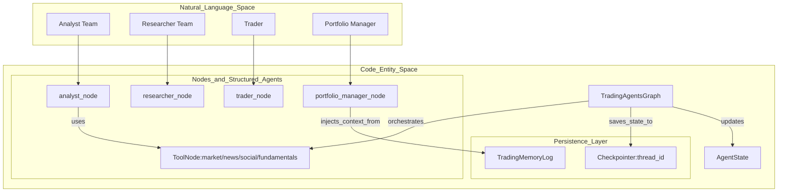
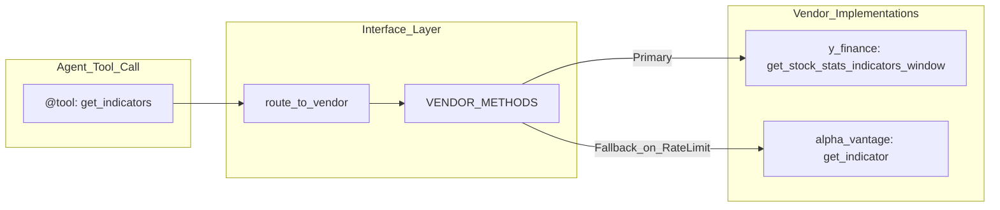

<!-- source: DeepWiki mcp.deepwiki.com · repo TauricResearch/TradingAgents · page 10 Glossary · fetched 2026-10-29 -->

# Glossary

Relevant source files

The following files were used as context for generating this wiki page:

- [CHANGELOG.md](CHANGELOG.md)
- [README.md](README.md)
- [main.py](main.py)
- [pyproject.toml](pyproject.toml)
- [requirements.txt](requirements.txt)
- [tests/test_memory_log.py](tests/test_memory_log.py)
- [tests/test_vendor_errors.py](tests/test_vendor_errors.py)
- [tests/test_vendor_routing.py](tests/test_vendor_routing.py)
- [tests/test_version.py](tests/test_version.py)
- [tradingagents/__init__.py](tradingagents/__init__.py)
- [tradingagents/dataflows/errors.py](tradingagents/dataflows/errors.py)
- [tradingagents/dataflows/router.py](tradingagents/dataflows/router.py)
- [tradingagents/default_config.py](tradingagents/default_config.py)
- [tradingagents/graph/trading_graph.py](tradingagents/graph/trading_graph.py)

This glossary defines codebase-specific terms, jargon, and domain concepts used throughout the **TradingAgents** framework. It serves as a technical reference for engineers to understand the mapping between high-level financial concepts and their underlying code implementations, updated for the v0.6.0 architecture.

---

## Core System Terms

### TradingAgentsGraph
The central orchestration class that manages the lifecycle of a trading analysis. It initializes the LLM clients, memory systems, and defines the LangGraph state machine structure [tradingagents/graph/trading_graph.py:51-113](). It coordinates the flow of information from data retrieval to final portfolio approval [tradingagents/graph/trading_graph.py:127-128]().

### AgentState
A TypedDict that defines the schema of the data passed between nodes in the LangGraph. It tracks messages, current reports (market, news, sentiment, etc.), and the status of the trading decision [tradingagents/agents/utils/agent_states.py:1-30]().

### Propagate
The primary execution method of the `TradingAgentsGraph`. It takes a ticker and a date, initializes the `AgentState`, and streams the graph execution until a final decision is reached [tradingagents/graph/trading_graph.py:255-263]().

### TradingMemoryLog
A persistent, append-only markdown log. It stores trading decisions in Phase A (`store_decision`) and updates them with actual market outcomes (raw return, alpha) and LLM reflections in Phase B (`update_with_outcome`) [tests/test_memory_log.py:51-55](). It uses a structured markdown format with HTML comment separators for robust parsing.

### Checkpoint Resume
A feature enabled by LangGraph's checkpointer integration. It allows the system to save the state of a thread at each node, enabling a run to be resumed if interrupted [tradingagents/graph/trading_graph.py:126-128](). The `thread_id` includes a `signature` to ensure graph-shape identity [tradingagents/graph/trading_graph.py:140-153]().

### Dual-Model Thinking (Deep vs. Quick)
An optimization strategy where the system uses two distinct LLM configurations:
*   **Deep Thinking LLM**: Used for complex reasoning, debates, and structured decision-making [tradingagents/graph/trading_graph.py:79-79]().
*   **Quick Thinking LLM**: Used for simpler tasks like summarizing reports or signal extraction [tradingagents/graph/trading_graph.py:80-80]().

### HTML Report (`complete_report.html`)
A self-contained single-page HTML report generated alongside Markdown reports during a run, displaying sections side-by-side for easy viewing in browsers or print [CHANGELOG.md:15-15]().

**TradingAgents Architecture Mapping**

The following diagram bridges the conceptual "Natural Language" trading roles to their specific Python class implementations and state management entities.

Sources: [tradingagents/graph/trading_graph.py:51-128](), [tradingagents/agents/utils/agent_states.py:1-30](), [tradingagents/memory/__init__.py](), [tradingagents/graph/checkpointer.py:1-50]().

---

## Data & Vendor Terms

### Verified Data-Access Contract
Ensures symbol normalization on every vendor path, look-ahead-safe news windows, and stale-OHLCV rejection via strict validation [CHANGELOG.md:24-25](). It guarantees point-in-time integrity across all dated tools, preventing future data leaks into historical runs.

### Grounded Sentiment Analyst
A sentiment agent that pre-fetches real Yahoo News, StockTwits, and Reddit data before generating reports, preventing LLM fabrication [CHANGELOG.md:87-89](). Supports crypto subreddits for crypto tickers [CHANGELOG.md:18-18]().

### Data Vendor Routing
The mechanism used to abstract data retrieval. The `route_to_vendor` function maps abstract methods to specific vendor implementations with fallback support [tradingagents/dataflows/router.py:97-149](). Includes integration for FRED (macro data) and Polymarket (prediction markets) [tradingagents/dataflows/router.py:141-148]().

### VendorError Taxonomy
A typed hierarchy of errors including `NoMarketDataError`, `VendorRateLimitError`, and `VendorNotConfiguredError` [tradingagents/dataflows/errors.py:1-30](), [tests/test_vendor_errors.py:30-43]().

**Data Flow and Vendor Interface Mapping**

Sources: [tradingagents/dataflows/router.py:97-149](), [tradingagents/dataflows/errors.py:1-30](), [CHANGELOG.md:24-25]().

---

## Technical & Integration Jargon

### Structured Output
A mechanism where agents return Pydantic models. Used by the Research Manager (`ResearchPlan`), Trader (`TraderProposal`), and Portfolio Manager (`PortfolioDecision`) [tradingagents/agents/schemas.py:1-200](). Coercion functions handle nullish strings and formatted prices to prevent validation errors.

### Provider Registry
A unified system for registering LLM providers supporting OpenAI, Anthropic, Google, Amazon Bedrock, NVIDIA NIM, Kimi, Groq, Mistral, and custom OpenAI-compatible endpoints [CHANGELOG.md:56-58]().

### A Provider Per Model Tier
Allows the quick-thinking and deep-thinking model tiers to run on different providers (e.g., managers on Claude while analysts run on OpenAI) via `deep_think_provider` and `quick_think_provider` settings [CHANGELOG.md:16-16]().

### llm_max_retries
A configurable budget forwarded to every provider to ride out bursty 429 throttling [tradingagents/default_config.py:120-120]().

---

## Backtesting & Portfolio Terms

### Backtest Grid
The concept of running the trading analysis pipeline over a defined grid of tickers and dates implemented via `run_backtest`, `iter_grid`, and `summarize` [tradingagents/backtest.py](). The purpose is to evaluate decision quality over many scenarios rather than simulate a live portfolio.

### PortfolioContext
Represents the current state of a portfolio including cash, currency, and existing positions [tradingagents/portfolio.py](). Passed via `propagate(portfolio=...)` or the `--portfolio` CLI flag so agents size decisions against real holdings.

### SEC EDGAR As-Filed Fundamentals
A keyless data vendor for US company fundamentals providing financial statements as filed on the run's date, suppressing unfiled periods and reflecting restatements as first reported [CHANGELOG.md:16-17]().

### `RATING_REVIEW`
A special rating value used when an LLM's decision cannot be parsed into a readable rating, flagging the decision for review rather than defaulting to "Hold" [CHANGELOG.md:38-38]().

### `holding_period_days`
A configurable parameter defining the window over which alpha and raw returns are measured for settled decisions [CHANGELOG.md:39]().

### Macro Vintage Pin
Ensures historical macro data requests (e.g. from FRED) are served from the data vintage available on the run's date to prevent look-ahead bias [CHANGELOG.md:30-31]().

### Run-Date-From-State Dated Tools
Integrity feature where all tools fetching time-sensitive data explicitly take the run date from the LangGraph state to prevent future data leaks [CHANGELOG.md:24-25]().

---

| Term | Code Pointer | Description |
| :--- | :--- | :--- |
| `PortfolioRating` | [tradingagents/agents/schemas.py:67]() | Enum defining the canonical 5-tier investment rating (Buy/Overweight/Hold/Underweight/Sell). |
| `OPTIONAL_CATEGORIES` | [tradingagents/dataflows/router.py:94]() | Categories like `macro_data` that degrade gracefully on failure instead of crashing. |
| `AnalystExecutionPlan` | [tradingagents/agents/analyst_execution.py:1]() | Structure for tracking analyst wall time and execution status. |
| `DEBATE_PATH_MAP` | [tradingagents/graph/conditional_logic.py:1]() | Shared path map ensuring crash-safety in graph routing. |
| `save_reports()` | [tradingagents/graph/trading_graph.py:300]() | Method for programmatic report output in headless/API runs. |
| `TraderProposal` | [tradingagents/agents/schemas.py:146]() | Pydantic schema for the structured transaction proposal produced by the Trader agent. |
| `TradingMemoryLog` | [tradingagents/memory/log.py:1]() | Persistent append-only markdown log for decision tracking and outcomes. |

Sources: [tradingagents/agents/schemas.py:1-200](), [tradingagents/dataflows/router.py:94-149](), [tradingagents/default_config.py:1-137](), [CHANGELOG.md:1-100](), [tradingagents/backtest.py:1-201](), [tradingagents/portfolio.py:1-50]().