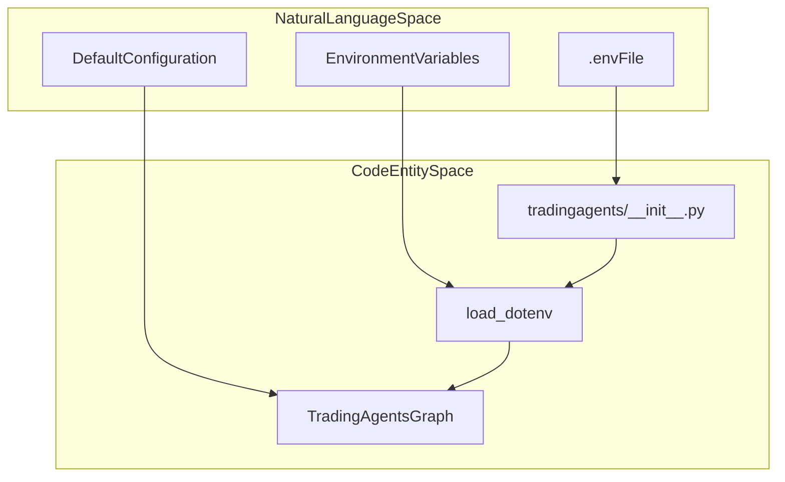
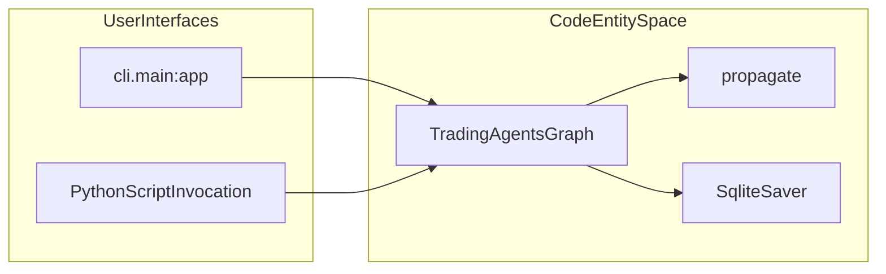

<!-- source: DeepWiki mcp.deepwiki.com · repo TauricResearch/TradingAgents · page 2 Getting Started · fetched 2026-10-29 -->

# Getting Started

<details>
<summary>Relevant source files</summary>

The following files were used as context for generating this wiki page:

- [CHANGELOG.md](CHANGELOG.md)
- [README.md](README.md)
- [pyproject.toml](pyproject.toml)
- [requirements.txt](requirements.txt)
- [tests/test_version.py](tests/test_version.py)
- [tradingagents/__init__.py](tradingagents/__init__.py)

</details>


This page guides you through installing TradingAgents, configuring API credentials, and running your first trading analysis. It covers the essential setup steps needed to use the framework through either the command-line interface (CLI) or the programmatic Python API.

For detailed installation instructions, dependency structures, and optional extras, see [Installation and Dependencies](#2.1). For an introduction to the configuration system, environment variables, and default configuration values, see [Configuration Basics](#2.2). For concrete usage examples covering both the CLI and programmatic APIs, see [Quick Start Examples](#2.3).

---

## Prerequisites and Requirements

TradingAgents requires **Python 3.11 or higher** [pyproject.toml:10](). The framework integrates with multiple LLM provider SDKs and financial data vendors.

| Requirement | Minimum Version / Detail | Source Reference |
|------------|-------------------------|------------------|
| Python | `>=3.11` | [pyproject.toml:10]() |
| Package Manager | `pip` or `uv` | [pyproject.toml:11-28]() |
| Environment Loading | Automatic via `python-dotenv` | [tradingagents/__init__.py:5-13]() |

Sources: [pyproject.toml:10-28](), [tradingagents/__init__.py:5-13]()

---

## Installation Overview

To install TradingAgents locally, clone the repository, create a virtual environment, and install the package using standard pip workflows [pyproject.toml:11-28]():

```bash
git clone https://github.com/TauricResearch/TradingAgents.git
cd TradingAgents
python -m venv .venv
source .venv/bin/activate
pip install .
```

The core runtime dependencies defined in `pyproject.toml` include LangChain and LangGraph components, Pandas, StockStats, and Rich [pyproject.toml:11-28](). For Amazon Bedrock support using AWS SigV4 authentication, install the optional `bedrock` extra: `pip install ".[bedrock]"` [pyproject.toml:37-41](). Package versioning is dynamically retrieved from `tradingagents.__version__` [pyproject.toml:46-47](), [tradingagents/__init__.py:1-3]().

Upon package import, `tradingagents/__init__.py` automatically loads environment variables from `.env` files using `python-dotenv` so that LLM clients and configuration modules have immediate access to required credentials [tradingagents/__init__.py:5-13]().

For detailed installation flows, virtual environment setup with `uv`, and deep dependency analysis, see [Installation and Dependencies](#2.1).

Sources: [pyproject.toml:11-47](), [tradingagents/__init__.py:1-13]()

---

## Configuration Basics

TradingAgents relies on centralized configuration patterns and environment variables prefixed with `TRADINGAGENTS_` to control execution parameters, model selections, debate rounds, and output languages [CHANGELOG.md:16](). 

API keys and operational overrides can be supplied via environment exports or a `.env` file placed in the project root [tradingagents/__init__.py:5-13]().

Title: Configuration Flow from Environment and Defaults to Core Graph Components

Sources: [tradingagents/__init__.py:5-13]()

For a complete breakdown of configuration keys, environment variable coercion rules, and tool-level overrides, see [Configuration Basics](#2.2).

---

## Usage Modes

TradingAgents provides two primary execution interfaces: an interactive command-line interface and a programmatic Python API.

### Command-Line Interface
The interactive CLI is configured as a console script entry point (`tradingagents = "cli.main:app"`), allowing direct invocation from the terminal once installed [pyproject.toml:43-44](). It guides users through asset selection, date ranges, and provider configuration before streaming execution logs.

### Python API
For programmatic integration, batch jobs, or headless pipelines, you can instantiate `TradingAgentsGraph` directly and invoke propagation methods [CHANGELOG.md:32]().

Title: Interface Convergence to TradingAgentsGraph Execution Pipeline

Sources: [pyproject.toml:43-44]()

For complete code examples, CLI command options, and programmatic execution scripts, see [Quick Start Examples](#2.3).

---

