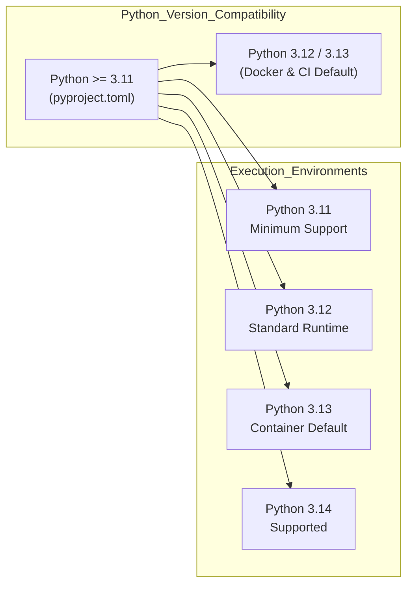
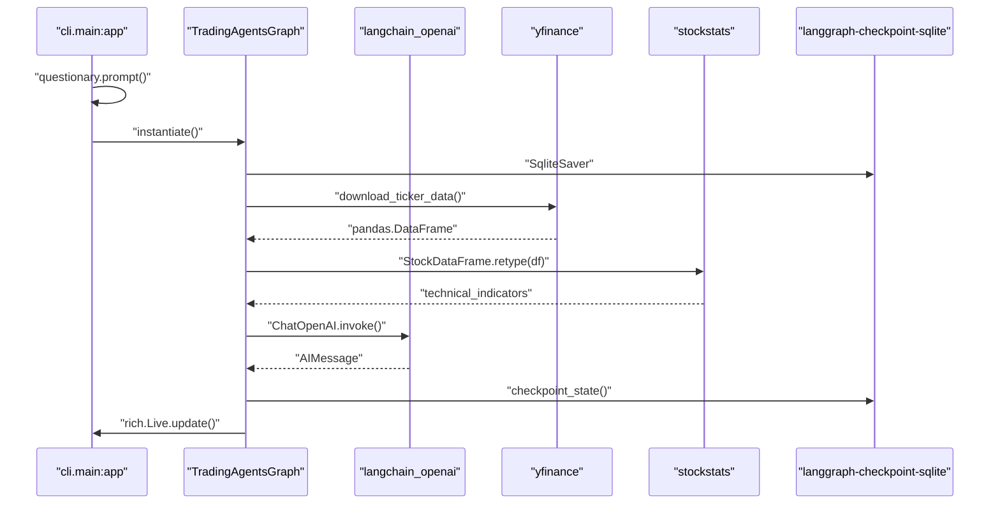

<!-- source: DeepWiki mcp.deepwiki.com · repo TauricResearch/TradingAgents · page 2.1 Installation and Dependencies · fetched 2026-10-29 -->

# Installation and Dependencies

<details>
<summary>Relevant source files</summary>

The following files were used as context for generating this wiki page:

- [CHANGELOG.md](CHANGELOG.md)
- [README.md](README.md)
- [pyproject.toml](pyproject.toml)
- [requirements.txt](requirements.txt)
- [tests/test_version.py](tests/test_version.py)
- [tradingagents/__init__.py](tradingagents/__init__.py)

</details>


This page provides comprehensive guidance on installing the TradingAgents framework and configuring its dependencies. It covers environment setup, dependency management via `pip` or `uv`, the dependency structure defined in `pyproject.toml`, optional extras such as `[bedrock]`, and the purpose of key runtime dependencies [pyproject.toml:11-41]().

---

## Installation Overview

The TradingAgents framework requires Python 3.11 or higher [pyproject.toml:10]() and relies on multiple external libraries for LLM inference, state management, and market data acquisition. The installation process registers the `tradingagents` command-line entry point which maps to `cli.main:app` [pyproject.toml:43-44]().

Sources: [pyproject.toml:10](), [pyproject.toml:43-44](), [README.md:98-104]()

---

## Python Version Requirements

### Version Compatibility Matrix

The project specifies `requires-python = ">=3.11"` in [pyproject.toml:10](). Continuous integration and packaging workflows validate support across modern Python runtimes.

Title: Python Version Compatibility and Requirements


**Key version considerations**:
- **Python 3.11**: The baseline requirement for modern typing and asynchronous features [pyproject.toml:10]().
- **Python 3.13**: Used as the base environment for standard container builds and clean-install verification [CHANGELOG.md:66]().
- **Cross-Platform**: Includes built-in compatibility handling for Windows UTF-8 encoding [CHANGELOG.md:49]().

Sources: [pyproject.toml:10](), [CHANGELOG.md:49](), [CHANGELOG.md:66]()

---

## Installation Methods

### Method 1: Standard Installation (pip)

Standard installation uses the root project configuration via `pip` [pyproject.toml:5-7](). The `requirements.txt` file points to the project package [requirements.txt:1-3]().

```bash
# Clone repository
git clone https://github.com/TauricResearch/TradingAgents.git
cd TradingAgents

# Create virtual environment
python -m venv .venv
source .venv/bin/activate  # Linux/macOS or .venv\Scripts\activate on Windows

# Install package and core dependencies
pip install .
```

To include optional features such as Amazon Bedrock support (`langchain-aws`), install with the `bedrock` extra tag [pyproject.toml:39-41]():
```bash
pip install ".[bedrock]"
```

For development and testing (`ruff`, `pytest`), install with the `dev` extra [pyproject.toml:31-36]():
```bash
pip install ".[dev]"
```

Sources: [pyproject.toml:11-41](), [requirements.txt:1-3]()

### Method 2: UV Package Manager

The project configuration is fully compatible with `uv` for fast dependency resolution and environment synchronization [pyproject.toml:5-29]().

```bash
# Sync environment using uv
uv sync
```

Sources: [pyproject.toml:5-29]()

---

## Dependency Structure

### Dependency Architecture

The framework organizes its dependencies into functional tiers: core graph orchestration, LLM vendor integrations, data processing, and user interface utilities [pyproject.toml:11-29]().

Title: Dependency Functional Blocks

```mermaid
graph TB
    subgraph "Core_Orchestration"
        LangGraph["langgraph>=1.2.12"]
        LangChain["langchain-core>=1.6.5"]
        Checkpointer["langgraph-checkpoint-sqlite>=3.1.1"]
    end
    
    subgraph "LLM_Providers"
        OpenAI["langchain-openai>=1.6.6"]
        Anthropic["langchain-anthropic>=1.7.4"]
        Google["langchain-google-genai>=4.4.0"]
        Bedrock["langchain-aws>=1.7.9 (Optional)"]
    end
    
    subgraph "Data_And_Analysis"
        YFinance["yfinance>=1.7.0"]
        StockStats["stockstats>=0.6.5"]
        Pandas["pandas>=3.0.6"]
    end
    
    subgraph "UI_And_CLI"
        Rich["rich>=14.0.0"]
        Typer["typer>=0.21.0"]
        Questionary["questionary>=2.1.0"]
    end

    TA["tradingagents"] --> LangGraph
    TA --> OpenAI
    TA --> YFinance
    TA --> Rich
    TA -.-> Bedrock
```


Sources: [pyproject.toml:11-41]()

### Key Dependencies and Purpose

| Package | Version | Purpose |
|---------|---------|---------|
| `langgraph` | >=1.2.12 | Orchestrates the multi-agent state machine and cyclic execution flows [pyproject.toml:16](). |
| `langgraph-checkpoint-sqlite` | >=3.1.1 | Enables persistence and checkpoint/resume functionality for graph states using SQLite [pyproject.toml:17](). |
| `langchain-openai` | >=1.6.6 | Primary integration client for OpenAI and compatible model providers [pyproject.toml:15](). |
| `langchain-anthropic` | >=1.7.4 | Integration client for Anthropic Claude models [pyproject.toml:13](). |
| `langchain-google-genai` | >=4.4.0 | Integration client for Google Gemini models [pyproject.toml:14](). |
| `langchain-aws` | >=1.7.9 | Optional Amazon Bedrock client via `[bedrock]` extra [pyproject.toml:39-41](). |
| `yfinance` | >=1.7.0 | Retrieves market price data, ticker information, and news [pyproject.toml:28](). |
| `stockstats` | >=0.6.5 | Calculates technical indicators (e.g., MACD, RSI) over pandas DataFrames [pyproject.toml:26](). |
| `pandas` | >=3.0.6 | High-performance data structure and time-series manipulation [pyproject.toml:19](). |
| `rich` | >=14.0.0 | Renders real-time terminal UI, progress tables, and panels [pyproject.toml:24](). |
| `questionary` | >=2.1.0 | Handles interactive CLI configuration wizards and prompts [pyproject.toml:22](). |
| `typer` | >=0.21.0 | CLI application structuring and argument parsing [pyproject.toml:25](). |

Sources: [pyproject.toml:11-29]()

---

## Technical Data Flow: Dependency Interaction

The sequence diagram below illustrates how internal execution modules interact with third-party dependencies defined in `pyproject.toml` during a typical analysis cycle.

Title: Bridge - Natural Language Flow to Code Entities and Dependencies


Sources: [pyproject.toml:11-29](), [pyproject.toml:43-44]()

---

## Installation Verification

### Verification via CLI
The package installs a command-line entry point named `tradingagents` [pyproject.toml:43-44](). You can verify the installation by running:

```bash
tradingagents --help
```

This command maps directly to the `app` object defined in `cli.main:app` [pyproject.toml:43-44](). Furthermore, automated package version verification runs via unit tests [tests/test_version.py:1-18]().

### Package Structure
The installation packaging includes the following core modules:
- `tradingagents`: Core logic, agent graph execution, memory systems, and data acquisition vendors [pyproject.toml:49-50]().
- `cli`: Command-line interface orchestration and static CLI assets [pyproject.toml:49-53]().

Sources: [pyproject.toml:43-54](), [tests/test_version.py:1-18]()

---

