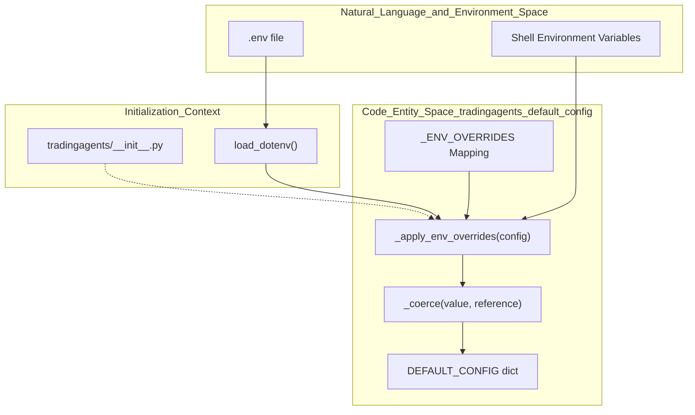
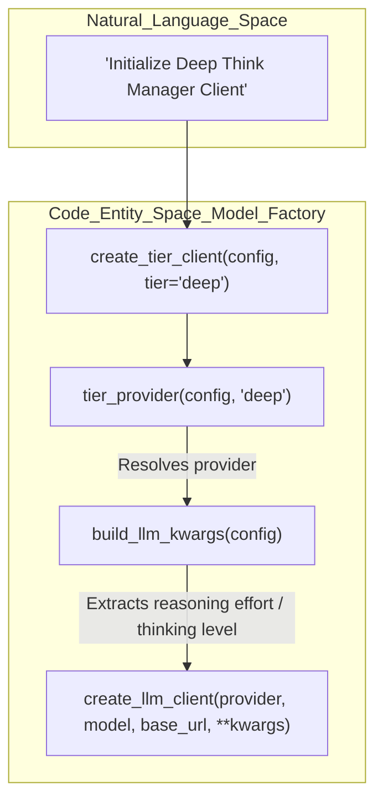

<!-- source: DeepWiki mcp.deepwiki.com · repo TauricResearch/TradingAgents · page 2.2 Configuration Basics · fetched 2026-10-29 -->

# Configuration Basics

Relevant source files

The following files were used as context for generating this wiki page:

- [.env.enterprise.example](.env.enterprise.example)
- [.env.example](.env.example)
- [main.py](main.py)
- [tests/test_tier_providers.py](tests/test_tier_providers.py)
- [tradingagents/default_config.py](tradingagents/default_config.py)
- [tradingagents/llm_clients/__init__.py](tradingagents/llm_clients/__init__.py)
- [tradingagents/llm_clients/factory.py](tradingagents/llm_clients/factory.py)

## Purpose and Scope

This document introduces the TradingAgents configuration system, detailing how to manage essential parameters, API keys, multi-model execution tiers, LLM thinking strategies, and system outputs such as `output_language`. The configuration system provides sensible defaults through `build_default_config()` and `DEFAULT_CONFIG` in `tradingagents/default_config.py` while supporting robust overrides via environment variables and runtime settings.

For installation procedures and dependencies, see [Installation and Dependencies](). For programmatic and CLI usage examples, see [Quick Start Examples](). For comprehensive details on LLM providers, see [LLM Provider Support]().

Sources: [tradingagents/default_config.py:1-137](), [.env.example:1-78]()

---

## Configuration System Architecture & Coercion

The TradingAgents configuration system operates across three tiers: base defaults defined in code, environment variables loaded from the shell or `.env` files, and explicit runtime overrides. At import time, `_apply_env_overrides()` maps `TRADINGAGENTS_*` environment variables onto the `DEFAULT_CONFIG` dictionary, performing strict type coercion using `_coerce()` to fail loudly on malformed inputs [tradingagents/default_config.py:37-75]().

Title: Configuration System Data Flow from Environment to Code Entities

Sources: [tradingagents/default_config.py:10-34](), [tradingagents/default_config.py:37-75]()

---

## Environment Variables and API Keys

API keys and configuration overrides are managed primarily through environment variables. The package loads `.env` files automatically upon initialization.

### Required API Keys

The following environment variables correspond to various LLM providers handled by the model factory:

| Variable | Provider | Required When |
|----------|----------|---------------|
| `OPENAI_API_KEY` | OpenAI GPT models | `llm_provider: "openai"` |
| `GOOGLE_API_KEY` | Google Gemini models | `llm_provider: "google"` |
| `ANTHROPIC_API_KEY` | Anthropic Claude models | `llm_provider: "anthropic"` |
| `FRED_API_KEY` | St. Louis FED | Macro data vendor is `"fred"` |
| `SEC_EDGAR_USER_AGENT` | SEC EDGAR | SEC EDGAR fundamentals vendor is active |
| `TYPESAFE_API_KEY` | TypeSafe Jev | Sentiment analyst screening via StockTwits/Reddit |

Sources: [.env.example:1-38]()

### Automatic Configuration Overrides

The `_ENV_OVERRIDES` dictionary defines the mapping from `TRADINGAGENTS_*` environment variables to `DEFAULT_CONFIG` keys [tradingagents/default_config.py:10-34](). The `_coerce()` function validates types (booleans, integers, floats, strings) and raises a `ValueError` on malformed inputs [tradingagents/default_config.py:41-61]().

| Environment Variable | Config Key | Type |
|----------------------|------------|------|
| `TRADINGAGENTS_LLM_PROVIDER` | `llm_provider` | string |
| `TRADINGAGENTS_DEEP_THINK_LLM` | `deep_think_llm` | string |
| `TRADINGAGENTS_QUICK_THINK_LLM` | `quick_think_llm` | string |
| `TRADINGAGENTS_DEEP_THINK_PROVIDER` | `deep_think_provider` | string |
| `TRADINGAGENTS_QUICK_THINK_PROVIDER` | `quick_think_provider` | string |
| `TRADINGAGENTS_OUTPUT_LANGUAGE` | `output_language` | string |
| `TRADINGAGENTS_MAX_DEBATE_ROUNDS` | `max_debate_rounds` | integer |
| `TRADINGAGENTS_CHECKPOINT_ENABLED` | `checkpoint_enabled` | boolean |
| `TRADINGAGENTS_LLM_MAX_RETRIES` | `llm_max_retries` | integer |

Sources: [tradingagents/default_config.py:10-34](), [tradingagents/default_config.py:41-61]()

---

## DEFAULT_CONFIG Structure and Essential Parameters

The `build_default_config()` function returns the baseline dictionary combining hardcoded defaults with `TRADINGAGENTS_*` overrides [tradingagents/default_config.py:77-83]().

### Essential Configuration Parameters

| Parameter | Default | Description |
|-----------|---------|-------------|
| `llm_provider` | `"openai"` | Primary fallback LLM provider [tradingagents/default_config.py:92]() |
| `deep_think_llm` | `"gpt-6-sol"` | Model used for complex reasoning, research managers, and portfolio decisions [tradingagents/default_config.py:93]() |
| `quick_think_llm` | `"gpt-6-luna"` | Model used for analysts, researchers, debaters, and trader execution [tradingagents/default_config.py:94]() |
| `output_language` | `"English"` | Target language for analyst reports and final summaries [tradingagents/default_config.py:131]() |
| `max_debate_rounds` | `1` | Bull vs bear debate rounds in research phase [tradingagents/default_config.py:133]() |
| `checkpoint_enabled` | `False` | LangGraph state saving for resuming crashed runs [tradingagents/default_config.py:128]() |
| `llm_max_retries` | `None` | SDK retry budget (`None` uses provider default) [tradingagents/default_config.py:120]() |

### Multi-Language Support

The `output_language` parameter controls the final reported language for analyst reports and final decisions [tradingagents/default_config.py:131](). Internal agent reasoning and debates remain in English to protect logical integrity across models.

Sources: [tradingagents/default_config.py:77-137]()

---

## Dual-Model Tiers and Thinking Strategies

TradingAgents supports independent model tiers (`quick` and `deep`) via `create_tier_client()` and `tier_provider()`, allowing distinct providers and endpoints for analysts versus managers [tradingagents/llm_clients/factory.py:133-152](). Provider-specific reasoning flags are normalized via `build_llm_kwargs()` [tradingagents/llm_clients/factory.py:90-131]().

Title: Model Tier Resolution from Natural Language Request to Code Entities

Sources: [tradingagents/llm_clients/factory.py:90-152]()

| Parameter | Provider | Values | Description |
|-----------|----------|--------|-------------|
| `openai_reasoning_effort` | OpenAI | `low`, `medium`, `high` | Reasoning effort for reasoning models [tradingagents/default_config.py:110]() |
| `google_thinking_level` | Google | `minimal`, `high`, etc. | Thinking level for Gemini models [tradingagents/default_config.py:109]() |
| `anthropic_effort` | Anthropic | `low`, `medium`, `high` | Effort budget for Claude thinking [tradingagents/default_config.py:111]() |

Sources: [tradingagents/default_config.py:108-111](), [tradingagents/llm_clients/factory.py:90-110]()

---

## Path and Directory Management

Default working directories are structured under the user home directory (`~/.tradingagents/`), configurable via environment variables [tradingagents/default_config.py:3-86]().

| Parameter | Default Path | Environment Override |
|-----------|--------------|----------------------|
| `results_dir` | `~/.tradingagents/logs` | `TRADINGAGENTS_RESULTS_DIR` [tradingagents/default_config.py:84]() |
| `data_cache_dir` | `~/.tradingagents/cache` | `TRADINGAGENTS_CACHE_DIR` [tradingagents/default_config.py:85]() |
| `memory_log_path` | `~/.tradingagents/memory/trading_memory.md` | `TRADINGAGENTS_MEMORY_LOG_PATH` [tradingagents/default_config.py:86]() |

Sources: [tradingagents/default_config.py:3-9](), [tradingagents/default_config.py:84-86]()

---

