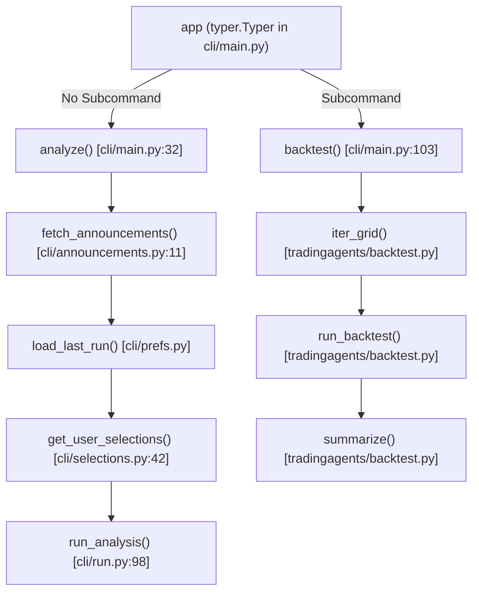
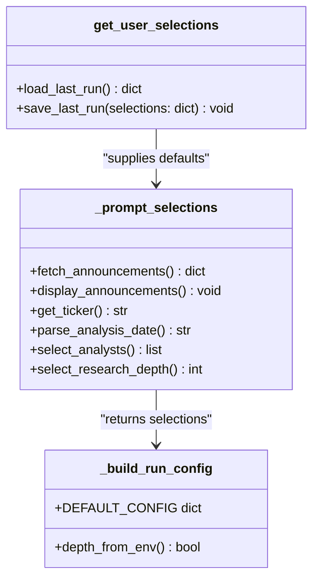

<!-- source: DeepWiki mcp.deepwiki.com · repo TauricResearch/TradingAgents · page 3.1 Command Line Interface · fetched 2026-10-29 -->

# Command Line Interface

<details>
<summary>Relevant source files</summary>

The following files were used as context for generating this wiki page:

- [cli/announcements.py](cli/announcements.py)
- [cli/config.py](cli/config.py)
- [cli/main.py](cli/main.py)
- [cli/prompts.py](cli/prompts.py)
- [cli/run.py](cli/run.py)
- [cli/selections.py](cli/selections.py)
- [tests/test_cli_headless.py](tests/test_cli_headless.py)
- [tests/test_cli_memory_log.py](tests/test_cli_memory_log.py)

</details>


The Command Line Interface (CLI) provides a Typer-driven command suite for interactive single-ticker analysis (`analyze`) and multi-cell parameter sweeps (`backtest`) `[cli/main.py:25]()- [cli/main.py:103]()`. It coordinates parameter collection, atomic user preferences persistence (`cli/prefs.py`), secure API credential verification `[tradingagents/llm_clients/api_key_env.py:1]`, real-time `rich` display updating `[cli/run.py:11]()`, remote community announcements `[cli/announcements.py:11]()`, and multi-format report generation including self-contained HTML output `[cli/main.py:63]()`.

## CLI Architecture and Command Routing

The CLI application entry point is defined in `cli/main.py` using `typer.Typer` `[cli/main.py:25]()`. The root callback handles bare `tradingagent` invocations or flags (`--ticker`, `--date`, `--analysts`, `--portfolio`, `--checkpoint`, `--save`, `--show`, `--html`), defaulting to an interactive configuration wizard when inputs are absent `[cli/main.py:32-67]()`. The explicit `backtest` subcommand coordinates multi-ticker and multi-date evaluation sweeps `[cli/main.py:103-119]()`.



**Sources:** [cli/main.py:25-151](), [cli/run.py:98-127](), [cli/announcements.py:11-29]()

## Interactive Configuration Flow and Preferences

The configuration wizard (`cli/selections.py` and `cli/prompts.py`) guides users through a series of interactive prompts using `questionary` `[cli/prompts.py:6]()`. To minimize friction during repeated executions, stable configuration selections are persisted across runs via `cli/prefs.py` `[cli/prefs.py:1]()`.

### Saved Preferences (`cli/prefs.py`)

Stable parameters such as `output_language`, `analysts`, `research_depth`, `llm_provider`, `quick_think_llm`, `deep_think_llm`, and `backend_url` are saved to `~/.tradingagents/cli_prefs.json` using atomic replacement (`.tmp` file swapping) to prevent torn file writes `[cli/prefs.py:27]()`. Transient execution targets like ticker symbols and analysis dates are deliberately excluded so users never inadvertently execute a run on a stale date `[cli/prefs.py:8]`.



**Sources:** [cli/selections.py:42-46](), [cli/prefs.py:1-50](), [cli/prompts.py:38-182]()

### Configuration Precedence and Environment Overrides

Configuration resolution adheres to an strict precedence hierarchy:
1. **Explicit Environment Variables** (`TRADINGAGENTS_*`): Take highest precedence. For example, if `TRADINGAGENTS_MAX_DEBATE_ROUNDS` is set, it overrides the research depth choice selected in the interactive wizard `[cli/run.py:69-81]()`.
2. **Command Line Flags**: Explicit options like `--ticker NVDA` or `--checkpoint` bypass prompt collection `[cli/main.py:35-66]()`.
3. **Interactive Prompts & Preferences**: Used when neither environment variables nor flags are provided, pre-filling defaults from `load_last_run()` `[cli/selections.py:42]`.

Unattended runs (where `sys.stdin` is not a TTY) validate that all required configuration gaps are satisfied by environment variables or flags before execution, raising a descriptive error via `unattended_gaps()` if variables are missing `[cli/run.py:102-108]`, `[tests/test_cli_headless.py:69-82]()`.

**Sources:** [cli/run.py:59-95](), [cli/selections.py:55-68](), [tests/test_cli_headless.py:50-82]()

## Symbol Handling, Asset Types, and Analyst Filtering

User ticker input is validated and normalized through `cli/prompts.py` and the data layer's canonical symbol utilities `[cli/prompts.py:27-136]()`:
* `is_valid_ticker_input(value: str)`: Validates alphanumeric characters, dots, underscores, dashes, carets (`^`) for indices, and equals signs (`=`) for futures (`GC=F`) and forex (`EURUSD=X`) `[cli/prompts.py:27-36]()`.
* `normalize_ticker_symbol(ticker: str)`: Delegates to `tradingagents.dataflows.symbols.normalize_symbol` to map symbol variations (e.g., `BTCUSD` or `BTCUSDT` to `BTC-USD`) `[cli/prompts.py:102-116]()`.
* `detect_asset_type(ticker: str)`: Classifies the canonical symbol into `AssetType.STOCK` or `AssetType.CRYPTO` based on suffixes like `-USD`, `-USDT` `[cli/prompts.py:118-125]()`.
* `filter_analysts_for_asset_type`: Automatically filters out the `Fundamentals Analyst` when `AssetType.CRYPTO` is detected, as SEC filings and balance sheets do not apply to cryptocurrencies `[cli/prompts.py:127-136]()`.

**Sources:** [cli/prompts.py:27-136]()

## API Key Management & Announcements

### API Key Verification

When an LLM provider is selected, the CLI verifies the corresponding environment variable defined in `PROVIDER_API_KEY_ENV` `[tradingagents/llm_clients/api_key_env.py:1]()`. If missing, `ensure_api_key()` prompts the user securely using password masking and persists the key to the local `.env` file `[cli/prompts.py:26]()`. Tier-specific providers (`quick_think_provider` and `deep_think_provider`) are independently validated via `_check_tier_providers()` before any model invocation takes place `[cli/selections.py:71-92]()`.

### Community Announcements

Before displaying prompts, the CLI fetches community bulletins from `CLI_CONFIG["announcements_url"]` with a strict timeout `[cli/announcements.py:11-14]()`. If `require_attention` is set to `True` in the JSON response payload, `display_announcements()` pauses interactive execution and blocks on `getpass.getpass("Press Enter to continue...")` to ensure operators acknowledge critical notices `[cli/announcements.py:32-52]()`.

**Sources:** [cli/selections.py:71-92](), [cli/prompts.py:26](), [cli/announcements.py:11-52](), [cli/config.py:1-6]()

## Backtest Command and Execution

The `backtest` subcommand evaluates past trading decisions over a multi-dimensional grid of tickers and analysis dates without cluttering the primary operational memory log `[cli/main.py:103]`, `[tradingagents/backtest.py:1]()`.

```mermaid
graph TD
    CLI_BACKTEST["backtest() [cli/main.py:103]"] -->|Calls| ITER_GRID["iter_grid(start, end, every) [tradingagents/backtest.py:32]"]
    ITER_GRID -->|Returns date sequence| RUN_BACKTEST["run_backtest(tickers, dates, config) [tradingagents/backtest.py:137]"]
    
    subGraph "Backtest Cell Execution Loop"
        RUN_BACKTEST --> SKIP_CHECK["Skip existing cells using backtest memory log"]
        SKIP_CHECK --> PROPAGATE["TradingAgentsGraph.propagate()"]
        PROPAGATE --> STORE_DECISION["TradingMemoryLog.store_decision()"]
    end
    
    RUN_BACKTEST --> SETTLE["Settle raw_return and alpha_return"]
    SETTLE --> SUMMARIZE["summarize(result) [tradingagents/backtest.py:91]"]
    SUMMARIZE --> RENDER["BacktestSummary.render()"]
```

* `iter_grid()`: Generates sequential analysis dates spaced by `--every` days up to the current date `[tradingagents/backtest.py:32-49]()`.
* `run_backtest()`: Instantiates isolated `TradingAgentsGraph` instances routing log entries to `results_dir/backtest/{run_id}/` `[tradingagents/backtest.py:137-148]()`.
* `summarize()`: Computes aggregate hit-rates grouped by rating direction (e.g., `Buy`, `Sell`) and mean alpha relative to benchmark mappings across resolved cells `[tradingagents/backtest.py:91-124]()`. Resumption is supported via `--run-id` to skip completed cells `[cli/main.py:116-118]()`.

**Sources:** [cli/main.py:103-153](), [tradingagents/backtest.py:32-170]()

## Real-Time Display, Memory Integration, and Output Options

### Real-Time Rendering and Metrics

During single-ticker execution (`run_analysis` in `cli/run.py`), a `MessageBuffer` tracks agent statuses (`pending`, `in_progress`, `completed`), tool invocations, and streaming report sections `[cli/run.py:98]`, `[tests/test_cli_memory_log.py:94-118]()`. The interface utilizes `rich.live.Live` to render a non-scrolling split-pane status layout `[cli/run.py:11]()`. Token consumption and LLM call rates are collected concurrently via `StatsCallbackHandler` `[cli/run.py:114]()`, `[cli/stats_handler.py:9-76]()`.

### Memory Log Integration

The CLI records decisions through `TradingAgentsGraph.record_decision()` immediately following graph execution, ensuring parity with programmatic `propagate()` runs `[tests/test_cli_memory_log.py:1-8]`, `[tests/test_cli_memory_log.py:143-154]()`. This appends a structured entry to the markdown decision log (`trading_memory.md`) to inform future trading sessions.

### Output Options and HTML Generation

Analyses generate structured file trees under `results_dir/{ticker}/{date}/`:
* `reports/complete_report.md`: Consolidated markdown analysis report.
* `reports/complete_report.html`: Self-contained, styled HTML report generated via `report_html.py` when `--html` is active (the default) `[cli/main.py:63-66]()`.
* `message_tool.log`: Detailed timestamped execution log of agent communications and tool arguments `[cli/run.py:138-163]()`.

**Sources:** [cli/run.py:98-165](), [tests/test_cli_memory_log.py:1-154](), [cli/main.py:63-66]()

---

