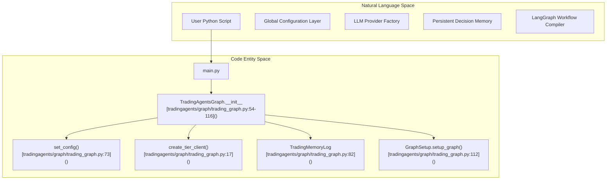
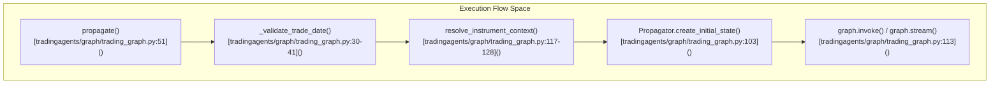

<!-- source: DeepWiki mcp.deepwiki.com · repo TauricResearch/TradingAgents · page 3.2 Python API · fetched 2026-10-29 -->

# Python API

<details>
<summary>Relevant source files</summary>

The following files were used as context for generating this wiki page:

- [main.py](main.py)
- [tests/test_memory_log.py](tests/test_memory_log.py)
- [tradingagents/default_config.py](tradingagents/default_config.py)
- [tradingagents/graph/trading_graph.py](tradingagents/graph/trading_graph.py)

</details>


The Python API provides programmatic access to the TradingAgents framework for integration into custom applications, backtesting systems, or automated trading workflows. This interface centers around the `TradingAgentsGraph` class [tradingagents/graph/trading_graph.py:51-116]() and its `.propagate()` method, which executes the complete multi-agent pipeline and returns structured trading decisions.

For interactive command-line usage, see [Command Line Interface](#3.1). For information about backtesting sweeps, see [Backtesting and Evaluation](#3.3).

---

## 1. Overview and Canonical Example (`main.py`)

The primary programmatic entry point is documented by `main.py`, which demonstrates a minimal end-to-end execution of the graph using configuration defaults [main.py:1-16](). 

```python
from tradingagents.default_config import DEFAULT_CONFIG
from tradingagents.graph.trading_graph import TradingAgentsGraph

config = DEFAULT_CONFIG.copy()

# Initialize with custom config
ta = TradingAgentsGraph(debug=True, config=config)

# forward propagate
_, decision = ta.propagate("NVDA", "2026-09-01")
print(decision)
```

The script illustrates how `DEFAULT_CONFIG` automatically incorporates environment overrides while allowing direct programmatic manipulation before graph instantiation [main.py:1-12]().

Sources: [main.py:1-16](), [tradingagents/graph/trading_graph.py:51-116]()

---

## 2. TradingAgentsGraph Instantiation and Configuration Options

The `TradingAgentsGraph` class manages the lifecycle of LLM clients, tool nodes, memory logs, and the LangGraph workflow compilation [tradingagents/graph/trading_graph.py:51-116]().

### Constructor Signature and Parameters

```python
class TradingAgentsGraph:
    def __init__(
        self,
        selected_analysts=("market", "social", "news", "fundamentals"),
        debug=False,
        config: dict[str, Any] = None,
        callbacks: list | None = None,
    ):
```

- `selected_analysts`: Tuple of active analyst modules (`"market"`, `"social"`, `"news"`, `"fundamentals"`) [tradingagents/graph/trading_graph.py:56]()
- `debug`: Boolean flag switching graph execution modes [tradingagents/graph/trading_graph.py:57]()
- `config`: Optional dictionary overriding `DEFAULT_CONFIG` [tradingagents/graph/trading_graph.py:58]()
- `callbacks`: Optional sequence of callback handlers for tracking LLM/tool usage [tradingagents/graph/trading_graph.py:59]()

### Initialization Architecture

The following diagram maps the high-level orchestration concepts to their exact codebase entities during graph construction:



Sources: [tradingagents/graph/trading_graph.py:51-116](), [main.py:1-16]()

---

## 3. The `propagate()` Method and Portfolio Context

The core execution method is `propagate()`, which validates input parameters, initializes execution state, runs the LangGraph workflow, and processes the final trade decision signal [tradingagents/graph/trading_graph.py:30-41]().

Input dates are strictly validated using `_validate_trade_date()` to ensure canonical `YYYY-MM-DD` formatting and prevent future-dated runs [tradingagents/graph/trading_graph.py:30-41](). Instrument identity and context resolution are handled via `resolve_instrument_context()` to anchor agents to real asset data [tradingagents/graph/trading_graph.py:117-128]().



Sources: [tradingagents/graph/trading_graph.py:30-41](), [tradingagents/graph/trading_graph.py:117-128]()

---

## 4. Programmatic Reports via `save_reports()`

Headless script runs can generate the complete hierarchical markdown report tree using `save_reports()` after executing `propagate()` [tradingagents/graph/trading_graph.py:20-20]().

```python
final_state, decision = ta.propagate("NVDA", "2026-09-01")
report_dir = ta.save_reports(final_state, "NVDA")
```

This method invokes `write_report_tree()`, writing analyst outputs, bull/bear research histories, risk analyses, and portfolio decisions into structured subdirectories alongside a consolidated `complete_report.md` [tradingagents/graph/trading_graph.py:20-20]().

Sources: [tradingagents/graph/trading_graph.py:20-20]()

---

## 5. Configuration Options and Environment Integration

Configuration defaults are maintained in `build_default_config()` and `DEFAULT_CONFIG` [tradingagents/default_config.py:77-83]() and can be overridden programmatically or via environment variables defined in `_ENV_OVERRIDES` [tradingagents/default_config.py:10-34]().

Coercion helpers like `_coerce()` ensure strict type enforcement for environment overrides (booleans, integers, floats) to fail fast on malformed configurations [tradingagents/default_config.py:41-61]().

Sources: [tradingagents/default_config.py:1-137]()

---

