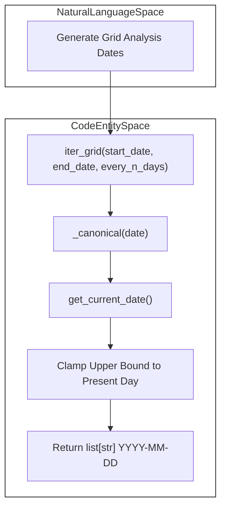
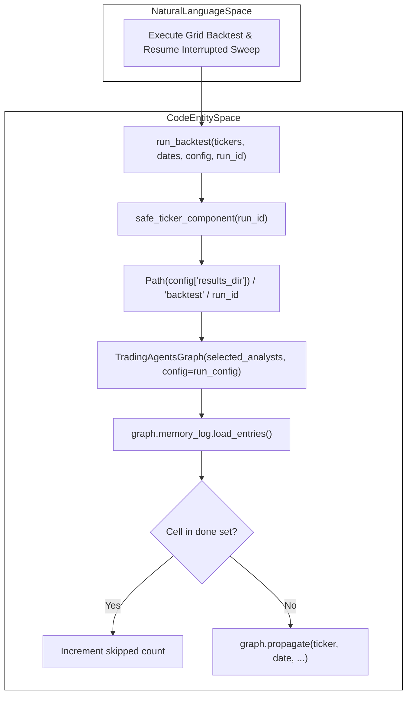

<!-- source: DeepWiki mcp.deepwiki.com · repo TauricResearch/TradingAgents · page 3.3 Backtesting and Evaluation · fetched 2026-10-29 -->

# Backtesting and Evaluation

Relevant source files

The following files were used as context for generating this wiki page:

- [cli/main.py](cli/main.py)
- [tests/test_backtest.py](tests/test_backtest.py)
- [tests/test_cli_commands.py](tests/test_cli_commands.py)
- [tests/test_memory_pointintime.py](tests/test_memory_pointintime.py)
- [tradingagents/backtest.py](tradingagents/backtest.py)

## Purpose and Scope
This page documents the backtesting and evaluation subsystem located in `tradingagents/backtest.py`. The backtesting framework evaluates multi-agent decision quality by executing the trading graph over a grid matrix of tickers and historical dates [tradingagents/backtest.py:1-15](). 

Crucially, backtesting in TradingAgents is designed around an explicit non-goal: **it is not a portfolio simulator** [tradingagents/backtest.py:9-15](). Because the system lacks a trade execution engine, fill-price modeling, and a dynamic cash ledger, backtest cells remain independent [tradingagents/backtest.py:9-15](). When a portfolio configuration is supplied, it acts as a static standing book across all cells rather than rolling positions forward [tradingagents/backtest.py:12-14]().

Sources: `tradingagents/backtest.py:1-15]()`

---

## 1. Grid Sweep Mechanics and Date Iteration
The grid sweep is driven by `iter_grid()`, which computes the sequence of analysis dates between a start and end point given a configurable step size (`every_n_days`) [tradingagents/backtest.py:34-51]().

### Key Functions
* `iter_grid(start_date: str, end_date: str, every_n_days: int = 1) -> list[str]`: Generates a list of date strings [tradingagents/backtest.py:34-51](). It enforces that `every_n_days >= 1` and that `end >= start` [tradingagents/backtest.py:41-44]().
* `_canonical(date: str) -> datetime`: Validates that incoming dates strictly adhere to `YYYY-MM-DD` formatting, rejecting malformed inputs or strings that change after parsing [tradingagents/backtest.py:54-62]().
* **Present-Day Bounding**: The grid automatically clamps its upper bound to `min(end, datetime.strptime(get_current_date(), "%Y-%m-d"))` because future dates have no realized outcomes against which to score [tradingagents/backtest.py:35-39, 46]().

*Figure 1: Natural Language to Code Entity mapping for grid iteration.*

Sources: `tradingagents/backtest.py:34-62]()`

---

## 2. Execution, Isolation, and `--run-id` Resumption
To prevent backtest sweeps from polluting live operational memory, `run_backtest()` isolates its output into a dedicated directory and decision log [tradingagents/backtest.py:129-153]().

### Isolation and Resumption Flow
1. **Directory Structure**: A unique `run_id` is validated via `safe_ticker_component()` and mapped to `results/backtest/{run_id}/` [tradingagents/backtest.py:148-150]().
2. **Dedicated Log**: A localized `trading_memory.md` is instantiated within the run directory, keeping live runs completely untouched [tradingagents/backtest.py:151-152]() [tests/test_backtest.py:79-85]().
3. **Resumption Guard**: Completed cells are identified by loading existing entries from the run log (`done = {(e["ticker"], e["date"]) for e in graph.memory_log.load_entries()}`) [tradingagents/backtest.py:156](). Interrupted sweeps resume seamlessly simply by re-invoking `run_backtest()` with the same `--run-id` [tradingagents/backtest.py:136-157]() [tests/test_backtest.py:88-96]().
4. **Fault Tolerance**: Individual cell exceptions (such as temporary vendor timeouts) are caught, logged as warnings, and appended to `BacktestResult.failures` without aborting the broader sweep [tradingagents/backtest.py:163-166]() [tests/test_backtest.py:107-113]().

*Figure 2: Natural Language to Code Entity mapping for backtest execution and resumption.*

Sources: `tradingagents/backtest.py:129-166]()`, `tests/test_backtest.py:79-113]()`

---

## 3. Evaluation, Hit-Rate Scoring, and Point-in-Time Memory
Once grid execution completes and outcomes are settled against regional benchmarks, `summarize()` processes the decision log to compute aggregate evaluation metrics [tradingagents/backtest.py:101-127]() [tradingagents/backtest.py:129-166]().

### Rating Direction Mapping
The scoring engine maps textual ratings to directional integer codes via `_DIRECTION` [tradingagents/backtest.py:90]():
* **Bullish (`Buy`, `Overweight`)**: `+1` [tradingagents/backtest.py:90]()
* **Neutral (`Hold`)**: `0` (claims no directional alpha) [tradingagents/backtest.py:90]()
* **Bearish (`Underweight`, `Sell`)**: `-1` [tradingagents/backtest.py:90]()

### Summary Dataclasses
* `RatingScore`: Records sample count (`count`), directional hit rate (`hit_rate`), and average excess return (`mean_alpha`) [tradingagents/backtest.py:94-98]().
* `BacktestSummary`: Aggregates resolved versus pending cells, maps rating categories to `RatingScore` instances, and formats output strings via `.render()` [tradingagents/backtest.py:101-126]().

### Point-in-Time Memory Constraints
To prevent look-ahead bias in backtesting, historical graph runs restrict past context retrieval using `_memory_as_of(as_of)` [tests/test_memory_pointintime.py:82-95](). Resolved memory log entries record their resolution dates (`resolved`), and `get_past_context(as_of=...)` filters out outcomes that were unknown at the specific historical trade date [tests/test_memory_pointintime.py:1-47]().

Sources: `tradingagents/backtest.py:65-127]`, `tests/test_memory_pointintime.py:1-96]()`

---

