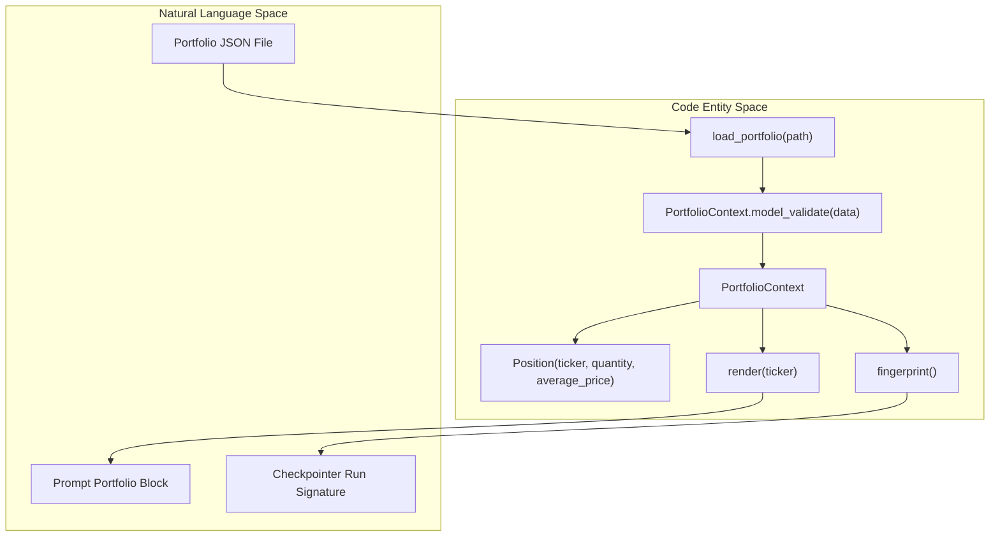
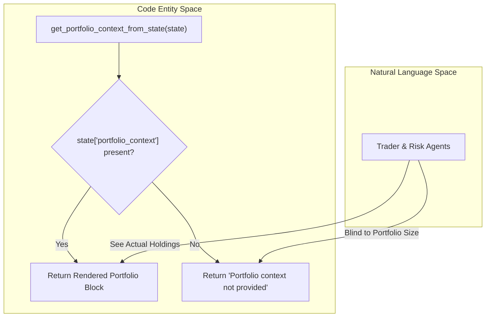
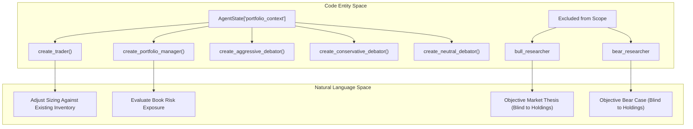

<!-- source: DeepWiki mcp.deepwiki.com · repo TauricResearch/TradingAgents · page 3.4 Portfolio Context · fetched 2026-10-29 -->

# Portfolio Context

<details>
<summary>Relevant source files</summary>

The following files were used as context for generating this wiki page:

- [tests/test_cli_display.py](tests/test_cli_display.py)
- [tests/test_portfolio_context.py](tests/test_portfolio_context.py)
- [tests/test_rating_integrity.py](tests/test_rating_integrity.py)
- [tests/test_signal_processing.py](tests/test_signal_processing.py)
- [tradingagents/agents/rating.py](tradingagents/agents/rating.py)
- [tradingagents/agents/structured.py](tradingagents/agents/structured.py)
- [tradingagents/portfolio.py](tradingagents/portfolio.py)

</details>


## Purpose and Scope
This page documents the portfolio management and context subsystem implemented in `tradingagents/portfolio.py`. It covers the `PortfolioContext` and `Position` data schemas, how portfolio state is passed via the `--portfolio` CLI flag and the `propagate(portfolio=...)` Python API, how decision-making agents size orders against real holdings, and the semantic distinction between a missing portfolio context and a flat book.

Sources: [tradingagents/portfolio.py:1-12](), [tests/test_portfolio_context.py:1-8]()

---

## 1. Core Data Structures (`PortfolioContext` & `Position`)

The portfolio system is broker-neutral by design, using generic asset quantities and caller-defined currency labels without binding to specific execution venues. The data layout is defined using Pydantic models in `tradingagents/portfolio.py`.

### `Position` Schema
The `Position` model represents a holding in a specific instrument:
* `ticker`: Instrument symbol (e.g., `AAPL`), normalized and matched case-insensitively [tradingagents/portfolio.py:24]().
* `quantity`: Signed float units held; negative values represent short positions [tradingagents/portfolio.py:25]().
* `average_price`: Optional float representing the average entry price per unit [tradingagents/portfolio.py:26]().

### `PortfolioContext` Schema
The `PortfolioContext` model aggregates cash, currency, and a list of positions:
* `cash`: Free cash available (`float | None`) [tradingagents/portfolio.py:30]().
* `currency`: Currency label string (e.g., `USD`) [tradingagents/portfolio.py:31]().
* `positions`: List of `Position` objects (`list[Position]`) [tradingagents/portfolio.py:32]().

Key methods on `PortfolioContext`:
* `position_in(ticker: str)`: Searches `self.positions` for a case-insensitive match on the requested symbol [tradingagents/portfolio.py:34-35]().
* `render(ticker: str)`: Formats the portfolio block for agent consumption, placing the analyzed target instrument at the top, followed by cash, currency, and other holdings [tradingagents/portfolio.py:37-51]().
* `fingerprint()`: Computes a 12-character SHA-256 hash digest of the JSON-serialized book (`self.model_dump_json()`), used to ensure checkpointers invalidate or isolate runs when portfolio holdings change [tradingagents/portfolio.py:53-55]().


Sources: [tradingagents/portfolio.py:14-56](), [tests/test_portfolio_context.py:19-74]()

---

## 2. File Loading, Validation, and Checkpoint Isolation

Portfolios can be loaded from external JSON files using `load_portfolio(path)`. This helper reads the file and validates it before graph execution begins, catching malformed files early rather than mid-graph [tradingagents/portfolio.py:58-64]().

```python
def load_portfolio(path: str | Path) -> PortfolioContext:
    try:
        data = json.loads(Path(path).read_text(encoding="utf-8"))
        return PortfolioContext.model_validate(data)
    except (OSError, json.JSONDecodeError, ValidationError) as exc:
        raise ValueError(f"portfolio file {path} is not usable: {exc}") from exc
```

If an `OSError`, `json.JSONDecodeError`, or Pydantic `ValidationError` occurs, it is wrapped into a clean `ValueError` [tradingagents/portfolio.py:60-64](). Additionally, the `fingerprint()` method generates a unique hash used by the checkpointer run signature [tests/test_portfolio_context.py:104-110](), ensuring that modifications to holdings invalidate cached run graphs.

Sources: [tradingagents/portfolio.py:58-64](), [tests/test_portfolio_context.py:62-110]()

---

## 3. Missing Book vs. Flat Book Semantics

A critical design principle of the tradingagents portfolio subsystem is that **missing context is never conflated with a flat book**. Three distinct states exist:
1. **Position held**: Specific units, quantities, and average prices are known.
2. **Flat book**: The portfolio context is provided explicitly with zero positions (`positions: []`), meaning cash is held but no units of the target asset are owned [tests/test_portfolio_context.py:37-40]().
3. **No context provided**: The portfolio parameter is omitted entirely (`portfolio=None`).

Treating a missing context as a flat book would hallucinate facts about the caller's account (e.g., assuming zero inventory and available cash). When absent, `get_portfolio_context_from_state()` reports the portfolio as "not provided" rather than "no position" [tests/test_portfolio_context.py:49-53]().


Sources: [tradingagents/portfolio.py:1-12](), [tests/test_portfolio_context.py:16-53]()

---

## 4. Agent Sizing and Research Blindness

Portfolio context is selectively routed to decision-making agents so they can calibrate position sizing, stop-loss levels, and risk tolerance against real holdings. However, **research agents remain deliberately blind** to prevent bias in bull and bear theses [tests/test_portfolio_context.py:7-8]().

### Agents with Portfolio Visibility
The portfolio block is injected into the prompts of execution and risk evaluation nodes:
* Trader: `create_trader()` [tests/test_portfolio_context.py:114]()
* Portfolio Manager: `create_portfolio_manager()` [tests/test_portfolio_context.py:115]()
* Aggressive Risk Debator: `create_aggressive_debator()` [tests/test_portfolio_context.py:116]()
* Conservative Risk Debator: `create_conservative_debator()` [tests/test_portfolio_context.py:117]()
* Neutral Risk Debator: `create_neutral_debator()` [tests/test_portfolio_context.py:118]()

### Agents Kept Blind
To maintain analytical independence, the research team is explicitly prohibited from accessing portfolio state:
* Bull Researcher: `bull_researcher` [tests/test_portfolio_context.py:157]()
* Bear Researcher: `bear_researcher` [tests/test_portfolio_context.py:157]()


Sources: [tradingagents/portfolio.py:37-51](), [tests/test_portfolio_context.py:96-160]()

---

