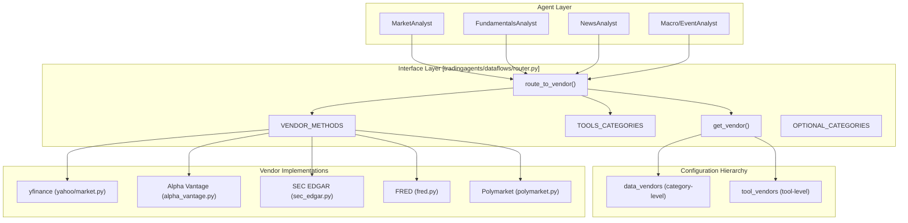
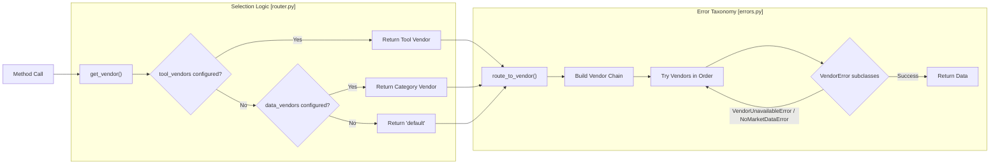

<!-- source: DeepWiki mcp.deepwiki.com · repo TauricResearch/TradingAgents · page 4 Data Layer · fetched 2026-10-29 -->

# Data Layer

Relevant source files

The following files were used as context for generating this wiki page:

- [tests/test_vendor_errors.py](tests/test_vendor_errors.py)
- [tests/test_vendor_routing.py](tests/test_vendor_routing.py)
- [tradingagents/dataflows/__init__.py](tradingagents/dataflows/__init__.py)
- [tradingagents/dataflows/errors.py](tradingagents/dataflows/errors.py)
- [tradingagents/dataflows/router.py](tradingagents/dataflows/router.py)

The Data Layer provides a flexible, resilient abstraction for acquiring market data from multiple vendor sources. It routes data requests from agents to appropriate vendor implementations using a configurable fallback mechanism, ensuring data availability even when individual vendors fail or hit rate limits. The system implements a verified data-access contract that prevents silent fallbacks to unconfigured sources, introduces graceful degradation for optional data categories like macroeconomics and prediction markets, integrates SEC EDGAR fundamentals, and enforces strict point-in-time integrity.

For information about how agents consume data through tools, see [Agent Tools and Utilities](#5.6). For configuration of data vendors, see [Configuration System](#7.1).

Sources: [tradingagents/dataflows/router.py:1-187](), [tradingagents/dataflows/errors.py:1-58]()

---

## Architecture Overview

The data layer sits between the agent system and external data vendors, providing a unified interface through routing functions defined in `router.py`. This architecture decouples agent logic from vendor-specific implementations, enabling vendor switching and multi-vendor fallback chains without code changes.

### Data Layer Architecture

Sources: [tradingagents/dataflows/router.py:45-149](), [tradingagents/dataflows/router.py:152-187]()

---

## Data Categories and Vendor Mapping

The system organizes data requests into six categories defined in `TOOLS_CATEGORIES` [tradingagents/dataflows/router.py:45-87](). This categorization enables category-level vendor configuration while allowing tool-level overrides via `tool_vendors` [tradingagents/dataflows/router.py:167-170]().

| Category | Description | Primary Methods | Vendors |
|----------|-------------|-----------------|---------|
| `core_stock_apis` | OHLCV stock price data | `get_stock_data` | `yfinance`, `alpha_vantage` |
| `technical_indicators` | Technical analysis indicators | `get_indicators` | `yfinance`, `alpha_vantage` |
| `fundamental_data` | Company financials | `get_fundamentals`, `get_balance_sheet`, `get_cashflow`, `get_income_statement` | `yfinance`, `alpha_vantage`, `sec_edgar` |
| `news_data` | News and insider data | `get_news`, `get_global_news`, `get_insider_transactions` | `yfinance`, `alpha_vantage` |
| `macro_data` | Macroeconomic indicators | `get_macro_indicators` | `fred` |
| `prediction_markets` | Event probabilities | `get_prediction_markets` | `polymarket` |

### Optional Enrichment vs. Core Data
A critical distinction in the data layer is the `OPTIONAL_CATEGORIES` set [tradingagents/dataflows/router.py:94](). 
- **Core Categories**: If `core_stock_apis`, `fundamental_data`, or `news_data` fail across all vendors, the system raises an error to prevent uninformed trading decisions [tests/test_vendor_routing.py:114-121]().
- **Optional Categories**: `macro_data` and `prediction_markets` are treated as enrichment. If these vendors fail (e.g., missing API keys or network errors), the system degrades to a sentinel rather than aborting the analysis [tradingagents/dataflows/router.py:89-94](), [tests/test_vendor_routing.py:103-112]().

Sources: [tradingagents/dataflows/router.py:45-94](), [tradingagents/dataflows/router.py:96-149]()

---

## Vendor Selection, Error Handling, and Point-in-Time Integrity

The routing logic implemented in `router.py` ensures deterministic vendor selection and error propagation. The system respects explicit single-vendor configurations and supports ordered fallback chains when configured [tests/test_vendor_routing.py:58-73]().

### Vendor Routing and Resolution Flow

1. **Chain Construction**: Vendor configurations are parsed to build an execution order. If set to `"default"`, all available vendors for that method are used [tradingagents/dataflows/router.py:160-174]().
2. **Error Taxonomy**: The system uses a unified `VendorError` hierarchy defined in `tradingagents/dataflows/errors.py`, including `NoMarketDataError`, `VendorUnavailableError`, and `VendorNotConfiguredError` [tradingagents/dataflows/errors.py:21-58]().
3. **Point-in-Time Integrity**: Dated tools take the run date from graph state, filtering financials and pricing to prevent look-ahead bias.

Sources: [tradingagents/dataflows/router.py:152-187](), [tradingagents/dataflows/errors.py:21-58](), [tests/test_vendor_errors.py:29-44]()

---

## Child Pages

For detailed information on specific components of the Data Layer, see the following child pages:

*   **[Data Vendor System](#4.1)** — Detail `route_to_vendor`, `VENDOR_METHODS`, `TOOLS_CATEGORIES`, `OPTIONAL_CATEGORIES`, `VendorError` taxonomy, vendor chains, sentinels, and configuration hierarchy.
*   **[Yahoo Finance Integration](#4.2)** — Document the `yfinance` implementation: OHLCV retrieval, technical indicators via `stockstats`, fundamentals with `withhold_live_profile`, news, and caching.
*   **[Alpha Vantage Integration](#4.3)** — Explain the Alpha Vantage modules, `_make_api_request`, rate-limit detection and `VendorRateLimitError`, and its role as a fallback vendor.
*   **[Fallback and Error Handling](#4.4)** — Describe the automatic fallback mechanism, `VendorError` taxonomy, `OPTIONAL_CATEGORIES` graceful degradation, and vendor-failure honesty guarantees.
*   **[Technical Indicators and Caching](#4.5)** — Explain `StockstatsUtils`, `load_ohlcv`, bulk indicator calculation, one-cache-file-per-symbol policy, TTL, retries, and stale-OHLCV rejection.
*   **[FRED and Polymarket Vendors](#4.6)** — Document the FRED macro vendor and Polymarket prediction-market vendor (both `OPTIONAL_CATEGORIES`).
*   **[SEC EDGAR Fundamentals](#4.7)** — Document the keyless SEC EDGAR fundamentals vendor: as-filed point-in-time statements, unfiled-period suppression, restatement handling, and `SEC_EDGAR_USER_AGENT`.
*   **[Social and News Sources](#4.8)** — Document Reddit, StockTwits resilience, yfinance/Alpha Vantage news feeds, and look-ahead bounds on social and news windows.
*   **[Point-in-Time Integrity and Symbol Resolution](#4.9)** — Explain how look-ahead bias is prevented end-to-end and detail symbol normalization (`symbol_utils`).

---

