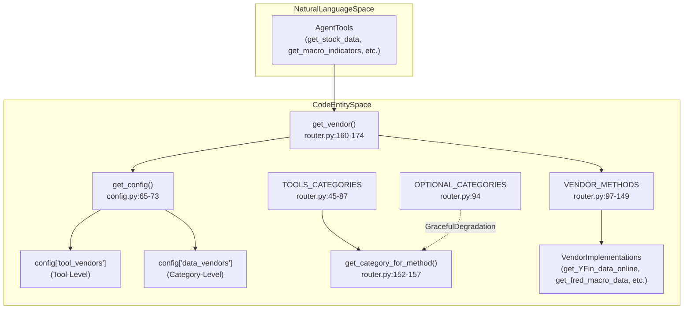
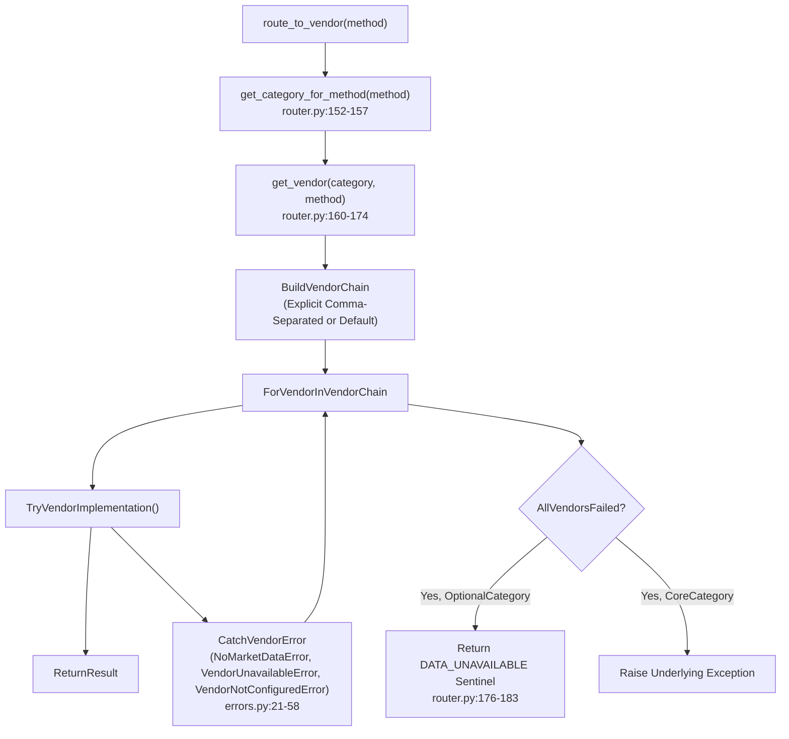

<!-- source: DeepWiki mcp.deepwiki.com · repo TauricResearch/TradingAgents · page 4.1 Data Vendor System · fetched 2026-10-29 -->

# Data Vendor System

<details>
<summary>Relevant source files</summary>

The following files were used as context for generating this wiki page:

- [tests/test_dataflows_config.py](tests/test_dataflows_config.py)
- [tests/test_statement_knowledge_time.py](tests/test_statement_knowledge_time.py)
- [tests/test_vendor_errors.py](tests/test_vendor_errors.py)
- [tests/test_vendor_routing.py](tests/test_vendor_routing.py)
- [tradingagents/dataflows/config.py](tradingagents/dataflows/config.py)
- [tradingagents/dataflows/errors.py](tradingagents/dataflows/errors.py)
- [tradingagents/dataflows/router.py](tradingagents/dataflows/router.py)
- [tradingagents/dataflows/vendors/alpha_vantage/news.py](tradingagents/dataflows/vendors/alpha_vantage/news.py)
- [tradingagents/graph/__init__.py](tradingagents/graph/__init__.py)
- [tradingagents/memory/__init__.py](tradingagents/memory/__init__.py)

</details>


## Purpose and Scope

The Data Vendor System provides a flexible abstraction layer for data acquisition in TradingAgents. It enables agents to request financial data through a unified interface while the system automatically routes requests to appropriate data providers based on configuration. This architecture supports multiple vendors (`yfinance`, `alpha_vantage`, `sec_edgar`, `fred`, `polymarket`) with automatic fallback when a vendor is unavailable, rate-limited, or unconfigured.

The system enforces a verified data-access contract that prevents silent cross-vendor inconsistencies and provides graceful degradation for optional enrichment data.

Sources: `[tradingagents/dataflows/router.py:1-42]`, `[tradingagents/dataflows/router.py:160-187]()`

## Architecture Overview

The vendor system consists of core components defined in `tradingagents/dataflows/router.py` and `tradingagents/dataflows/config.py` that work together to route data requests:

1. **Tool Categories**: Logical grouping of data methods by domain defined in `TOOLS_CATEGORIES` `[tradingagents/dataflows/router.py:45-87]()`.
2. **Optional Categories**: A set of enrichment categories (`macro_data`, `prediction_markets`) that degrade to a sentinel string instead of raising an error on failure `[tradingagents/dataflows/router.py:94-94]()`.
3. **Vendor Methods Registry**: A mapping (`VENDOR_METHODS`) of tool method names to vendor-specific implementation functions `[tradingagents/dataflows/router.py:97-149]()`.
4. **Configuration System**: Hierarchical configuration supporting category-level (`data_vendors`) and tool-specific (`tool_vendors`) vendor selection via `get_vendor()` `[tradingagents/dataflows/router.py:160-174]()`.
5. **Routing Engine**: Functions that orchestrate selection, fallback chains, and error handling `[tradingagents/dataflows/router.py:152-187]()`.

### Component Architecture Diagram

This diagram bridges natural language tool concepts to the exact code entities responsible for configuration, registry lookup, and routing execution.



Sources: `[tradingagents/dataflows/router.py:45-149]`, `[tradingagents/dataflows/config.py:65-73]()`

## Tool Organization and Categories

The system organizes data acquisition tools into logical categories defined in `TOOLS_CATEGORIES` `[tradingagents/dataflows/router.py:45-87]()`:

| Category | Description | Tools (`method` names) |
| :--- | :--- | :--- |
| `core_stock_apis` | OHLCV stock price data | `get_stock_data` `[tradingagents/dataflows/router.py:46-51]()` |
| `technical_indicators` | Technical analysis indicators | `get_indicators` `[tradingagents/dataflows/router.py:52-57]()` |
| `fundamental_data` | Company fundamentals | `get_fundamentals`, `get_balance_sheet`, `get_cashflow`, `get_income_statement` `[tradingagents/dataflows/router.py:58-66]()` |
| `news_data` | News and insider data | `get_news`, `get_global_news`, `get_insider_transactions` `[tradingagents/dataflows/router.py:67-74]()` |
| `macro_data` | Macroeconomic indicators | `get_macro_indicators` `[tradingagents/dataflows/router.py:75-80]()` |
| `prediction_markets` | Market-implied probabilities | `get_prediction_markets` `[tradingagents/dataflows/router.py:81-86]()` |

### Optional Categories and Graceful Degradation

`OPTIONAL_CATEGORIES` (defined as `{"macro_data", "prediction_markets"}`) are treated as non-critical enrichment data `[tradingagents/dataflows/router.py:94-94]()`. If all vendors in these categories fail (e.g., missing API keys or network blocks), the system returns a sentinel string (`DATA_UNAVAILABLE`) instead of crashing the workflow run. Core categories (`core_stock_apis`, `fundamental_data`, `news_data`) raise exceptions to ensure broken primary data sources fail loudly.

Sources: `[tradingagents/dataflows/router.py:45-94]()`

## Configuration Hierarchy (Tool-Level vs Category-Level)

The function `get_vendor(category: str, method: str = None)` resolves which vendor or vendor chain should service a request `[tradingagents/dataflows/router.py:160-174]()`. It implements a strict hierarchy:

1. **Tool-Level Configuration (`tool_vendors`)**: Checked first. If a specific tool method (e.g., `get_balance_sheet`) is mapped in `config["tool_vendors"]`, that configuration takes absolute precedence `[tradingagents/dataflows/router.py:167-170]()`.
2. **Category-Level Configuration (`data_vendors`)**: If no tool-level override exists, the system falls back to `config["data_vendors"][category]` `[tradingagents/dataflows/router.py:172-173]()`.
3. **Default Sentinel**: If neither is explicitly configured, it defaults to `"default"` `[tradingagents/dataflows/router.py:173]()`.

Sources: `[tradingagents/dataflows/router.py:160-174]`, `[tradingagents/dataflows/config.py:65-73]()`

## Vendor Error Taxonomy

TradingAgents uses a unified hierarchy for data errors so the routing layer reacts to behavior rather than vendor-specific exception classes `[tradingagents/dataflows/errors.py:1-16]()`.

```
    VendorError
    ├── NoMarketDataError          no usable rows (empty result OR stale data)
    ├── VendorUnavailableError     throttled or failed request -> skip to next vendor
    └── VendorNotConfiguredError   missing API key/config -> vendor unavailable
```

| Error Class | Purpose | Router Reaction |
| :--- | :--- | :--- |
| `VendorError` | Base class for all data acquisition errors `[tradingagents/dataflows/errors.py:21-23]()` | Caught by router across all implementations |
| `NoMarketDataError` | Vendor returned empty or stale rows `[tradingagents/dataflows/errors.py:25-44]()` | Advances to the next vendor in the fallback chain |
| `VendorUnavailableError` | Transient API throttling or failure `[tradingagents/dataflows/errors.py:46-50]()` | Advances to the next vendor in the fallback chain |
| `VendorNotConfiguredError` | Missing API key or configuration `[tradingagents/dataflows/errors.py:53-58]()` | Treats vendor as unavailable; advances or surfaces if sole vendor |

Sources: `[tradingagents/dataflows/errors.py:1-58]`, `[tests/test_vendor_errors.py:30-116]()`

## Vendor Routing, Chains, and Sentinels

The routing mechanism manages execution flow, vendor chain resolution, error handling, and fallback behavior across registered implementations `[tradingagents/dataflows/router.py:97-187]()`.

### Vendor Chains
- **Explicit Chains**: Configured as comma-separated strings (e.g., `"alpha_vantage,yfinance"`). The router attempts vendors strictly in the specified sequence. Silent fallbacks to unselected vendors are strictly prohibited to prevent cross-vendor data contamination.
- **Default Sentinel**: When configured as `"default"`, the router evaluates all registered vendors available for that method inside `VENDOR_METHODS` `[tradingagents/dataflows/router.py:97-149]()`.

### Routing and Execution Flow Diagram



Sources: `[tradingagents/dataflows/router.py:97-187]`, `[tradingagents/dataflows/errors.py:21-58]`, `[tests/test_vendor_routing.py:58-121]()`

---

