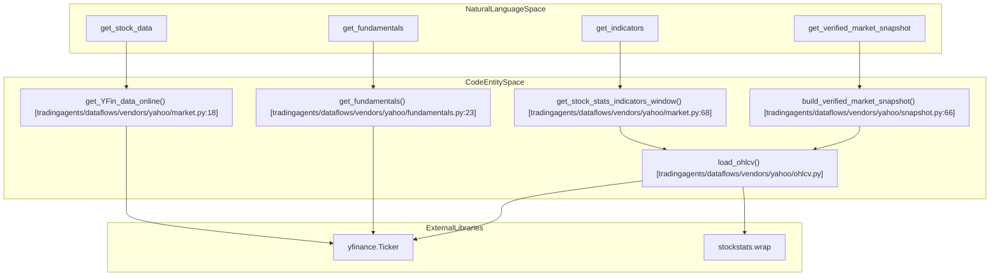
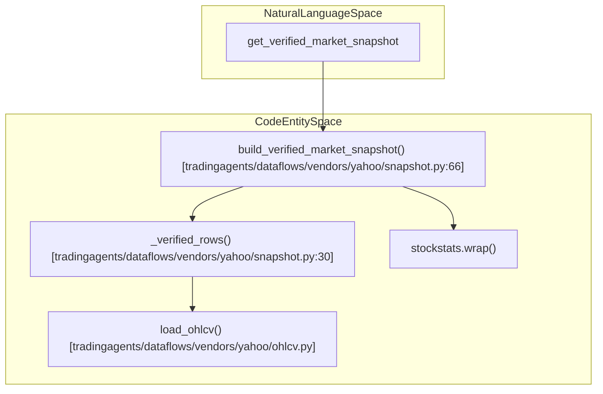

<!-- source: DeepWiki mcp.deepwiki.com · repo TauricResearch/TradingAgents · page 4.2 Yahoo Finance Integration · fetched 2026-10-29 -->

# Yahoo Finance Integration

Relevant source files

The following files were used as context for generating this wiki page:

- [tests/test_fundamentals_units.py](tests/test_fundamentals_units.py)
- [tests/test_yahoo_rate_limit.py](tests/test_yahoo_rate_limit.py)
- [tests/test_yahoo_snapshot.py](tests/test_yahoo_snapshot.py)
- [tradingagents/dataflows/vendors/alpha_vantage/indicator.py](tradingagents/dataflows/vendors/alpha_vantage/indicator.py)
- [tradingagents/dataflows/vendors/yahoo/fundamentals.py](tradingagents/dataflows/vendors/yahoo/fundamentals.py)
- [tradingagents/dataflows/vendors/yahoo/market.py](tradingagents/dataflows/vendors/yahoo/market.py)
- [tradingagents/dataflows/vendors/yahoo/snapshot.py](tradingagents/dataflows/vendors/yahoo/snapshot.py)

## Purpose and Scope

This document details the Yahoo Finance implementation within the TradingAgents data layer. It covers historical OHLCV retrieval, technical indicators via `stockstats`, fundamental data processing with `withhold_live_profile` and unit normalization, deterministic market verification snapshots, and caching/rate-limit resilience via `yf_retry`. Yahoo Finance operates as a primary unauthenticated data vendor for broad asset coverage.

Sources: [tradingagents/dataflows/vendors/yahoo/market.py:1-66](), [tradingagents/dataflows/vendors/yahoo/fundamentals.py:1-105](), [tradingagents/dataflows/vendors/yahoo/snapshot.py:1-127]()

---

## Architecture Overview and Code Entities

The Yahoo Finance integration is partitioned across modular files under `tradingagents/dataflows/vendors/yahoo/`. The following diagram bridges the Natural Language Space of agent requests to the Code Entity Space of the Yahoo Finance vendor modules.

**Diagram: Routing from agent tool requests to Yahoo Finance vendor code entities.**

Sources: [tradingagents/dataflows/vendors/yahoo/market.py:18-75](), [tradingagents/dataflows/vendors/yahoo/fundamentals.py:23-45](), [tradingagents/dataflows/vendors/yahoo/snapshot.py:66-78]()

---

## OHLCV Retrieval and Online Data

Historical price series are retrieved through `get_YFin_data_online` in `tradingagents/dataflows/vendors/yahoo/market.py`. 

### Key Implementation Details
1. **Symbol Normalization**: Resolves broker and forex symbols using `normalize_symbol` [tradingagents/dataflows/vendors/yahoo/market.py:28]().
2. **Inclusive Date Windows**: Because `yfinance` treats the `end` parameter as exclusive, the system requests one day past `end_date` (`end_dt + relativedelta(days=1)`) to ensure the requested end-date session is fully captured [tradingagents/dataflows/vendors/yahoo/market.py:30-33]().
3. **Execution & Validation**: Requests are wrapped in `yf_retry` [tradingagents/dataflows/vendors/yahoo/market.py:34](). Empty results trigger `raise_for_empty` [tradingagents/dataflows/vendors/yahoo/market.py:39-40](), while stale frames are rejected via `_assert_ohlcv_not_stale` [tradingagents/dataflows/vendors/yahoo/market.py:46-49]().
4. **Formatting**: Timezone information is stripped from the index, and numerical columns (`Open`, `High`, `Low`, `Close`, `Adj Close`) are rounded to two decimal places before CSV serialization [tradingagents/dataflows/vendors/yahoo/market.py:42-65]().

Sources: [tradingagents/dataflows/vendors/yahoo/market.py:18-65]()

---

## Technical Indicators and `stockstats`

Technical indicators are calculated using `stockstats` wrapped around historical price frames.

### Indicator Window Execution
`get_stock_stats_indicators_window` maps indicator keys (such as `close_50_sma`, `rsi`, `boll`, `macd`, and `atr`) to rich natural language definitions that guide analyst agents [tradingagents/dataflows/vendors/yahoo/market.py:68-145](). Behind the scenes, `load_ohlcv` retrieves cached or fresh price panels, which are then processed via `stockstats.wrap()` [tradingagents/dataflows/vendors/yahoo/snapshot.py:76-77]().

Sources: [tradingagents/dataflows/vendors/yahoo/market.py:68-145](), [tradingagents/dataflows/vendors/yahoo/snapshot.py:76-78]()

---

## Fundamentals and Point-in-Time Protection

Fundamental metrics, balance sheets, cash flow statements, and income statements are retrieved via modules in `tradingagents/dataflows/vendors/yahoo/fundamentals.py`.

### Point-in-Time Guard
`get_fundamentals` checks historical date constraints by invoking `withhold_live_profile(as_of_date, canonical)` [tradingagents/dataflows/vendors/yahoo/fundamentals.py:37-39](). Because `yf.Ticker.info` represents a present-day snapshot without historical vintage, past runs withhold live profile data to preserve point-in-time integrity.

### Unit Normalization
Yahoo Finance returns several metrics in heterogeneous scales and units. The fundamentals module explicitly normalizes these:
- **Percentages**: `dividendYield` and `debtToEquity` are reported in percentage scale (e.g. `78.4` meaning 78.4%, or a 0.78 ratio), and carry explicit percentage units [tradingagents/dataflows/vendors/yahoo/fundamentals.py:45-48](), [tests/test_fundamentals_units.py:1-6]().
- **Currency Units**: Minor units (such as London pence `GBp`) are mapped via `_MAIN_UNIT` to their main currency units (`GBP`), while market caps, EPS, and reporting currencies are explicitly formatted [tradingagents/dataflows/vendors/yahoo/fundamentals.py:19-61](), [tests/test_fundamentals_units.py:43-55]().

Sources: [tradingagents/dataflows/vendors/yahoo/fundamentals.py:1-105](), [tests/test_fundamentals_units.py:1-79]()

---

## Deterministic Market-Data Verification Snapshot

To prevent LLM analyst hallucination of exact prices and indicators, `tradingagents/dataflows/vendors/yahoo/snapshot.py` builds a deterministic ground-truth snapshot [tradingagents/dataflows/vendors/yahoo/snapshot.py:1-9]().

**Diagram: Flow for generating deterministic verified market snapshots.**

### Snapshot Mechanics
1. **Row Filtering**: `_verified_rows` loads OHLCV data with gap filling disabled (`fill_gaps=False`), dropping any rows occurring after `as_of_date` [tradingagents/dataflows/vendors/yahoo/snapshot.py:30-49]().
2. **Indicator Calculation**: Evaluates a standard set of indicators (`DEFAULT_SNAPSHOT_INDICATORS`) against the latest verified row [tradingagents/dataflows/vendors/yahoo/snapshot.py:23-27, 76-87]().
3. **Markdown Rendering**: Outputs a structured markdown table containing open, high, low, close, volume, indicator values, and recent closes, instructing agents to treat it as the absolute source of truth [tradingagents/dataflows/vendors/yahoo/snapshot.py:93-127]().

Sources: [tradingagents/dataflows/vendors/yahoo/snapshot.py:1-127](), [tests/test_yahoo_snapshot.py:1-75]()

---

## Caching, Retry, and Rate Limit Resilience

Network failures and rate limits from Yahoo Finance are handled robustly:
- **Rate Limit Handling**: HTTP 429 errors (`YFRateLimitError`) are intercepted by `yf_retry`, performing exponential backoff or bubbling up as a typed `VendorUnavailableError` when exhaustion occurs [tests/test_yahoo_rate_limit.py:1-91]().
- **Empty & Error Distinction**: Unknown or delisted symbols yield empty frames, distinguishing structural missing data from transient connection errors or vendor throttling [tests/test_yahoo_rate_limit.py:117-176]().

Sources: [tests/test_yahoo_rate_limit.py:1-176]()

---

