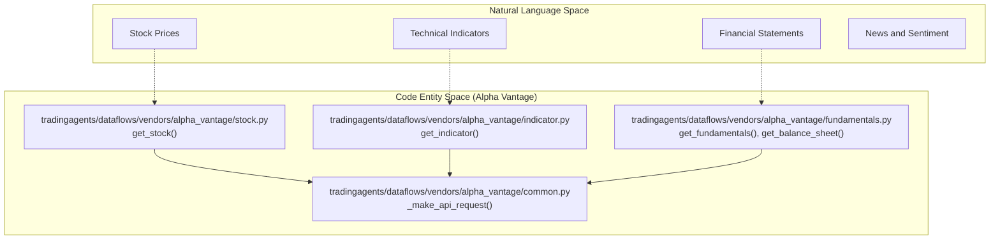
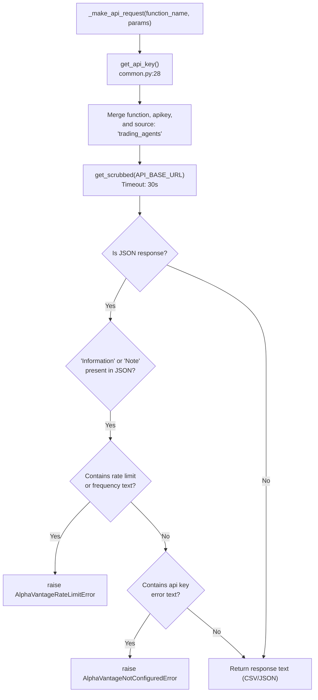

<!-- source: DeepWiki mcp.deepwiki.com · repo TauricResearch/TradingAgents · page 4.3 Alpha Vantage Integration · fetched 2026-10-29 -->

# Alpha Vantage Integration

Relevant source files

The following files were used as context for generating this wiki page:

- [tests/test_alpha_vantage_hardening.py](tests/test_alpha_vantage_hardening.py)
- [tradingagents/dataflows/vendors/alpha_vantage/common.py](tradingagents/dataflows/vendors/alpha_vantage/common.py)
- [tradingagents/dataflows/vendors/alpha_vantage/fundamentals.py](tradingagents/dataflows/vendors/alpha_vantage/fundamentals.py)
- [tradingagents/dataflows/vendors/alpha_vantage/stock.py](tradingagents/dataflows/vendors/alpha_vantage/stock.py)

## Purpose and Scope

This document details the Alpha Vantage data vendor integration within the `TradingAgents` framework. Alpha Vantage serves as a modular data provider supporting stock price histories, technical indicators, fundamental financial statements, and news sentiment data. It integrates into the broader dataflow architecture as either a primary vendor or an automated fallback provider when primary sources encounter rate limits or connection errors.

---

## Architecture Overview and Modules

The Alpha Vantage integration is structured into dedicated submodules housed under `tradingagents/dataflows/vendors/alpha_vantage/`. Shared utilities like request execution, timeout management, credential handling, and date formatting reside in `common.py`.

### System Entity Mapping

The following diagram bridges the natural language data categories to their corresponding implementation files and functions within the Alpha Vantage vendor package.

**Sources**: [tradingagents/dataflows/vendors/alpha_vantage/common.py:1-166](), [tradingagents/dataflows/vendors/alpha_vantage/stock.py:1-42](), [tradingagents/dataflows/vendors/alpha_vantage/fundamentals.py:1-54]()

---

## Core API Request Infrastructure and `_make_api_request()`

All HTTP communication with Alpha Vantage is routed through `_make_api_request()` defined in `tradingagents/dataflows/vendors/alpha_vantage/common.py`. This function injects the required API key and source identifiers, enforces network timeouts, and inspects responses for rate limits or rejections.

### Key Request Behaviors and Hardening
*   **Request Timeout**: A network timeout of 30 seconds (`REQUEST_TIMEOUT`) prevents stalled requests from hanging execution flows indefinitely [tradingagents/dataflows/vendors/alpha_vantage/common.py:15-15]().
*   **Rate-Limit Detection**: Alpha Vantage frequently returns HTTP status `200 OK` even when throttling requests. The response body is scanned for phrases like `"rate limit"`, `"requests per day"`, or `"call frequency"` to raise an `AlphaVantageRateLimitError` [tradingagents/dataflows/vendors/alpha_vantage/common.py:116-121]().
*   **Invalid Key Classification**: Notices referencing invalid or missing API keys are intercepted and translated into `AlphaVantageNotConfiguredError` rather than being misclassified as transient rate limits [tradingagents/dataflows/vendors/alpha_vantage/common.py:122-125]().
*   **Credential Scrubbing**: The underlying `get_scrubbed` mechanism ensures that the raw API key is never exposed in exception messages or system logs [tradingagents/dataflows/vendors/alpha_vantage/common.py:95-97](), [tests/test_alpha_vantage_hardening.py:162-167]().

**Sources**: [tradingagents/dataflows/vendors/alpha_vantage/common.py:28-134](), [tests/test_alpha_vantage_hardening.py:38-65]()

---

## Stock and Fundamental Data Modules

### Stock Data (`stock.py`)
The `get_stock()` function retrieves daily adjusted time-series data using the `TIME_SERIES_DAILY_ADJUSTED` API endpoint [tradingagents/dataflows/vendors/alpha_vantage/stock.py:9-42](). Depending on the distance between the requested start date and the current date, it automatically toggles the `outputsize` parameter between `compact` (latest 100 data points) and `full` [tradingagents/dataflows/vendors/alpha_vantage/stock.py:31-32](). The returned CSV data is subsequently filtered via `_filter_csv_by_date_range()` to strip out unrequested bars or future data points [tradingagents/dataflows/vendors/alpha_vantage/common.py:137-166](), [tradingagents/dataflows/vendors/alpha_vantage/stock.py:42-42]().

### Fundamentals (`fundamentals.py`)
The fundamentals module exposes endpoints for company overviews, balance sheets, cash flows, and income statements [tradingagents/dataflows/vendors/alpha_vantage/fundamentals.py:5-53](). To preserve point-in-time integrity and prevent look-ahead bias during backtesting, company profiles and undated financial statements are guarded using date window checks (`withhold_live_profile` and `withhold_undated_statements`) [tradingagents/dataflows/vendors/alpha_vantage/fundamentals.py:21-23]().

**Sources**: [tradingagents/dataflows/vendors/alpha_vantage/stock.py:9-42](), [tradingagents/dataflows/vendors/alpha_vantage/common.py:137-166](), [tradingagents/dataflows/vendors/alpha_vantage/fundamentals.py:5-54]()

---

## Error Taxonomy and Fallback Role

Alpha Vantage errors derive from the system's broader vendor error taxonomy (`tradingagents/dataflows/errors.py`), supporting graceful fallback behavior across vendor router chains.

*   **`AlphaVantageRateLimitError`**: Inherits from `VendorUnavailableError`. When raised, it signals to the vendor router that the request failed due to rate throttling, prompting an automatic failover to alternative providers (such as Yahoo Finance) [tradingagents/dataflows/vendors/alpha_vantage/common.py:65-67]().
*   **`AlphaVantageNotConfiguredError`**: Inherits from `VendorNotConfiguredError` and `ValueError`, indicating that `ALPHA_VANTAGE_API_KEY` is missing or invalid [tradingagents/dataflows/vendors/alpha_vantage/common.py:18-25]().

**Sources**: [tradingagents/dataflows/vendors/alpha_vantage/common.py:18-67](), [tests/test_alpha_vantage_hardening.py:46-65]()

---

