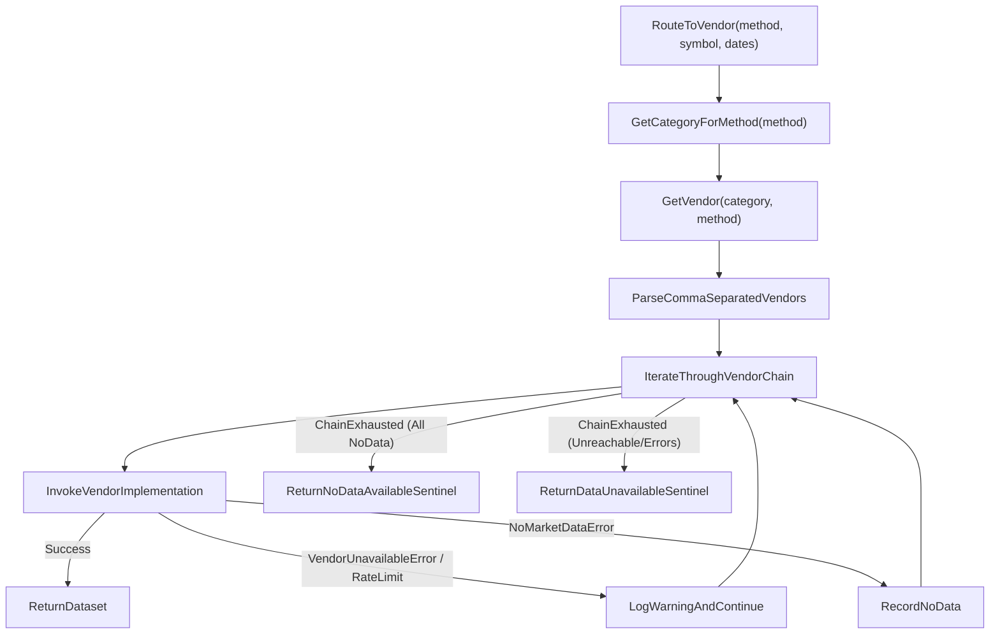
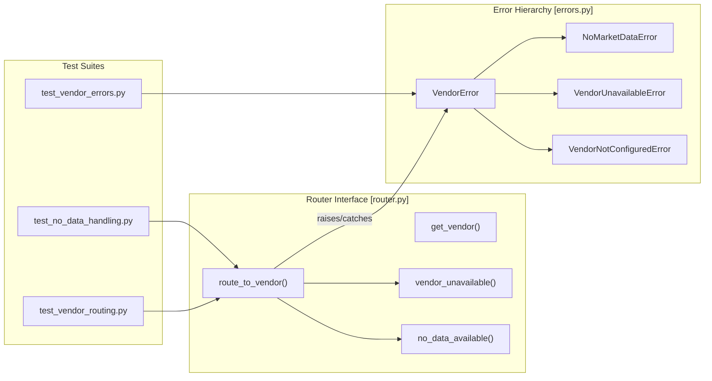
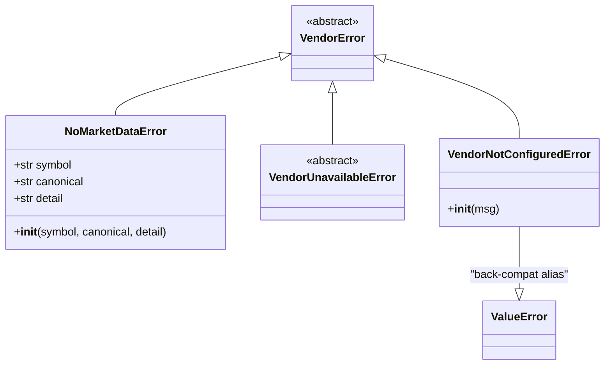

<!-- source: DeepWiki mcp.deepwiki.com · repo TauricResearch/TradingAgents · page 4.4 Fallback and Error Handling · fetched 2026-10-29 -->

# Fallback and Error Handling

<details>
<summary>Relevant source files</summary>

The following files were used as context for generating this wiki page:

- [tests/test_no_data_handling.py](tests/test_no_data_handling.py)
- [tests/test_vendor_errors.py](tests/test_vendor_errors.py)
- [tests/test_vendor_routing.py](tests/test_vendor_routing.py)
- [tradingagents/dataflows/errors.py](tradingagents/dataflows/errors.py)
- [tradingagents/dataflows/router.py](tradingagents/dataflows/router.py)

</details>


This page details the automated fallback mechanisms, the unified `VendorError` taxonomy, graceful degradation protocols for optional categories, and data-integrity guarantees implemented in `tradingagents/dataflows/router.py` and `tradingagents/dataflows/errors.py`. The system ensures that transient network failures, missing credentials, or empty vendor datasets are handled transparently and honestly, preventing LLM agents from hallucinating financial data or crashing system runs.

Sources: [tradingagents/dataflows/router.py:1-187](), [tradingagents/dataflows/errors.py:1-58]()

---

## Automatic Fallback Mechanism

Data retrieval requests are orchestrated through `route_to_vendor` in `tradingagents/dataflows/router.py`, which consults configured vendor chains for each tool category or specific tool method [tradingagents/dataflows/router.py:160-174](). When an active vendor fails due to throttling or unavailability, the router systematically advances to the next configured fallback vendor without user intervention.

### Fallback Execution Flow



Sources: [tradingagents/dataflows/router.py:1-187](), [tests/test_vendor_routing.py:58-121]()

### Code Entity Mapping: Routing and Error Handling



Sources: [tradingagents/dataflows/router.py:1-187](), [tradingagents/dataflows/errors.py:1-58](), [tests/test_no_data_handling.py:1-94](), [tests/test_vendor_routing.py:1-124]()

---

## The VendorError Taxonomy

To decouple error recovery from vendor-specific libraries, TradingAgents organizes all data-acquisition failures under a single inheritance hierarchy rooted at `VendorError` [tradingagents/dataflows/errors.py:21-23](). 



The error classes and their router behaviors are defined as follows:

1. **`NoMarketDataError`**: Raised when a vendor successfully connects but returns no usable rows or stale data [tradingagents/dataflows/errors.py:25-44](). It captures both the user-requested symbol and the canonical vendor-resolved symbol, along with free-text `detail` [tradingagents/dataflows/errors.py:34-37]().
2. **`VendorUnavailableError`**: Raised when a vendor throttles requests (e.g., HTTP 429) or fails due to network partitions [tradingagents/dataflows/errors.py:46-50](). This indicates that data availability is temporarily unknown rather than absent, causing the router to advance to the next configured fallback vendor [tests/test_vendor_errors.py:97-115]().
3. **`VendorNotConfiguredError`**: Raised when a selected vendor lacks necessary API keys or credentials [tradingagents/dataflows/errors.py:53-58](). It also inherits from `ValueError` to preserve backward compatibility with legacy callers catching generic value errors [tradingagents/dataflows/errors.py:53-58]().

Sources: [tradingagents/dataflows/errors.py:1-58](), [tests/test_vendor_errors.py:1-119]()

---

## Graceful Degradation via `OPTIONAL_CATEGORIES`

Not all data categories are equally critical for generating a trading decision. Categories designated as core (such as core stock prices, technical indicators, fundamentals, and core news) must raise loud exceptions if their primary sources fail [tradingagents/dataflows/router.py:93](). 

In contrast, enrichment categories are classified under `OPTIONAL_CATEGORIES` [tradingagents/dataflows/router.py:94]():

```python
OPTIONAL_CATEGORIES = {"macro_data", "prediction_markets"}
```

When an optional vendor (such as FRED for macro indicators or Polymarket for prediction markets) fails due to missing keys or network errors, the router intercepts the failure and returns a `DATA_UNAVAILABLE` sentinel string rather than crashing the agent workflow [tests/test_vendor_routing.py:103-113](). This ensures secondary context providers do not block primary financial analysis.

Sources: [tradingagents/dataflows/router.py:89-94](), [tests/test_vendor_routing.py:103-113]()

---

## Unavailable-Window Reporting vs. Absence

A core design principle of the TradingAgents data layer is **vendor-failure honesty**: distinguishing between a symbol that genuinely does not exist or have data versus a vendor that failed to report due to rate limiting or timeouts.

- **Absence (`NO_DATA_AVAILABLE`)**: Triggered when all configured vendors for a core method successfully answer but confirm zero coverage or rows for a ticker [tests/test_no_data_handling.py:56-72](). The returned sentinel explicitly instructs the LLM: *"Do not estimate or fabricate values"* [tests/test_no_data_handling.py:71]().
- **Unavailable Window (`DATA_UNAVAILABLE`)**: Triggered when all vendors in the fallback chain fail or time out without returning a definitive answer [tests/test_vendor_routing.py:74-82](). This guarantees that temporary network outages or throttling are never misinterpreted by agents as a stock having zero price history or missing fundamentals.

Sources: [tradingagents/dataflows/router.py:176-187](), [tests/test_no_data_handling.py:56-91](), [tests/test_vendor_routing.py:74-86]()

---

## Cache Poisoning Prevention

To prevent empty or malformed downloads from corrupting local storage, data-loading functions (such as `load_ohlcv` for Yahoo Finance) enforce strict anti-poisoning checks:

1. An empty dataframe returned by a remote download does not get written to the data cache directory [tests/test_no_data_handling.py:36-46]().
2. The function immediately raises `NoMarketDataError`, ensuring subsequent requests re-attempt fetching from upstream vendors rather than serving stale empty cache files [tests/test_no_data_handling.py:48-53]().

Sources: [tests/test_no_data_handling.py:1-54]()

---

