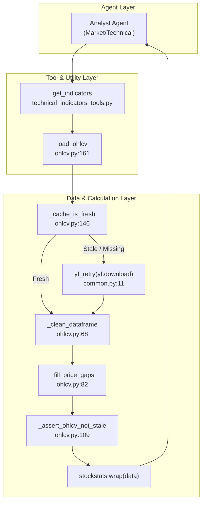
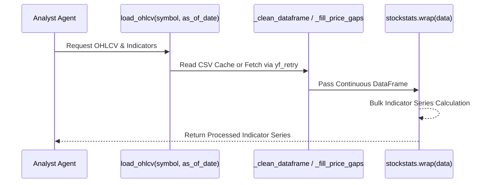

<!-- source: DeepWiki mcp.deepwiki.com · repo TauricResearch/TradingAgents · page 4.5 Technical Indicators and Caching · fetched 2026-10-29 -->

# Technical Indicators and Caching

Relevant source files

The following files were used as context for generating this wiki page:

- [tests/test_date_boundaries.py](tests/test_date_boundaries.py)
- [tests/test_ohlcv_cache_freshness.py](tests/test_ohlcv_cache_freshness.py)
- [tests/test_ohlcv_date_column.py](tests/test_ohlcv_date_column.py)
- [tests/test_ohlcv_latest_bar.py](tests/test_ohlcv_latest_bar.py)
- [tests/test_yfinance_stale_ohlcv_guard.py](tests/test_yfinance_stale_ohlcv_guard.py)
- [tradingagents/dataflows/vendors/yahoo/ohlcv.py](tradingagents/dataflows/vendors/yahoo/ohlcv.py)

## Purpose and Scope

This document describes the technical indicator calculation system and caching strategies used in TradingAgents. The system computes technical indicators (RSI, MACD, Bollinger Bands, etc.) from stock price data and employs a multi-layered caching mechanism to optimize performance and minimize redundant API calls. The integration leverages the `stockstats` library for robust financial calculations and implements a bulk-processing strategy to handle high-volume data requests from analyst agents. It also includes strict freshness guards and gap-filling logic to prevent stale or malformed data from polluting trading decisions.

**Sources:** [tradingagents/dataflows/vendors/yahoo/ohlcv.py:1-163](), [tests/test_ohlcv_cache_freshness.py:1-113]()

---

## Technical Indicator Architecture

The system uses the `stockstats` Python library to calculate technical indicators from OHLCV (Open, High, Low, Close, Volume) price data. The architecture consists of core utility functions in the Yahoo vendor module and tool bindings used by agents.

### Core Components

| Component | File | Purpose |
|-----------|------|---------|
| `load_ohlcv` | [tradingagents/dataflows/vendors/yahoo/ohlcv.py:161-163]() | Fetching, date-filtering, and file-based caching of historical price data. |
| `_cache_is_fresh` | [tradingagents/dataflows/vendors/yahoo/ohlcv.py:146-159]() | Enforces `OHLCV_CACHE_TTL_SECONDS` for same-day cache validation. |
| `_assert_ohlcv_not_stale` | [tradingagents/dataflows/vendors/yahoo/ohlcv.py:109-144]() | Rejects data if the latest row is older than `MAX_OHLCV_STALE_DAYS`. |
| `_clean_dataframe` & `_fill_price_gaps` | [tradingagents/dataflows/vendors/yahoo/ohlcv.py:68-89]() | Normalizes date columns, parses timestamps, handles NaN values, and fills price gaps. |
| `yf_retry` | [tradingagents/dataflows/vendors/yahoo/common.py:11-11]() | Decorator for exponential backoff on Yahoo Finance rate limits. |

**Sources:** [tradingagents/dataflows/vendors/yahoo/ohlcv.py:1-163](), [tradingagents/dataflows/vendors/yahoo/common.py:1-12]()

---

## Indicator Request Flow

The following diagram illustrates how indicator and price requests flow from the agent layer through the caching and data normalization utilities.

**Sources:** [tradingagents/dataflows/vendors/yahoo/ohlcv.py:68-163](), [tradingagents/dataflows/vendors/yahoo/common.py:11-12]()

---

## Caching Mechanism and Freshness Guards

The system implements a persistent file-based caching strategy, robust retry logic, and strict staleness checks.

### Cache Strategy
1. **One Cache File Per Symbol**: Data is stored as CSV files in the directory specified by `config["data_cache_dir"]`. Each symbol has a single cache file (e.g., `AAPL-YFin-data.csv`), preventing the cache from accumulating a separate file per symbol per day [tests/test_ohlcv_cache_freshness.py:97-113]().
2. **Look-ahead Bias Prevention**: Cached historical frames are filtered during `load_ohlcv` to ensure data does not exceed the requested `as_of_date` cutoff.
3. **Same-Day Refresh TTL (`OHLCV_CACHE_TTL_SECONDS`)**: For current-day requests, the system enforces an `OHLCV_CACHE_TTL_SECONDS` (default `900` seconds / 15 minutes) [tradingagents/dataflows/vendors/yahoo/ohlcv.py:24](). This ensures intraday runs pick up updated closing or in-progress candles shortly after publication without hammering the vendor during non-trading hours or repeated calls [tests/test_ohlcv_cache_freshness.py:48-65]().

### Staleness and Data Integrity
To prevent feeding agents outdated prices (such as a vendor returning a year-old frame):
* **Staleness Threshold**: `_assert_ohlcv_not_stale` rejects data if the latest row is more than `MAX_OHLCV_STALE_DAYS` (default `10` days) before the requested date [tradingagents/dataflows/vendors/yahoo/ohlcv.py:18](), [tradingagents/dataflows/vendors/yahoo/ohlcv.py:109-144]().
* **Typed Rejection**: Raises `NoMarketDataError` with a specific detail string, enabling the router to fall back to alternative vendors or surface a clear unavailability notice [tests/test_yfinance_stale_ohlcv_guard.py:92-110]().

### The `yf_retry` Decorator
To handle rate limits and transient connection failures from the `yfinance` library, the system wraps network calls with `yf_retry`, applying exponential backoff across retries [tradingagents/dataflows/vendors/yahoo/common.py:11-11]().

**Sources:** [tradingagents/dataflows/vendors/yahoo/ohlcv.py:18-163](), [tests/test_ohlcv_cache_freshness.py:48-113](), [tests/test_yfinance_stale_ohlcv_guard.py:92-110]()

---

## Data Normalization, Gap Filling, and Date Handling

Raw data downloaded from external APIs often contains formatting inconsistencies, timezone variances, or missing session rows. The `ohlcv.py` module includes rigorous preprocessing steps:

* **Date Column Normalization (`_ensure_date_column`)**: Standardizes unnamed indices, `Datetime`, or `date` columns into a uniform `Date` column [tradingagents/dataflows/vendors/yahoo/ohlcv.py:27-39]().
* **Timezone and Midnight Normalization (`_normalize_dates`)**: Parses timestamps into naive, midnight-normalized `pd.Timestamp` objects, correctly handling multi-year DST transitions and non-US positive-offset markets without shifting calendar days [tradingagents/dataflows/vendors/yahoo/ohlcv.py:55-65](), [tests/test_ohlcv_latest_bar.py:36-74]().
* **Unsettled Bar Handling**: If the newest session has a `NaN` close (such as an unfinalized or glitched intraday session), the loader serves the last settled bar instead of discarding the entire symbol or carrying a fabricated close [tests/test_ohlcv_latest_bar.py:114-125]().
* **Gap Filling (`_fill_price_gaps`)**: Drops rows lacking any `Close` price and applies forward-fill (`ffill()`) and back-fill (`bfill()`) operations across price columns to maintain a continuous series for `stockstats` indicator calculations [tradingagents/dataflows/vendors/yahoo/ohlcv.py:82-89]().

**Sources:** [tradingagents/dataflows/vendors/yahoo/ohlcv.py:27-89](), [tests/test_ohlcv_latest_bar.py:36-125]()

---

## Bulk Calculation Optimization

Indicator calculations across historical windows are optimized using vectorized operations via `stockstats`.

**Sources:** [tradingagents/dataflows/vendors/yahoo/ohlcv.py:68-163](), [tests/test_ohlcv_date_column.py:64-73]()

---

