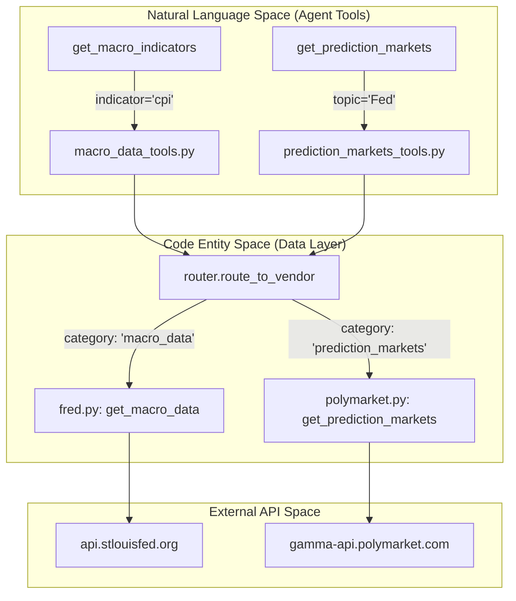
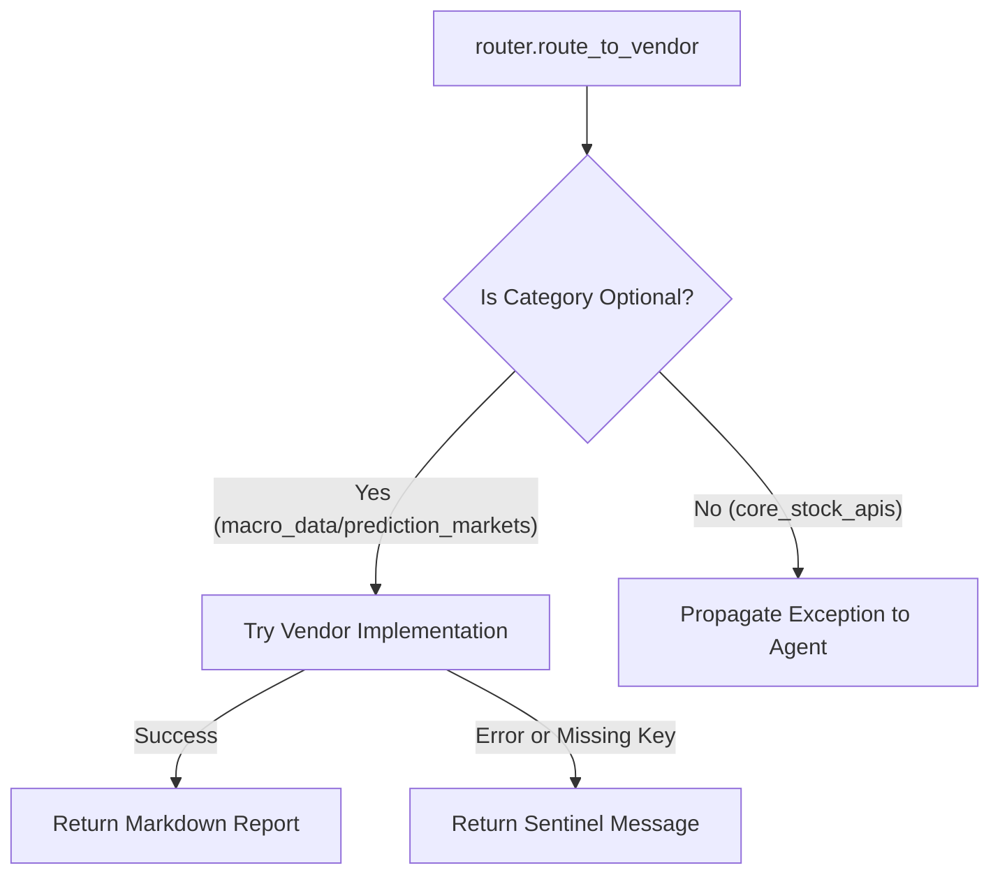

<!-- source: DeepWiki mcp.deepwiki.com · repo TauricResearch/TradingAgents · page 4.6 FRED and Polymarket Vendors · fetched 2026-10-29 -->

# FRED and Polymarket Vendors

Relevant source files

The following files were used as context for generating this wiki page:

- [tests/test_fred.py](tests/test_fred.py)
- [tests/test_polymarket.py](tests/test_polymarket.py)
- [tests/test_social_lookahead.py](tests/test_social_lookahead.py)
- [tradingagents/dataflows/vendors/fred.py](tradingagents/dataflows/vendors/fred.py)
- [tradingagents/dataflows/vendors/polymarket.py](tradingagents/dataflows/vendors/polymarket.py)

## Purpose and Scope
This page documents the integration of macroeconomic data via FRED (Federal Reserve Economic Data) [tradingagents/dataflows/vendors/fred.py:1-10]() and prediction market insights via Polymarket [tradingagents/dataflows/vendors/polymarket.py:1-11](). Both vendors belong to `OPTIONAL_CATEGORIES` within the data acquisition architecture, meaning they provide graceful degradation: if an API key is missing or an external service fails, the system returns a sentinel message to the calling agent rather than raising a fatal exception or aborting the run.

---

## FRED Macro Data Vendor

The FRED vendor fetches macroeconomic time series—such as interest rates, inflation, employment data, and gross domestic product—from the St. Louis Fed's public API [tradingagents/dataflows/vendors/fred.py:1-10](). It is primarily utilized by the News and Fundamentals Analysts to ground economic commentary in quantitative historical records.

### Configuration and Authentication
- **Environment Variable**: `FRED_API_KEY` is required [tradingagents/dataflows/fred.py:102-110]().
- **Error Handling**: If the key is absent, the system raises `FredNotConfiguredError` (a subclass of `VendorNotConfiguredError` and `ValueError`), which is caught by the routing layer to flag the vendor as unavailable without halting execution [tradingagents/dataflows/fred.py:93-110]().
- **Default Window**: If no explicit lookback is specified by an agent, the system defaults to a trailing window of 365 days (`DEFAULT_LOOKBACK_DAYS`) [tradingagents/dataflows/fred.py:34-36]().

### Macro Series Aliases
To simplify agent prompts and tool calls, the vendor implements a `MACRO_SERIES` lookup dictionary mapping user-friendly aliases to official FRED series IDs [tradingagents/dataflows/fred.py:44-90]().

| Category | Friendly Aliases | FRED Series ID |
| :--- | :--- | :--- |
| **Rates** | `fed_funds_rate`, `10y_treasury`, `yield_curve` | `FEDFUNDS`, `DGS10`, `T10Y2Y` |
| **Inflation** | `cpi`, `core_pce`, `inflation_expectations` | `CPIAUCSL`, `PCEPILFE`, `T10YIE` |
| **Labor** | `unemployment_rate`, `nonfarm_payrolls` | `UNRATE`, `PAYEMS` |
| **Sentiment** | `vix`, `consumer_sentiment` | `VIXCLS`, `UMCSENT` |

### Implementation Details
- **Alias Resolution**: The `_resolve_series_id` function normalizes inputs to lowercase, maps known aliases, and validates raw series IDs. It rejects descriptive natural language phrases (e.g., "bank of japan rate") up front to prevent unnecessary HTTP 400 errors from the FRED API [tradingagents/dataflows/fred.py:113-133]().
- **Vintage Pinning and Vendor Clock**: To prevent look-ahead bias during historical backtests, FRED queries use `realtime_start` and `realtime_end` pinned to the graph state date (`as_of_date`). Because FRED's internal clock operates on US Central time (`America/Chicago`), the vintage pin is clamped using `_fred_today` to avoid requesting future dates that the API rejects [tradingagents/dataflows/fred.py:24-29, 136-144]().
- **Data Rendering**: Observations are formatted into a markdown report containing the latest value, net change over the requested span, and a structured table of recent data points capped at `MAX_ROWS = 40` [tradingagents/dataflows/fred.py:38-41, 167-177]().

Sources: [tradingagents/dataflows/vendors/fred.py:1-177](), [tests/test_fred.py:1-158]()

---

## Polymarket Prediction Market Vendor

The Polymarket vendor provides live, market-implied probabilities for forward-looking events (such as central bank decisions, elections, geopolitical outcomes, and crypto milestones) [tradingagents/dataflows/vendors/polymarket.py:1-11]().

### Technical Specification
- **API Endpoint**: Utilizes Polymarket's public Gamma API (`https://gamma-api.polymarket.com`) [tradingagents/dataflows/vendors/polymarket.py:22]().
- **Authentication**: No API key or authentication is required [tradingagents/dataflows/vendors/polymarket.py:8-11]().
- **Volume Ranking**: Retrieved markets are sorted by `volumeNum` to prioritize liquid, high-confidence prediction streams [tradingagents/dataflows/vendors/polymarket.py:27-28, 111]().

### Forward-Looking Filter and Run-Date Bounded Odds
To ensure data integrity, `_is_forward_looking` filters candidate markets to exclude:
1. Markets marked as `closed` [tradingagents/dataflows/vendors/polymarket.py:56-57]().
2. Markets with an `endDate` in the past relative to current system time [tradingagents/dataflows/vendors/polymarket.py:58-64]().
3. Markets lacking valid `outcomePrices` or `outcomes` arrays [tradingagents/dataflows/vendors/polymarket.py:65-67]().

Additionally, `get_prediction_markets` enforces run-date bounds: if `as_of_date` is historical (in the past relative to real-world time), odds are explicitly withheld [tradingagents/dataflows/vendors/polymarket.py:86-91](). Because Polymarket serves only live, real-time odds without historical vintage records, releasing live odds during a historical backtest would introduce severe look-ahead bias [tradingagents/dataflows/vendors/polymarket.py:86-91]().

### Data Transformation and Output
The `get_prediction_markets` function queries the `public-search` endpoint, filters open forward-looking events, extracts outcome prices, converts decimals to percentages (e.g., `0.76` to `76%`), and appends 1-week price changes expressed in percentage points (`pp`) [tradingagents/dataflows/vendors/polymarket.py:70-149]().

Sources: [tradingagents/dataflows/vendors/polymarket.py:1-149](), [tests/test_polymarket.py:1-128]()

---

## System Integration and Data Flow

Both FRED and Polymarket vendors integrate into the system via the data routing layer. Agents interact with them exclusively through LangChain-decorated tools (`get_macro_indicators` and `get_prediction_markets`) [tradingagents/agents/utils/macro_data_tools.py:10-39](), [tradingagents/agents/utils/prediction_markets_tools.py:9-33]().

### Natural Language to Code Entity Mapping

The diagram below illustrates how agent tool calls bridge natural language requests to specific vendor implementations within the codebase.

**Data Retrieval Flow: Agent to Vendor**

Sources: [tradingagents/dataflows/vendors/fred.py:1-177](), [tradingagents/dataflows/vendors/polymarket.py:1-149](), [tradingagents/dataflows/router.py]()

### Optional Category Degradation

Because both modules reside under `OPTIONAL_CATEGORIES`, exceptions during execution (such as missing API keys, rate limits, or network timeouts) are caught and converted into informative sentinel strings [tradingagents/dataflows/fred.py:93-110](), [tradingagents/dataflows/vendors/polymarket.py:95-102]().

**Graceful Degradation Logic**

Sources: [tradingagents/dataflows/vendors/fred.py:93-110](), [tradingagents/dataflows/vendors/polymarket.py:95-102](), [tradingagents/dataflows/router.py]()

### Summary Table: Tool to Implementation

| Tool Function | File Path | Implementation Function | Category |
| :--- | :--- | :--- | :--- |
| `get_macro_indicators` | `tradingagents/agents/utils/macro_data_tools.py` | `fred.get_macro_data` | `macro_data` |
| `get_prediction_markets` | `tradingagents/agents/utils/prediction_markets_tools.py` | `polymarket.get_prediction_markets` | `prediction_markets` |

Sources: [tradingagents/dataflows/vendors/fred.py:167-177](), [tradingagents/dataflows/vendors/polymarket.py:70-149]()

---

