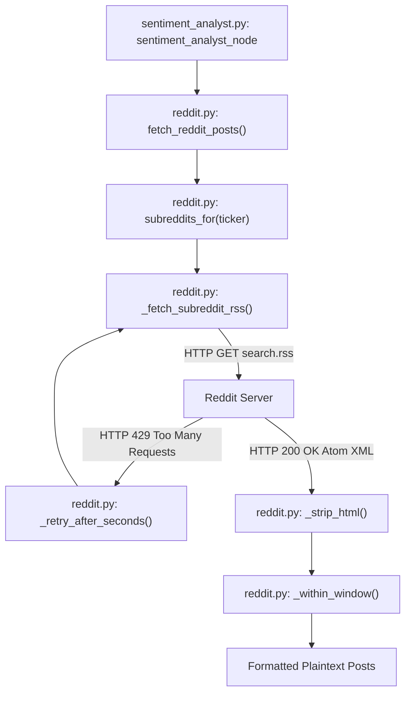
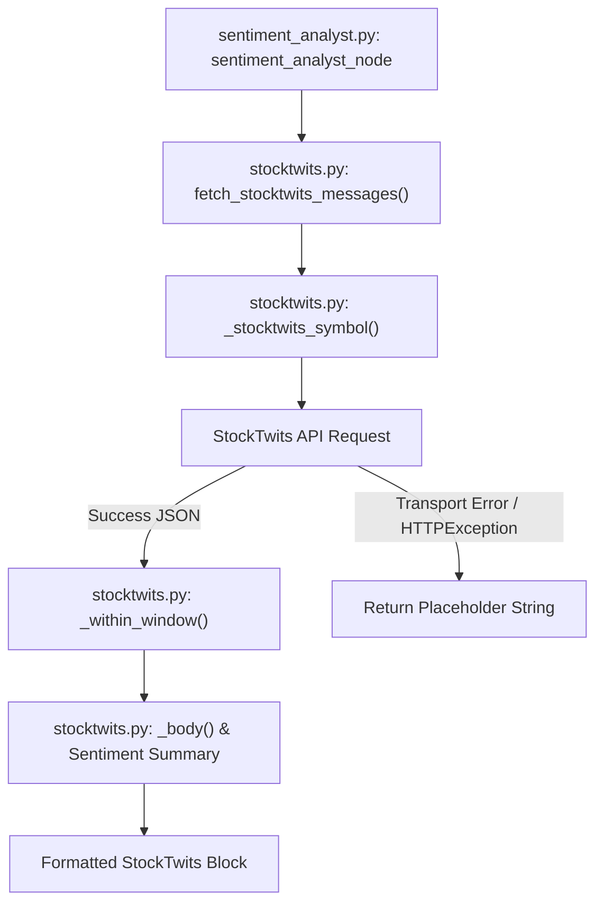
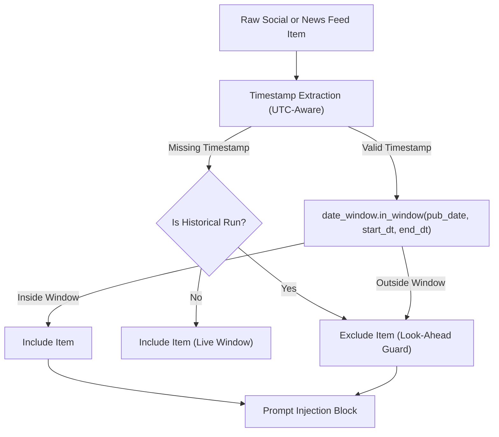

<!-- source: DeepWiki mcp.deepwiki.com · repo TauricResearch/TradingAgents · page 4.8 Social and News Sources · fetched 2026-10-29 -->

# Social andne News Sources

Relevant source files

The following files were used as context for generating this wiki page:

- [tests/test_news_lookahead.py](tests/test_news_lookahead.py)
- [tests/test_post_screen.py](tests/test_post_screen.py)
- [tests/test_reddit_fallback.py](tests/test_reddit_fallback.py)
- [tests/test_stocktwits_resilience.py](tests/test_stocktwits_resilience.py)
- [tests/test_structured_agent_prompts.py](tests/test_structured_agent_prompts.py)
- [tradingagents/agents/analysts/sentiment_analyst.py](tradingagents/agents/analysts/sentiment_analyst.py)
- [tradingagents/agents/post_screen.py](tradingagents/agents/post_screen.py)
- [tradingagents/dataflows/vendors/reddit.py](tradingagents/dataflows/vendors/reddit.py)
- [tradingagents/dataflows/vendors/stocktwits.py](tradingagents/dataflows/vendors/stocktwits.py)
- [tradingagents/dataflows/vendors/yahoo/news.py](tradingagents/dataflows/vendors/yahoo/news.py)

This page details the integration and handling of social media and news data within the TradingAgents framework. It covers data acquisition from Reddit, StockTwits, yfinance, and Alpha Vantage, post screening via TypeSafe Jev, and the strict enforcement of look-ahead bounds on historical windows.

## Reddit Integration

The system fetches ticker-specific discussion posts from Reddit's public Atom/RSS search feed. This approach is required because Reddit's JSON search endpoint is blocked for anonymous clients [tradingagents/dataflows/vendors/reddit.py:4-6](). The RSS feed carries no score or comment counts but provides a reliable textual stream.

### Implementation Details

Reddit posts are fetched via `_fetch_subreddit_rss` [tradingagents/dataflows/reddit.py:68]() which builds URLs using `_search_qs` [tradingagents/dataflows/vendors/reddit.py:105-112]() across `DEFAULT_SUBREDDITS` (`wallstreetbets`, `stocks`, `investing`) [tradingagents/dataflows/vendors/reddit.py:79]() or crypto-specific communities via `subreddits_for` [tradingagents/dataflows/vendors/reddit.py:87-94]().

Key resilience mechanisms include:
* **Rate Limiting (HTTP 429):** Handled by retrying once after waiting for the duration specified in the `Retry-After` header or falling back to a jittered `_RETRY_FALLBACK_SECONDS` (60 seconds) to prevent synchronized retries across concurrent runs [tradingagents/dataflows/vendors/reddit.py:142-165]().
* **Chunked-Transfer and Parsing Errors:** Transport errors such as `http.client.IncompleteRead` or malformed XML are caught gracefully, returning `None` so the sentiment analyst receives an explicit unavailable notice rather than a silent failure [tests/test_reddit_fallback.py:140-147]().
* **Content Extraction:** The function `_strip_html` strips embedded HTML and parses Atom entries into structured dictionaries [tradingagents/dataflows/vendors/reddit.py:126-135]().
* **Look-ahead Prevention:** `_within_window` ensures posts are strictly bounded by `start_date` and `end_date` [tradingagents/dataflows/vendors/reddit.py:38-48]().

### Reddit Data Flow

Sources:
* [tradingagents/dataflows/vendors/reddit.py:4-6]()
* [tradingagents/dataflows/vendors/reddit.py:38-48]()
* [tradingagents/dataflows/vendors/reddit.py:68]()
* [tradingagents/dataflows/vendors/reddit.py:79]()
* [tradingagents/dataflows/vendors/reddit.py:87-94]()
* [tradingagents/dataflows/vendors/reddit.py:105-112]()
* [tradingagents/dataflows/vendors/reddit.py:126-135]()
* [tradingagents/dataflows/vendors/reddit.py:142-165]()
* [tests/test_reddit_fallback.py:140-147]()

## StockTwits Resilience

StockTwits exposes an unauthenticated symbol-stream API at `api.stocktwits.com/api/2/streams/symbol/{ticker}.json` [tradingagents/dataflows/vendors/stocktwits.py:3-5](). 

### Implementation Details

* **Crypto Symbol Mapping:** The function `_stocktwits_symbol` maps cryptocurrency tickers (e.g., `BTC-USD`) to StockTwits' required `<BASE>.X` convention (`BTC.X`), while passing equity symbols through upper-cased [tradingagents/dataflows/vendors/stocktwits.py:63-71]().
* **Transport and Error Handling:** `fetch_stocktwits_messages` catches `OSError`, `http.client.HTTPException`, and `json.JSONDecodeError`, logging a warning and returning a standardized placeholder string (`<stocktwits unavailable: ...>`) [tradingagents/dataflows/vendors/stocktwits.py:99-106]().
* **Look-ahead & Gap Reporting:** Messages are filtered through `_within_window` [tradingagents/dataflows/vendors/stocktwits.py:44-55](). If no messages match the window but historical feed metadata exists, `coverage_gap` formats an informative notice [tradingagents/dataflows/vendors/stocktwits.py:111-119]().

### StockTwits Data Flow

Sources:
* [tradingagents/dataflows/vendors/stocktwits.py:3-5]()
* [tradingagents/dataflows/vendors/stocktwits.py:44-55]()
* [tradingagents/dataflows/vendors/stocktwits.py:63-71]()
* [tradingagents/dataflows/vendors/stocktwits.py:99-106]()
* [tradingagents/dataflows/vendors/stocktwits.py:111-119]()

## Post Screening via Jev

When `TYPESAFE_API_KEY` is configured, social media posts fetched from Reddit and StockTwits undergo automated relevance and stance screening via TypeSafe's Jev model (`system_one`) [tradingagents/agents/post_screen.py:1-13]().

### Implementation Details

* **Screening Criteria:** `jev_screen` initializes a closure that evaluates individual posts against two primary prompts: whether the post is about the instrument (`about`) and what stance the author takes on the stock price (`stance`) [tradingagents/agents/post_screen.py:41-61]().
* **Thresholds:** Posts with an `about` score below `_OFF_TOPIC_BELOW` (0.3) are dropped [tradingagents/agents/post_screen.py:36-37](). Stances (`bullish`, `bearish`, `neutral`, `unclear`) require a confidence level exceeding `_STANCE_CONFIDENCE` (0.5) [tradingagents/agents/post_screen.py:38-39]().
* **Graceful Fallback:** If the TypeSafe API encounters transient network errors or rate limits (HTTP 429, 529), `system_one` performs retries with exponential backoff and jitter [tradingagents/agents/post_screen.py:75-99](). If screening fails entirely, posts are passed through unscreened with a warning banner [tradingagents/agents/post_screen.py:162-165]().

Sources:
* [tradingagents/agents/post_screen.py:1-13]()
* [tradingagents/agents/post_screen.py:36-61]()
* [tradingagents/agents/post_screen.py:75-99]()
* [tradingagents/agents/post_screen.py:162-165]()

## yfinance and Alpha Vantage News Feeds

News feeds provide structured context for the market and sentiment analysts.

### yfinance News Integration

* **Ticker News:** `get_news_yfinance` fetches news using `yf.Ticker(canonical).get_news()` [tradingagents/dataflows/vendors/yahoo/news.py:107](). If the ticker feed is empty, it queries `yf.Search` for related articles [tradingagents/dataflows/vendors/yahoo/news.py:110]().
* **Global News:** `get_global_news_yfinance` aggregates macro economic headlines using configured query terms and search limits [tradingagents/dataflows/vendors/yahoo/news.py:137-161]().
* **Timestamp Parsing:** `_extract_article_data` parses nested content structures or epoch timestamps as UTC-aware datetimes to prevent host-timezone drift [tradingagents/dataflows/vendors/yahoo/news.py:16-54]().

### Alpha Vantage News Integration

Alpha Vantage acts as an auxiliary news and sentiment vendor via `tradingagents.dataflows.alphavantage` modules, managed through vendor fallback chains.

Sources:
* [tradingagents/dataflows/vendors/yahoo/news.py:16-54]()
* [tradingagents/dataflows/vendors/yahoo/news.py:107-161]()

## Look-Ahead Bounds on Social and News Windows

Preventing look-ahead bias is critical for backtesting integrity.

### Core Principles

* **Strict Window Boundaries:** `in_window` evaluates whether article or post timestamps fall within `[start_date, end_date)` [tradingagents/dataflows/date_window.py:10-11]().
* **Exclusive Upper Bound:** The upper boundary is exclusive, preventing articles published at midnight immediately following the `end_date` from leaking into historical analyses [tests/test_news_lookahead.py:53-62]().
* **Undated Content Policy:** In historical backtests, content lacking explicit timestamps is omitted to prevent unverified future data leaks. In live runs, undated items are retained [tests/test_news_lookahead.py:35-50]().
* **Coverage Gap Distinction:** The system separates genuine absence of news from feed unavailability across historical horizons using `coverage_gap` [tradingagents/dataflows/vendors/yahoo/news.py:130-134]().

### Look-Ahead Prevention Flow

Sources:
* [tradingagents/dataflows/date_window.py:10-11]()
* [tradingagents/dataflows/vendors/yahoo/news.py:130-134]()
* [tests/test_news_lookahead.py:35-62]()

---

