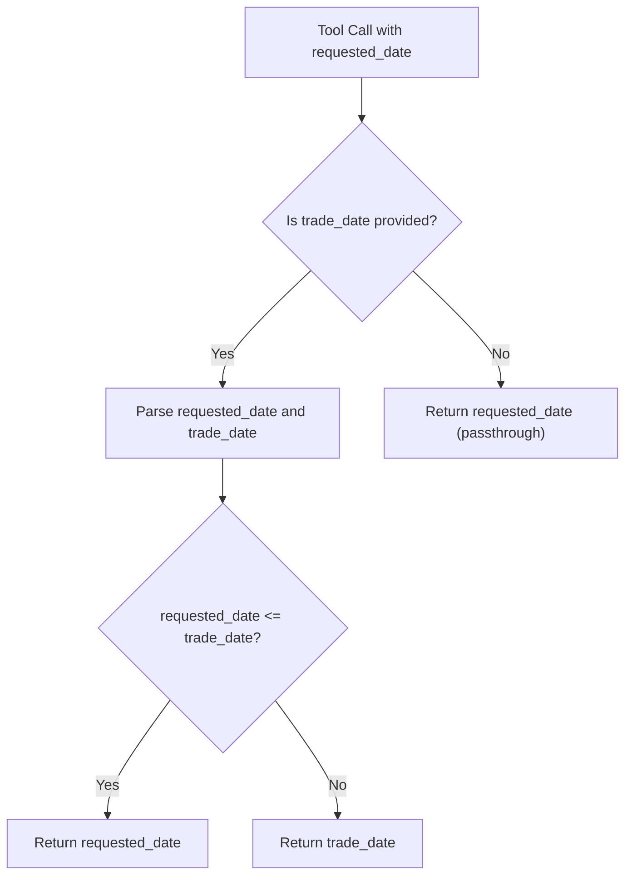
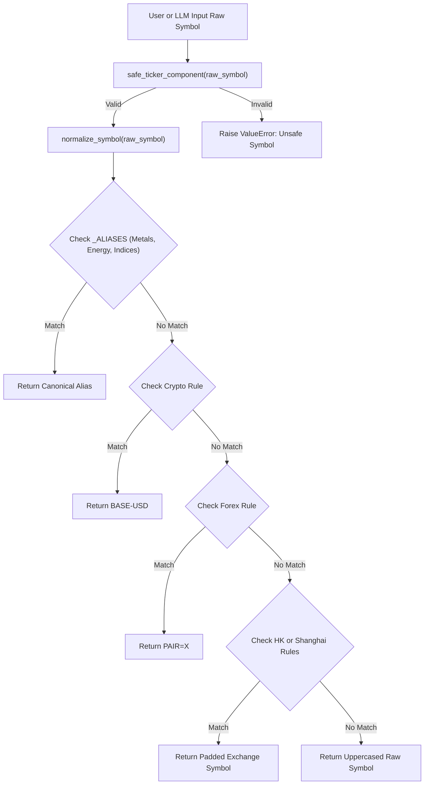

<!-- source: DeepWiki mcp.deepwiki.com · repo TauricResearch/TradingAgents · page 4.9 Point-in-Time Integrity and Symbol Resolution · fetched 2026-10-29 -->

# Point-in-Time Integrity and Symbol Resolution

Relevant source files

The following files were used as context for generating this wiki page:

- [tests/test_crypto_asset_mode.py](tests/test_crypto_asset_mode.py)
- [tests/test_safe_ticker_component.py](tests/test_safe_ticker_component.py)
- [tests/test_symbols.py](tests/test_symbols.py)
- [tests/test_undated_tools_as_of.py](tests/test_undated_tools_as_of.py)
- [tradingagents/dataflows/date_window.py](tradingagents/dataflows/date_window.py)
- [tradingagents/dataflows/symbols.py](tradingagents/dataflows/symbols.py)

This page details how the TradingAgents framework prevents look-ahead bias and ensures point-in-time integrity across its data sources. It covers the mechanisms that ensure agents only access information available up to a specified `trade_date`, including dated tools, date window helpers, financial data filtering, market data verification snapshots, and robust symbol normalization.

## Preventing Look-Ahead Bias

Look-ahead bias occurs when a model or agent uses information that would not have been available at the time a decision was made. In financial trading, this is critical for accurate backtesting and realistic simulations. TradingAgents implements several safeguards to ensure that all data presented to agents is strictly point-in-time.

### Dated Tools and Graph State

Many data retrieval tools within TradingAgents are designed to accept a `trade_date` or `curr_date` parameter. This date is typically derived from the graph's current state, ensuring that all data fetched by the tool is bounded by this date.

For example, tools like insider transactions and prediction markets implicitly receive the `trade_date` from the graph state, even if it is not explicitly part of the tool's execution schema [tests/test_undated_tools_as_of.py:61-65](). 

This ensures that:
*   Insider filings are filtered to only include transactions that occurred on or before the `trade_date` [tests/test_undated_tools_as_of.py:32-36]().
*   Polymarket prediction market odds are withheld for historical runs, as they represent live, real-time information [tests/test_undated_tools_as_of.py:45-48](). Only current runs (where `curr_date` matches `get_current_date()`) are allowed to fetch live odds [tests/test_undated_tools_as_of.py:52-55]().

Sources:
* [tests/test_undated_tools_as_of.py:32-65]()

### Date Window Helpers

The `tradingagents.dataflows.date_window` module provides utilities to manage and filter dated content, ensuring that information falls within the specified analysis window [tradingagents/dataflows/date_window.py:1-11]().

*   `to_utc(dt: datetime)`: Normalizes a datetime object to UTC-aware, assuming naive datetimes are already UTC [tradingagents/dataflows/date_window.py:18-20]().
*   `in_window(pub_dt: datetime | None, start_dt: datetime, end_dt: datetime) -> bool`: Determines if a publication datetime `pub_dt` falls within a half-open window `[start_dt, end_dt + 1 day)`. Undated items are only kept if the window reaches the present [tradingagents/dataflows/date_window.py:23-31]().
*   `as_of(requested: str | None, trade_date: str) -> str | None`: Clamps a requested date to be no later than the `trade_date` [tradingagents/dataflows/date_window.py:78-88]().
*   `as_of_window(start_date: str, end_date: str, trade_date: str) -> tuple[str, str]`: Adjusts a date range `[start, end]` so that its end is clamped to the `trade_date` [tradingagents/dataflows/date_window.py:91-106]().
*   `withhold_live_profile(as_of_date: str | None, label: str) -> str | None`: Withholds live company profiles that lack historical vintage when running historical analyses [tradingagents/dataflows/date_window.py:108-132]().

#### Date Window Flow Diagram

Sources:
* [tradingagents/dataflows/date_window.py:18-106]()

### Filtering Financials by Date

Fundamental data, such as balance sheets, income statements, and cash flow statements, must adhere to point-in-time integrity. Fundamental vendors withhold present-day profiles (`withhold_live_profile`) during historical runs to prevent leaking current market caps, valuation multiples, and sector reclassifications into past dates [tradingagents/dataflows/date_window.py:108-132](). SEC EDGAR fundamentals provide as-filed statements where the filing date is strictly tracked.

Sources:
* [tradingagents/dataflows/date_window.py:108-132]()

### Market Data Validator Verification Snapshots

The market data validator module provides a deterministic, LLM-independent snapshot of market data to serve as ground truth for agents, loading OHLCV data strictly up to the run date and computing technical indicators safely.

Sources:
* [tradingagents/dataflows/date_window.py:1-11]()

## Symbol Resolution and Normalization

Accurate symbol resolution is critical for fetching the correct market data. Users may input symbols in various formats (broker-specific, different exchanges, crypto pairs). The `tradingagents.dataflows.symbols` module standardizes these inputs to Yahoo Finance's canonical format [tradingagents/dataflows/symbols.py:1-21]().

### `normalize_symbol(raw: str) -> str`

This function maps user-provided or broker-specific symbols to their canonical Yahoo Finance equivalents [tradingagents/dataflows/symbols.py:103-144](). The resolution order is:

1.  **Explicit Alias Table**: Handles common aliases for metals (`XAUUSD` -> `GC=F`), energy (`USOIL` -> `CL=F`), and index CFDs (`SPX500` -> `^GSPC`) [tradingagents/dataflows/symbols.py:51-68]().
2.  **Crypto Rule**: Converts known crypto bases quoted in USD/USDT/USDC (`BTCUSD`, `BTC-USDT`) to `BASE-USD` (`BTC-USD`) [tradingagents/dataflows/symbols.py:97-100]().
3.  **Forex Rule**: Six-letter symbols consisting of two ISO currency codes (`EURUSD`) are suffixed with `=X` (`EURUSD=X`) [tradingagents/dataflows/symbols.py:34-40]().
4.  **HK Rule**: Hong Kong Exchange (HKEX) codes (`09992.HK`, `700.HK`) are zero-padded to four digits (`9992.HK`, `0700.HK`) [tradingagents/dataflows/symbols.py:71-71]().
5.  **Shanghai Rule**: Shanghai Stock Exchange symbols (`600519.SH`) are mapped to Yahoo's `.SS` suffix (`600519.SS`) [tradingagents/dataflows/symbols.py:72-72]().
6.  **Default**: If no specific rule applies, the symbol is upper-cased and returned as is [tradingagents/dataflows/symbols.py:139-140]().

Sources:
* [tradingagents/dataflows/symbols.py:34-144]()

### `safe_ticker_component(value: str, *, max_len: int = 32) -> str`

This utility function in `tradingagents.dataflows.symbols` validates that a ticker symbol is safe to use as a filesystem path component, preventing directory traversal attacks (`../../../etc/foo`) [tradingagents/dataflows/symbols.py:152-180]().

Sources:
* [tradingagents/dataflows/symbols.py:152-180]()

### Symbol Resolution Flow Diagram

Sources:
* [tradingagents/dataflows/symbols.py:103-180]()

---

