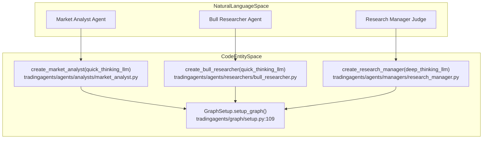
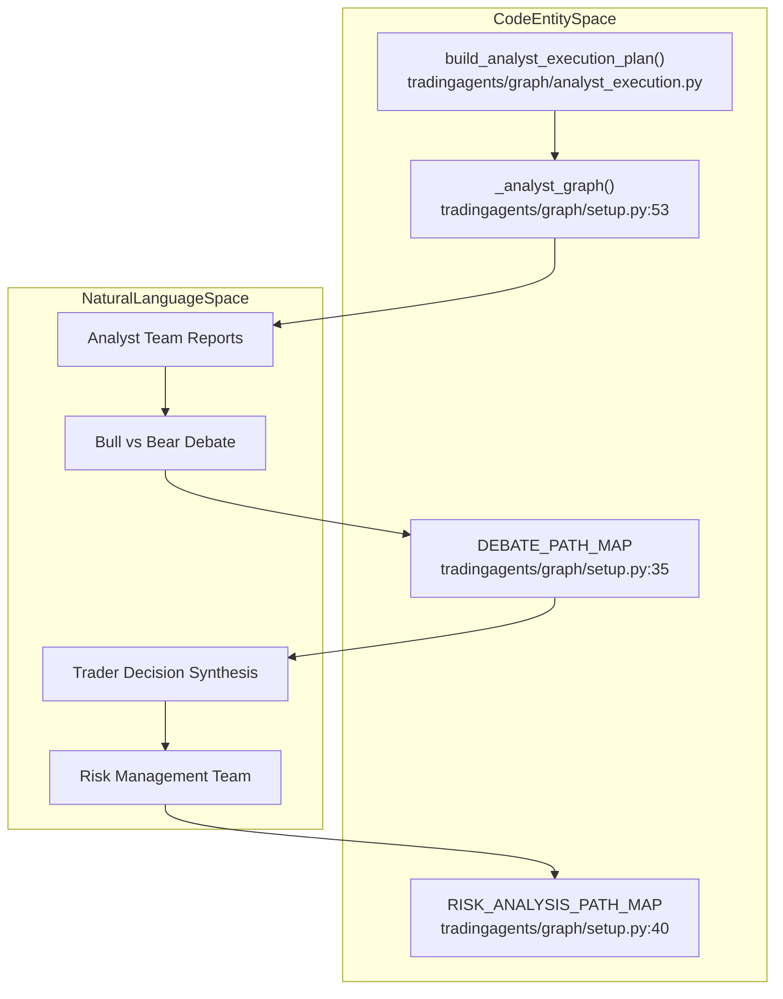

<!-- source: DeepWiki mcp.deepwiki.com · repo TauricResearch/TradingAgents · page 5 Agent System · fetched 2026-10-29 -->

# Agent System

Relevant source files

The following files were used as context for generating this wiki page:

- [tests/test_graph_end_to_end.py](tests/test_graph_end_to_end.py)
- [tradingagents/agents/__init__.py](tradingagents/agents/__init__.py)
- [tradingagents/graph/setup.py](tradingagents/graph/setup.py)

## Purpose and Scope

This document provides a comprehensive high-level overview of the agent architecture in TradingAgents, including agent types, common implementation patterns, tool systems, and state management. It covers how agents are structured, how they interact with tools, and how they process and transform state through the multi-phase trading pipeline.

For deep technical details, see the child pages:
- [Agent Architecture Patterns](#5.1)
- [Analyst Agents](#5.2)
- [Researcher and Debate System](#5.3)
- [Trader and Risk Management Agents](#5.4)
- [Memory and Decision Log](#5.5)
- [Agent Tools and Utilities](#5.6)
- [Structured Output and Rating System](#5.7)

---

## Agent Architecture Overview

The TradingAgents system implements a **factory pattern** for agent creation, where each agent type is defined by a factory function that returns a node function. These nodes are orchestrated within a LangGraph workflow managed by `GraphSetup` [tradingagents/graph/setup.py:93-108]() and `TradingAgentsGraph`.

### Diagram: Agent Pipeline to Code Entity Mapping

**Sources:** [tradingagents/graph/setup.py:93-141](), [tradingagents/agents/__init__.py:1-14]()

---

## Agent Teams and Roles

The system organizes agents into specialized teams covering analysis, debate, trading, and risk management.

### Diagram: Multi-Agent Workflow State Transition

**Sources:** [tradingagents/graph/setup.py:35-90](), [tradingagents/graph/analyst_execution.py:1-50]()

For complete details on specific teams, refer to:
- **Analysts**: See [Analyst Agents](#5.2) and `build_analyst_execution_plan` in [tradingagents/graph/analyst_execution.py]().
- **Researchers**: See [Researcher and Debate System](#5.3) and `DEBATE_PATH_MAP` in [tradingagents/graph/setup.py:35-39]().
- **Trader & Risk**: See [Trader and Risk Management Agents](#5.4) and `RISK_ANALYSIS_PATH_MAP` in [tradingagents/graph/setup.py:40-45]().

---

## Common Implementation Patterns

All agents share core implementation patterns to ensure deterministic execution, prevent look-ahead bias, and support structured outputs:
- **Factory Pattern**: Encapsulates prompt compilation, tool binding, and LLM instantiation [tradingagents/graph/setup.py:125-141]().
- **Instrument Anchoring**: Injects resolved identity metadata into system prompts.
- **Multi-Language Support**: Applies localized instructions via `get_language_instruction`.

For full implementation details, see [Agent Architecture Patterns](#5.1).

**Sources:** [tradingagents/graph/setup.py:125-141](), [tests/test_graph_end_to_end.py:50-91]()

---

## Memory and Decision Logging

The agent system tracks historical performance using an append-only markdown log (`TradingMemoryLog`). Past decisions are settled and injected into the execution context for downstream reflection by the `Portfolio Manager`.

For details, see [Memory and Decision Log](#5.5).

**Sources:** [tradingagents/graph/setup.py:157-161]()

---

## Tools, Utilities, and Structured Output

Agents interact with financial data vendors through a categorized tool system, utilizing `@tool` decorators, run-date enforcement, and structured Pydantic schemas (`ResearchPlan`, `TraderProposal`, `PortfolioDecision`, `SentimentReport`).

For detailed documentation, see:
- [Agent Tools and Utilities](#5.6)
- [Structured Output and Rating System](#5.7)

**Sources:** [tests/test_graph_end_to_end.py:34-44]()

---

