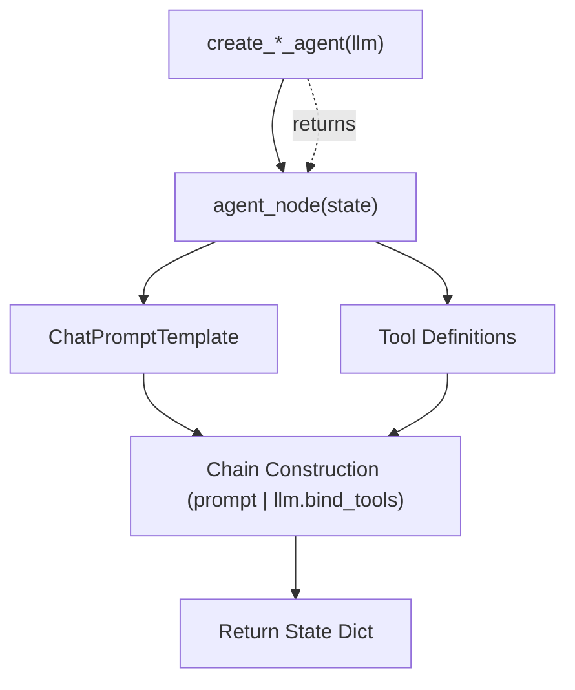
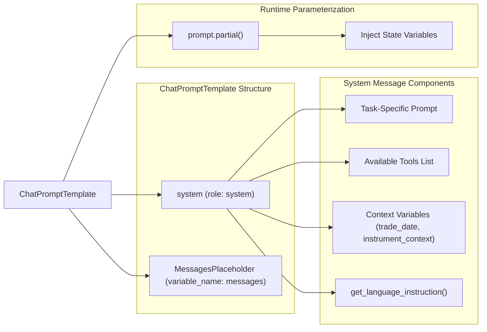
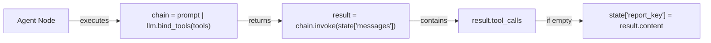

<!-- source: DeepWiki mcp.deepwiki.com · repo TauricResearch/TradingAgents · page 5.1 Agent Architecture Patterns · fetched 2026-10-29 -->

# Agent Architecture Patterns

<details>
<summary>Relevant source files</summary>

The following files were used as context for generating this wiki page:

- [tests/test_debate_opening.py](tests/test_debate_opening.py)
- [tests/test_i18n_coverage.py](tests/test_i18n_coverage.py)
- [tests/test_instrument_identity.py](tests/test_instrument_identity.py)
- [tests/test_prompt_integrity.py](tests/test_prompt_integrity.py)
- [tests/test_symbol_normalization_paths.py](tests/test_symbol_normalization_paths.py)
- [tradingagents/agents/context.py](tradingagents/agents/context.py)

</details>


## Purpose and Scope

This page documents the common architectural patterns used across all agent implementations in the `TradingAgents` system. These patterns establish a consistent structure for creating agents, managing their state, binding tools, ensuring multi-language output, and maintaining strict point-in-time instrument identity within the LangGraph workflow.

The architecture relies on a structured execution pipeline where agents transition from data retrieval and analysis through research debate, trading decision formulation, risk assessment, and portfolio approval.

Sources: [tradingagents/agents/context.py:1-166]()

## Factory Pattern

All agents in the system follow a consistent **factory pattern** where agent creation is encapsulated in `create_*` functions. These functions accept language model instances and return node functions compatible with LangGraph.



**Diagram: Factory Pattern Structure**

Each factory function:
1. Accepts an `llm` parameter representing the language model instance.
2. Defines an inner node function (e.g., `market_analyst_node(state)`) that takes the current `AgentState`.
3. Returns the node function for integration into the LangGraph orchestration flow.

Sources: [tradingagents/agents/context.py:1-166]()

## Prompt Template Architecture

Agents use LangChain's `ChatPromptTemplate` with a standardized structure consisting of a system message and a `MessagesPlaceholder` for conversation history.



**Diagram: Prompt Template Structure and Parameterization**

### Template Construction Pattern
The `.partial()` method injects state variables and configuration settings at runtime. This allows prompt templates to dynamically receive contextual data such as trade dates, instrument identity definitions, and language instructions.

Sources: [tradingagents/agents/context.py:14-49]()

## Tool Binding and Data Access

Agents gain access to specialized data retrieval capabilities through tool binding. Tools are categorized by domain (core stock, technical indicators, fundamental data, news, macro, and prediction markets) and attached to the LLM using `.bind_tools()`.



**Diagram: Code Entity Space (Agent-Tool Interaction)**

Sources: [tradingagents/agents/context.py:1-50]()

## State and Context Handling

The system uses specialized utilities in `tradingagents/agents/context.py` to manage multi-language output, instrument identity grounding, and debate turn openings.

### Multi-Language Output Support
The `get_language_instruction()` function retrieves the `output_language` from the global configuration [tradingagents/agents/context.py:23-24](). If the language is English (the default), it returns an empty string to avoid wasting token overhead [tradingagents/agents/context.py:25-26](). For non-English configurations, it injects a directive requiring the model to write its response in the target language while strictly preserving required formatting labels (such as `**Rating**:` and `FINAL TRANSACTION PROPOSAL`) in English [tradingagents/agents/context.py:30-34]().

```mermaid
graph TD
    A[Agent Node] --> B{get_language_instruction()};
    B --> C{output_language == "English"?};
    C -- Yes --> D[Return ""];
    C -- No --> E[Return Language Directive];
    D --> F[Prompt Construction];
    E --> F;
```
**Diagram: `get_language_instruction()` Data Flow**

Sources: [tradingagents/agents/context.py:14-34](), [tests/test_i18n_coverage.py:37-57]()

### Instrument Context and Identity Resolution
To prevent agents from hallucinating incorrect company profiles or confusing tickers, `resolve_instrument_identity(ticker)` fetches deterministic metadata (company name, sector, industry, exchange, quote type) via yfinance [tradingagents/agents/context.py:61-104](). Symbol normalization handles alternative asset formats such as `XAUUSD` mapping to `GC=F` [tests/test_symbol_normalization_paths.py:16-34]().

The `build_instrument_context(...)` utility constructs an explicit prompt segment instructing agents to adhere strictly to the resolved ticker and company metadata, ensuring cross-agent consistency throughout the analysis pipeline [tradingagents/agents/context.py:107-166]().

```mermaid
graph TD
    A[Ticker Input] --> B{resolve_instrument_identity(ticker)};
    B -- Calls --> C[yfinance Profile Lookup];
    C -- Returns --> D[Identity Metadata];
    D --> E{build_instrument_context(ticker, asset_type, identity)};
    E -- Generates --> F[Instrument Context String];
    F --> G[Agent Prompt];
```
**Diagram: Instrument Context Generation**

Sources: [tradingagents/agents/context.py:61-166](), [tests/test_instrument_identity.py:18-74]()

### Debate Opening Handling
In multi-agent debates and discussions, the first speaker in each round receives an empty opponent response. The `opponent_argument_or_opening(text, opponent)` utility intercepts empty responses and substitutes an explicit marker (e.g., `(The opponent has not spoken yet — open the debate with your own case.)`) to prevent language models from hallucinating opposing arguments [tradingagents/agents/context.py:37-49]().

Sources: [tradingagents/agents/context.py:37-49](), [tests/test_debate_opening.py:61-64]()

---

