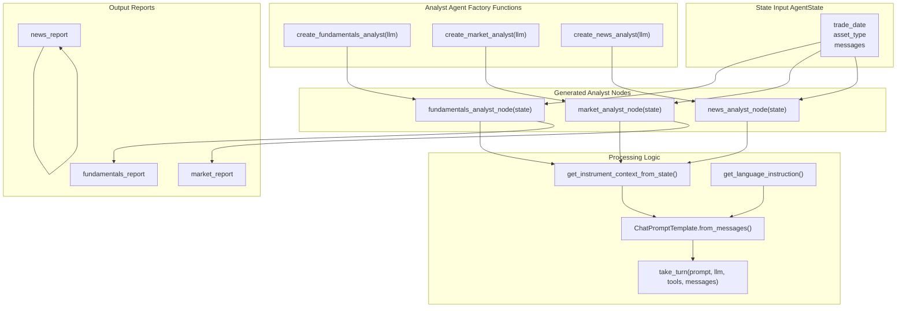
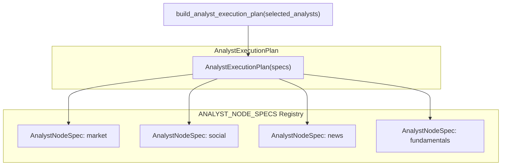

<!-- source: DeepWiki mcp.deepwiki.com · repo TauricResearch/TradingAgents · page 5.2 Analyst Agents · fetched 2026-10-29 -->

# Analyst Agents

<details>
<summary>Relevant source files</summary>

The following files were used as context for generating this wiki page:

- [cli/display.py](cli/display.py)
- [tests/test_analyst_execution.py](tests/test_analyst_execution.py)
- [tradingagents/agents/analysts/fundamentals_analyst.py](tradingagents/agents/analysts/fundamentals_analyst.py)
- [tradingagents/agents/analysts/market_analyst.py](tradingagents/agents/analysts/market_analyst.py)
- [tradingagents/agents/analysts/news_analyst.py](tradingagents/agents/analysts/news_analyst.py)
- [tradingagents/agents/analysts/turn.py](tradingagents/agents/analysts/turn.py)
- [tradingagents/graph/analyst_execution.py](tradingagents/graph/analyst_execution.py)
- [tradingagents/graph/conditional_logic.py](tradingagents/graph/conditional_logic.py)

</details>


This document covers the implementation and architecture of the specialized analyst agents that form the data analysis layer of the TradingAgents system. These agents are responsible for gathering, processing, and analyzing different types of financial data to generate comprehensive reports that inform trading decisions.

## Analyst Agent Architecture

The analyst agent system consists of specialized agents, each focused on a specific domain of financial analysis. All analysts follow a consistent architectural pattern using factory functions to create LangGraph-compatible nodes. These nodes process the shared `AgentState` and return specific report strings once their analysis is complete [tradingagents/agents/analysts/fundamentals_analyst.py:23-63](), [tradingagents/agents/analysts/market_analyst.py:15-84](), [tradingagents/agents/analysts/news_analyst.py:21-63]().

Title: Analyst Node Generation and Data Flow


Sources: [tradingagents/agents/analysts/fundamentals_analyst.py:23-63](), [tradingagents/agents/analysts/market_analyst.py:15-84](), [tradingagents/agents/analysts/news_analyst.py:21-63]()

## Individual Analyst Implementations

### Fundamentals Analyst

The `fundamentals_analyst_node` analyzes core financial health and corporate governance [tradingagents/agents/analysts/fundamentals_analyst.py:24-29]().

| Aspect | Implementation Details |
|--------|----------------------|
| Factory Function | `create_fundamentals_analyst(llm)` [tradingagents/agents/analysts/fundamentals_analyst.py:23-23]() |
| Bound Tools | `get_fundamentals`, `get_balance_sheet`, `get_cashflow`, `get_income_statement`, `get_insider_transactions` [tradingagents/agents/analysts/fundamentals_analyst.py:14-20]() |
| Output Key | `fundamentals_report` [tradingagents/agents/analysts/fundamentals_analyst.py:61-61]() |
| Report Content | Financial documents, company profile, basic financials, and insider transactions [tradingagents/agents/analysts/fundamentals_analyst.py:28-31]() |

Sources: [tradingagents/agents/analysts/fundamentals_analyst.py:1-64]()

### Market Analyst

The `market_analyst_node` performs technical analysis, selecting up to 8 complementary indicators across categories such as Moving Averages, MACD, Momentum, Volatility, and Volume-Based indicators [tradingagents/agents/analysts/market_analyst.py:21-46]().

| Aspect | Implementation Details |
|--------|----------------------|
| Factory Function | `create_market_analyst(llm)` [tradingagents/agents/analysts/market_analyst.py:15-15]() |
| Bound Tools | `get_stock_data`, `get_indicators`, `get_verified_market_snapshot` [tradingagents/agents/analysts/market_analyst.py:8-12]() |
| Source of Truth | `get_verified_market_snapshot` is treated as the source of truth for exact price levels and OHLCV data [tradingagents/agents/analysts/market_analyst.py:48-48]() |
| Output Key | `market_report` [tradingagents/agents/analysts/market_analyst.py:81-81]() |

The analyst is instructed to call `get_stock_data` first to retrieve the necessary CSV before calling `get_indicators` [tradingagents/agents/analysts/market_analyst.py:46-46]().

Sources: [tradingagents/agents/analysts/market_analyst.py:1-84]()

### News Analyst

The `news_analyst_node` provides macroeconomic context and news tracking, differentiating between company-specific news and broader global trends [tradingagents/agents/analysts/news_analyst.py:21-32]().

| Aspect | Implementation Details |
|--------|----------------------|
| Factory Function | `create_news_analyst(llm)` [tradingagents/agents/analysts/news_analyst.py:21-21]() |
| Bound Tools | `get_news`, `get_global_news`, `get_macro_indicators`, `get_prediction_markets` [tradingagents/agents/analysts/news_analyst.py:13-18]() |
| Output Key | `news_report` [tradingagents/agents/analysts/news_analyst.py:60-60]() |
| Analysis Focus | Recent news trends, macroeconomic state via FRED indicators, and prediction market probabilities [tradingagents/agents/analysts/news_analyst.py:28-29]() |

Sources: [tradingagents/agents/analysts/news_analyst.py:1-63]()

## Execution Planning and Turn Management

The system uses an `AnalystExecutionPlan` to manage which analysts run and their corresponding graph node configurations [tradingagents/graph/analyst_execution.py:16-18]().

### Execution Specifications

Each analyst is defined by an `AnalystNodeSpec` which maps internal keys to graph node names, report keys, and tool sets [tradingagents/graph/analyst_execution.py:7-13]().

* **Market**: `market` -> `Market Analyst` (reports to `market_report`) [tradingagents/graph/analyst_execution.py:21-26]()
* **Sentiment**: `social` -> `Sentiment Analyst` (reports to `sentiment_report`, pre-fetches sources without tools) [tradingagents/graph/analyst_execution.py:27-33]()
* **News**: `news` -> `News Analyst` (reports to `news_report`) [tradingagents/graph/analyst_execution.py:34-39]()
* **Fundamentals**: `fundamentals` -> `Fundamentals Analyst` (reports to `fundamentals_report`) [tradingagents/graph/analyst_execution.py:40-45]()

Title: Analyst Execution Plan Structure


Sources: [tradingagents/graph/analyst_execution.py:1-63]()

### Turn-Taking Mechanics (`analysts/turn.py`)

Analyst execution during tool rounds is managed by `take_turn` in `tradingagents/agents/analysts/turn.py` [tradingagents/agents/analysts/turn.py:13-27]().

* **`take_turn(prompt, llm, tools, messages)`**: Binds tools to the LLM and invokes it with the message history [tradingagents/agents/analysts/turn.py:13-27](). If tool rounds are exhausted and a wrap-up message (`WRAP_UP`) is reached, it invokes the model without tool bindings, formatting previous tool calls and outputs as plain text via `_as_text` [tradingagents/agents/analysts/turn.py:20-27]().
* **`_as_text(messages)`**: Converts tool call histories and `ToolMessage` outputs into plain text `HumanMessage` and `AIMessage` objects to ensure compatibility with providers that reject tool history when tools are unbound [tradingagents/agents/analysts/turn.py:30-42]().

Sources: [tradingagents/agents/analysts/turn.py:1-42]()

## Report Generation Process and Date Anchoring

### Date-Anchored Prompts

Analysts that use tool-calling include explicit date anchoring in their prompts to prevent models from using training cutoff dates for time-sensitive data requests [tradingagents/agents/analysts/market_analyst.py:65](), [tradingagents/agents/analysts/news_analyst.py:44](), [tradingagents/agents/analysts/fundamentals_analyst.py:45]():

```text
Today's date is {current_date}; treat it as 'now' for all analysis and tool-call date ranges.
```

### Final Report Extraction

When an analyst node executes, it invokes the model using `take_turn` [tradingagents/agents/analysts/market_analyst.py:77](), [tradingagents/agents/analysts/news_analyst.py:56](), [tradingagents/agents/analysts/fundamentals_analyst.py:57](). If the result contains tool calls, the report string remains empty (`""`), and graph conditional logic routes execution to the tool execution node [tradingagents/agents/analysts/turn.py:27](). Once tool rounds are complete and the model produces a text response without tool calls, that text is captured as the final report [tradingagents/agents/analysts/turn.py:27]().

Sources: [tradingagents/agents/analysts/market_analyst.py:77-82](), [tradingagents/agents/analysts/news_analyst.py:56-61](), [tradingagents/agents/analysts/fundamentals_analyst.py:57-62](), [tradingagents/agents/analysts/turn.py:13-28]()

---

