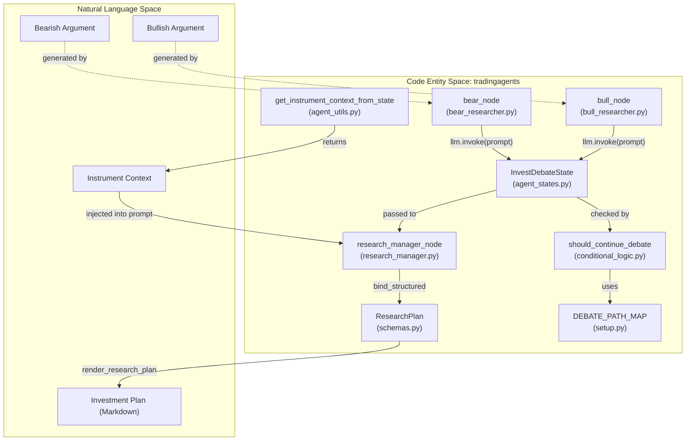
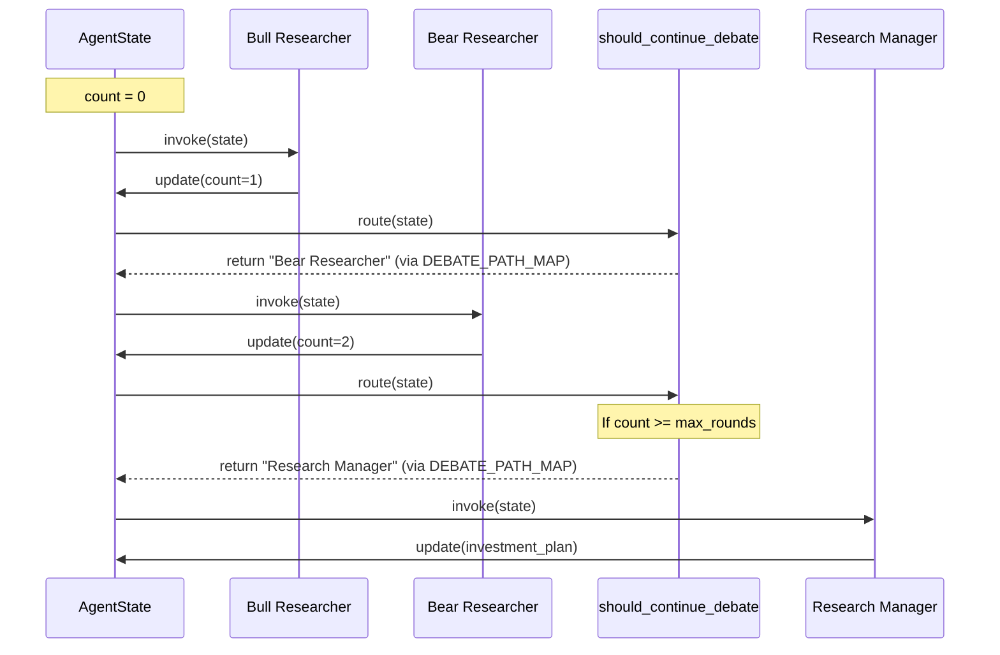

<!-- source: DeepWiki mcp.deepwiki.com · repo TauricResearch/TradingAgents · page 5.3 Researcher and Debate System · fetched 2026-10-29 -->

# Researcher and Debate System

Relevant source files

The following files were used as context for generating this wiki page:

- [tradingagents/agents/managers/portfolio_manager.py](tradingagents/agents/managers/portfolio_manager.py)
- [tradingagents/agents/managers/research_manager.py](tradingagents/agents/managers/research_manager.py)
- [tradingagents/agents/researchers/bear_researcher.py](tradingagents/agents/researchers/bear_researcher.py)
- [tradingagents/agents/researchers/bull_researcher.py](tradingagents/agents/researchers/bull_researcher.py)
- [tradingagents/agents/trader/trader.py](tradingagents/agents/trader/trader.py)

## Purpose and Scope

The Researcher and Debate System implements adversarial reasoning through structured debates between bull (optimistic) and bear (pessimistic) researchers. This system critically evaluates the insights produced by the Analyst Team through multi-round debates, ultimately producing a balanced research conclusion and investment plan that informs trading decisions.

This page covers the debate mechanism, researcher agent roles, round management, crash-safe routing via `DEBATE_PATH_MAP`, and the structured output of the Research Manager.

**Sources:** [tradingagents/agents/managers/research_manager.py:1-46](), [tradingagents/agents/researchers/bull_researcher.py:27-45](), [tradingagents/agents/researchers/bear_researcher.py:27-47]()

---

## Debate Architecture Overview

The debate system creates a structured adversarial environment where two specialized researchers examine the same market data from opposing perspectives. This multi-agent debate pattern ensures comprehensive risk assessment and prevents confirmation bias.

### System Components

| Component | Role | Key Responsibility | File Pointer |
|-----------|------|-------------------|--------------|
| **Bull Researcher** | Optimistic Perspective | Identifies growth opportunities, positive catalysts, and upside potential. | [tradingagents/agents/researchers/bull_researcher.py:9-65]() |
| **Bear Researcher** | Pessimistic Perspective | Identifies risks, downside scenarios, and reasons for caution. | [tradingagents/agents/researchers/bear_researcher.py:10-67]() |
| **Research Manager** | Debate Facilitator & Judge | Evaluates arguments, makes a definitive decision using a 5-tier scale, and creates an investment plan. | [tradingagents/agents/managers/research_manager.py:17-74]() |
| **InvestDebateState** | State Container | Tracks `history`, `bull_history`, `bear_history`, `current_response`, and `count`. | [tradingagents/agents/researchers/bull_researcher.py:11-12](), [tradingagents/agents/researchers/bull_researcher.py:51-57]() |
| **DEBATE_PATH_MAP** | Crash-Safety Map | Maps all possible router returns to valid graph nodes to prevent mid-run failures. | [tradingagents/graph/setup.py:32-36]() |

### Code Entity Space Mapping

**Diagram: Mapping Concepts to Code Nodes**

**Sources:** [tradingagents/agents/researchers/bull_researcher.py:9-65](), [tradingagents/agents/researchers/bear_researcher.py:10-67](), [tradingagents/agents/managers/research_manager.py:17-74](), [tradingagents/graph/setup.py:32-36](), [tradingagents/agents/context.py:1-11]()

---

## Researcher Agent Roles

### Bull Researcher (`bull_node`)
The bull researcher advocates for investing by focusing on growth potential, competitive advantages, and positive indicators. It leverages the market, sentiment, news, and fundamentals reports [tradingagents/agents/researchers/bull_researcher.py:18-21](). It specifically engages with the `current_response` (the last bear argument) to refute concerns [tradingagents/agents/researchers/bull_researcher.py:46-47]().

### Bear Researcher (`bear_node`)
The bear researcher emphasizes risks, financial instability, and competitive weaknesses [tradingagents/agents/researchers/bear_researcher.py:31-33](). It is tasked with exposing over-optimistic assumptions in the bull's case by analyzing the `current_response` (the last bull argument) [tradingagents/agents/researchers/bear_researcher.py:48-49]().

### Debate Opening Behavior
A critical aspect of the debate system is how agents handle the initial round when no opponent argument exists. The `opponent_argument_or_opening` utility function [tradingagents/agents/context.py:4]() ensures that the first speaker in a debate round does not attempt to rebut a non-existent argument. Instead, it inserts a placeholder like "has not spoken yet" into the prompt. This prevents the LLM from fabricating an opponent's position, leading to more grounded and realistic debate progression. When a real argument is present, it is passed through unchanged.

### Instrument Context
Both researchers and the manager use `get_instrument_context_from_state` to include specific details about the ticker symbol, ensuring the LLM is aware of the specific company or crypto asset of interest [tradingagents/agents/researchers/bull_researcher.py:22-22](), [tradingagents/agents/managers/research_manager.py:21-21]().

**Sources:** [tradingagents/agents/researchers/bull_researcher.py:27-45](), [tradingagents/agents/researchers/bear_researcher.py:27-47](), [tradingagents/agents/managers/research_manager.py:21-21](), [tradingagents/agents/context.py:1-11]()

---

## Debate Flow and State Management

### State Transitions
The debate progresses by updating the `InvestDebateState` within the global `AgentState`. Each researcher node appends its argument to the shared history and increments the round count.

| Field | Update Logic | Source |
|-------|--------------|--------|
| `history` | `history + "\n" + argument` | [tradingagents/agents/researchers/bull_researcher.py:56]() |
| `bull_history` | `bull_history + "\n" + argument` | [tradingagents/agents/researchers/bull_researcher.py:57]() |
| `bear_history` | `bear_history + "\n" + argument` | [tradingagents/agents/researchers/bear_researcher.py:59]() |
| `count` | `investment_debate_state["count"] + 1` | [tradingagents/agents/researchers/bull_researcher.py:60]() |
| `current_response`| Stores the very last argument for the next agent | [tradingagents/agents/researchers/bear_researcher.py:61]() |

### Crash-Safe Routing
To prevent `LangGraph` from crashing due to unexpected speaker labels (e.g., from translation or refactor drift), the system uses `DEBATE_PATH_MAP`. This map explicitly defines all valid targets for the debate router [tradingagents/graph/setup.py:32-36]().

**Diagram: Node Interaction and State Update Sequence**

**Sources:** [tradingagents/agents/researchers/bull_researcher.py:55-63](), [tradingagents/agents/researchers/bear_researcher.py:57-65](), [tradingagents/graph/setup.py:32-36]()

---

## Research Manager Synthesis

### The "Judge" Role and Structured Output
The `research_manager_node` acts as the final arbiter. It uses `bind_structured` to wrap the LLM with the `ResearchPlan` schema [tradingagents/agents/managers/research_manager.py:14-15](). This ensures the output is a typed object containing a recommendation, rationale, and strategic actions [tradingagents/agents/managers/research_manager.py:43-51]().

### 5-Tier Rating Scale
The manager must choose exactly one rating from the defined scale [tradingagents/agents/managers/research_manager.py:29-34]():
*   **Buy**: Strong conviction in the bull thesis.
*   **Overweight**: Constructive view; gradually increase exposure.
*   **Hold**: Balanced view; maintain current position.
*   **Underweight**: Cautious view; trim exposure.
*   **Sell**: Strong conviction in the bear thesis.

The manager is explicitly instructed to reserve **Hold** for genuinely balanced evidence and to commit to a clear stance whenever the debate's strongest arguments warrant one [tradingagents/agents/managers/research_manager.py:36-36]().

### Strategic Hand-off
The `investment_plan` generated by the manager is stored in the global state [tradingagents/agents/managers/research_manager.py:69-72](). This plan is then retrieved by the `trader_node` to formulate a concrete transaction proposal [tradingagents/agents/trader/trader.py:26-33]().

**Sources:** [tradingagents/agents/managers/research_manager.py:14-74](), [tradingagents/agents/trader/trader.py:20-98](), [tradingagents/agents/structured.py:13-20]()

---

## Configuration: max_debate_rounds

The length of the debate is governed by the `max_debate_rounds` configuration parameter.

- **Round Tracking**: Each researcher incrementing the `count` allows the graph orchestrator to determine when to transition from the researcher loop to the `Research Manager` [tradingagents/agents/researchers/bull_researcher.py:60]().
- **Adversarial Refinement**: More rounds allow researchers to specifically address counterpoints. This iterative process forces the LLMs to move beyond surface-level data and engage with the weaknesses of their respective positions.

**Sources:** [tradingagents/agents/researchers/bull_researcher.py:55-63](), [tradingagents/agents/researchers/bear_researcher.py:57-65]()

---

