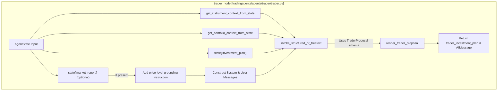
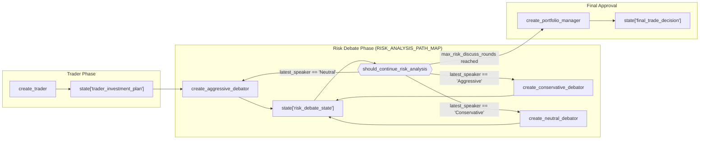

<!-- source: DeepWiki mcp.deepwiki.com · repo TauricResearch/TradingAgents · page 5.4 Trader and Risk Management Agents · fetched 2026-10-29 -->

# Trader and Risk Management Agents

Relevant source files

The following files were used as context for generating this wiki page:

- [tests/test_risk_router_path_map.py](tests/test_risk_router_path_map.py)
- [tradingagents/agents/managers/portfolio_manager.py](tradingagents/agents/managers/portfolio_manager.py)
- [tradingagents/agents/managers/research_manager.py](tradingagents/agents/managers/research_manager.py)
- [tradingagents/agents/risk_mgmt/aggressive_debator.py](tradingagents/agents/risk_mgmt/aggressive_debator.py)
- [tradingagents/agents/risk_mgmt/conservative_debator.py](tradingagents/agents/risk_mgmt/conservative_debator.py)
- [tradingagents/agents/risk_mgmt/neutral_debator.py](tradingagents/agents/risk_mgmt/neutral_debator.py)
- [tradingagents/agents/trader/trader.py](tradingagents/agents/trader/trader.py)

## Purpose and Scope

This document details the **Trader Agent** and the **Risk Management Team**, which comprise the final stages of the `TradingAgents` decision pipeline. The Trader Agent synthesizes analyst reports and research outputs into a concrete transaction proposal using structured output with price-level entry and stop-loss grounding. The Risk Management Team then evaluates this proposal through a multi-perspective debate (Aggressive, Conservative, and Neutral) managed via `RiskDebateState` and `RISK_ANALYSIS_PATH_MAP` routing before a final portfolio approval and decision is reached by the Portfolio Manager against real portfolio holdings.

The system incorporates historical context via the `TradingMemoryLog`, providing lessons learned from prior decisions directly to the Portfolio Manager [tradingagents/agents/managers/portfolio_manager.py:35-41]().

---

## Trader Agent Architecture

### Role and Responsibilities

The Trader Agent acts as the bridge between research strategy and execution. It transforms the Research Manager's investment plan into a concrete transaction proposal.

**Key Responsibilities:**
- **Decision Synthesis**: Consumes the `investment_plan` and `instrument_context` to formulate a transaction [tradingagents/agents/trader/trader.py:24-27]().
- **Price-Level Grounding**: Explicitly instructed to ground entry, stop-loss, and position sizing in concrete price levels derived from the `market_report` (e.g., current price, support/resistance, ATR) [tradingagents/agents/trader/trader.py:31-42](). It converts percentage-based levels to absolute prices or omits them if a numerical price cannot be stated [tradingagents/agents/trader/trader.py:57-61]().
- **Structured Proposal**: Produces a `TraderProposal` containing an action (Buy/Hold/Sell), reasoning, and execution levels [tradingagents/agents/schemas.py:9-10]().
- **Constraint Enforcement**: Explicitly includes the `NO_EXTERNAL_TOOLS` instruction to prevent the LLM from attempting tool calls during the structured output phase [tradingagents/agents/trader/trader.py:60]().
- **Graceful Fallback**: Uses `invoke_structured_or_freetext` to ensure a decision is reached even if the LLM provider fails to return valid JSON [tradingagents/agents/trader/trader.py:85-91]().

### Implementation and Data Flow

The `trader_node` is generated via the `create_trader` factory [tradingagents/agents/trader/trader.py:20](). It uses `bind_structured` to attach the `TraderProposal` schema to the LLM [tradingagents/agents/trader/trader.py:21](). The `market_report` is conditionally included in the prompt to provide grounding for price levels [tradingagents/agents/trader/trader.py:35-44]().

**Diagram: Trader Node Logic Flow**

**Sources:** [tradingagents/agents/trader/trader.py:20-98](), [tradingagents/agents/schemas.py:9-12]()

---

## Risk Management Team

The Risk Management phase introduces a checks-and-balances system where the Trader's plan is scrutinized by three specialized analysts with conflicting risk appetites, coordinated via `RiskDebateState`.

### The Risk Debate Perspectives

The system uses three distinct nodes to simulate a professional risk committee. These nodes update the `RiskDebateState` dictionary tracking conversation history, individual analyst histories, latest speaker, and round counts [tradingagents/agents/risk_mgmt/aggressive_debator.py:52-65](), [tradingagents/agents/risk_mgmt/conservative_debator.py:52-66](), [tradingagents/agents/risk_mgmt/neutral_debator.py:52-64]().

| Agent | File Path | Philosophy |
| :--- | :--- | :--- |
| **Aggressive Analyst** | [tradingagents/agents/risk_mgmt/aggressive_debator.py]() | Champions high-reward opportunities; critiques caution as missed growth [tradingagents/agents/risk_mgmt/aggressive_debator.py:31-32](). Actively counters conservative and neutral arguments [tradingagents/agents/risk_mgmt/aggressive_debator.py:45-46](). |
| **Conservative Analyst** | [tradingagents/agents/risk_mgmt/conservative_debator.py]() | Prioritizes capital preservation; highlights volatility and downside risks [tradingagents/agents/risk_mgmt/conservative_debator.py:31-32](). Actively counters aggressive and neutral arguments [tradingagents/agents/risk_mgmt/conservative_debator.py:45-46](). |
| **Neutral Analyst** | [tradingagents/agents/risk_mgmt/neutral_debator.py]() | Seeks a balanced approach; challenges both over-optimism and over-caution [tradingagents/agents/risk_mgmt/neutral_debator.py:31-32](). Actively challenges aggressive and conservative arguments [tradingagents/agents/risk_mgmt/neutral_debator.py:45-46](). |

Each debator receives the `trader_investment_plan` and the four analyst reports (`market_report`, `sentiment_report`, `news_report`, `fundamentals_report`) as context [tradingagents/agents/risk_mgmt/neutral_debator.py:23-30](). They also receive `instrument_context` and `portfolio_context` to ground their arguments [tradingagents/agents/risk_mgmt/neutral_debator.py:27-28](). The `opponent_argument_or_opening` utility ensures that if an opponent has not spoken yet, the debator presents their own opening argument based on data [tradingagents/agents/risk_mgmt/neutral_debator.py:16-21]().

**Sources:** [tradingagents/agents/risk_mgmt/aggressive_debator.py:10-68](), [tradingagents/agents/risk_mgmt/conservative_debator.py:10-70](), [tradingagents/agents/risk_mgmt/neutral_debator.py:10-68]()

### Portfolio Manager (Judge) and Portfolio Approval

The `portfolio_manager_node` acts as the final judge. It synthesizes the risk debate and historical lessons into a final `PortfolioDecision` [tradingagents/agents/managers/portfolio_manager.py:26-34]().

**Decision Logic:**
1. **Context Gathering**: Retrieves `risk_debate_state["history"]`, `investment_plan`, and `trader_plan` [tradingagents/agents/managers/portfolio_manager.py:30-33]().
2. **Historical Injection**: Incorporates `past_context` (lessons from prior outcomes retrieved from `TradingMemoryLog`) directly into the prompt [tradingagents/agents/managers/portfolio_manager.py:35-41]().
3. **Structured Output**: Uses the `PortfolioDecision` schema to produce a 5-tier rating (Buy, Overweight, Hold, Underweight, Sell), an executive summary, and an investment thesis [tradingagents/agents/managers/portfolio_manager.py:24-55]().
4. **Rendering**: Converts the structured Pydantic object back to markdown via `render_pm_decision` for storage and UI display [tradingagents/agents/managers/portfolio_manager.py:82]().
5. **Portfolio Approval Against Real Holdings**: The Portfolio Manager evaluates the decision with full awareness of the current `portfolio_context` (cash, currency, positions), sizing adjustments against actual holdings rather than assuming a flat book [tradingagents/agents/managers/portfolio_manager.py:28]().

**Sources:** [tradingagents/agents/managers/portfolio_manager.py:23-106]()

---

## Technical Integration

### State Transition and Orchestration

The transition from the Trader's synthesis to the Risk Management debate is managed within the graph. The debate cycles through the three analysts until the configured round limit is reached. `RISK_ANALYSIS_PATH_MAP` ensures crash-safety by mapping all possible return values from the `should_continue_risk_analysis` router to valid target nodes [tests/test_risk_router_path_map.py:1-14](). This map covers all variant speaker labels and the terminal "Portfolio Manager" state [tests/test_risk_router_path_map.py:25-37]().

**Diagram: Transition from Trader Synthesis to Portfolio Approval with RISK_ANALYSIS_PATH_MAP**

**Sources:** [tradingagents/agents/trader/trader.py:20-98](), [tradingagents/agents/risk_mgmt/aggressive_debator.py:10-68](), [tradingagents/agents/risk_mgmt/conservative_debator.py:10-70](), [tradingagents/agents/risk_mgmt/neutral_debator.py:10-68](), [tradingagents/agents/managers/portfolio_manager.py:23-106](), [tests/test_risk_router_path_map.py:11-57]()

### Signal Processing and Rating Heuristics

Once the Portfolio Manager issues a decision, the system extracts the canonical 5-tier rating for downstream systems.

- **Rating Scale**: Enforces a strict 5-tier scale: **Buy**, **Overweight**, **Hold**, **Underweight**, **Sell** [tradingagents/agents/managers/portfolio_manager.py:50-55]().
- **Reliability**: Validates the rating against the `PortfolioDecision` schema before rendering to markdown [tradingagents/agents/managers/portfolio_manager.py:24-83]().
- **Constraint Consistency**: All decision agents include the `NO_EXTERNAL_TOOLS` constraint in their prompts to avoid hallucinated tool calls [tradingagents/agents/trader/trader.py:60](), [tradingagents/agents/managers/portfolio_manager.py:76]().

**Sources:** [tradingagents/agents/managers/portfolio_manager.py:23-106](), [tradingagents/agents/trader/trader.py:20-98]()

---

