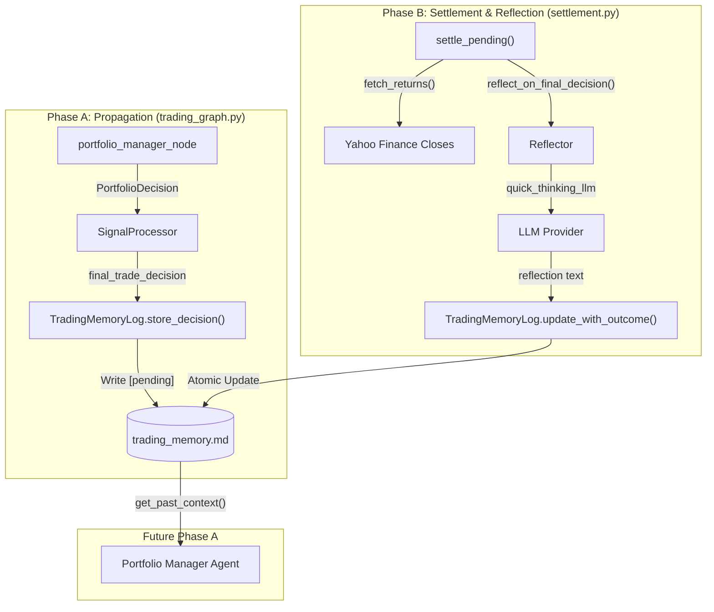

<!-- source: DeepWiki mcp.deepwiki.com · repo TauricResearch/TradingAgents · page 5.5 Memory and Decision Log · fetched 2026-10-29 -->

# Memory and Decision Log

<details>
<summary>Relevant source files</summary>

The following files were used as context for generating this wiki page:

- [tests/test_cache_writes.py](tests/test_cache_writes.py)
- [tests/test_memory_log.py](tests/test_memory_log.py)
- [tradingagents/dataflows/files.py](tradingagents/dataflows/files.py)
- [tradingagents/graph/trading_graph.py](tradingagents/graph/trading_graph.py)
- [tradingagents/memory/log.py](tradingagents/memory/log.py)
- [tradingagents/memory/reflection.py](tradingagents/memory/reflection.py)
- [tradingagents/memory/settlement.py](tradingagents/memory/settlement.py)

</details>


## Purpose and Scope

This document explains the **TradingMemoryLog** system, which provides a persistent, append-only markdown record of all trading decisions and their subsequent performance reflections. Managed in `tradingagents/memory/log.py`, this system offers a human-readable and robust audit trail for multi-agent trading sessions [tradingagents/memory/log.py:1-12]().

The memory system operates across a two-phase lifecycle: **Phase A (Propagation)**, where decisions are recorded as `pending`, and **Phase B (Reflection/Settlement)**, where realized market returns are evaluated against a benchmark to generate LLM-powered reflections that are injected into future agent prompt contexts [tradingagents/memory/log.py:32-143](), [tradingagents/memory/settlement.py:1-147]().

Sources: [tradingagents/memory/log.py:1-12](), [tradingagents/memory/settlement.py:1-147]()

---

## Architecture and Data Flow

The `TradingMemoryLog` manages the decision log file (typically configured via `memory_log_path`). It handles structured markdown parsing via precompiled regex patterns, atomic file updates via `tradingagents/dataflows/files.py`, and cross-thread/cross-process locking [tradingagents/memory/log.py:13-29](), [tradingagents/dataflows/files.py:14-50]().

### Decision-to-Reflection Lifecycle Diagram



Sources: [tradingagents/memory/log.py:32-143](), [tradingagents/memory/settlement.py:109-147](), [tradingagents/memory/reflection.py:36-63](), [tradingagents/graph/trading_graph.py:82]()

---

## TradingMemoryLog Implementation

The `TradingMemoryLog` class structures log entries separated by hard delimiters (`_SEPARATOR = "\n\n<!-- ENTRY_END -->\n\n"`) to prevent parsing ambiguities from LLM prose output [tradingagents/memory/log.py:11-18]().

### Key Class Methods

| Method | Role | Implementation Detail |
|:---|:---|:---|
| `store_decision` | **Phase A Write** | Appends a new block with a `[pending]` tag and the `DECISION:` text [tradingagents/memory/log.py:32-60](). Includes an idempotency guard that scans for existing entries of the same date/ticker to prevent duplicate evaluations [tradingagents/memory/log.py:46-55](). |
| `update_with_outcome` | **Phase B Update** | Replaces the `pending` tag with realized returns and appends a `REFLECTION:` section via atomic write [tradingagents/memory/log.py:134-165](). |
| `get_past_context` | **Read/Injection** | Retrieves $N$ same-ticker and $M$ cross-ticker entries for agent prompt injection, supporting point-in-time filtering [tradingagents/memory/log.py:89-130](). |
| `settling` | **Locking Context** | Acquires an exclusive settlement lock (`.settle`) so concurrent runs never duplicate reflection API costs [tradingagents/memory/log.py:62-73](). |

Sources: [tradingagents/memory/log.py:11-165]()

### Entry Structure
A completed entry in the log follows this format:
```markdown
[2026-01-10 | NVDA | Buy | +5.2% | +1.1% | 5d | resolved:2026-01-17]

DECISION:
Rating: Buy
... (Full Portfolio Manager Output) ...

REFLECTION:
The decision to buy was correct as data center demand exceeded expectations. However, the entry price was slightly high.

<!-- ENTRY_END -->
```
The `resolved:YYYY-MM-DD` tag records when the outcome became known, maintaining point-in-time integrity [tradingagents/memory/log.py:142-143]().

Sources: [tradingagents/memory/log.py:134-165]()

---

## Deferred Reflection and Idempotent Settlement

Trading decisions are initially stored without performance metrics (`pending`). Once the holding window specified by `holding_period_days` has elapsed, outcomes are settled asynchronously during subsequent runs via `settle_pending` [tradingagents/memory/settlement.py:109-147]().

1. **Benchmark Resolution**: `resolve_benchmark` selects the appropriate baseline index (e.g., `SPY` for US equities, regional equivalents via `benchmark_map`, or an explicit `benchmark_ticker`) [tradingagents/memory/settlement.py:14-36]().
2. **Return Calculation**: `fetch_returns` computes the raw price change of the asset and compares it against the benchmark over the exact trading sessions spanned by `holding_days` [tradingagents/memory/settlement.py:52-98]().
3. **Idempotent Settlement**: If a settlement pass is interrupted or executed concurrently across processes, atomic operations ensure entries are marked as resolved only once, preventing duplicate scoring [tradingagents/memory/log.py:134-165](), [tradingagents/memory/settlement.py:109-147]().

Sources: [tradingagents/memory/settlement.py:1-147]()

---

## Context Injection and Point-in-Time Constraints

During agent execution, `get_past_context` builds injection strings from historical memory entries [tradingagents/memory/log.py:89-130]().

### Point-in-Time Constraints
To prevent look-ahead bias during backtesting, `get_past_context` accepts an `as_of` parameter [tradingagents/memory/log.py:93-94](). When specified, only entries whose `resolved` date is on or before `as_of` are injected [tradingagents/memory/log.py:98-107](). Live runs set `as_of=None` to disable this filter [tradingagents/memory/log.py:101-103](). The graph automatically derives this cutoff using `TradingAgentsGraph._memory_as_of` [tradingagents/graph/trading_graph.py:130-139]().

### Injection Composition
The injection combines two tiers of experience:
* **Same-Ticker History**: The last $N$ (default 5) analyses of the target ticker [tradingagents/memory/log.py:111-116]().
* **Cross-Ticker Lessons**: The last $M$ (default 3) reflections from alternative tickers [tradingagents/memory/log.py:117-119]().

Sources: [tradingagents/memory/log.py:89-130](), [tradingagents/graph/trading_graph.py:130-139]()

---

## Log Rotation (`memory_log_max_entries`)

The memory log supports size management via the `memory_log_max_entries` configuration setting [tradingagents/memory/log.py:27-28](). When configured, the system prunes older resolved entries while strictly preserving all `pending` entries to guarantee that every executed trade eventually receives an outcome reflection and settles properly [tradingagents/memory/log.py:27-28]().

Sources: [tradingagents/memory/log.py:27-28]()

---

