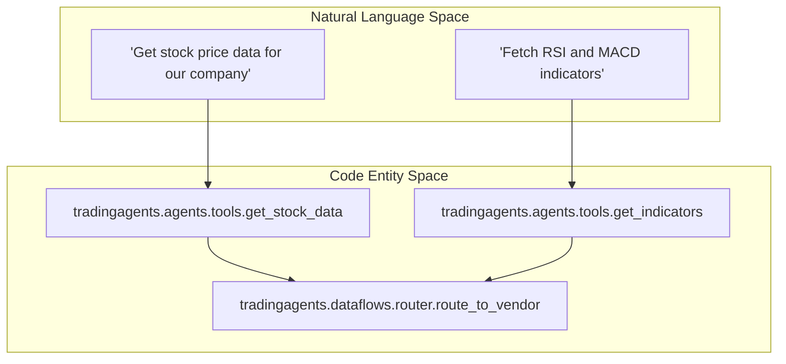
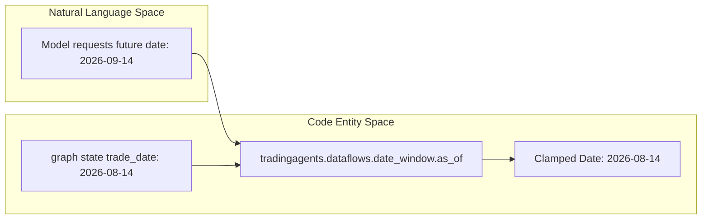

<!-- source: DeepWiki mcp.deepwiki.com · repo TauricResearch/TradingAgents · page 5.6 Agent Tools and Utilities · fetched 2026-10-29 -->

# Agent Tools and Utilities

Relevant source files

The following files were used as context for generating this wiki page:

- [tests/test_get_scrubbed.py](tests/test_get_scrubbed.py)
- [tests/test_news_analyst_prompt.py](tests/test_news_analyst_prompt.py)
- [tests/test_tool_date_enforcement.py](tests/test_tool_date_enforcement.py)
- [tradingagents/agents/tools.py](tradingagents/agents/tools.py)

## Purpose and Scope

This page documents the agent tool system that provides standardized access to market data, news, fundamentals, and technical analysis. It covers the per-category tool modules, `@tool` decorators, run-date enforcement to prevent look-ahead bias, structured output helpers, and state management utilities such as `create_msg_delete`.

---

## Tool Organization and Architecture

Agent capabilities are exposed via LangChain `@tool` decorators defined in `tradingagents/agents/tools.py`. These tools automatically inject context variables from the graph state—such as `company_of_interest` and `trade_date`—using LangGraph's `InjectedState` [tradingagents/agents/tools.py:19-24]().

**Sources:** [tradingagents/agents/tools.py:1-162]()

---

## Run-Date Enforcement and Point-in-Time Integrity

To prevent look-ahead bias, all dated tools enforce point-in-time integrity using the `trade_date` injected from graph state [tradingagents/agents/tools.py:3-5](). The `trade_date` and instrument identity are hidden from the model-visible tool call schema, ensuring that models cannot bypass historical constraints by passing future dates or external tickers [tests/test_tool_date_enforcement.py:67-85]().

*   **`as_of()`**: Clamps any requested date to be no later than the run's `trade_date` [tests/test_tool_date_enforcement.py:32-33]().
*   **`as_of_window()`**: Adjusts date ranges (`start_date`, `end_date`) to ensure the `end_date` does not exceed `trade_date` [tests/test_tool_date_enforcement.py:47-48]().

**Sources:** [tradingagents/agents/tools.py:3-5](), [tests/test_tool_date_enforcement.py:1-172]()

---

## Per-Category Tool Modules

Tools are categorized by domain to serve different analyst roles:

*   **Core Stock Data**: `get_stock_data()` retrieves OHLCV price series over an enforced date range [tradingagents/agents/tools.py:19-38]().
*   **Technical Indicators**: `get_indicators()` parses single or comma-separated indicator requests and retrieves historical indicator data [tradingagents/agents/tools.py:42-69]().
*   **Market Validation**: `get_verified_market_snapshot()` provides a deterministic verification snapshot for exact price and indicator claims [tradingagents/agents/tools.py:73-95]().
*   **Fundamental Data**: `get_fundamentals()`, `get_balance_sheet()`, `get_cashflow()`, and `get_income_statement()` retrieve point-in-time financial statements and fundamental metrics [tradingagents/agents/tools.py:98-162]().

**Sources:** [tradingagents/agents/tools.py:1-162]()

---

## Structured Output and State Utilities

The tool and agent ecosystem relies on robust output parsing and state maintenance helpers:

*   **Structured Output & Fallbacks**: Utilizes Pydantic schemas (`ResearchPlan`, `TraderProposal`, `PortfolioDecision`) with helpers like `bind_structured()` and `invoke_structured_or_freetext()` to guarantee robust parsing even when LLM providers do not natively support structured outputs.
*   **Message Management**: Utilities like `create_msg_delete()` clear conversation history using `RemoveMessage` operations and append placeholder messages, preventing context window bloat and ensuring compatibility across LLM providers (e.g., Anthropic).

**Sources:** [tradingagents/agents/tools.py:1-162](), [tests/test_tool_date_enforcement.py:1-172]()

---

