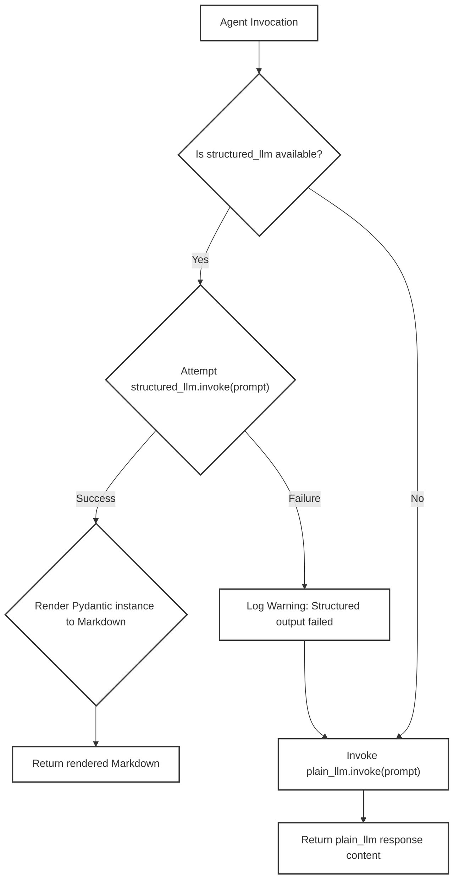
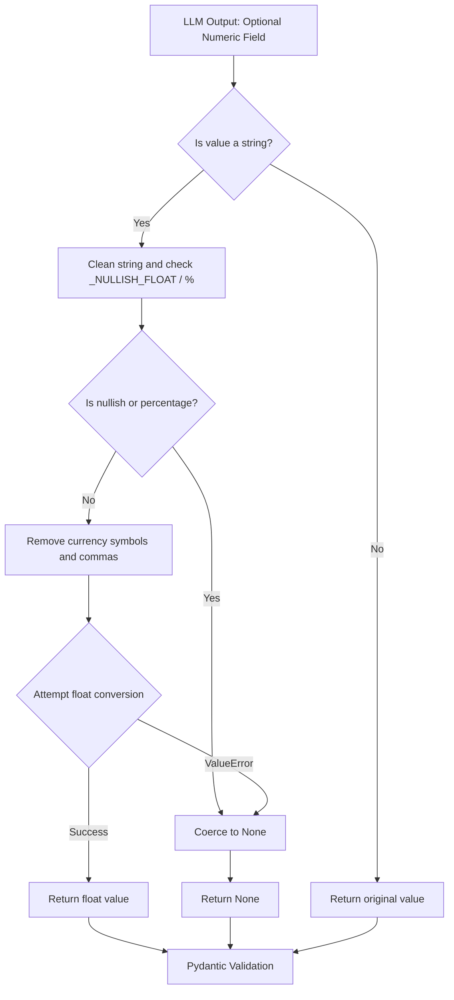

<!-- source: DeepWiki mcp.deepwiki.com · repo TauricResearch/TradingAgents · page 5.7 Structured Output and Rating System · fetched 2026-10-29 -->

# Structured Output and Rating System

Relevant source files

The following files were used as context for generating this wiki page:

- [tests/test_cli_display.py](tests/test_cli_display.py)
- [tests/test_portfolio_context.py](tests/test_portfolio_context.py)
- [tests/test_rating_integrity.py](tests/test_rating_integrity.py)
- [tests/test_signal_processing.py](tests/test_signal_processing.py)
- [tests/test_structured_agents.py](tests/test_structured_agents.py)
- [tradingagents/agents/rating.py](tradingagents/agents/rating.py)
- [tradingagents/agents/schemas.py](tradingagents/agents/schemas.py)
- [tradingagents/agents/structured.py](tradingagents/agents/structured.py)

This page details the structured output mechanisms used by key agents in the TradingAgents framework, focusing on the Pydantic schemas defined in `tradingagents/agents/schemas.py` [tradingagents/agents/schemas.py:1-17](). It covers how these schemas enforce consistent output formats, the role of enums and render helpers, the `bind_structured`/`invoke_structured_or_freetext` fallback in `tradingagents/agents/structured.py` [tradingagents/agents/structured.py:1-17]() for robustness, and the coercion of nullish float values. Additionally, it explains the rating system in `tradingagents/agents/rating.py` [tradingagents/agents/rating.py:1-14](), including the `RATING_REVIEW` sentinel for unreadable decisions, ensuring clarity and preventing misinterpretation of agent outputs.

## Pydantic Schemas for Agent Output

The TradingAgents framework leverages Pydantic schemas to enforce a consistent structure for the outputs of its decision-making agents: the Research Manager, Trader, and Portfolio Manager. This approach ensures that downstream processes and human users receive predictable and parseable information, regardless of the underlying LLM provider.

The primary schemas are:
*   `ResearchPlan`: Produced by the Research Manager, outlining investment recommendations [tradingagents/agents/schemas.py:95-127]().
*   `TraderProposal`: Generated by the Trader, detailing concrete transaction proposals [tradingagents/agents/schemas.py:146-174]().
*   `PortfolioDecision`: Output by the Portfolio Manager, representing the final portfolio action.
*   `SentimentReport`: Used by the Sentiment Analyst to summarize market sentiment.

These schemas serve several critical purposes [tradingagents/agents/schemas.py:8-16]():
*   **Consistency**: Ensures uniform section headers and data types across different runs and LLM providers.
*   **Provider Agnostic**: Utilizes each provider's native structured output capabilities (e.g., `json_schema` for OpenAI, `response_schema` for Gemini, tool-use for Anthropic).
*   **Clear Instructions**: Schema field descriptions directly guide the LLM's output, allowing prompts to focus on context and reasoning.
*   **Render Helpers**: Convert the Pydantic instances back into markdown, maintaining compatibility with existing display, memory log, and reporting systems.

### `ResearchPlan`

The `ResearchPlan` schema [tradingagents/agents/schemas.py:95-127]() captures the Research Manager's investment recommendation. It includes:
*   `recommendation`: A `PortfolioRating` enum value (Buy, Overweight, Hold, Underweight, Sell) [tradingagents/agents/schemas.py:66-74]().
*   `rationale`: A conversational summary of the bull/bear debate [tradingagents/agents/schemas.py:113-119]().
*   `strategic_actions`: Concrete steps for the trader to implement the recommendation [tradingagents/agents/schemas.py:120-127]().

The `render_research_plan` function [tradingagents/agents/schemas.py:130-138]() converts a `ResearchPlan` instance into a markdown string for display and use as context by the Trader agent.

### `TraderProposal`

The `TraderProposal` schema [tradingagents/agents/schemas.py:146-174]() defines the Trader's transaction proposal. Key fields include:
*   `action`: A `TraderAction` enum value (Buy, Hold, Sell) [tradingagents/agents/schemas.py:76-87]().
*   `reasoning`: A concise justification for the proposed action [tradingagents/agents/schemas.py:158-163]().
*   `entry_price`: An optional target entry price as a float [tradingagents/agents/schemas.py:164-171]().
*   `stop_loss`: An optional stop-loss price as a float [tradingagents/agents/schemas.py:172-179]().
*   `position_sizing`: An optional string describing position sizing guidance.

The `render_trader_proposal` function formats a `TraderProposal` into markdown, explicitly stating "not provided" for omitted optional fields to ensure clarity [tests/test_structured_agents.py:64-71]().

### `PortfolioDecision`

The `PortfolioDecision` schema represents the Portfolio Manager's final decision. It contains:
*   `rating`: A `PortfolioRating` enum value [tradingagents/agents/schemas.py:66-74]().
*   `executive_summary`: A brief overview of the decision.
*   `investment_thesis`: The underlying rationale for the decision.
*   `price_target`: An optional price target as a float.

### `SentimentReport`

The `SentimentReport` schema is used by the Sentiment Analyst to provide a structured summary of market sentiment. It includes:
*   `overall_band`: A `SentimentBand` enum value (e.g., `VERY_BULLISH`, `BULLISH`, `NEUTRAL`, `BEARISH`, `VERY_BULLISH`) [tradingagents/agents/schemas.py:290-297]().
*   `overall_score`: A float representing the sentiment score.
*   `confidence`: A string indicating the confidence level.
*   `narrative`: A textual explanation of the sentiment.

Sources:
* `tradingagents/agents/schemas.py:1-17`
* `tradingagents/agents/schemas.py:8-16`
* `tradingagents/agents/schemas.py:66-74`
* `tradingagents/agents/schemas.py:76-87`
* `tradingagents/agents/schemas.py:95-127`
* `tradingagents/agents/schemas.py:130-138`
* `tradingagents/agents/schemas.py:146-174`
* `tests/test_structured_agents.py:64-71`

## Enums and Render Helpers

The schemas utilize Python `StrEnum` types to constrain agent outputs to a predefined set of values, improving consistency and parseability.

### `PortfolioRating`

This enum [tradingagents/agents/schemas.py:66-74]() defines the 5-tier rating scale used by the Research Manager and Portfolio Manager: `Buy`, `Overweight`, `Hold`, `Underweight`, `Sell`.

### `TraderAction`

This enum [tradingagents/agents/schemas.py:76-87]() specifies the 3-tier transaction direction for the Trader: `Buy`, `Hold`, `Sell`. The Trader's role is to propose a concrete transaction, with nuanced sizing and overweight/underweight calls handled by the Portfolio Manager.

### `SentimentBand`

This enum categorizes sentiment into `VERY_BULLISH`, `BULLISH`, `NEUTRAL`, `BEARISH`, and `VERY_BEARISH` [tradingagents/agents/schemas.py:290-297]().

### Render Helpers

Each schema has a corresponding `render_` helper function (e.g., `render_research_plan` [tradingagents/agents/schemas.py:130-138](), `render_trader_proposal`, `render_pm_decision`, `render_sentiment_report`). These functions take a Pydantic instance and convert it into a human-readable markdown string. This ensures that even when structured output is used internally, the final output presented to users and stored in memory logs remains consistent with the prose-based reports generated by other agents.

Sources:
* `tradingagents/agents/schemas.py:66-74`
* `tradingagents/agents/schemas.py:76-87`
* `tradingagents/agents/schemas.py:130-138`
* `tradingagents/agents/schemas.py:290-297`

## Structured Output Invocation and Fallback

The `tradingagents/agents/structured.py` module [tradingagents/agents/structured.py:1-17]() provides shared utilities for invoking an agent with structured output and a graceful fallback. This pattern is applied to the Portfolio Manager, Trader, and Research Manager.

### `bind_structured`

The `bind_structured` function [tradingagents/agents/structured.py:42-57]() attempts to return `llm.with_structured_output(schema)`. If the LLM provider does not support structured output (such as older Ollama models), a warning is logged, and `None` is returned [tradingagents/agents/structured.py:50-56](), indicating that the agent will fall back to free-text generation.

### `invoke_structured_or_freetext`

The `invoke_structured_or_freetext` function [tradingagents/agents/structured.py:84-95]() is the core of the robust structured output mechanism. It delegates to `invoke_structured` [tradingagents/agents/structured.py:59-81]() and handles outcomes:
1.  **Structured Invocation**: Calls `structured_llm.invoke(prompt)` [tradingagents/agents/structured.py:69]().
2.  **Result Handling**: If a Pydantic instance is successfully returned, it is rendered to markdown using the provided `render` function [tradingagents/agents/structured.py:92-94]().
3.  **Fallback on Failure**: If the structured invocation fails (e.g., malformed JSON, transient provider issues, or the model returns `None` [tradingagents/agents/structured.py:70-74]()), a warning is logged [tradingagents/agents/structured.py:76-80](), and the system falls back to invoking `plain_llm.invoke(prompt)` [tradingagents/agents/structured.py:95]().

**Diagram: "Structured Output Invocation Flow in tradingagents/agents/structured.py"**

### `NO_EXTERNAL_TOOLS` Constraint

For agents using schema-only structured output, it's critical that the LLM does not attempt to call external tools. The `NO_EXTERNAL_TOOLS` constant [tradingagents/agents/structured.py:36-39]() is appended to prompts for these agents, explicitly instructing the model to rely only on provided context and not search the web or call other tools, preventing unknown tool errors.

Sources:
* `tradingagents/agents/structured.py:1-17`
* `tradingagents/agents/structured.py:36-39`
* `tradingagents/agents/structured.py:42-57`
* `tradingagents/agents/structured.py:59-81`
* `tradingagents/agents/structured.py:84-96`

## Nullish Float Coercion

LLMs sometimes output placeholder strings like "None", "N/A", or percentages ("15%") when an optional numeric field is expected, instead of omitting the field [tradingagents/agents/schemas.py:26-31](). If passed directly to Pydantic, validation would fail.

The `_coerce_optional_float` function [tradingagents/agents/schemas.py:33-59]() addresses this by:
*   **Identifying Nullish Strings**: Converts common placeholder strings (e.g., `_NULLISH_FLOAT` values like `"None"`, `"N/A"`, `"-"`, `"tbd"`) to `None` [tradingagents/agents/schemas.py:30-53]().
*   **Handling Percentages**: Treats percentages ending with `%` as `None` because they cannot be reliably converted to absolute price levels [tradingagents/agents/schemas.py:38-42]().
*   **Cleaning Formatted Prices**: Removes currency symbols and commas from human-formatted prices [tradingagents/agents/schemas.py:54]().
*   **Graceful Failure**: If a value cannot be converted to a float after cleaning, it is coerced to `None` [tradingagents/agents/schemas.py:55-58]().

**Diagram: "Nullish Float Coercion Logic in tradingagents/agents/schemas.py"**

Sources:
* `tradingagents/agents/schemas.py:26-31`
* `tradingagents/agents/schemas.py:33-59`
* `tests/test_structured_agents.py:75-139`

## Rating Module and `RATING_REVIEW`

The `tradingagents/agents/rating.py` module [tradingagents/agents/rating.py:1-14]() centralizes the 5-tier rating vocabulary and provides a deterministic heuristic for extracting ratings from prose.

### `RATINGS_5_TIER` and `RATING_REVIEW`

*   `RATINGS_5_TIER` defines the canonical 5-tier rating scale: `Buy`, `Overweight`, `Hold`, `Underweight`, `Sell` [tradingagents/agents/rating.py:22-24]().
*   `RATING_REVIEW` is a sentinel value (`"REVIEW"`) returned when an agent's decision cannot be unambiguously parsed into one of the 5-tier ratings [tradingagents/agents/rating.py:26-30](). This flags outputs requiring human review or re-runs rather than silently defaulting to a tradeable position like `Hold` [tradingagents/agents/rating.py:10-14]().

### Rating Functions

*   `extract_rating(text)`: Extracts a 5-tier rating from explicit labels or returns `None` [tradingagents/agents/rating.py:55-93]().
*   `parse_rating(text, default)`: Wraps `extract_rating`, returning the rating or `RATING_REVIEW` [tradingagents/agents/rating.py:96-104]().
*   `run_rating(final_state)`: Retrieves the completed run's rating from state or parses the final decision [tradingagents/agents/rating.py:106-113]().
*   `is_review(signal)`: Checks if a signal equals `RATING_REVIEW` [tradingagents/agents/rating.py:115-117]().

Sources:
* `tradingagents/agents/rating.py:1-14`
* `tradingagents/agents/rating.py:22-24`
* `tradingagents/agents/rating.py:26-30`
* `tradingagents/agents/rating.py:55-93`
* `tradingagents/agents/rating.py:96-104`
* `tradingagents/agents/rating.py:106-113`
* `tradingagents/agents/rating.py:115-118`

---

