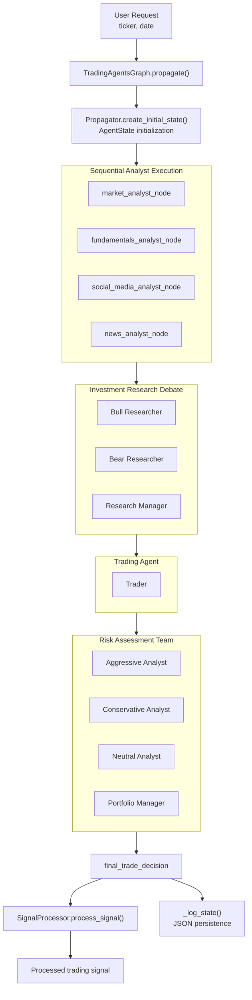
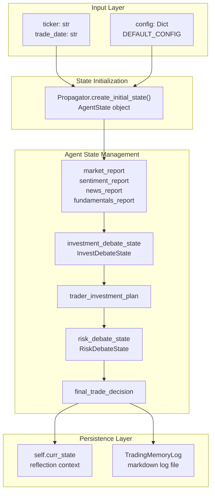
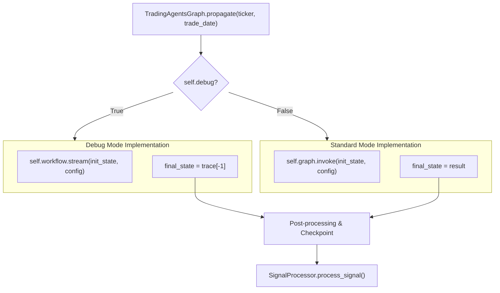
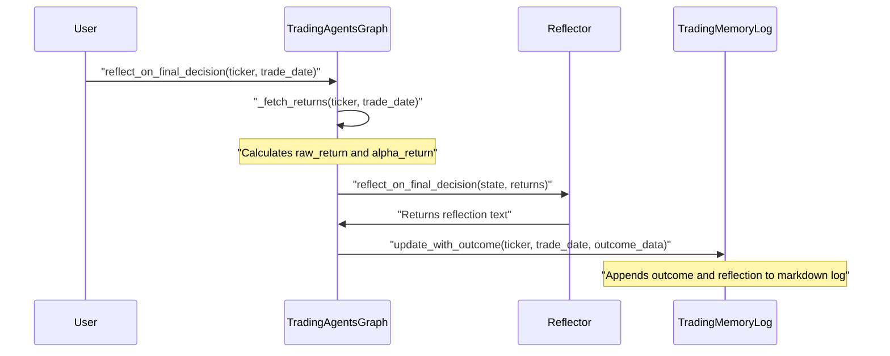

<!-- source: DeepWiki mcp.deepwiki.com · repo TauricResearch/TradingAgents · page 6 Core Orchestration · fetched 2026-10-29 -->

# Core Orchestration

Relevant source files

The following files were used as context for generating this wiki page:

- [tests/test_memory_log.py](tests/test_memory_log.py)
- [tradingagents/graph/trading_graph.py](tradingagents/graph/trading_graph.py)

## Purpose and Scope

This document covers the core orchestration system of TradingAgents, focusing on how the `TradingAgentsGraph` class coordinates the entire multi-agent trading analysis framework [tradingagents/graph/trading_graph.py:51-52](). The orchestration system manages the execution flow from initial data gathering through multi-agent analysis, debate, and final trading decisions.

The orchestration layer sits between the user interfaces ([User Interfaces](#3)) and the individual agent implementations ([Agent System](#5)), providing a unified execution pipeline that coordinates data flow, agent interactions, and decision synthesis using LangGraph.

For detailed information about the `TradingAgentsGraph` class architecture, see [TradingAgentsGraph Architecture](#6.1). For details on how the state transitions through the pipeline, see [State Management and Propagation](#6.2). For the learning and feedback loop, see [Reflection and Memory Updates](#6.3). For checkpointing capabilities, see [Checkpointing and Resume](#6.4). For signal extraction and report outputs, see [Signal Processing and Reporting Output](#6.5).

Sources: `[tradingagents/graph/trading_graph.py:51-52]()`

---

## Main Orchestration Flow

The core orchestration follows a structured pipeline that coordinates multiple agent teams through distinct phases of analysis, research, and decision-making [tradingagents/graph/trading_graph.py:51-116](). The graph construction initializes LangGraph workflows, binding tier-specific LLM clients and tool nodes.

### High-Level Execution Pipeline

For details on the underlying setup, see [TradingAgentsGraph Architecture](#6.1).

Sources: `[tradingagents/graph/trading_graph.py:51-116]()`

---

## State Management and Data Flow

The orchestration system manages complex state transitions through the multi-agent pipeline, ensuring data consistency and proper information flow between agent teams. The graph maintains run state, debate states (`InvestDebateState`, `RiskDebateState`), and checkpoint signatures [tradingagents/graph/trading_graph.py:140-154]().

### State Flow Architecture

For details on state propagation, data structures, and streaming vs. invocation modes, see [State Management and Propagation](#6.2).

Sources: `[tradingagents/graph/trading_graph.py:51-154]()`

---

## Execution Modes and Checkpointing

The orchestration system supports standard batch execution via `.invoke()` and streaming execution for debug modes, alongside durable per-ticker SQLite checkpointers to resume interrupted or cached runs [tradingagents/graph/trading_graph.py:22-26]() [tradingagents/graph/trading_graph.py:112-116]().

### Execution Mode Selection

For details on SQLite checkpointers, run signatures, and resumption logic, see [Checkpointing and Resume](#6.4).

Sources: `[tradingagents/graph/trading_graph.py:22-26](), [tradingagents/graph/trading_graph.py:112-116]()`

---

## Learning, Signal Processing, and Reporting

After graph execution completes, the orchestration layer invokes signal processing, outcome settlement, and report tree generation. The `Reflector` evaluates final outcomes against historical benchmarks (`benchmark_map`), appending structured lessons to `TradingMemoryLog` [tradingagents/graph/trading_graph.py:18-20]() [tradingagents/graph/trading_graph.py:106-106]().

### Reflection and Memory Update Flow

For details on outcome settlement and reflection resilience, see [Reflection and Memory Updates](#6.3). For signal extraction, review flagging, and HTML report generation, see [Signal Processing and Reporting Output](#6.5).

Sources: `[tradingagents/graph/trading_graph.py:18-20](), [tradingagents/graph/trading_graph.py:106-106]()`

---

## Child Pages
- [TradingAgentsGraph Architecture](#6.1) — Explain the TradingAgentsGraph class, initialization parameters, component setup (LLMs, memories, tool nodes), GraphSetup, ConditionalLogic, Propagator, Reflector, SignalProcessor, _log_state, and save_reports()
- [State Management and Propagation](#6.2) — Detail AgentState, InvestDebateState, RiskDebateState, create_run_state/create_initial_state, instrument identity resolution, propagate(), and graph streaming vs invocation
- [Reflection and Memory Updates](#6.3) — Explain the Reflector, reflect_on_final_decision, outcome settlement (raw_return, alpha_return, holding_period_days window), configurable benchmark_map alpha baselines, and resilience when reflection fails
- [Checkpointing and Resume](#6.4) — Document graph/checkpointer.py, per-ticker SQLite checkpointers, begin_checkpoint/end_checkpoint, run signature graph-shape identity, clear_checkpoint_on_success, and the --checkpoint / checkpoint_enabled options
- [Signal Processing and Reporting Output](#6.5) — Explain signal_processing.py extraction of the final rating, labelled-rating precedence and review flagging, tradingagents/reporting.py write_report_tree / missing-report handling, and report_html.py self-contained HTML report generation with embedded logo assets

---

