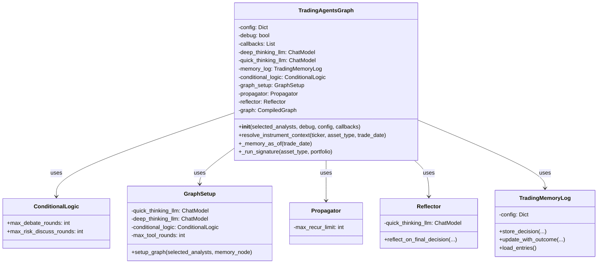
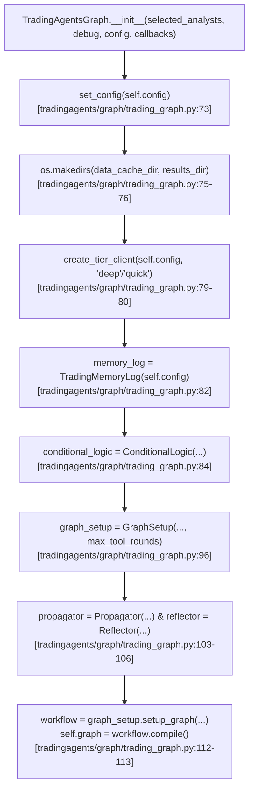

<!-- source: DeepWiki mcp.deepwiki.com · repo TauricResearch/TradingAgents · page 6.1 TradingAgentsGraph Architecture · fetched 2026-10-29 -->

# TradingAgentsGraph Architecture

Relevant source files

The following files were used as context for generating this wiki page:

- [tests/test_graph_end_to_end.py](tests/test_graph_end_to_end.py)
- [tests/test_memory_log.py](tests/test_memory_log.py)
- [tradingagents/agents/__init__.py](tradingagents/agents/__init__.py)
- [tradingagents/graph/setup.py](tradingagents/graph/setup.py)
- [tradingagents/graph/trading_graph.py](tradingagents/graph/trading_graph.py)

## Purpose and Scope
The `TradingAgentsGraph` class serves as the central orchestration engine for the TradingAgents framework, coordinating multi-agent LLM financial analyses, state propagation, memory logging, tool execution, and reporting output. This document details its internal class structure, initialization sequence, component relationships (including `GraphSetup`, `ConditionalLogic`, `Propagator`, `Reflector`, and `SignalProcessor`), state logging (`_log_state`), and report persistence via `save_reports()`.

Sources: [tradingagents/graph/trading_graph.py:51-116]()

---

## Core Class Structure

The `TradingAgentsGraph` class brings together LLMs, persistent memory logs, conditional routing logic, and execution propagators into a unified LangGraph workflow.

### Class Architecture Diagram

Sources: [tradingagents/graph/trading_graph.py:51-116](), [tradingagents/graph/setup.py:93-111]()

---

## Initialization Process and Component Setup

The `__init__` method of `TradingAgentsGraph` instantiates configuration parameters, directories, tier-based LLM clients, memory logs, and helper graph managers [tradingagents/graph/trading_graph.py:54-116]().

### Initialization Flow

Sources: [tradingagents/graph/trading_graph.py:54-116]()

---

## Component Details

### GraphSetup
`GraphSetup` [tradingagents/graph/setup.py:93-111]() is responsible for assembling the `StateGraph` workflow. It iterates over the `build_analyst_execution_plan(selected_analysts)` specification, builds encapsulated analyst subgraphs with tool round limits, and wires up researcher debates (`Bull Researcher`, `Bear Researcher`, `Research Manager`), trader nodes, risk debate teams (`Aggressive Analyst`, `Conservative Analyst`, `Neutral Analyst`), and the `Portfolio Manager` [tradingagents/graph/setup.py:123-156]().

It defines critical safety structures such as `DEBATE_PATH_MAP` and `RISK_ANALYSIS_PATH_MAP` to prevent fall-through router errors during graph execution [tradingagents/graph/setup.py:35-45]().

Sources: [tradingagents/graph/setup.py:35-156]()

### ConditionalLogic
`ConditionalLogic` manages execution flow decisions, including determining whether an analyst needs another round of tool execution via `_tools_or_done`, tracking debate convergence rounds against `max_debate_rounds`, and evaluating risk discussion limits against `max_risk_discuss_rounds` [tradingagents/graph/trading_graph.py:84-87]().

Sources: [tradingagents/graph/trading_graph.py:84-87](), [tradingagents/graph/setup.py:48-51]()

### Propagator
`Propagator` coordinates the execution of compiled LangGraph instances, handling recursion limits (`max_recur_limit`), state creation (`create_initial_state`), and execution propagation [tradingagents/graph/trading_graph.py:103-105]().

Sources: [tradingagents/graph/trading_graph.py:103-105]()

### Reflector
`Reflector` utilizes the quick thinking LLM client to generate qualitative reflections on trade outcomes once holding periods and market returns are realized [tradingagents/graph/trading_graph.py:106]().

Sources: [tradingagents/graph/trading_graph.py:106]()

### SignalProcessor
`SignalProcessor` parses raw LLM output text or structured payloads into standardized portfolio signals and ratings (e.g., Buy, Sell, Hold, Overweight, Underweight) [tradingagents/graph/trading_graph.py:12]().

Sources: [tradingagents/graph/trading_graph.py:12]()

---

## State Logging and Report Persistence

### State Logging (`_log_state`)
During execution, the system captures snapshots of graph states keyed by ticker and trade date. This internal tracking supports debugging, replay analysis, and step-by-step state inspection.

### Report Persistence (`save_reports()`)
The `save_reports()` method interacts with `tradingagents.reporting.write_report_tree` to export structured markdown hierarchies and consolidated reports across all execution phases (analysts, research debates, trading plans, risk discussions, and portfolio decisions) [tradingagents/reporting.py:1-101](), [tradingagents/graph/trading_graph.py:20]().

Sources: [tradingagents/reporting.py:1-101](), [tradingagents/graph/trading_graph.py:20]()

---

