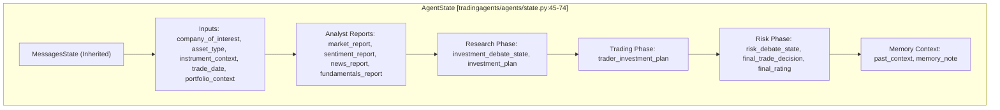
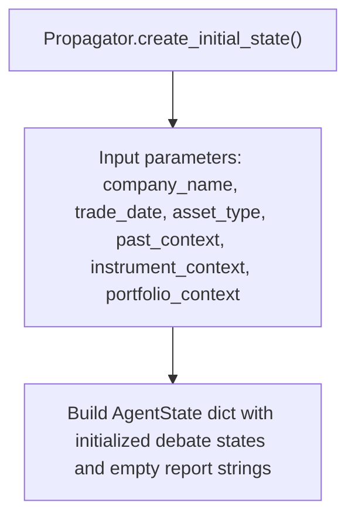
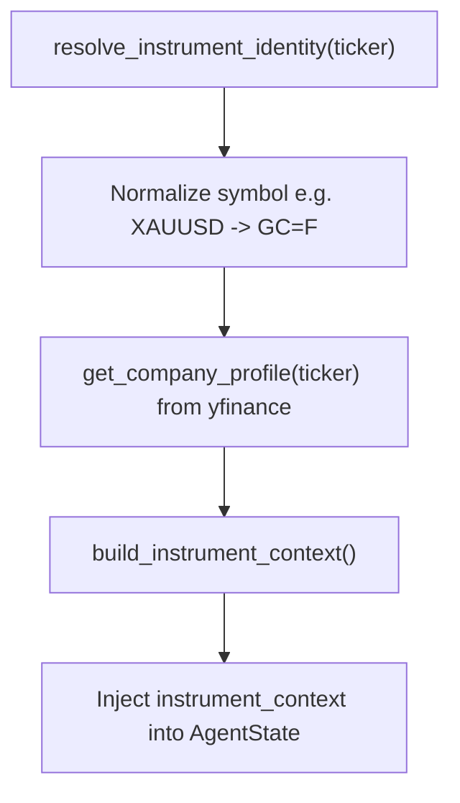

<!-- source: DeepWiki mcp.deepwiki.com · repo TauricResearch/TradingAgents · page 6.2 State Management and Propagation · fetched 2026-10-29 -->

# State Management and Propagation

Relevant source files

The following files were used as context for generating this wiki page:

- [tests/test_debate_opening.py](tests/test_debate_opening.py)
- [tests/test_i18n_coverage.py](tests/test_i18n_coverage.py)
- [tests/test_instrument_identity.py](tests/test_instrument_identity.py)
- [tests/test_symbol_normalization_paths.py](tests/test_symbol_normalization_paths.py)
- [tradingagents/agents/context.py](tradingagents/agents/context.py)
- [tradingagents/agents/state.py](tradingagents/agents/state.py)
- [tradingagents/graph/propagation.py](tradingagents/graph/propagation.py)

## Purpose and Scope

This document details the state management system and propagation pipeline in TradingAgents. It covers the core data structures (`AgentState`, `InvestDebateState`, and `RiskDebateState`), initial state construction via `Propagator.create_initial_state()`, deterministic instrument identity resolution, the execution flow within `TradingAgentsGraph.propagate()`, and the distinction between graph streaming and single invocation modes.

Sources: [tradingagents/agents/state.py:1-73](), [tradingagents/graph/propagation.py:1-80]()

---

## AgentState and Nested State Structures

The execution state of the multi-agent pipeline is modeled using typed dictionaries that inherit from LangGraph's base state types.

### `AgentState` Definition

`AgentState` extends `MessagesState` [tradingagents/agents/state.py:45]() to maintain the conversation history alongside domain-specific fields for financial analysis, debate histories, risk evaluations, and execution metadata.

Sources: [tradingagents/agents/state.py:45-73]()

### Nested Debate States

The researcher and risk management teams utilize specialized sub-states to track multi-turn arguments:

*   **`InvestDebateState`**: Captures the bull-versus-bear research debate [tradingagents/agents/state.py:8-18]().
*   **`RiskDebateState`**: Captures the multi-analyst risk evaluation debate across aggressive, conservative, and neutral perspectives [tradingagents/agents/state.py:21-43]().

Sources: [tradingagents/agents/state.py:8-43]()

---

## State Initialization (`create_initial_state`)

The `Propagator` class [tradingagents/graph/propagation.py:6-66]() constructs the initial state dictionary passed into the LangGraph execution engine.

### Initialization Flow

Sources: [tradingagents/graph/propagation.py:13-65]()

The `create_initial_state` method initializes the root message list with a human prompt containing the target company, assigns metadata fields, and seeds empty strings for all analyst reports and debate histories [tradingagents/graph/propagation.py:30-65]().

Sources: [tradingagents/graph/propagation.py:13-65]()

---

## Instrument Identity Resolution

To prevent LLMs from hallucinating corporate identities or misattributing tickers, the system resolves deterministic metadata before execution begins [tradingagents/agents/context.py:61-77]().

Sources: [tradingagents/agents/context.py:61-163](), [tests/test_symbol_normalization_paths.py:16-58]()

`resolve_instrument_identity()` fetches corporate profile data via yfinance (with automatic symbol normalization such as mapping `XAUUSD` to `GC=F`) [tradingagents/agents/context.py:61-88](), [tests/test_symbol_normalization_paths.py:16-34](). If the lookup fails, the function fails open by returning an empty dictionary, allowing the pipeline to proceed using ticker-only context [tradingagents/agents/context.py:80-82]().

Sources: [tradingagents/agents/context.py:61-104](), [tests/test_symbol_normalization_paths.py:16-34]()

---

## The `propagate()` Method and Execution Modes

Graph execution is orchestrated via `TradingAgentsGraph`, which wraps the underlying LangGraph compiled graph and manages state propagation.

### Execution Modes

The propagator configures execution parameters via `Propagator.get_graph_args()` [tradingagents/graph/propagation.py:67-80](). Depending on configuration settings, execution runs in one of two modes:

1.  **Debug Mode (`stream_mode="values"`)**: Streams state updates incrementally, allowing real-time message inspection and logging [tradingagents/graph/propagation.py:78-80]().
2.  **Standard Mode (`invoke`)**: Executes the graph atomically to completion, optimizing performance for headless runs and backtesting sweeps.

Sources: [tradingagents/graph/propagation.py:67-80]()

---

## Summary of State Fields

| Field Name | Type | Description |
| :--- | :--- | :--- |
| `company_of_interest` | `str` | Ticker or asset identifier being analyzed [tradingagents/agents/state.py:46]() |
| `asset_type` | `str` | Asset class (e.g., `stock`, `crypto`) [tradingagents/agents/state.py:47]() |
| `instrument_context` | `str` | Resolved corporate identity description [tradingagents/agents/state.py:48]() |
| `trade_date` | `str` | Anchor date for point-in-time data retrieval [tradingagents/agents/state.py:49]() |
| `investment_debate_state` | `InvestDebateState` | Bull/bear debate transcript and counters [tradingagents/agents/state.py:58-60]() |
| `risk_debate_state` | `RiskDebateState` | Risk management debate transcript and counters [tradingagents/agents/state.py:66-68]() |
| `final_rating` | `str` | Portfolio manager's 5-tier rating or `REVIEW` fallback [tradingagents/agents/state.py:70]() |

Sources: [tradingagents/agents/state.py:45-73]()

---

