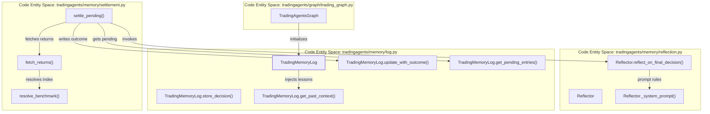
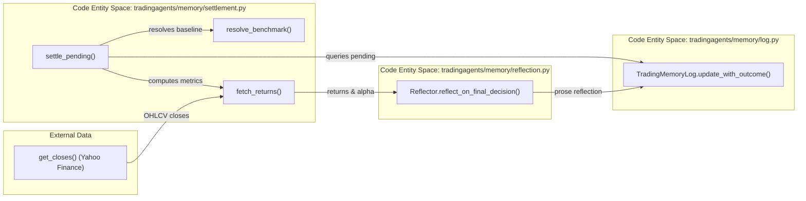

<!-- source: DeepWiki mcp.deepwiki.com · repo TauricResearch/TradingAgents · page 6.3 Reflection and Memory Updates · fetched 2026-10-29 -->

# Reflection and Memory Updates

Relevant source files

The following files were used as context for generating this wiki page:

- [tests/test_cache_writes.py](tests/test_cache_writes.py)
- [tests/test_memory_log.py](tests/test_memory_log.py)
- [tradingagents/dataflows/files.py](tradingagents/dataflows/files.py)
- [tradingagents/graph/trading_graph.py](tradingagents/graph/trading_graph.py)
- [tradingagents/memory/log.py](tradingagents/memory/log.py)
- [tradingagents/memory/reflection.py](tradingagents/memory/reflection.py)
- [tradingagents/memory/settlement.py](tradingagents/memory/settlement.py)

## Purpose and Scope

This document explains the reflection and memory update system in TradingAgents, which enables agent workflows to learn from past trading decisions. The system utilizes a persistent, append-only markdown decision log managed by the `TradingMemoryLog` class [tradingagents/memory/log.py:11-12](), paired with deferred outcome settlement and LLM-driven reflection [tradingagents/memory/settlement.py:1-3]().

The learning cycle operates across two distinct temporal phases:
1.  **Phase A (Decision Storage):** Storing the final trade decision, its rating, and its context as `pending` immediately after graph propagation completes [tradingagents/memory/log.py:32-60]().
2.  **Phase B (Deferred Reflection):** Scoring settled decisions against market returns (`raw_return`, `alpha_return`) over a configurable holding window (`holding_period_days`) once sufficient price history is available, generating a concise textual reflection via the `Reflector` class [tradingagents/memory/reflection.py:6-11](), [tradingagents/memory/settlement.py:1-3]().

**Sources:** [tradingagents/memory/log.py:11-60](), [tradingagents/memory/reflection.py:6-11](), [tradingagents/memory/settlement.py:1-3]()

---

## Memory System Architecture

The `TradingAgentsGraph` initializes a single `TradingMemoryLog` instance (`self.memory_log`) during graph setup [tradingagents/graph/trading_graph.py:82](). This log serves as an append-only audit trail and supplies historical context (`get_past_context`) for agent prompts [tradingagents/memory/log.py:94-130]().

### Data Structure: TradingMemoryLog
The log file uses structured markdown blocks separated by HTML comments (`<!-- ENTRY_END -->`) to allow safe, robust parsing without complex database dependencies [tradingagents/memory/log.py:14-18]().

| Component | Code Entity / Pattern | Description |
| :--- | :--- | :--- |
| **Entry Tag** | `f"[{trade_date} \| {ticker} \| {rating} \| pending]"` | Header for pending entries before outcome settlement [tradingagents/memory/log.py:57](). |
| **Decision** | `DECISION:` block | The verbatim markdown output of the final trade decision [tradingagents/memory/log.py:58](). |
| **Reflection** | `REFLECTION:` block | 2-4 sentences of LLM analysis added during Phase B settlement [tradingagents/memory/log.py:18-18](). |
| **Outcome Tag** | `f"[{trade_date} \| {ticker} \| {rating} \| {raw_pct} \| {alpha_pct} \| {holding_days}d]"` | Replaces the pending tag once financial outcomes are computed [tradingagents/memory/log.py:180-195](). |

**Diagram: Memory and Reflection Entity Mapping**

This diagram bridges the conceptual reflection workflow with concrete code entities across the memory and reflection modules.

**Sources:** [tradingagents/memory/log.py:11-130](), [tradingagents/memory/reflection.py:6-63](), [tradingagents/memory/settlement.py:14-145](), [tradingagents/graph/trading_graph.py:82]()

---

## Outcome Settlement and Benchmark Resolution

Once trading periods elapse, pending decisions are evaluated via `settle_pending()` in `tradingagents/memory/settlement.py` [tradingagents/memory/settlement.py:109-118]().

### Benchmark Mapping and Alpha Baselines
To calculate alpha return, the system determines the appropriate benchmark ticker via `resolve_benchmark(ticker, config)` [tradingagents/memory/settlement.py:14-35]():
1.  **Explicit Override:** If `config["benchmark_ticker"]` is provided, it takes precedence after normalization [tradingagents/memory/settlement.py:25-29]().
2.  **Suffix Mapping:** The system checks `config["benchmark_map"]` against exchange suffixes (e.g., `.T` for Tokyo maps to `^N225`) [tradingagents/memory/settlement.py:30-34]().
3.  **Default Baseline:** Unmapped US tickers or standard symbols default to `SPY` [tradingagents/memory/settlement.py:35]().

### Return Calculation and Holding Window
The function `fetch_returns(ticker, trade_date, holding_days, benchmark)` handles price retrieval and return calculations [tradingagents/memory/settlement.py:52-98]():
- Fetches daily close prices for both the asset and the benchmark using Yahoo Finance utilities (`get_closes`) [tradingagents/memory/settlement.py:73-76]().
- **Window Validation:** Enforces that the full holding window (`holding_days` trading sessions) has actually traded. If the window is incomplete, it returns `(None, None, None, None)` so the entry remains pending for future runs rather than recording a premature partial return [tradingagents/memory/settlement.py:81-82]().
- Computes `raw_return` (asset price change) and `alpha_return` (`raw_return - benchmark_return`), capturing the `resolution_date` of the final bar [tradingagents/memory/settlement.py:91-97]().

**Diagram: Outcome Settlement Data Flow**

**Sources:** [tradingagents/memory/settlement.py:14-145]()

---

## The Reflector and LLM Reflection

The `Reflector` class (`tradingagents/memory/reflection.py`) transforms numerical returns and investment decisions into compact qualitative lessons [tradingagents/memory/reflection.py:6-11]().

- **System Prompting:** `_system_prompt(holding_days)` instructs the quick-thinking LLM to produce exactly 2–4 sentences of plain prose covering directional alpha, thesis validation, and a concrete future lesson [tradingagents/memory/reflection.py:13-34]().
- **Reflection Execution:** `reflect_on_final_decision()` formats the raw return, alpha return against the benchmark name, and final decision text into messages for the quick-thinking LLM client [tradingagents/memory/reflection.py:36-63]().

**Sources:** [tradingagents/memory/reflection.py:6-63]()

---

## Resilience and Error Handling

The reflection and settlement architecture is engineered to tolerate external disruptions without corrupting state or halting pipelines:

1.  **Transient Reflection Failures:** If an LLM call fails during `reflect_on_final_decision()`, the exception is caught, logged as a warning, and the entry is left in a `pending` state (`result.failed.append(...)`) to be retried on subsequent runs rather than aborting settlement or writing partial data [tradingagents/memory/settlement.py:138-147]().
2.  **Atomic File Writes:** `TradingMemoryLog` uses file locking (`locked`) and atomic replacement (`replace_file`) via temporary files (`.tmp`) in `tradingagents/dataflows/files.py` to prevent race conditions across concurrent processes or threads and eliminate half-written log corruption [tradingagents/dataflows/files.py:14-34](), [tradingagents/memory/log.py:46, 156]().
3.  **Idempotency Protection:** `store_decision()` performs a fast raw-text scan to prevent duplicate entries for the same ticker and date, ensuring settled or pending records are never double-counted in past context injection [tradingagents/memory/log.py:51-55]().

**Sources:** [tradingagents/dataflows/files.py:14-34](), [tradingagents/memory/log.py:46-55, 156](), [tradingagents/memory/settlement.py:138-147]()

---

