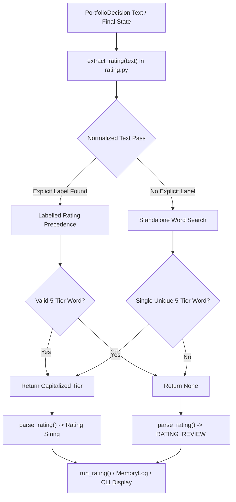
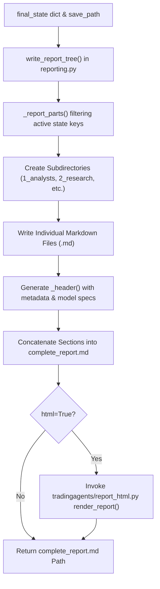

<!-- source: DeepWiki mcp.deepwiki.com · repo TauricResearch/TradingAgents · page 6.5 Signal Processing and Reporting Output · fetched 2026-10-29 -->

# Signal Processing and Reporting Output

Relevant source files

The following files were used as context for generating this wiki page:

- [tests/test_cli_display.py](tests/test_cli_display.py)
- [tests/test_portfolio_context.py](tests/test_portfolio_context.py)
- [tests/test_rating_integrity.py](tests/test_rating_integrity.py)
- [tests/test_report_html.py](tests/test_report_html.py)
- [tests/test_reporting.py](tests/test_reporting.py)
- [tests/test_signal_processing.py](tests/test_signal_processing.py)
- [tradingagents/agents/rating.py](tradingagents/agents/rating.py)
- [tradingagents/agents/structured.py](tradingagents/agents/structured.py)
- [tradingagents/assets/tauric-logo.svg](tradingagents/assets/tauric-logo.svg)
- [tradingagents/report_html.py](tradingagents/report_html.py)
- [tradingagents/reporting.py](tradingagents/reporting.py)

## Purpose and Scope

This page details the signal processing and reporting pipeline of the TradingAgents framework. It explains how final investment ratings are deterministically extracted from the Portfolio Manager's decision text via `tradingagents/agents/rating.py`, how labelled-rating precedence and review flagging (`RATING_REVIEW`) operate to prevent incorrect directional assumptions, how `tradingagents/reporting.py` coordinates the writing of a structured report tree (`write_report_tree`) with robust missing-report handling, and how `tradingagents/report_html.py` produces self-contained, secure HTML reports with embedded SVG logo assets.

Sources:
* [tradingagents/agents/rating.py:1-117]()
* [tradingagents/reporting.py:1-120]()
* [tradingagents/report_html.py:1-150]()

---

## Signal Processing and Rating Extraction

The `tradingagents/agents/rating.py` module defines the canonical 5-tier rating vocabulary and the deterministic heuristic parser that extracts the final investment call from unstructured or semi-structured model output [tradingagents/agents/rating.py:1-14](). 

### The 5-Tier Rating System and Vocabulary

The framework utilizes a strict, ordered 5-tier scale:
- `Buy`
- `Overweight`
- `Hold`
- `Underweight`
- `Sell`

This vocabulary is shared across the Research Manager, the Portfolio Manager, the signal processor, and the `TradingMemoryLog` to prevent drift [tradingagents/agents/rating.py:3-8]().

Sources:
* [tradingagents/agents/rating.py:21-25]()

### Heuristic Parser: `extract_rating`, `parse_rating`, and `run_rating`

Rather than invoking an expensive secondary LLM call to classify a decision, `extract_rating(text: str)` uses a deterministic, two-pass regular expression strategy on NFKC-normalized text [tradingagents/agents/rating.py:55-93]().

1. **Opening / Labelled Rating Precedence**: The parser scans non-heading lines for explicit labels (e.g., `Rating: X`, `**Rating**: X`, or fullwidth colons like `Rating：Overweight`) using `_RATING_LINE_RE` and `_RATING_LABEL_RE` [tradingagents/agents/rating.py:34-50](). Lines matching `_RATING_SCALE_RE` (such as echoed legends like `Rating Scale: Buy, Overweight...`) are explicitly filtered out [tradingagents/agents/rating.py:53-74]().
2. **Ambiguity & Prose Guardrails**: If text contains multiple rating words without an explicit label, `extract_rating` returns `None` rather than guessing [tradingagents/agents/rating.py:89-93](). This prevents prose arguing against a rating (e.g., *“We would not Sell here; the dip is a chance to add”* or *“The bull wants Buy, the bear wants Sell...”*) from being misread as the final call [tests/test_rating_integrity.py:31-52]().

`parse_rating(text: str, default: str = RATING_REVIEW)` wraps `extract_rating`, substituting unextractable ratings with the non-tradeable sentinel `RATING_REVIEW` (`"REVIEW"`) [tradingagents/agents/rating.py:96-104](). `run_rating(final_state: dict)` extracts the rating from a completed run state dictionary, falling back to parsing `final_trade_decision` if `final_rating` is absent [tradingagents/agents/rating.py:106-113]().

Sources:
* [tradingagents/agents/rating.py:34-113]()
* [tests/test_rating_integrity.py:16-52]()

### Review Flagging and Unreadable Decisions

When a decision cannot be reliably parsed (e.g., model refusals like `I'm sorry, I can't provide a rating for this security` or ambiguous multi-rating debates), `parse_rating` yields `RATING_REVIEW` [tradingagents/agents/rating.py:26-30](), [tests/test_rating_integrity.py:20-58](). 

- **Non-Tradeable Sentinel**: `RATING_REVIEW` ensures that parsing failures never silently degrade into a default `Hold` or tradeable position [tradingagents/agents/rating.py:11-14]().
- **Memory and Backtest Filtering**: In `TradingMemoryLog`, decisions tagged with `RATING_REVIEW` record `REVIEW` rather than a fabricated hold [tests/test_rating_integrity.py:73-81](). In `tradingagents/backtest.py`, unscored decisions (`REVIEW`) are excluded from win/loss and hit-rate scoring because they lack directional intent [tests/test_rating_integrity.py:98-111]().

Sources:
* [tradingagents/agents/rating.py:11-30]()
* [tests/test_rating_integrity.py:73-111]()

**Diagram 1: Natural Language Space to Code Entity Space: Rating Extraction Pipeline (`tradingagents/agents/rating.py`)**

Sources:
* [tradingagents/agents/rating.py:55-113]()
* [tests/test_rating_integrity.py:16-68]()

---

## Reporting Output Structure: `write_report_tree`

The `tradingagents/reporting.py` module exposes `write_report_tree`, a shared utility called by both the CLI (`cli/run.py`) and programmatic API (`TradingAgentsGraph.save_reports`) to serialize run artifacts uniformly [tradingagents/reporting.py:1-7]().

### Report Directory Tree and Sections

`write_report_tree` accepts `final_state`, `ticker`, `save_path`, `settings`, and an `html` flag [tradingagents/reporting.py:92-93](). It structures output into hierarchical subdirectories defined by `_SECTIONS` [tradingagents/reporting.py:50-73]():

| Section Heading | Subdirectory | Component Agents and State Paths |
| :--- | :--- | :--- |
| **I. Analyst Team Reports** | `1_analysts` | Market (`market_report`), Sentiment (`sentiment_report`), News (`news_report`), Fundamentals (`fundamentals_report`) [tradingagents/reporting.py:51-56]() |
| **II. Research Team Decision** | `2_research` | Bull Researcher (`bull_history`), Bear Researcher (`bear_history`), Research Manager (`investment_plan`) [tradingagents/reporting.py:57-61]() |
| **III. Trading Team Plan** | `3_trading` | Trader (`trader_investment_plan`) [tradingagents/reporting.py:62-64]() |
| **IV. Risk Management Team Decision** | `4_risk` | Aggressive (`aggressive_history`), Conservative (`conservative_history`), Neutral (`neutral_history`) [tradingagents/reporting.py:65-69]() |
| **V. Portfolio Manager Decision** | `5_portfolio` | Portfolio Manager (`final_trade_decision`) [tradingagents/reporting.py:70-72]() |

Sources:
* [tradingagents/reporting.py:50-73]()

### Missing-Report Handling and Consolidated Output

- **Graceful Omission**: `_report_parts(final_state)` inspects state paths recursively (`(value or {}).get(key)`). If a report or debate history is absent (e.g., when specific analysts are omitted from a run configuration), it is omitted without raising `KeyError` [tradingagents/reporting.py:76-89]().
- **Header Metadata**: The consolidated `complete_report.md` is prepended with `_header()`, detailing the analysis date, extracted rating, generation timestamp, model providers and specific deep/quick model identifiers, active analysts, debate rounds, and data vendor chains [tradingagents/reporting.py:20-46](). Sensitive credentials or local absolute paths are scrubbed from settings summaries [tests/test_reporting.py:79-94]().

Sources:
* [tradingagents/reporting.py:20-89]()
* [tests/test_reporting.py:79-94]()

**Diagram 2: Natural Language Space to Code Entity Space: Report Generation and Tree Writer (`tradingagents/reporting.py`)**

Sources:
* [tradingagents/reporting.py:92-120]()

---

## Self-Contained HTML Report Generation: `report_html.py`

When `html=True` is passed to `write_report_tree`, `tradingagents/report_html.py` generates a single self-contained `complete_report.html` page alongside the markdown tree [tradingagents/reporting.py:114-119](), [tradingagents/report_html.py:1-6]().

### Security and Asset Embedding Constraints

To guarantee offline readability, zero network dependency, and strict protection against prompt injection:
- **Content Security Policy (CSP)**: The generated HTML includes a strict `<meta http-equiv="Content-Security-Policy" content="default-src 'none'">` header [tradingagents/report_html.py:57]().
- **Zero Scripts and External Fetches**: No JavaScript is included (`<script>` tags are absent), and external resources (`img`, `link`, `iframe`, `object`, `embed`) are forbidden [tradingagents/report_html.py:3-6](), [tests/test_report_html.py:55-59]().
- **Embedded Logo Assets**: The Tauric Research logo SVG (`tradingagents/assets/tauric-logo.svg`) is loaded via `importlib.resources` and inlined directly into the masthead HTML [tradingagents/report_html.py:21-23](), [tests/test_report_html.py:142-149]().
- **Markdown Sanitization**: Report text is rendered using `markdown_it.MarkdownIt` with raw HTML and remote image fetching disabled, preventing model-generated prompt text from injecting markup [tradingagents/report_html.py:13](), [tests/test_report_html.py:63-70]().

Sources:
* [tradingagents/report_html.py:1-140]()
* [tests/test_report_html.py:55-70]()

### Layout and Responsive Navigation

- **Tone Indicator**: Ratings are mapped to visual tones (`up` for Buy/Overweight, `down` for Underweight/Sell, `level` for Hold, `review` for italicized review states) [tradingagents/report_html.py:18-19]().
- **Responsive Section Rail**: On wide viewports (`min-width: 60rem`), an interactive left-edge navigation rail displays section numbers (`I` through `V`) and agent bars, expanding smoothly on hover or keyboard focus to reveal agent titles [tradingagents/report_html.py:82-123](), [tests/test_report_html.py:115-123](). On narrow viewports, it collapses gracefully.

Sources:
* [tradingagents/report_html.py:82-132]()
* [tests/test_report_html.py:106-132]()

---

## Sources

* [tradingagents/agents/rating.py:1-117]()
* [tradingagents/reporting.py:1-120]()
* [tradingagents/report_html.py:1-150]()
* [tests/test_rating_integrity.py:1-173]()
* [tests/test_reporting.py:1-135]()
* [tests/test_report_html.py:1-149]()

---

