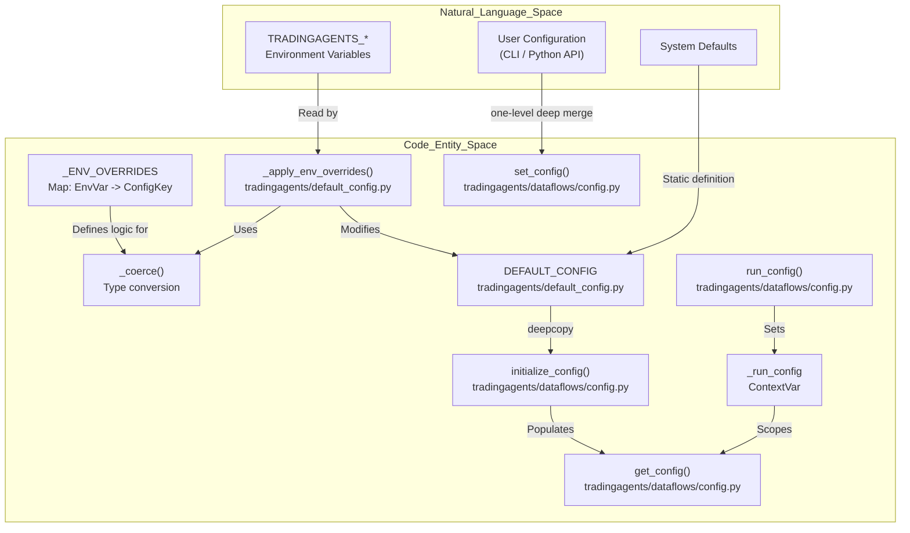

<!-- source: DeepWiki mcp.deepwiki.com · repo TauricResearch/TradingAgents · page 7.1 Configuration System · fetched 2026-10-29 -->

# Configuration System

Relevant source files

The following files were used as context for generating this wiki page:

- [main.py](main.py)
- [tests/test_dataflows_config.py](tests/test_dataflows_config.py)
- [tests/test_llm_max_retries.py](tests/test_llm_max_retries.py)
- [tests/test_llm_max_tokens.py](tests/test_llm_max_tokens.py)
- [tests/test_statement_knowledge_time.py](tests/test_statement_knowledge_time.py)
- [tests/test_temperature_config.py](tests/test_temperature_config.py)
- [tradingagents/dataflows/config.py](tradingagents/dataflows/config.py)
- [tradingagents/dataflows/vendors/alpha_vantage/news.py](tradingagents/dataflows/vendors/alpha_vantage/news.py)
- [tradingagents/default_config.py](tradingagents/default_config.py)
- [tradingagents/graph/__init__.py](tradingagents/graph/__init__.py)
- [tradingagents/memory/__init__.py](tradingagents/memory/__init__.py)

## Purpose and Scope

This document details the centralized configuration system that controls all runtime parameters, paths, LLM selections, vendor bindings, and execution properties across the TradingAgents framework. It covers the `DEFAULT_CONFIG` structure defined in `tradingagents/default_config.py`, the environment variable override and strict coercion pipeline, and the thread-safe `tradingagents/dataflows/config.py` module which manages process-wide and run-scoped configurations via `ContextVar`.

---

## 1. Configuration Architecture Overview

The configuration system relies on a single source of truth: `DEFAULT_CONFIG`, initialized at package import time [tradingagents/default_config.py:77-83](). Environment variables prefixed with `TRADINGAGENTS_*` are automatically folded into the configuration dictionary via `_apply_env_overrides()` [tradingagents/default_config.py:64-74](). 

At runtime, the `tradingagents/dataflows/config.py` module manages configuration state. It supports thread-safe and asynchronous execution isolation through `ContextVar` (`_run_config`), ensuring that concurrent graph runs or individual tool executions inherit their specific graph-bound configuration without leaking state across threads or tasks [tradingagents/dataflows/config.py:11-14]().

### Configuration Entity Mapping

Sources: [tradingagents/default_config.py:10-74](), [tradingagents/dataflows/config.py:11-73]()

---

## 2. Directory and Path Configuration

System persistence, caching, and output directories default to a hidden `.tradingagents` folder located in the user's home directory (`~/.tradingagents`), managed by `_TRADINGAGENTS_HOME` [tradingagents/default_config.py:3]() and environment overrides [tradingagents/default_config.py:84-86]().

| Configuration Key | Purpose | Default Value | Environment Override |
|------------------|---------|---------------|---------------------|
| `results_dir` | Output and report storage path | `~/.tradingagents/logs` | `TRADINGAGENTS_RESULTS_DIR` |
| `data_cache_dir` | Cached API responses for vendor data | `~/.tradingagents/cache` | `TRADINGAGENTS_CACHE_DIR` |
| `memory_log_path` | Persistent markdown decision log | `~/.tradingagents/memory/trading_memory.md` | `TRADINGAGENTS_MEMORY_LOG_PATH` |
| `memory_log_max_entries` | Optional cap on resolved memory log entries (`None` disables rotation) | `None` | None |

Sources: [tradingagents/default_config.py:3](), [tradingagents/default_config.py:84-90]()

---

## 3. Environment Variable Overrides and Coercion Pipeline

The `_ENV_OVERRIDES` dictionary maps `TRADINGAGENTS_*` environment variables to their corresponding `DEFAULT_CONFIG` keys [tradingagents/default_config.py:10-34](). 

When `build_default_config()` runs, `_apply_env_overrides()` iterates through `_ENV_OVERRIDES` [tradingagents/default_config.py:64-74](). If an environment variable is set, `_coerce()` converts the raw string value to match the type of the existing default reference value [tradingagents/default_config.py:41-61]():
- **Booleans**: Evaluated against strict positive (`true`, `1`, `yes`, `on`) and negative (`false`, `0`, `no`, `off`) string sets. Invalid booleans raise a `ValueError` rather than defaulting [tradingagents/default_config.py:37-56]().
- **Integers / Floats**: Coerced via `int()` or `float()`. Malformed numeric strings fail loudly with a `ValueError` [tradingagents/default_config.py:57-61]().
- **Strings**: Passed through directly.

Sources: [tradingagents/default_config.py:10-74](), [tests/test_temperature_config.py:43-56](), [tests/test_llm_max_retries.py:75-95]()

---

## 4. LLM and Reasoning Configuration

TradingAgents employs a dual-model architecture separating deep reasoning tasks (research synthesis, manager debate, portfolio decisions) from quick processing tasks (analyst tool calling, raw data parsing).

### Core LLM Parameters
- `llm_provider`: Primary default provider (e.g., `"openai"`, `"google"`, `"anthropic"`, `"deepseek"`) [tradingagents/default_config.py:92]().
- `deep_think_llm`: Model used by managers, debaters, and trader proposal synthesis [tradingagents/default_config.py:93]().
- `quick_think_llm`: Model used by analyst agents and tool orchestration [tradingagents/default_config.py:94]().
- `backend_url`: Custom base URL for the primary LLM client (`None` uses the provider SDK default) [tradingagents/default_config.py:95-100]().
- Tiered overrides (`quick_think_provider`, `deep_think_provider`, `quick_think_backend_url`, `deep_think_backend_url`): Allow specific model tiers to target distinct providers or custom proxy endpoints [tradingagents/default_config.py:101-107]().
- `temperature`: Sampling temperature forwarded across providers when set (`None` leaves each provider at its default) [tradingagents/default_config.py:112-116]().
- `llm_max_retries`: SDK retry budget forwarded to chat clients to ride out bursty 429 throttling (`None` leaves default, typically 2) [tradingagents/default_config.py:117-120]().
- `max_tokens`: Upper bound on model output tokens (`None` leaves provider default) [tradingagents/default_config.py:121-125]().

### Provider-Specific Reasoning Parameters
- `google_thinking_level`: Thinking budget/level for Gemini models (e.g., `"high"`, `"minimal"`) [tradingagents/default_config.py:31](), [tradingagents/default_config.py:109]().
- `openai_reasoning_effort`: Controls `reasoning_effort` for OpenAI o-series models (`"low"`, `"medium"`, `"high"`) [tradingagents/default_config.py:32](), [tradingagents/default_config.py:110]().
- `anthropic_effort`: Reasoning effort setting for Anthropic models [tradingagents/default_config.py:33](), [tradingagents/default_config.py:111]().

Sources: [tradingagents/default_config.py:10-34](), [tradingagents/default_config.py:91-125](), [tests/test_temperature_config.py:14-41](), [tests/test_llm_max_retries.py:47-65](), [tests/test_llm_max_tokens.py:49-76]()

---

## 5. Data Vendor and Benchmark System

Data acquisition is governed by hierarchical routing rules separating broad category defaults from fine-grained tool overrides.

### Vendor and Benchmark Parameters
- `data_vendors`: Category-level routing strings mapping categories (`core_stock_apis`, `technical_indicators`, `fundamental_data`, `news_data`, `macro_data`, `prediction_markets`) to comma-separated vendor chains (e.g., `"sec_edgar,yfinance"`) [tradingagents/default_config.py:135-140]().
- `tool_vendors`: Tool-specific overrides mapping individual function names (e.g., `get_stock_data`) directly to a preferred vendor [tradingagents/default_config.py:142-144]().
- `holding_period_days`: Number of days a trade is assumed held for settlement and alpha return calculation [tradingagents/default_config.py:150]().
- `benchmark_map`: Mapping of asset classes (e.g., `"stock"`) to benchmark tickers (e.g., `"SPY"`) used in alpha calculations [tradingagents/default_config.py:153-156]().
- `output_language`: Language used for analyst reports and final trading decisions (internal debate remains in English) [tradingagents/default_config.py:129-131]().
- `max_debate_rounds` & `max_risk_discuss_rounds`: Limits on bull/bear and risk committee discussion loops [tradingagents/default_config.py:133-134]().
- `checkpoint_enabled`: Boolean flag enabling LangGraph state checkpointing for crash recovery [tradingagents/default_config.py:126-128]().

Sources: [tradingagents/default_config.py:126-156]()

---

## 6. Dataflows Config Module and Run-Level Scoping

The `tradingagents/dataflows/config.py` module exposes functions to query and modify active configuration states safely [tradingagents/dataflows/config.py:1-75]().

### Key Functions
- `initialize_config()`: Populates the process-wide `_config` store with a deep copy of `DEFAULT_CONFIG` [tradingagents/dataflows/config.py:16-21]().
- `set_config(config: dict)`: Merges partial configuration updates one level deep (preserving nested dictionary keys like `data_vendors` while overwriting scalars) [tradingagents/dataflows/config.py:33-42]().
- `get_config() -> dict`: Returns a deep copy of the active run configuration if bound to the current context (`_run_config`), otherwise returning the process-wide configuration [tradingagents/dataflows/config.py:65-73]().
- `run_config(config: dict)` / `run_config_context(config: dict)`: Context managers and context providers that bind a specific configuration dictionary to a LangGraph execution block via `ContextVar`, ensuring safe concurrent multi-graph execution [tradingagents/dataflows/config.py:44-63]().

Sources: [tradingagents/dataflows/config.py:1-75](), [tests/test_dataflows_config.py:17-140]()

---

