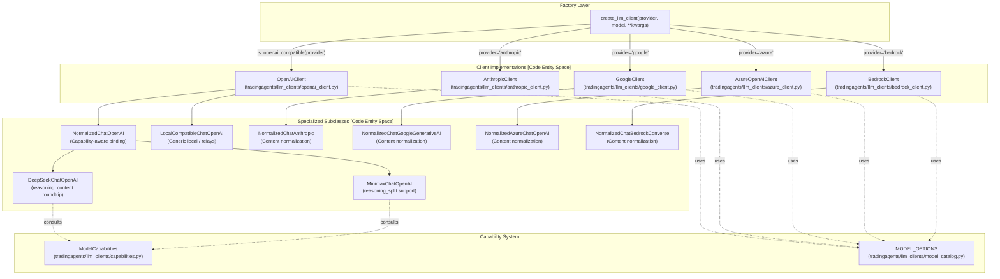
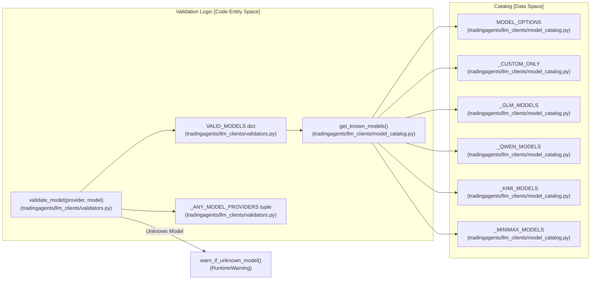

<!-- source: DeepWiki mcp.deepwiki.com · repo TauricResearch/TradingAgents · page 7.2 LLM Provider Support · fetched 2026-10-29 -->

# LLM Provider Support

Relevant source files

The following files were used as context for generating this wiki page:

- [tests/test_anthropic_effort.py](tests/test_anthropic_effort.py)
- [tests/test_api_key_env.py](tests/test_api_key_env.py)
- [tests/test_bedrock_provider.py](tests/test_bedrock_provider.py)
- [tests/test_env_overrides.py](tests/test_env_overrides.py)
- [tests/test_model_validation.py](tests/test_model_validation.py)
- [tests/test_ollama_base_url.py](tests/test_ollama_base_url.py)
- [tests/test_openai_compatible_provider.py](tests/test_openai_compatible_provider.py)
- [tests/test_openrouter_model_select.py](tests/test_openrouter_model_select.py)
- [tests/test_provider_registry.py](tests/test_provider_registry.py)
- [tradingagents/llm_clients/anthropic_client.py](tradingagents/llm_clients/anthropic_client.py)
- [tradingagents/llm_clients/api_key_env.py](tradingagents/llm_clients/api_key_env.py)
- [tradingagents/llm_clients/azure_client.py](tradingagents/llm_clients/azure_client.py)
- [tradingagents/llm_clients/base_client.py](tradingagents/llm_clients/base_client.py)
- [tradingagents/llm_clients/bedrock_client.py](tradingagents/llm_clients/bedrock_client.py)
- [tradingagents/llm_clients/google_client.py](tradingagents/llm_clients/google_client.py)
- [tradingagents/llm_clients/model_catalog.py](tradingagents/llm_clients/model_catalog.py)
- [tradingagents/llm_clients/openai_client.py](tradingagents/llm_clients/openai_client.py)
- [tradingagents/llm_clients/validators.py](tradingagents/llm_clients/validators.py)

## Purpose and Scope

This document explains the LLM provider architecture in TradingAgents, detailing how the system supports a wide array of LLM providers through a unified interface. It covers the `create_llm_client` factory, specialized client implementations (OpenAI, Anthropic, Google, Azure, Amazon Bedrock, etc.), the `NormalizedChat*` subclasses, the `OPENAI_COMPATIBLE_PROVIDERS` registry, `api_key_env` resolution, validators, remote Ollama handling, and the `model_catalog` including custom model IDs.

The architecture abstracts provider-specific differences in authentication, endpoint routing, and reasoning parameters (such as `reasoning_effort` for OpenAI, `thinking_level` for Google, `effort` for Anthropic, and `thinking` for GLM) while providing a consistent `BaseLLMClient` interface for the rest of the framework.

**Sources:** [tradingagents/llm_clients/base_client.py:25-62](), [tradingagents/llm_clients/factory.py:5-54]()

## Supported Providers Overview

TradingAgents supports a diverse set of LLM providers, including global APIs, regional China-specific endpoints, and local inference engines. Most providers follow the OpenAI-compatible specification.

| Provider | Client Implementation | Base URL / Endpoint | API Key Env Var |
|----------|-----------------------|---------------------|-----------------|
| `openai` | `OpenAIClient` | `api.openai.com` | `OPENAI_API_KEY` |
| `anthropic`| `AnthropicClient` | `api.anthropic.com` | `ANTHROPIC_API_KEY` |
| `google` | `GoogleClient` | Google Generative AI | `GOOGLE_API_KEY` |
| `azure` | `AzureOpenAIClient` | Resource-specific | `AZURE_OPENAI_API_KEY` |
| `bedrock` | `BedrockClient` | AWS Converse API | `AWS_BEARER_TOKEN_BEDROCK` |
| `deepseek` | `DeepSeekChatOpenAI` | `api.deepseek.com` | `DEEPSEEK_API_KEY` |
| `xai` | `OpenAIClient` | `api.x.ai/v1` | `XAI_API_KEY` |
| `qwen` / `-cn` | `OpenAIClient` | DashScope (Intl / CN) | `DASHSCOPE_API_KEY` |
| `glm` / `-cn` | `OpenAIClient` | Z.AI / BigModel.cn | `ZHIPU_API_KEY` |
| `minimax` / `-cn`| `MinimaxChatOpenAI` | MiniMax (.io / .com) | `MINIMAX_API_KEY` |
| `ollama` | `OpenAIClient` | `OLLAMA_BASE_URL` | None |
| `openrouter`| `OpenAIClient` | `openrouter.ai/api/v1` | `OPENROUTER_API_KEY` |
| `openai_compatible` | `OpenAIClient` | User-supplied `base_url` | `OPENAI_COMPATIBLE_API_KEY` |

**Sources:** [tradingagents/llm_clients/api_key_env.py:14-44](), [tradingagents/llm_clients/factory.py:34-52](), [tradingagents/llm_clients/bedrock_client.py:41-50]()

## Provider Architecture

The following diagram illustrates how the `create_llm_client` factory instantiates the appropriate client and how those clients interact with the capability system and external providers.

### Provider Mapping and Data Flow

**Sources:** [tradingagents/llm_clients/factory.py:34-52](), [tradingagents/llm_clients/openai_client.py:16-151](), [tradingagents/llm_clients/bedrock_client.py:31-72](), [tradingagents/llm_clients/anthropic_client.py:41-50](), [tradingagents/llm_clients/google_client.py:23-31](), [tradingagents/llm_clients/azure_client.py:14-18]()

## Client Factory, Base Interface, and API Key Resolution

The system utilizes an abstract base class `BaseLLMClient` [tradingagents/llm_clients/base_client.py:25-62]() to define the contract for all LLM integrations, requiring implementations of `get_llm()` and `validate_model()`.

### Content Normalization
Multiple providers return content as a list of typed blocks (text, reasoning, etc.). The `normalize_content` function [tradingagents/llm_clients/base_client.py:6-22]() extracts and joins text blocks into a plain string. Subclasses like `NormalizedChatOpenAI` [tradingagents/llm_clients/openai_client.py:16-51](), `LocalCompatibleChatOpenAI` [tradingagents/llm_clients/openai_client.py:54-69](), `NormalizedChatAnthropic` [tradingagents/llm_clients/anthropic_client.py:41-50](), `NormalizedChatGoogleGenerativeAI` [tradingagents/llm_clients/google_client.py:23-31](), `NormalizedAzureChatOpenAI` [tradingagents/llm_clients/azure_client.py:14-18](), and `NormalizedChatBedrockConverse` [tradingagents/llm_clients/bedrock_client.py:31-35]() override `invoke` to apply this normalization automatically.

### `create_llm_client()` and Provider Registry
The `create_llm_client` function routes requests based on the `provider` string using `OPENAI_COMPATIBLE_PROVIDERS` and provider specifications (`ProviderSpec`):
- **Native SDKs:** Dedicated clients for `AnthropicClient` [tradingagents/llm_clients/factory.py:34-36](), `GoogleClient` [tradingagents/llm_clients/factory.py:38-40](), `AzureOpenAIClient` [tradingagents/llm_clients/factory.py:42-44](), and `BedrockClient` [tradingagents/llm_clients/factory.py:46-48]().
- **OpenAI-Compatible:** Any provider registered as compatible routes through `OpenAIClient` [tradingagents/llm_clients/factory.py:50-52](), leveraging registry properties such as default base URLs and whether keys are optional (`key_optional`).

### API Key Resolution
The mapping between providers and their corresponding environment variables is centralized in `PROVIDER_API_KEY_ENV` [tradingagents/llm_clients/api_key_env.py:14-44](). The helper function `get_api_key_env(provider)` [tradingagents/llm_clients/api_key_env.py:47-53]() retrieves the appropriate environment variable name (e.g., `OPENAI_API_KEY`, `DASHSCOPE_API_KEY`, or `None` for keyless local runtimes like Ollama and Bedrock which use IAM). The interactive CLI uses `ensure_api_key` to prompt for missing credentials and safely write them back to local `.env` files with strict permissions [tests/test_api_key_env.py:98-170]().

**Sources:** [tradingagents/llm_clients/base_client.py:6-62](), [tradingagents/llm_clients/factory.py:5-54](), [tradingagents/llm_clients/api_key_env.py:14-53](), [tests/test_api_key_env.py:76-179]()

## Capability-Driven OpenAI Client and Specialized Subclasses

The `OpenAIClient` uses `NormalizedChatOpenAI` [tradingagents/llm_clients/openai_client.py:16-51]() which consults a per-model capability table (`get_capabilities`) to handle model-specific quirks, such as picking structured-output methods and determining whether `tool_choice` may be sent.

### Local and Generic OpenAI-Compatible Clients
`LocalCompatibleChatOpenAI` [tradingagents/llm_clients/openai_client.py:54-69]() handles arbitrary local servers (LM Studio, vLLM, llama.cpp via `openai_compatible` or `ollama`) where tool-calling support varies. It binds schemas as tools but suppresses object-form `tool_choice` to prevent rejections [tests/test_openai_compatible_provider.py:76-98]().

### DeepSeek Support
`DeepSeekChatOpenAI` [tradingagents/llm_clients/openai_client.py:88-130]() implements the "reasoning content roundtrip." When DeepSeek thinking models return `reasoning_content`, it must be captured and echoed back in the message history on the next turn to avoid HTTP 400 errors [tradingagents/llm_clients/openai_client.py:91-96]().

### MiniMax Support
`MinimaxChatOpenAI` [tradingagents/llm_clients/openai_client.py:132-161]() handles the `reasoning_split` parameter via `extra_body`. For M2.x reasoning models, setting `reasoning_split=True` redirects the `<think>` block into `reasoning_details`, keeping the main `content` field clean for downstream analysis [tradingagents/llm_clients/openai_client.py:135-141]().

**Sources:** [tradingagents/llm_clients/openai_client.py:16-161](), [tests/test_openai_compatible_provider.py:76-98]()

## Google, Anthropic, Azure, and Bedrock Clients

### Google Client
`GoogleClient` [tradingagents/llm_clients/google_client.py:38-79]() initializes `NormalizedChatGoogleGenerativeAI` [tradingagents/llm_clients/google_client.py:23-31]() with a robust default timeout (`REQUEST_TIMEOUT_SECONDS = 600`) and processes thinking parameters like `thinking_level`, falling back from `"minimal"` to `"low"` on models that reject it [tradingagents/llm_clients/google_client.py:65-73]().

### Anthropic Client
`AnthropicClient` [tradingagents/llm_clients/anthropic_client.py:53-78]() configures `NormalizedChatAnthropic` [tradingagents/llm_clients/anthropic_client.py:41-50](). It enforces an effort parameter gate (`_supports_effort`) ensuring extended-thinking `effort` parameters are only forwarded to compatible models (Opus 4.5+, Sonnet 4.6+, and Claude 5 family), preventing HTTP 400 errors on models like Haiku or older Sonnet versions [tradingagents/llm_clients/anthropic_client.py:14-39]().

### Amazon Bedrock Support
The `BedrockClient` supports AWS Bedrock via the `langchain-aws` integration using either bearer tokens (`AWS_BEARER_TOKEN_BEDROCK`) or the standard AWS IAM credential chain, defaulting to region `us-west-2` [tradingagents/llm_clients/bedrock_client.py:41-72]().

**Sources:** [tradingagents/llm_clients/google_client.py:38-79](), [tradingagents/llm_clients/anthropic_client.py:14-78](), [tradingagents/llm_clients/bedrock_client.py:41-72]()

## Remote Ollama and Dual-Region Providers

### Remote Ollama
Ollama support is dynamic via the `OLLAMA_BASE_URL` environment variable.
- **Default:** `http://localhost:11434/v1` [tests/test_ollama_base_url.py:35]().
- **Override:** Setting `OLLAMA_BASE_URL` updates both the CLI configuration flow and the underlying client at call time [tests/test_ollama_base_url.py:38-50]().

### Dual-Region Providers
Providers such as Qwen, GLM, and MiniMax maintain separate international and China-region endpoints (e.g., `qwen` vs `qwen-cn`), utilizing distinct API key environment variables because accounts are not shared across regions [tradingagents/llm_clients/api_key_env.py:25-30]().

**Sources:** [tests/test_ollama_base_url.py:32-80](), [tradingagents/llm_clients/api_key_env.py:25-30]()

## Model Catalog and Validation

The `MODEL_OPTIONS` catalog [tradingagents/llm_clients/model_catalog.py:96-257]() centralizes recommended models for "quick" and "deep" modes, organized into `ModelOption` tuples `(display_name, model_id)` [tradingagents/llm_clients/model_catalog.py:5-7](). 

### Custom Model IDs
For frequently changing providers or custom deployments, `_CUSTOM_ONLY` and provider-specific catalogs include explicit `"Custom model ID"` (`"custom"`) options allowing users to supply arbitrary model identifiers [tradingagents/llm_clients/model_catalog.py:10-13]().

### Model Validation
The `validate_model` function [tradingagents/llm_clients/validators.py:20-33]() checks if a given model name is valid for its provider.
- **`_ANY_MODEL_PROVIDERS`**: For providers like `ollama`, `openrouter`, `openai_compatible`, `mistral`, `kimi`, `groq`, `nvidia`, and `bedrock`, any model string is accepted without warning since model names are user-defined or dynamic [tradingagents/llm_clients/validators.py:8-11]().
- **Known Models**: For strict providers, validation checks against `VALID_MODELS` [tradingagents/llm_clients/validators.py:13-17]() derived from `get_known_models()` [tradingagents/llm_clients/model_catalog.py:3-7](). Unknown models emit a `RuntimeWarning` via `warn_if_unknown_model()` [tradingagents/llm_clients/base_client.py:40-52]() while still permitting execution for zero-day model support.

**Sources:** [tradingagents/llm_clients/model_catalog.py:1-13](), [tradingagents/llm_clients/model_catalog.py:96-124](), [tradingagents/llm_clients/validators.py:8-33](), [tradingagents/llm_clients/base_client.py:40-52]()

---

