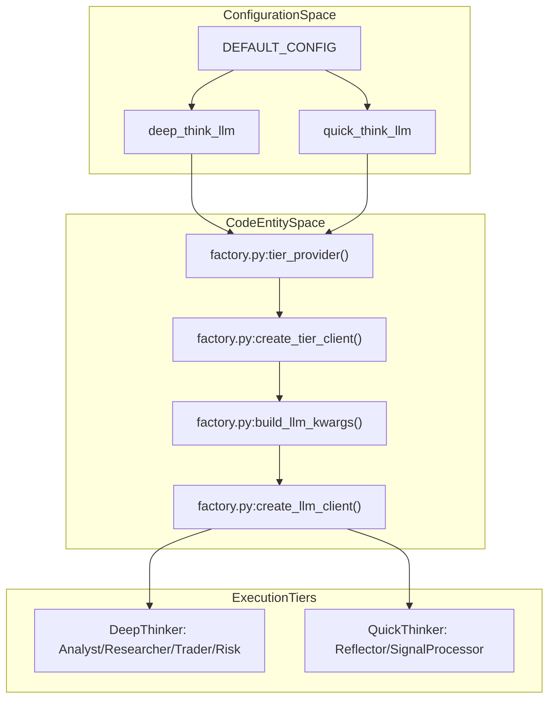
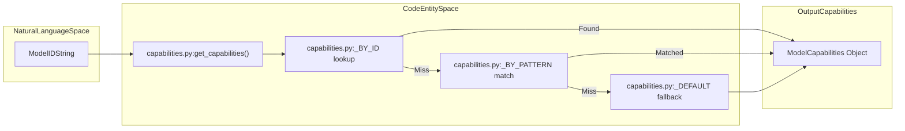

<!-- source: DeepWiki mcp.deepwiki.com · repo TauricResearch/TradingAgents · page 7.3 Deep vs Quick Thinking Strategy · fetched 2026-10-29 -->

# Deep vs Quick Thinking Strategy

<details>
<summary>Relevant source files</summary>

The following files were used as context for generating this wiki page:

- [.env.example](.env.example)
- [tests/test_capabilities.py](tests/test_capabilities.py)
- [tests/test_deepseek_reasoning.py](tests/test_deepseek_reasoning.py)
- [tests/test_google_api_key.py](tests/test_google_api_key.py)
- [tests/test_google_thinking_level.py](tests/test_google_thinking_level.py)
- [tests/test_minimax.py](tests/test_minimax.py)
- [tests/test_openai_reasoning_effort.py](tests/test_openai_reasoning_effort.py)
- [tests/test_openai_responses_base_url.py](tests/test_openai_responses_base_url.py)
- [tests/test_tier_providers.py](tests/test_tier_providers.py)
- [tradingagents/llm_clients/__init__.py](tradingagents/llm_clients/__init__.py)
- [tradingagents/llm_clients/capabilities.py](tradingagents/llm_clients/capabilities.py)
- [tradingagents/llm_clients/factory.py](tradingagents/llm_clients/factory.py)

</details>


## Purpose and Scope

This document explains the dual-model LLM strategy employed by TradingAgents, where different tasks use either `deep_think_llm` vs `quick_think_llm` based on complexity requirements. The system optimizes for both quality and performance by routing complex analytical tasks to powerful reasoning models while delegating simple formatting, reflection, and utility tasks to faster, cheaper models. This page covers model selection criteria, configuration parameters, implementation details in the orchestration and factory layers, provider-specific reasoning parameters (`reasoning_effort`, `thinking_level`, `effort`, `thinking_budget`), the `ModelCapabilities` table, and retry/token limit management.

Sources: [tradingagents/llm_clients/factory.py:1-152](), [tradingagents/llm_clients/capabilities.py:1-140]()

---

## Dual-Model Architecture Overview

TradingAgents implements a two-tier LLM strategy that balances analytical depth with operational efficiency. The system maintains separate model configurations for different cognitive workloads, instantiated via `create_tier_client` [tradingagents/llm_clients/factory.py:138-152]().

### Model Usage Pattern

The following diagram illustrates how natural language configuration options map directly to code entities and functions in `tradingagents/llm_clients/factory.py` and graph orchestration modules.

**Dual-Model Task Distribution and Code Mapping**


Sources: [tradingagents/llm_clients/factory.py:133-152](), [tests/test_tier_providers.py:31-64]()

---

## Deep vs Quick Tier Selection

The system separates workloads into two distinct tiers:

1. **Deep Thinking Tier (`deep_think_llm`)**: Used for core analytical workloads that require deep reasoning, multi-step planning, and complex decision-making. This includes the Analyst team, Researcher adversarial debates, Trader decision synthesis, and Risk Management evaluation.
2. **Quick Thinking Tier (`quick_think_llm`)**: Used for structured extraction, reflection, and signal processing tasks where latency and throughput are prioritized over deep multi-turn contemplation. This includes `Reflector` outcome logging and `SignalProcessor` parsing.

Each tier can optionally operate on its own provider via `tier_provider()` [tradingagents/llm_clients/factory.py:133-136]() and `create_tier_client()` [tradingagents/llm_clients/factory.py:138-152](). If a tier specifies a separate provider (e.g., `deep_think_provider = "anthropic"`), it retrieves that provider's specific API settings and custom backend URL independently of the main run configuration [tests/test_tier_providers.py:42-64]().

Sources: [tradingagents/llm_clients/factory.py:90-152](), [tests/test_tier_providers.py:15-64]()

---

## Model Capabilities and Structured Output

TradingAgents uses a declarative capability table to handle model-specific API restrictions and structured output methods without cluttering client code with conditional logic [tradingagents/llm_clients/capabilities.py:1-13]().

### The `ModelCapabilities` Dataclass

The `ModelCapabilities` dataclass defines what an OpenAI-compatible model accepts at the API level [tradingagents/llm_clients/capabilities.py:30-46]().

```python
@dataclass(frozen=True)
class ModelCapabilities:
    supports_tool_choice: bool
    supports_json_mode: bool
    supports_json_schema: bool
    preferred_structured_method: StructuredMethod
    requires_reasoning_content_roundtrip: bool = False
    requires_reasoning_split: bool = False
```

Capabilities are resolved via `get_capabilities(model_name)` [tradingagents/llm_clients/capabilities.py:124-140](), which strips OpenRouter namespaces (e.g., `deepseek/`) [tradingagents/llm_clients/capabilities.py:132-133](), matches exact model IDs in `_BY_ID`, falls back to regex patterns in `_BY_PATTERN`, and defaults to permissive settings via `_DEFAULT` [tradingagents/llm_clients/capabilities.py:94-140]().

**Model Capabilities Resolution Workflow**


Sources: [tradingagents/llm_clients/capabilities.py:30-140](), [tests/test_capabilities.py:12-160]()

---

## Provider-Specific Reasoning Parameters

Different LLM providers expose varying parameters to control reasoning effort and depth. TradingAgents normalizes these parameters inside `build_llm_kwargs` [tradingagents/llm_clients/factory.py:90-130]() and provider-specific client wrappers.

### Parameter Mapping Overview

| Provider | Config Key | Parameter Passed to Client | Notes |
|----------|------------|----------------------------|-------|
| OpenAI / Azure | `openai_reasoning_effort` | `reasoning_effort` (`low`, `medium`, `high`) | Gated via `_supports_reasoning_effort` to prevent 400 errors on non-reasoning models [tests/test_openai_reasoning_effort.py:16-28](). |
| Google Gemini | `google_thinking_level` | `thinking_level` / `thinking_budget` | Gemini 3.x uses string levels; Pro and 3.8 Flash automatically remap `"minimal"` to `"low"` [tests/test_google_thinking_level.py:26-45](). |
| Anthropic | `anthropic_effort` | `effort` (`low`, `medium`, `high`) | Gated via `_supports_effort` for compatible Claude models [tests/test_anthropic_effort.py:1-20](). |
| MiniMax | N/A | `reasoning_split=True` via `extra_body` | Injected for M2.x reasoning models so `<think>` blocks populate `reasoning_details` [tests/test_minimax.py:27-34](). |

Sources: [tradingagents/llm_clients/factory.py:90-130](), [tests/test_openai_reasoning_effort.py:16-43](), [tests/test_google_thinking_level.py:26-63](), [tests/test_minimax.py:27-44]()

---

## Retry Budgets, Token Limits, and Timeout Configuration

Robust execution requires strict validation and coercion of retry budgets and token constraints.

### Coercion and Validation Functions

* **`_coerce_max_retries(value)`**: Validates `llm_max_retries` from environment variables or config dictionaries. Rejects booleans and negative integers loudly at startup rather than failing silently [tradingagents/llm_clients/factory.py:59-74]().
* **`_coerce_max_tokens(value)`**: Validates `max_tokens` (or `max_output_tokens` for Google) to ensure they are strictly positive integers [tradingagents/llm_clients/factory.py:77-88]().
* **Timeout Enforcement**: Clients enforce default network timeouts (e.g., 600 seconds) to prevent stalled requests from hanging graph execution [tests/test_google_thinking_level.py:66-70]().

Sources: [tradingagents/llm_clients/factory.py:59-130](), [tests/test_google_thinking_level.py:66-70]()

---

## Content Normalization and Thinking Round-Trip

Reasoning models like DeepSeek require special message round-trip handling.

### DeepSeek Reasoning Propagation

DeepSeek reasoning models return `reasoning_content` blocks that must be echoed back in subsequent assistant message turns, or the API returns an HTTP 400 error [tests/test_deepseek_reasoning.py:65-116]().
1. **Capture**: `_create_chat_result` captures incoming reasoning chunks into `AIMessage.additional_kwargs["reasoning_content"]` [tests/test_deepseek_reasoning.py:65-88]().
2. **Round-Trip**: `_get_request_payload` re-attaches the captured content to outgoing assistant message payloads across conversation turns [tests/test_deepseek_reasoning.py:89-116]().

Sources: [tradingagents/llm_clients/openai_client.py:1-158](), [tests/test_deepseek_reasoning.py:65-164]()

---

