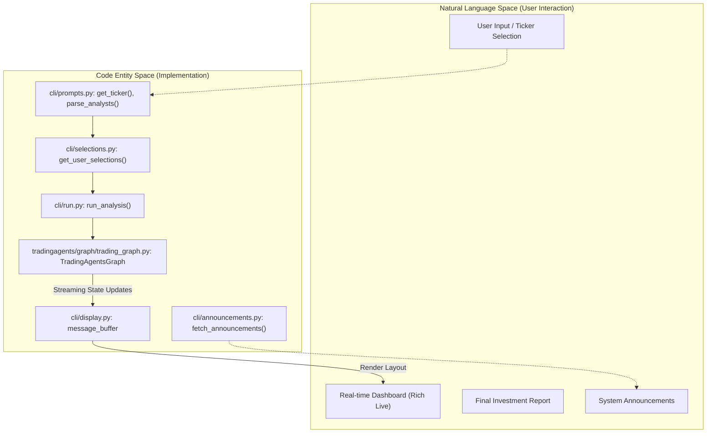
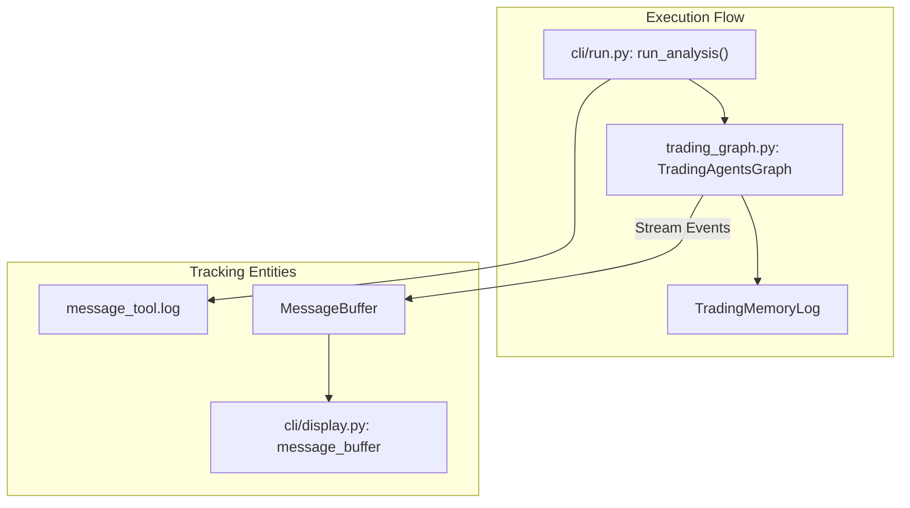

<!-- source: DeepWiki mcp.deepwiki.com · repo TauricResearch/TradingAgents · page 8 CLI Deep Dive · fetched 2026-10-29 -->

# CLI Deep Dive

Relevant source files

The following files were used as context for generating this wiki page:

- [cli/__init__.py](cli/__init__.py)
- [cli/prompts.py](cli/prompts.py)
- [cli/run.py](cli/run.py)
- [cli/selections.py](cli/selections.py)
- [tests/test_cli_headless.py](tests/test_cli_headless.py)
- [tests/test_cli_memory_log.py](tests/test_cli_memory_log.py)

## Purpose and Scope

The TradingAgents CLI provides an interactive, real-time terminal interface for orchestrating multi-agent financial analysis. It manages the complete lifecycle of a trading session, from user configuration collection [cli/selections.py:42-46]() and prompt validation [cli/prompts.py:66-81]() to real-time graph execution monitoring [cli/run.py:98-127]() and report generation [cli/run.py:115](). This parent page outlines the high-level architecture of the CLI subsystems, linking to child pages for in-depth technical details.

Sources:
- [cli/run.py:98-127]()
- [cli/selections.py:42-46]()
- [cli/prompts.py:66-81]()

## System Architecture Overview

The CLI relies on Typer for command-line parsing [tests/test_cli_headless.py:153-156](), Questionary for interactive prompts [cli/prompts.py:45-57](), and Rich for terminal dashboards [cli/run.py:11-12](). It bridges user selections into a running `TradingAgentsGraph` instance [cli/run.py:122-127]() while maintaining state logs and message buffers.

### UI to Code Entity Mapping

The following diagram bridges the user-facing CLI concepts to the specific modules and functions that implement them.

Sources:
- [cli/announcements.py]()
- [cli/display.py]()
- [cli/prompts.py:45-57]()
- [cli/run.py:98-127]()
- [cli/selections.py:42-46]()
- [tradingagents/graph/trading_graph.py:33]()

## Interactive Configuration Flow

Before execution begins, the CLI conducts a multi-step configuration wizard. This flow gathers parameters such as ticker symbols [cli/prompts.py:38-63](), analysis dates [cli/prompts.py:73-81](), agent rosters [cli/prompts.py:144-176](), and LLM provider settings. It incorporates asset type detection [cli/prompts.py:118-125](), `.env` persistence for API keys [cli/prompts.py:8](), and preference caching [cli/prefs.py]() to streamline subsequent runs.

For details, see [Interactive Configuration Flow](#8.1).

Sources:
- [cli/prompts.py:8]()
- [cli/prompts.py:38-63]()
- [cli/prompts.py:73-81]()
- [cli/prompts.py:118-125]()
- [cli/prompts.py:144-176]()
- [cli/prefs.py]()

## Real-time Display System

Once graph execution starts, the CLI enters a real-time display mode using `rich.live.Live` [cli/run.py:11-12](). This subsystem manages progress panels, message streams, analyst status updates, and live token usage metrics via `StatsCallbackHandler` [cli/run.py:26](), falling back gracefully when run without a terminal [cli/run.py:102-108]().

For details, see [Real-time Display System](#8.2).

Sources:
- [cli/run.py:11-12]()
- [cli/run.py:26]()
- [cli/run.py:102-108]()

## Message Buffer and State Tracking

The message buffer tracks agent execution status (pending, in_progress, completed) and intercepts tool calls [tests/test_cli_memory_log.py:94-118]() and text messages to populate report sections [tests/test_cli_memory_log.py:98](). It ensures that the CLI execution path interacts with the memory log and decision recording mechanisms identically to programmatic runs [tests/test_cli_memory_log.py:1-8]().

### State Tracking and Execution Mapping

For details, see [Message Buffer and State Tracking](#8.3).

Sources:
- [cli/run.py:1-165]()
- [tests/test_cli_memory_log.py:1-8]()
- [tests/test_cli_memory_log.py:94-118]()

## Report Generation and Output

At the conclusion of a run, the CLI compiles collected report sections into a structured directory tree [cli/run.py:134-137]() or outputs consolidated markdown and self-contained HTML files. It handles final decision displays, unreadable rating reviews, and state log persistence.

For details, see [Report Generation and Output](#8.4).

Sources:
- [cli/run.py:134-137]()

---

