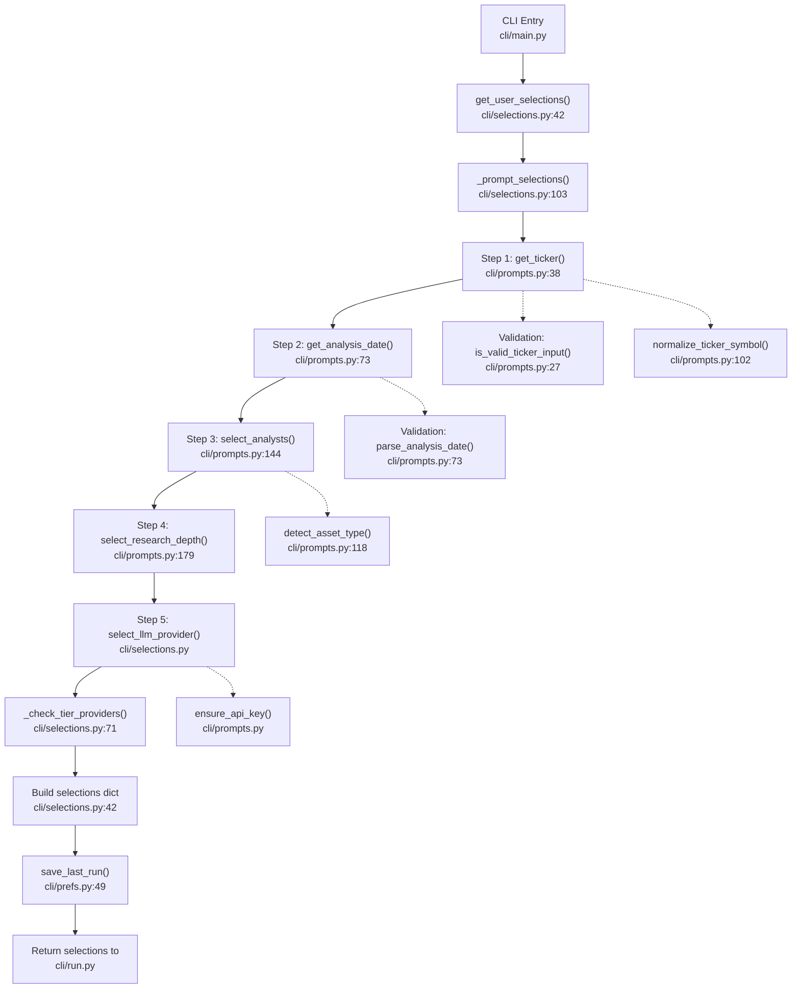
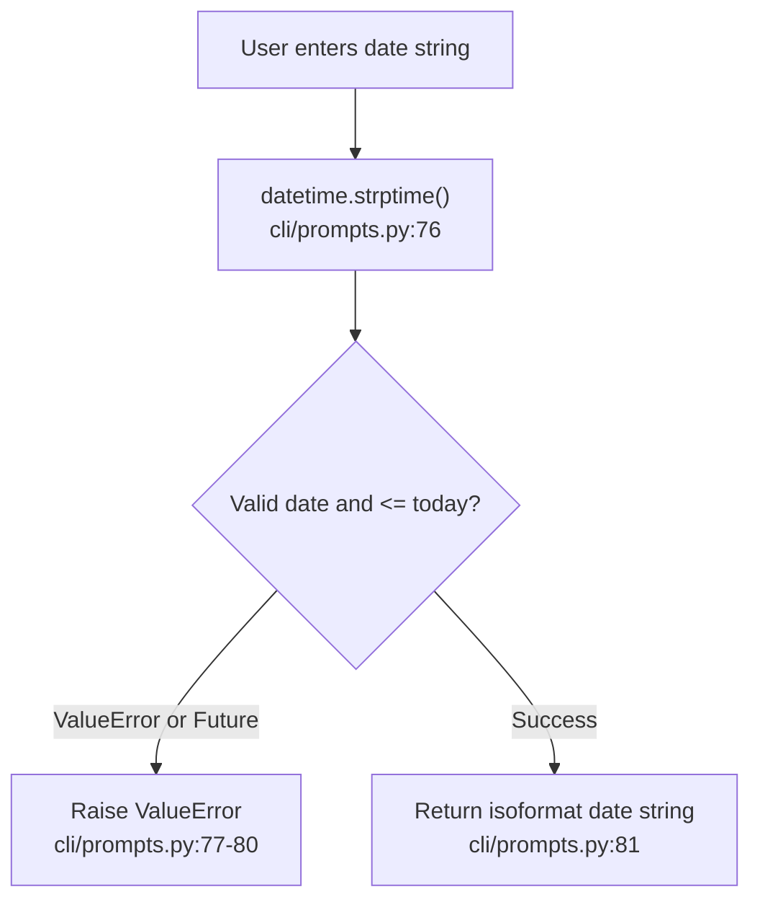
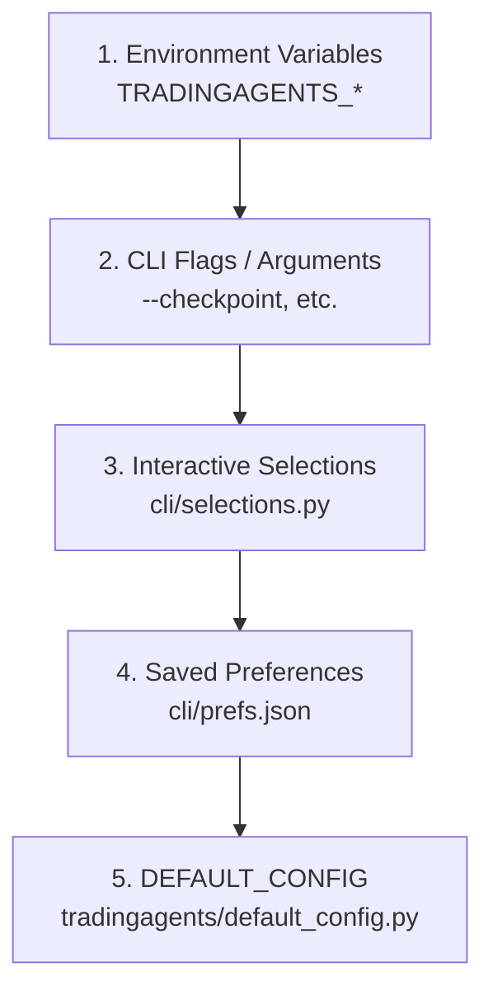

<!-- source: DeepWiki mcp.deepwiki.com · repo TauricResearch/TradingAgents · page 8.1 Interactive Configuration Flow · fetched 2026-10-29 -->

# Interactive Configuration Flow

Relevant source files

The following files were used as context for generating this wiki page:

- [cli/announcements.py](cli/announcements.py)
- [cli/config.py](cli/config.py)
- [cli/prefs.py](cli/prefs.py)
- [cli/prompts.py](cli/prompts.py)
- [cli/run.py](cli/run.py)
- [cli/selections.py](cli/selections.py)
- [tests/test_cli_config_precedence.py](tests/test_cli_config_precedence.py)
- [tests/test_cli_env_skip.py](tests/test_cli_env_skip.py)
- [tests/test_cli_headless.py](tests/test_cli_headless.py)
- [tests/test_cli_memory_log.py](tests/test_cli_memory_log.py)
- [tests/test_cli_prefs.py](tests/test_cli_prefs.py)
- [tests/test_cli_symbol_handling.py](tests/test_cli_symbol_handling.py)
- [tests/test_ticker_symbol_handling.py](tests/test_ticker_symbol_handling.py)

## Purpose and Scope

This document details the interactive configuration collection process in the CLI interface of TradingAgents. Before launching the real-time analysis display, the CLI guides users through a structured questionnaire to gather all necessary parameters: ticker symbol, analysis date, analyst team composition, research depth, LLM provider, reasoning tier parameters, and model selections. This flow transforms user inputs and saved preferences into configuration overrides that customize the `TradingAgentsGraph` execution.

The configuration collection logic is distributed across several modules: `cli/selections.py` orchestrates the prompt sequence, `cli/prompts.py` handles individual interactive widgets via `questionary` and validates user input, `cli/prefs.py` manages persistent defaults, and `cli/run.py` synthesizes selections with environment variables and CLI flags.

---

## Configuration Collection Architecture

The configuration flow is orchestrated by the `get_user_selections()` function inside `cli/selections.py`, which executes a sequential series of prompts before any analysis begins. This ensures all parameters are collected upfront, enabling immediate execution without interruption.

**Sources:** [cli/selections.py:42-46](), [cli/selections.py:71-92](), [cli/selections.py:103-173](), [cli/prompts.py:27-124]()

---

## Step-by-Step Input Collection

### Step 1: Ticker Symbol Input and Normalization

The ticker symbol input accepts a wide range of symbols (stocks, indices, crypto, futures) and normalizes them to the canonical Yahoo Finance format.

| Function | `get_ticker()` / `parse_ticker()` |
|----------|---------------------------------|
| **Location** | [cli/prompts.py:38-71]() |
| **Widget** | `questionary.text()` |
| **Validation** | `is_valid_ticker_input()` (alnum + `._-^=`) [cli/prompts.py:27-36]() |
| **Normalization** | `normalize_ticker_symbol()` [cli/prompts.py:102-116]() |

The normalization process delegates to the data layer's `normalize_symbol` function so the symbol the CLI passes through the pipeline matches what the data path prices (e.g., `BTCUSD` -> `BTC-USD`, `XAUUSD` -> `GC=F`) [cli/prompts.py:102-116](). If the data layer is unavailable, it falls back to plain upper-case conversion [cli/prompts.py:114-115]().

**Sources:** [cli/prompts.py:27-116](), [tests/test_cli_symbol_handling.py:15-63]()

---

### Step 2: Analysis Date Input

The analysis date input validates temporal formatting and ensures the selected date is not in the future.

| Function | `parse_analysis_date()` |
|----------|------------------------|
| **Location** | [cli/prompts.py:73-82]() |
| **Format** | `YYYY-MM-DD` |

**Sources:** [cli/prompts.py:73-82]()

---

### Step 3: Analyst Team Selection

The analyst selection uses an interactive checkbox widget. The system automatically detects the asset type via `detect_asset_type()` [cli/prompts.py:118-124]() and filters available analysts via `filter_analysts_for_asset_type()` [cli/prompts.py:127-136](). For instance, `AnalystType.FUNDAMENTALS` is automatically excluded for cryptocurrency assets [cli/prompts.py:130-136]().

| Analyst Option | Enum Value |
|----------------|------------|
| Market Analyst | `AnalystType.MARKET` |
| Sentiment Analyst | `AnalystType.SOCIAL` |
| News Analyst | `AnalystType.NEWS` |
| Fundamentals Analyst | `AnalystType.FUNDAMENTALS` |

**Sources:** [cli/prompts.py:17-22](), [cli/prompts.py:118-136](), [cli/prompts.py:144-176]()

---

### Step 4: Research Depth Selection

Research depth controls the scale of debate and risk discussion rounds within the agent graph.

| Depth Level | Value | Description |
|-------------|-------|-------------|
| **Shallow** | `1` | Quick research, minimal debate [cli/prompts.py:180]() |
| **Medium** | `3` | Moderate debate and strategy rounds [cli/prompts.py:181]() |
| **Deep** | `5` | Comprehensive research and in-depth debate [cli/prompts.py:182]() |

The selected research depth sets both `max_debate_rounds` and `max_risk_discuss_rounds` unless overridden by explicit environment variables (`TRADINGAGENTS_MAX_DEBATE_ROUNDS` or `TRADINGAGENTS_MAX_RISK_ROUNDS`) [cli/run.py:66-81]().

**Sources:** [cli/prompts.py:179-195](), [cli/run.py:66-81](), [tests/test_cli_config_precedence.py:28-56]()

---

### Step 5: LLM Provider, Tier Validation, and API Key Persistence

The CLI supports multi-provider LLM integration with automatic API key validation and persistence.

*   **Tier Provider Checking:** `_check_tier_providers()` inspects quick and deep thinking tiers before execution, verifying that any secondary provider has its corresponding API key present in the environment [cli/selections.py:71-92]().
*   **API Key Persistence:** `ensure_api_key(provider)` checks `os.environ` for the required API key variable. If missing, it prompts the user interactively and saves the key to the local `.env` file using python-dotenv's `set_key` utility [cli/prompts.py]().
*   **Regional Selection:** For providers like GLM, Qwen, and MiniMax, regional prompts distinguish between international endpoints and domestic China endpoints [cli/selections.py:19-23]().

**Sources:** [cli/selections.py:71-92](), [cli/prompts.py](), [tests/test_cli_env_skip.py:37-77]()

---

## Headless and Unattended Mode Execution

When run in environments without an interactive terminal (`sys.stdin.isatty()` evaluates to `False`), the CLI checks for unattended gaps via `unattended_gaps(flags)` [cli/run.py:100-108](). If required flags or environment variables are missing, it halts execution and explicitly lists the missing parameters [cli/run.py:102-108](), preventing blocked prompt hangs.

**Sources:** [cli/run.py:98-109](), [cli/selections.py:55-68](), [tests/test_cli_headless.py:69-81]()

---

## Announcements System

Before collecting selections, the CLI fetches and displays remote announcements to communicate critical system updates or notices.

*   **Fetching:** `fetch_announcements()` performs an HTTP GET request to the announcements endpoint with a configurable timeout [cli/announcements.py:11-29]().
*   **Display:** Renders a Rich `Panel`. If `require_attention` is `True`, the CLI prompts the user to press Enter before continuing [cli/announcements.py:32-53]().

**Sources:** [cli/announcements.py:11-53](), [cli/config.py]()

---

## Saved Preferences as Defaults

Preferences from the last successful run are persisted to preferences storage and offered as defaults on subsequent runs [cli/prefs.py:1-15]().

*   **Storage Path:** Preferences are serialized as JSON at `~/.tradingagents/cli_prefs.json` [cli/prefs.py:28]().
*   **Remembered Fields:** Stored keys are constrained to `REMEMBERED` fields (`output_language`, `analysts`, `research_depth`, `llm_provider`, `quick_think_llm`, `deep_think_llm`, `backend_url`) [cli/prefs.py:30-33](). Dynamic parameters like tickers and dates are excluded [cli/prefs.py:8-10]().
*   **Sanitization:** `sanitize()` checks remembered values against current valid options in the model catalog and asset constraints, dropping stale or retired model IDs [cli/prefs.py:62-91]().
*   **Atomicity:** Writes are performed atomically using `replace_file()` to prevent torn or corrupted JSON files during concurrent invocations [cli/prefs.py:54-57]().

**Sources:** [cli/prefs.py:1-91](), [tests/test_cli_prefs.py:31-90]()

---

## Configuration Precedence

When assembling the final runtime configuration dictionary inside `_build_run_config()`, the system applies a strict precedence hierarchy [cli/run.py:59-95]():

**Sources:** [cli/run.py:59-95](), [tests/test_cli_config_precedence.py:28-70]()

---

