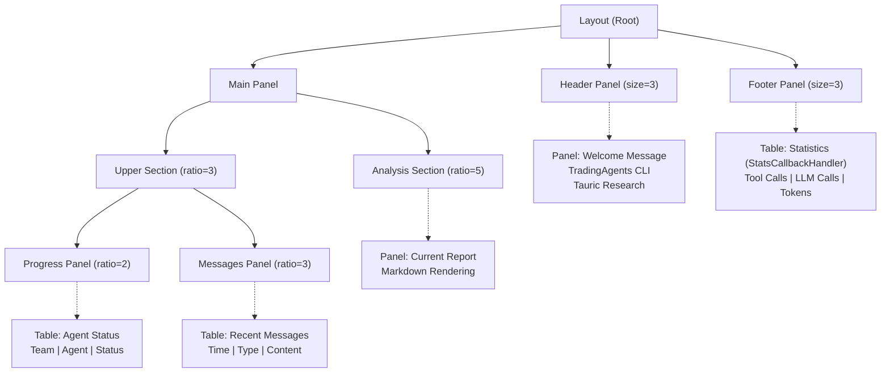
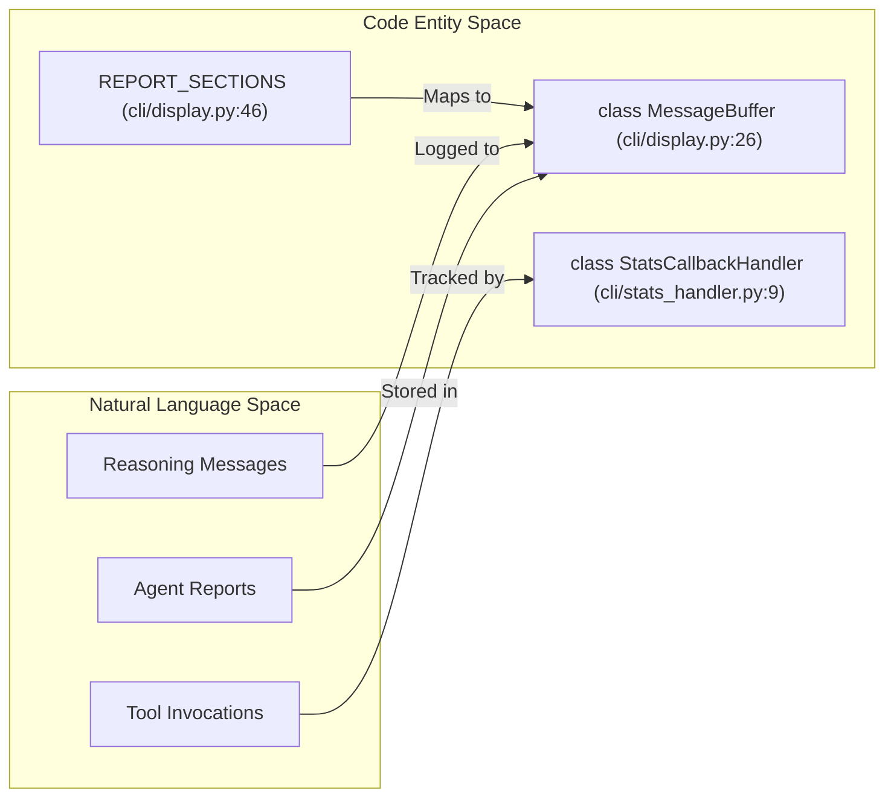

<!-- source: DeepWiki mcp.deepwiki.com · repo TauricResearch/TradingAgents · page 8.2 Real-time Display System · fetched 2026-10-29 -->

# Real-time Display System

<details>
<summary>Relevant source files</summary>

The following files were used as context for generating this wiki page:

- [cli/display.py](cli/display.py)
- [cli/static/welcome.txt](cli/static/welcome.txt)
- [cli/stats_handler.py](cli/stats_handler.py)
- [tests/test_analyst_execution.py](tests/test_analyst_execution.py)
- [tests/test_cli_no_console.py](tests/test_cli_no_console.py)
- [tradingagents/graph/analyst_execution.py](tradingagents/graph/analyst_execution.py)
- [tradingagents/graph/conditional_logic.py](tradingagents/graph/conditional_logic.py)

</details>


## Purpose and Scope

This document describes the real-time display system used by the TradingAgents CLI to provide live visual feedback during multi-agent trading analysis. The system leverages the `Rich` library to create a structured terminal interface with multiple panels showing agent progress, message logs, tool calls, and generated reports, all updated in real-time as the analysis executes.

The display system is encapsulated primarily within `cli/display.py` and invoked via `cli/main.py`, utilizing a specialized `MessageBuffer` class to manage state transitions between the LangGraph execution and the UI rendering layer [cli/display.py:1-157](). It also integrates the `StatsCallbackHandler` from `cli/stats_handler.py` to track token usage and API call metrics [cli/stats_handler.py:9-76]().

Sources: [cli/display.py:1-157](), [cli/stats_handler.py:9-76]().

## Architecture Overview

The real-time display system is built on four core components:

1.  **Rich Library Integration**: Uses `rich.live.Live`, `rich.layout.Layout`, and various Rich widgets for terminal rendering [cli/display.py:8-23]().
2.  **Layout Structure**: A hierarchical panel system organizing progress, messages, and reports [cli/display.py:160-173]().
3.  **Streaming Update Loop**: Consumes chunks from `graph.stream()` and updates the display via the `update_display` function [cli/display.py:183-200]().
4.  **Metrics Tracking**: Uses `StatsCallbackHandler` to monitor `llm_calls`, `tool_calls`, and token usage (`tokens_in`/`tokens_out`) across all agents [cli/stats_handler.py:9-18]().

The display runs within a `Live` context that refreshes at a consistent rate, providing smooth animations and status updates without clearing the terminal.

Sources: [cli/display.py:8-173](), [cli/display.py:183-200](), [cli/stats_handler.py:9-18]().

## Display Layout Hierarchy

The terminal interface uses a hierarchical `Layout` structure divided into regions. The `create_layout()` function defines this structure [cli/display.py:160-173]().

### Layout Structure Diagram



Sources: [cli/display.py:160-173](), [cli/stats_handler.py:68-76]().

### Layout Code Structure

The layout is created with fixed-size headers and footers, while the main content area uses ratio-based sizing to ensure responsiveness [cli/display.py:160-173]():

```python
layout.split_column(
    Layout(name="header", size=3),      # Fixed 3 lines
    Layout(name="main"),                # Variable size
    Layout(name="footer", size=3),      # Fixed 3 lines
)

layout["main"].split_column(
    Layout(name="upper", ratio=3),      # 3/8 of main area
    Layout(name="analysis", ratio=5)    # 5/8 of main area
)

layout["upper"].split_row(
    Layout(name="progress", ratio=2),   # 2/5 of upper area
    Layout(name="messages", ratio=3)    # 3/5 of upper area
)
```

Sources: [cli/display.py:160-173]().

## Data Entities and State Management

The system bridges the "Natural Language" output of agents to "Code Entities" through the `MessageBuffer` and `StatsCallbackHandler`.

### Entity Mapping Diagram



Sources: [cli/display.py:26-64](), [cli/stats_handler.py:9-18]().

## Metrics and Statistics Tracking

The `StatsCallbackHandler` implements the LangChain `BaseCallbackHandler` to capture low-level execution metrics [cli/stats_handler.py:9-10]().

*   **LLM Calls**: Incremented in `on_llm_start` and `on_chat_model_start` [cli/stats_handler.py:20-39]().
*   **Token Usage**: Extracted from `LLMResult` in `on_llm_end`. It specifically looks for `usage_metadata` in `AIMessage` objects to update `tokens_in` and `tokens_out` [cli/stats_handler.py:40-57]().
*   **Tool Calls**: Incremented in `on_tool_start` [cli/stats_handler.py:58-67]().

These metrics are retrieved via `get_stats()` and rendered in the footer of the real-time display [cli/stats_handler.py:68-76]().

Sources: [cli/stats_handler.py:9-76]().

## Display Update Mechanism

The `update_display()` function rebuilds all panels on each refresh cycle. This function is called repeatedly within the `Live` context as the LangGraph stream yields new state updates [cli/display.py:183-200]().

### Display Update Flow Diagram

```mermaid
sequenceDiagram
    participant Stream as "TradingAgentsGraph.graph.stream()"
    participant Loop as "Stream Loop (cli/main.py)"
    participant Buffer as "MessageBuffer (cli/display.py:26)"
    participant Stats as "StatsCallbackHandler (cli/stats_handler.py)"
    participant Update as "update_display() (cli/display.py:183)"
    participant Live as "rich.live.Live"

    Stream->>Loop: "Yield chunk"
    Loop->>Buffer: "update_agent_status()<br/>update_report_section()"
    Loop->>Update: "Call update_display(layout, buffer, stats_handler)"
    Update->>Buffer: "Get agent_status & messages"
    Update->>Stats: "get_stats()"
    Update->>Live: "Refresh Layout"
    Note over Stream,Live: "Loop continues until graph reaches END"
```

Sources: [cli/display.py:26-200](), [cli/stats_handler.py:68-76]().

### Progress Panel Construction

The progress panel displays agent status grouped by team using `MessageBuffer.FIXED_AGENTS` and user-selected analysts [cli/display.py:28-41](), [cli/display.py:65-93]().

**Agent Status States**:
*   **Pending**: Yellow text, indicating the node has not been reached.
*   **In Progress**: Cyan text with a `Spinner` animation.
*   **Completed**: Green text with a checkmark.

Sources: [cli/display.py:28-93]().

### Messages Panel Construction

The messages panel combines tool calls and reasoning messages, sorted by timestamp [cli/display.py:115-122]().

Sources: [cli/display.py:115-122]().

### Analysis Panel Construction

The analysis panel renders the most recently updated report section as Markdown. The `MessageBuffer._update_current_report()` method identifies the latest section with content and formats it for display [cli/display.py:127-155]().

Sources: [cli/display.py:127-155]().

## Non-Scrolling View

The real-time display is designed to prevent terminal scrolling, which can cause flicker and a poor user experience. It achieves this by running within a `rich.live.Live` context with `screen=True`. This ensures that the entire display is redrawn in place within the terminal's alternate screen buffer, keeping the content static and readable. Once the live view ends, the final report is printed, ensuring no information is lost.

Sources: [cli/display.py:1-157]().

## No-Console Fallback

In environments where a console buffer is not available (e.g., certain non-interactive Windows terminals), `prompt_toolkit` can raise a `NoConsoleScreenBufferError`. The CLI includes a specific handler to catch this error and provide an actionable message to the user, preventing a raw traceback from being displayed [tests/test_cli_no_console.py:1-6]().

The `_NO_CONSOLE_ERRORS` tuple in `cli/main.py` is platform-aware; it contains the specific exception type on Windows and is empty on other platforms [tests/test_cli_no_console.py:16-27](). If this specific error occurs, the CLI prints a user-friendly message like "no Windows console available" and exits gracefully, without exposing internal tracebacks [tests/test_cli_no_console.py:29-47](). Unrelated errors are allowed to propagate normally [tests/test_cli_no_console.py:49-57]().

Sources: [tests/test_cli_no_console.py:1-57]().

## Complete Report Display

After the streaming loop completes, report rendering functions provide a comprehensive view of all analysis results organized by team using side-by-side columns or structured layouts.

Sources: [cli/display.py:1-157]().

## Performance Considerations

*   **Update Frequency**: Set appropriately to balance visual smoothness with CPU usage.
*   **Memory Management**: `MessageBuffer` uses `collections.deque` with a `maxlen=100` to prevent memory leaks during long-running analyses [cli/display.py:56-58]().
*   **Concurrency**: `StatsCallbackHandler` uses `threading.Lock` to ensure thread-safe updates to metrics from asynchronous LLM calls [cli/stats_handler.py:14](), [cli/stats_handler.py:27](), [cli/stats_handler.py:37](), [cli/stats_handler.py:54](), [cli/stats_handler.py:65](), [cli/stats_handler.py:70]().

Sources: [cli/display.py:56-58](), [cli/stats_handler.py:14-70]().

---

