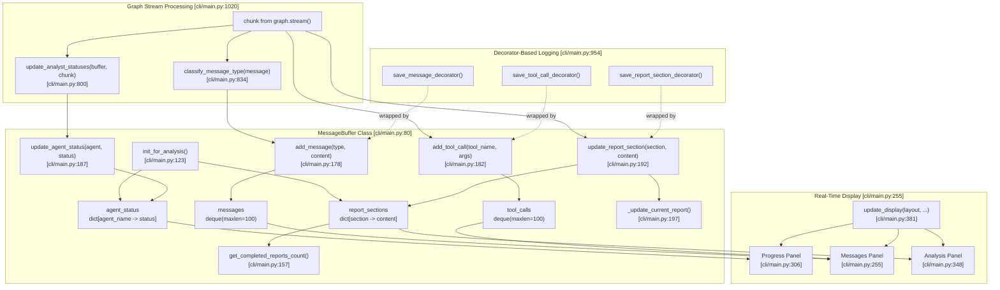
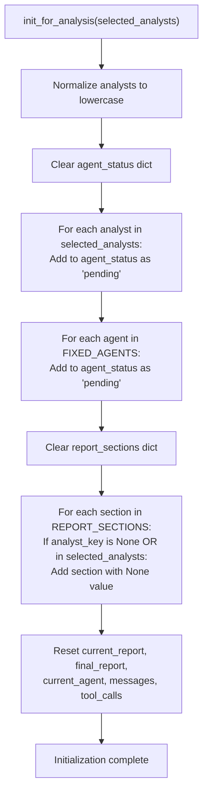
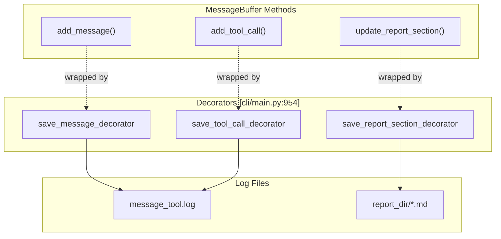

<!-- source: DeepWiki mcp.deepwiki.com · repo TauricResearch/TradingAgents · page 8.3 Message Buffer and State Tracking · fetched 2026-10-29 -->

# Message Buffer and State Tracking

<details>
<summary>Relevant source files</summary>

The following files were used as context for generating this wiki page:

- [.github/workflows/ci.yml](.github/workflows/ci.yml)
- [cli/models.py](cli/models.py)
- [tests/test_cli_display.py](tests/test_cli_display.py)
- [tests/test_portfolio_context.py](tests/test_portfolio_context.py)
- [tests/test_rating_integrity.py](tests/test_rating_integrity.py)
- [tests/test_signal_processing.py](tests/test_signal_processing.py)
- [tradingagents/agents/rating.py](tradingagents/agents/rating.py)
- [tradingagents/agents/structured.py](tradingagents/agents/structured.py)

</details>


## Purpose and Scope

This document describes the `MessageBuffer` class and its role in managing state during CLI execution. The `MessageBuffer` serves as the central state manager for the CLI's real-time display system, tracking agent execution status, collecting messages and tool calls, and organizing report sections as they are generated. This page focuses on the data structures, state management logic, and logging mechanisms. For information about the visual display system that consumes this state, see [Real-time display system (8.2)](). For the overall CLI flow, see [Command Line Interface (3.1)]().

**Sources:** [cli/main.py:76-160]()

---

## MessageBuffer Class Overview

The `MessageBuffer` class is the central state management component in the CLI, maintaining all runtime information needed to display progress and track execution. It uses a combination of fixed-size deques for streaming data (messages, tool calls) and dictionaries for persistent state (agent status, report sections).

### Core Data Structures

| Data Structure | Type | Purpose | Max Size |
|----------------|------|---------|----------|
| `messages` | `deque` | Recent messages from agents and system | 100 [cli/main.py:112]() |
| `tool_calls` | `deque` | Recent tool invocations with arguments | 100 [cli/main.py:113]() |
| `agent_status` | `dict` | Current status of each agent (pending/in_progress/completed/error) | Dynamic [cli/main.py:116]() |
| `report_sections` | `dict` | Generated report content by section name | Dynamic [cli/main.py:118]() |
| `current_report` | `str` | Most recently updated section for display | N/A [cli/main.py:114]() |
| `final_report` | `str` | Complete consolidated report | N/A [cli/main.py:115]() |
| `selected_analysts` | `list` | User-selected analyst types for this run | Dynamic [cli/main.py:119]() |
| `_processed_message_ids` | `set` | Tracks unique message IDs to prevent duplicates | N/A [cli/main.py:120]() |

**Sources:** [cli/main.py:76-121]()

---

## MessageBuffer Architecture Diagram

This diagram bridges the Natural Language concepts of "Reports" and "Agents" to the specific code entities in `cli/main.py`.

Title: "MessageBuffer Architecture and Data Flow"


**Sources:** [cli/main.py:76-160](), [cli/main.py:160](), [cli/main.py:160](), [cli/main.py:160]()

---

## Team and Agent Configuration

The `MessageBuffer` maintains a hybrid agent tracking system with two categories: fixed teams (always present) and selectable analyst teams (user-configurable).

### Fixed Teams

These agent teams are always included in every analysis run and cannot be disabled by users:

```python
FIXED_AGENTS = {
    "Research Team": ["Bull Researcher", "Bear Researcher", "Research Manager"],
    "Trading Team": ["Trader"],
    "Risk Management": ["Aggressive Analyst", "Neutral Analyst", "Conservative Analyst"],
    "Portfolio Management": ["Portfolio Manager"],
}
```

**Sources:** [cli/main.py:83-88]()

### Analyst Team Mapping

The analyst team members are dynamically included based on user selection. The mapping translates configuration keys to agent display names. The keys correspond to the `AnalystType` enum in `cli/models.py`.

```python
ANALYST_MAPPING = {
    "market": "Market Analyst",
    "social": "Sentiment Analyst",
    "news": "News Analyst",
    "fundamentals": "Fundamentals Analyst",
}
```

**Sources:** [cli/main.py:91-96](), [cli/models.py:4-10]()

### Report Section Configuration

Each report section is associated with an analyst selection key (for filtering) and a finalizing agent (for completion detection) in the `REPORT_SECTIONS` dictionary [cli/main.py:99-107]().

| Section Key | Analyst Selection Key | Finalizing Agent | Always Included |
|-------------|----------------------|------------------|-----------------|
| `market_report` | `"market"` | `"Market Analyst"` | No |
| `sentiment_report` | `"social"` | `"Sentiment Analyst"` | No |
| `news_report` | `"news"` | `"News Analyst"` | No |
| `fundamentals_report` | `"fundamentals"` | `"Fundamentals Analyst"` | No |
| `investment_plan` | `None` | `"Research Manager"` | Yes |
| `trader_investment_plan` | `None` | `"Trader"` | Yes |
| `final_trade_decision` | `None` | `"Portfolio Manager"` | Yes |

**Sources:** [cli/main.py:99-107]()

---

## Initialization Process

The `init_for_analysis()` method [cli/main.py:123]() configures the buffer for a new analysis run based on user selections. It dynamically builds the `agent_status` and `report_sections` dictionaries.

### Initialization Algorithm

Title: "MessageBuffer Initialization Logic"


**Sources:** [cli/main.py:123-156]()

---

## Agent Status Tracking

The `MessageBuffer` maintains a status for each agent throughout execution. Status values represent the current lifecycle state of an agent within the pipeline.

### Status Values

| Status | Meaning | Display Color |
|--------|---------|---------------|
| `"pending"` | Agent has not started | Yellow [cli/main.py:160]() |
| `"in_progress"` | Agent is currently executing | Cyan (with spinner) [cli/main.py:160]() |
| `"completed"` | Agent has finished successfully | Green [cli/main.py:160]() |
| `"error"` | Agent encountered an error | Red [cli/main.py:160]() |

**Sources:** [cli/main.py:160]()

### Status Transition Logic for Analysts

The `update_analyst_statuses()` function [cli/main.py:160]() implements the sequential activation pattern for analyst agents. It uses the `AnalystWallTimeTracker` to track execution and updates the `MessageBuffer` status based on the current chunk's contents.

**Sources:** [cli/main.py:160]()

---

## Report Completion Tracking

The system distinguishes between "report has content" and "report is finalized". A report is only considered complete when both conditions are met:

1. The report section has content (`not None`) [cli/main.py:160]()
2. The agent responsible for finalizing that report has status `"completed"` [cli/main.py:160]()

### Completion Detection Algorithm

The `get_completed_reports_count()` method [cli/main.py:157]() iterates through active sections and checks the status of the `finalizing_agent` defined in `REPORT_SECTIONS`.

**Sources:** [cli/main.py:157-160]()

---

## Message and Tool Call Management

The `MessageBuffer` maintains two fixed-size deques to store recent activity for display in the Messages panel.

### Message Classification

Messages are classified into types before being added to the buffer. The `classify_message_type()` function [cli/main.py:160]() determines the type and extracts content.

| Type | Source | Example |
|------|--------|---------|
| `"System"` | CLI control messages | "Selected ticker: SPY" |
| `"User"` | `HumanMessage` (non-continue) | User prompts |
| `"Control"` | `HumanMessage` with "Continue" | Debate continuation |
| `"Agent"` | `AIMessage` | Agent responses |
| `"Data"` | `ToolMessage` | Tool execution results |

**Sources:** [cli/main.py:160]()

---

## Decorator-Based Logging System

The CLI implements a decorator pattern to automatically log all buffer operations to disk without modifying the `MessageBuffer` class itself.

### Logging Architecture

Title: "Decorator Pattern for Buffer Logging"


**Sources:** [cli/main.py:160]()

### Decorator Implementation

*   **`save_message_decorator`**: Captures the last message added to the buffer and appends it to `message_tool.log` [cli/main.py:160]().
*   **`save_tool_call_decorator`**: Captures the last tool call and appends it to `message_tool.log` [cli/main.py:160]().
*   **`save_report_section_decorator`**: Saves the individual report content to a `.md` file in the report directory [cli/main.py:160]().

**Sources:** [cli/main.py:160]()

---

## Message Deduplication

The buffer implements message deduplication to avoid displaying the same message multiple times when chunks contain repeated messages from the graph. It tracks unique message IDs in the `_processed_message_ids` set [cli/main.py:120]() and checks if an incoming message ID has already been seen before adding it to the buffer [cli/main.py:160]().

**Sources:** [cli/main.py:120](), [cli/main.py:160]()

---

