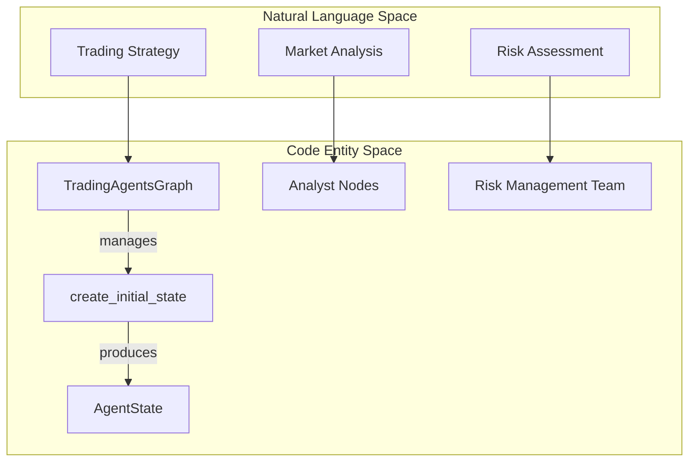
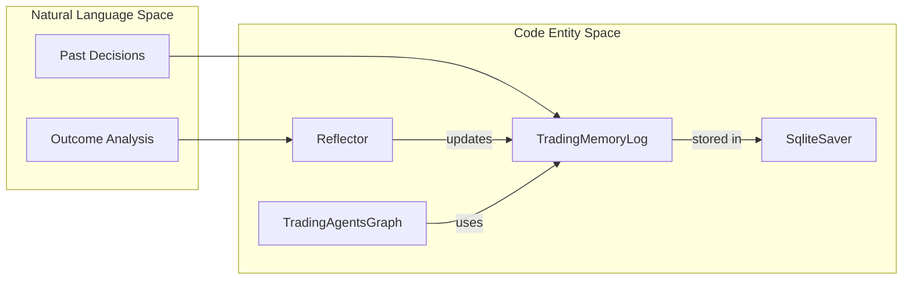

<!-- source: DeepWiki mcp.deepwiki.com · repo TauricResearch/TradingAgents · page 9 Developer Guide · fetched 2026-10-29 -->

# Developer Guide

Relevant source files

The following files were used as context for generating this wiki page:

- [.github/ISSUE_TEMPLATE/bug-report.yml](.github/ISSUE_TEMPLATE/bug-report.yml)
- [.github/ISSUE_TEMPLATE/config.yml](.github/ISSUE_TEMPLATE/config.yml)
- [.github/ISSUE_TEMPLATE/data-issue.yml](.github/ISSUE_TEMPLATE/data-issue.yml)
- [.github/ISSUE_TEMPLATE/feature-request.yml](.github/ISSUE_TEMPLATE/feature-request.yml)
- [CHANGELOG.md](CHANGELOG.md)
- [README.md](README.md)
- [pyproject.toml](pyproject.toml)
- [requirements.txt](requirements.txt)
- [tests/test_version.py](tests/test_version.py)
- [tradingagents/__init__.py](tradingagents/__init__.py)

The Developer Guide provides the necessary technical context for engineers looking to extend, customize, or deploy the `TradingAgents` framework. This page serves as a high-level map of the development ecosystem, linking to specialized child pages for implementation details.

The framework is designed with modularity in mind, using a factory pattern for agents, a provider-agnostic LLM interface, and a robust vendor abstraction layer `[pyproject.toml:5-29]()`. Recent releases introduced a verified data-access contract `[CHANGELOG.md:68-73]()`, an expanded provider registry including Amazon Bedrock `[CHANGELOG.md:38-40]()`, and a CI gate for code quality and stability `[pyproject.toml:56-66]()`.

### System Entity Map
The following diagrams bridge the gap between natural language concepts and the core code entities that implement them.

**Core Orchestration and State Flow**

**Sources:** `[CHANGELOG.md:44-50]()`, `[pyproject.toml:11-29]()`

**Persistence and Logging Architecture**

**Sources:** `[CHANGELOG.md:44-50]()`, `[pyproject.toml:16-17]()`

---

### 9.1 Extending Data Vendors
The data layer uses a verified data-access contract to ensure high availability and fallback support. Developers can add new data sources by implementing the vendor-specific logic and registering it in the central interface.

* **Vendor Registration:** New vendors must be added to the vendor list and interface maps `[CHANGELOG.md:68-73]()`.
* **Method Mapping:** Implementation functions are mapped in the dataflow configuration `[CHANGELOG.md:68-73]()`.
* **Optional Categories:** FRED (macro) and Polymarket (prediction) are registered as optional categories, allowing the system to degrade gracefully with a no-data sentinel if they fail `[CHANGELOG.md:80-82]()`.
* **Taxonomy:** Errors are categorized using a structured `VendorError` taxonomy `[CHANGELOG.md:37-41]()`.

For implementation details, see [Extending Data Vendors](#9.1).

**Sources:** `[CHANGELOG.md:37-82]()`, `[pyproject.toml:11-29]()`

---

### 9.2 Creating Custom Agents
Agents in this framework are built using a factory pattern that binds specific tools and system prompts to graph nodes.

* **Tool Binding:** Tool nodes are categorized by analyst type and assigned during graph initialization `[CHANGELOG.md:59-63]()`.
* **Structured Output:** Decision agents use structured output bindings to handle schemas like `ResearchPlan` and `TraderProposal` `[CHANGELOG.md:70-71]()`.
* **Date Anchoring:** Analyst prompts are anchored with the current run date to prevent tool-call hallucinations `[CHANGELOG.md:44-45]()`.
* **Crash Safety:** Shared debate and risk routers utilize path mappings to prevent graph crashes during state transitions `[CHANGELOG.md:45-47]()`.

For a tutorial on agent creation, see [Creating Custom Agents](#9.2).

**Sources:** `[CHANGELOG.md:44-71]`, `[README.md:80-83]()`

---

### 9.3 Testing and Debugging
The framework includes a comprehensive test suite and execution tracing capabilities.

* **CI Gate:** GitHub Actions runs `pytest` across Python versions and enforces `ruff` linting `[pyproject.toml:32-36]()`, `[pyproject.toml:68-80]()`.
* **Test Suite:** The `tests` directory contains a wide range of tests covering vendor routing, look-ahead guards, memory log, structured agents, checkpoints, capabilities, CLI, i18n, symbol handling, and backtesting `[pyproject.toml:56-63]()`.
* **Checkpoint Resume:** `TradingAgentsGraph` supports resuming runs based on a thread ID that incorporates graph shape `[CHANGELOG.md:43-49]()`.
* **Resilience:** A configurable LLM retry budget handles transient rate limit bursts `[CHANGELOG.md:46-47]()`.

For debugging procedures, see [Testing and Debugging](#9.3).

**Sources:** `[pyproject.toml:32-80]()`, `[CHANGELOG.md:43-49]()`

---

### 9.4 Deployment Considerations
Deploying `TradingAgents` involves managing multiple API keys, environment variables, and containerized environments.

| Component | Code Entity / File | Deployment Role |
| :--- | :--- | :--- |
| **Containerization** | `Dockerfile` / `docker-compose.yml` | Standardizes environment and manages Ollama profiles `[README.md:48-49]()` |
| **Dependency Management** | `pyproject.toml` | Defines core and optional dependencies like `bedrock` `[pyproject.toml:11-41]()` |
| **LLM Orchestration** | `create_llm_client` | Factory for multi-provider support including local endpoints `[CHANGELOG.md:47-49]()` |
| **Environment Variables** | `.env` / `TRADINGAGENTS_*` | Manages secrets and configuration overrides `[CHANGELOG.md:48-49]()` |
| **Dependency Locking** | `uv.lock` | Ensures reproducible builds by locking dependencies `[README.md:36-38]()` |

For production setup and Docker instructions, see [Deployment Considerations](#9.4).

**Sources:** `[pyproject.toml:11-41]()`, `[README.md:36-49]()`, `[CHANGELOG.md:47-49]()`

---

