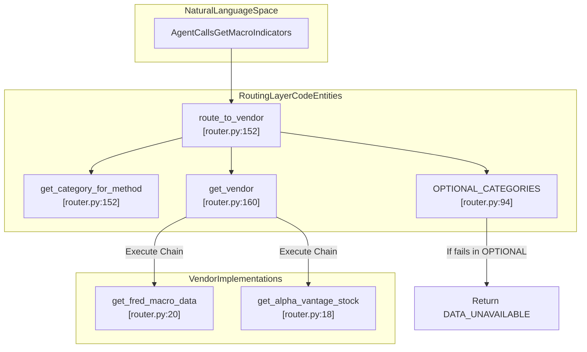
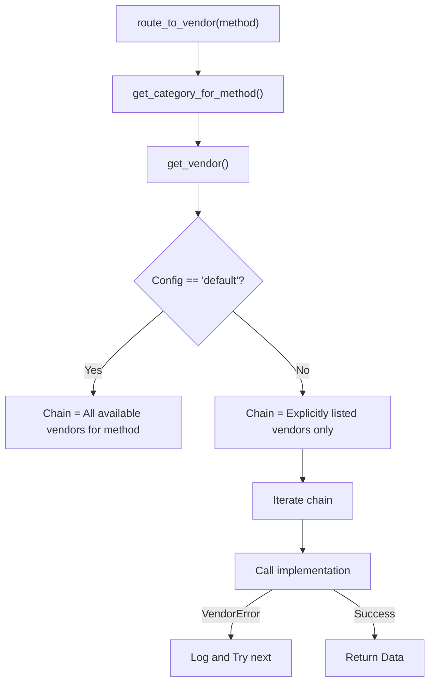

<!-- source: DeepWiki mcp.deepwiki.com · repo TauricResearch/TradingAgents · page 9.1 Extending Data Vendors · fetched 2026-10-29 -->

# Extending Data Vendors

<details>
<summary>Relevant source files</summary>

The following files were used as context for generating this wiki page:

- [tests/test_vendor_errors.py](tests/test_vendor_errors.py)
- [tests/test_vendor_routing.py](tests/test_vendor_routing.py)
- [tradingagents/dataflows/errors.py](tradingagents/dataflows/errors.py)
- [tradingagents/dataflows/net.py](tradingagents/dataflows/net.py)
- [tradingagents/dataflows/router.py](tradingagents/dataflows/router.py)
- [tradingagents/dataflows/vendors/__init__.py](tradingagents/dataflows/vendors/__init__.py)

</details>


## Purpose and Scope

This page serves as a comprehensive technical guide for developers looking to extend the TradingAgents system with new data vendors. It focuses on the standardized vendor interface, the `VENDOR_METHODS` and `TOOLS_CATEGORIES` registries, the routing mechanism in `router.py`, the `VendorError` taxonomy, and the registration of `OPTIONAL_CATEGORIES` for graceful degradation. By following these guidelines, new data sources can be integrated into the multi-agent framework while maintaining the verified data-access contract.

Sources: [tradingagents/dataflows/router.py:1-187](), [tradingagents/dataflows/errors.py:1-58]()

---

## Vendor System Architecture Overview

The data vendor layer is an abstraction that allows trading agents to request financial data transparently. The architecture prevents cross-vendor inconsistencies by requiring explicit configuration for fallback chains [tradingagents/dataflows/router.py:160-174]().

1. **Tool Categories:** Logical groupings defined in `TOOLS_CATEGORIES` (e.g., `"core_stock_apis"`, `"macro_data"`) [tradingagents/dataflows/router.py:45-87]().
2. **Vendor Implementations:** Concrete functions (e.g., `get_fred_macro_data`) that provide data in standardized formats [tradingagents/dataflows/router.py:20-28]().
3. **Routing Logic:** The routing system resolves implementations based on a user-defined chain, handling errors according to the `VendorError` hierarchy [tradingagents/dataflows/errors.py:21-58]().
4. **Graceful Degradation:** Categories registered in `OPTIONAL_CATEGORIES` return sentinels on failure rather than crashing the analysis [tradingagents/dataflows/router.py:94]().

### Diagram: Tool Call Routing and Error Handling



Sources: [tradingagents/dataflows/router.py:18-28, 45-87, 94, 152-174]()

---

## The VendorError Taxonomy

Every condition where a vendor cannot return usable data must derive from `VendorError`. This allows the router to react by behavior rather than by specific vendor [tradingagents/dataflows/errors.py:21-58]().

| Exception Class | Purpose | Router Reaction |
|:---|:---|:---|
| `VendorError` | Base for all data failures | Caught by router [tradingagents/dataflows/errors.py:21-22] |
| `NoMarketDataError` | Empty result or stale data | Logged; continues to next vendor in chain [tradingagents/dataflows/errors.py:25-43] |
| `VendorUnavailableError` | Transient API throttling | Skips to next vendor immediately [tradingagents/dataflows/errors.py:46-50] |
| `VendorNotConfiguredError` | Missing API key/config | Treated as "vendor unavailable"; skips to next [tradingagents/dataflows/errors.py:53-58] |

Sources: [tradingagents/dataflows/errors.py:1-58]()

---

## Key Data Structures

### TOOLS_CATEGORIES and OPTIONAL_CATEGORIES

`TOOLS_CATEGORIES` defines the available data domains. `OPTIONAL_CATEGORIES` marks domains (like `macro_data` or `prediction_markets`) that are non-essential enrichment data. If these fail, the system returns a sentinel instead of aborting the run [tradingagents/dataflows/router.py:45-94]().

| Category | Optional? | Core Tools |
|:---|:---|:---|
| `core_stock_apis` | No | `get_stock_data` |
| `fundamental_data` | No | `get_fundamentals`, `get_balance_sheet` |
| `macro_data` | Yes | `get_macro_indicators` |
| `prediction_markets`| Yes | `get_prediction_markets` |

Sources: [tradingagents/dataflows/router.py:45-94]()

### VENDOR_METHODS Registry

This dictionary maps tool methods to their vendor-specific implementations.

```python
# [tradingagents/dataflows/router.py:97-149]
VENDOR_METHODS = {
    # core_stock_apis
    "get_stock_data": {
        "alpha_vantage": get_alpha_vantage_stock,
        "yfinance": get_YFin_data_online,
    },
    # technical_indicators
    "get_indicators": {
        "alpha_vantage": get_alpha_vantage_indicator,
        "yfinance": get_stock_stats_indicators_window,
    },
    # fundamental_data
    "get_fundamentals": {
        "alpha_vantage": get_alpha_vantage_fundamentals,
        "yfinance": get_yfinance_fundamentals,
    },
    "get_balance_sheet": {
        "alpha_vantage": get_alpha_vantage_balance_sheet,
        "sec_edgar": get_sec_edgar_balance_sheet,
        "yfinance": get_yfinance_balance_sheet,
    },
    "get_cashflow": {
        "alpha_vantage": get_alpha_vantage_cashflow,
        "sec_edgar": get_sec_edgar_cashflow,
        "yfinance": get_yfinance_cashflow,
    },
    "get_income_statement": {
        "alpha_vantage": get_alpha_vantage_income_statement,
        "sec_edgar": get_sec_edgar_income_statement,
        "yfinance": get_yfinance_income_statement,
    },
    # news_data
    "get_news": {
        "alpha_vantage": get_alpha_vantage_news,
        "yfinance": get_news_yfinance,
    },
    "get_global_news": {
        "yfinance": get_global_news_yfinance,
        "alpha_vantage": get_alpha_vantage_global_news,
    },
    "get_insider_transactions": {
        "alpha_vantage": get_alpha_vantage_insider_transactions,
        "yfinance": get_yfinance_insider_transactions,
    },
    # macro_data
    "get_macro_indicators": {
        "fred": get_fred_macro_data,
    },
    # prediction_markets
    "get_prediction_markets": {
        "polymarket": get_polymarket_prediction_markets,
    },
}
```

Sources: [tradingagents/dataflows/router.py:97-149]()

---

## Vendor Selection and Routing Logic

### Configuration Hierarchy

The `get_vendor` function implements a two-tier resolution strategy [tradingagents/dataflows/router.py:160-174]():
1. **Tool-level:** Checks `tool_vendors` in config (e.g., `get_news: "alpha_vantage"`).
2. **Category-level:** Falls back to `data_vendors` (e.g., `news_data: "yfinance"`).

### Fallback Chain Construction

The fallback chain is constructed strictly from the user's comma-separated list in configuration or defaults to available implementations [tradingagents/dataflows/router.py:160-174]().



Sources: [tradingagents/dataflows/router.py:152-187]()

---

## Implementation Guide: Adding a New Data Vendor

### 1. Define the Vendor Module
Create a new file (e.g., `tradingagents/dataflows/vendors/my_vendor.py`). Implement the logic and ensure it raises appropriate `VendorError` subclasses [tradingagents/dataflows/errors.py:21-58](). For instance, missing configuration should raise `VendorNotConfiguredError` [tradingagents/dataflows/errors.py:53-58] and empty or stale returns should raise `NoMarketDataError` [tradingagents/dataflows/errors.py:25-43].

```python
# Example pattern from [tradingagents/dataflows/errors.py:53-58]
from tradingagents.dataflows.errors import VendorNotConfiguredError, NoMarketDataError

class MyVendorNotConfiguredError(VendorNotConfiguredError):
    """MyVendor was selected but its API key/configuration is missing."""
    pass
```

Sources: [tradingagents/dataflows/errors.py:21-58]()

### 2. Implement the Tool Method
Ensure the signature matches the requirements of the tool category. The method should return data in a standardized string format (e.g., structured text or CSV).

```python
# Example pattern from [tradingagents/dataflows/router.py:20-28]
from typing import Annotated
from tradingagents.dataflows.errors import NoMarketDataError

def get_my_vendor_data(
    symbol: Annotated[str, "ticker symbol of the company"],
    start_date: Annotated[str, "Start date in yyyy-mm-dd format"],
    end_date: Annotated[str, "End date in yyyy-mm-dd format"],
) -> str:
    data = "date,open,high,low,close\n2026-01-01,100,101,99,100"
    if not data:
        raise NoMarketDataError(symbol, detail="No data from MyVendor for this period.")
    
    header = f"# Data from MyVendor for {symbol} from {start_date} to {end_date}\n"
    return header + data
```

Sources: [tradingagents/dataflows/router.py:20-28](), [tradingagents/dataflows/errors.py:25-43]()

### 3. Register in `router.py`
1. **Import:** Add the implementation import to `router.py` [tradingagents/dataflows/router.py:9-28]().
2. **VENDOR_METHODS:** Map your function to the tool name under `VENDOR_METHODS` [tradingagents/dataflows/router.py:97-149]().

```python
# [tradingagents/dataflows/router.py:9-28]
from tradingagents.dataflows.vendors.my_vendor import get_my_vendor_data

# [tradingagents/dataflows/router.py:97-149]
VENDOR_METHODS = {
    "get_stock_data": {
        "alpha_vantage": get_alpha_vantage_stock,
        "yfinance": get_YFin_data_online,
        "my_vendor": get_my_vendor_data,
    },
}
```

Sources: [tradingagents/dataflows/router.py:9-28, 97-149]()

### 4. Configure Optionality (Optional)
If the data is non-core, add the category to `OPTIONAL_CATEGORIES` to ensure failures degrade gracefully rather than aborting the pipeline [tradingagents/dataflows/router.py:94]().

```python
# [tradingagents/dataflows/router.py:94]
OPTIONAL_CATEGORIES = {"macro_data", "prediction_markets", "my_optional_category"}
```

Sources: [tradingagents/dataflows/router.py:94]()

---

## Summary of Key Entities

| Code Entity | Role | Location |
|:---|:---|:---|
| `TOOLS_CATEGORIES` | Defines available data domains and tools | [tradingagents/dataflows/router.py:45-87]() |
| `OPTIONAL_CATEGORIES` | Non-critical categories triggering graceful degradation | [tradingagents/dataflows/router.py:94]() |
| `VENDOR_METHODS` | Registry mapping tool methods to vendor functions | [tradingagents/dataflows/router.py:97-149]() |
| `get_vendor` | Resolves configured vendor for category or tool | [tradingagents/dataflows/router.py:160-174]() |
| `VendorError` | Base class for data retrieval failures | [tradingagents/dataflows/errors.py:21-22]() |
| `NoMarketDataError` | Error for empty or stale results | [tradingagents/dataflows/errors.py:25-43]() |

Sources: [tradingagents/dataflows/router.py:45-174](), [tradingagents/dataflows/errors.py:21-43]()

---

