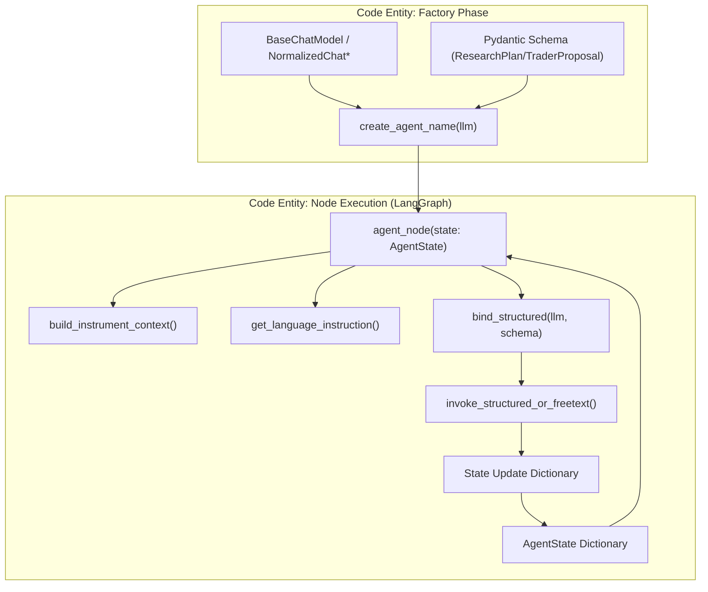
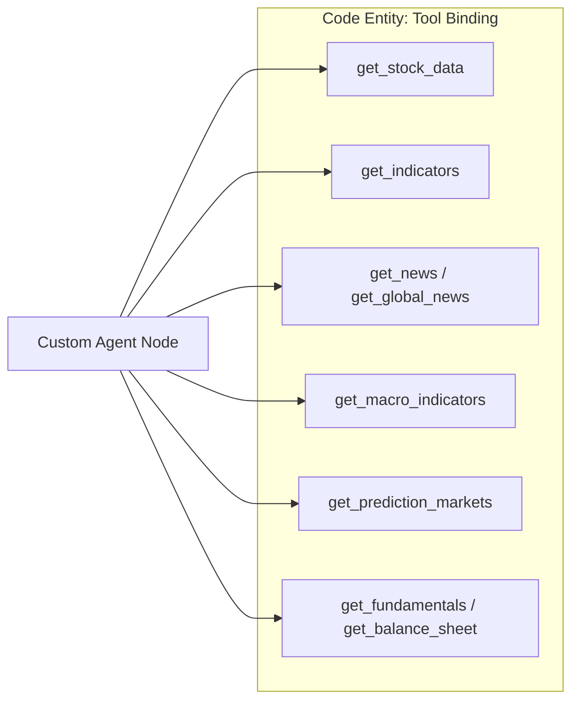
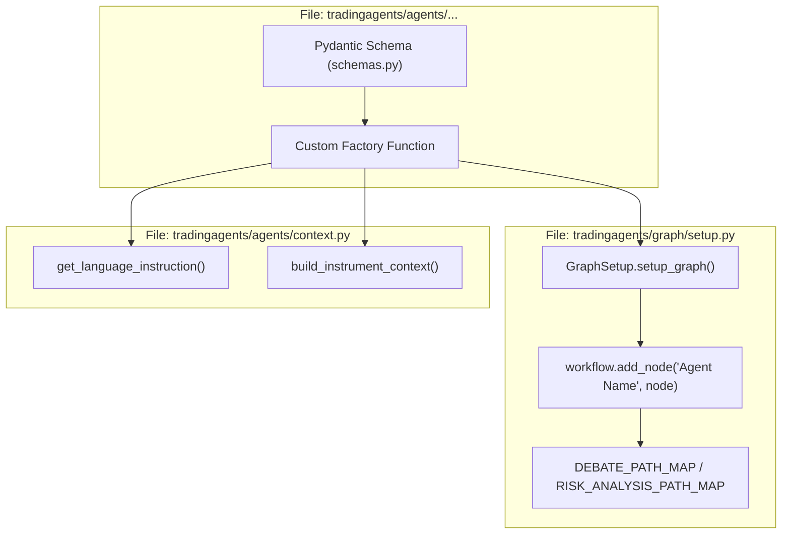

<!-- source: DeepWiki mcp.deepwiki.com · repo TauricResearch/TradingAgents · page 9.2 Creating Custom Agents · fetched 2026-10-29 -->

# Creating Custom Agents

Relevant source files

The following files were used as context for generating this wiki page:

- [tests/test_debate_opening.py](tests/test_debate_opening.py)
- [tests/test_graph_end_to_end.py](tests/test_graph_end_to_end.py)
- [tests/test_i18n_coverage.py](tests/test_i18n_coverage.py)
- [tests/test_instrument_identity.py](tests/test_instrument_identity.py)
- [tests/test_structured_agents.py](tests/test_structured_agents.py)
- [tests/test_symbol_normalization_paths.py](tests/test_symbol_normalization_paths.py)
- [tradingagents/agents/__init__.py](tradingagents/agents/__init__.py)
- [tradingagents/agents/context.py](tradingagents/agents/context.py)
- [tradingagents/agents/schemas.py](tradingagents/agents/schemas.py)
- [tradingagents/graph/setup.py](tradingagents/graph/setup.py)

## Purpose and Scope

This page provides a technical guide for implementing custom agent types in the TradingAgents framework. It covers the agent factory pattern, tool binding mechanisms, prompt engineering strategies, and integration procedures. This page focuses on the **implementation mechanics** of creating new agents, specifically highlighting the use of `build_instrument_context` for ticker preservation, `get_language_instruction` for multi-language support, and the integration of **structured output** via Pydantic schemas.

---

## Agent Factory Pattern Overview

The TradingAgents system implements a **factory pattern** for agent creation. Each agent type is defined as a factory function that:
1. Accepts an LLM instance (and optionally a memory component) as input [tradingagents/graph/setup.py:96-108]().
2. Returns a node function that processes the `AgentState` [tradingagents/graph/setup.py:62-90]().
3. Encapsulates agent-specific logic, tools, and prompts.

**Diagram: Agent Factory and Node Execution Flow**

Title: Agent Factory and Node Execution Flow

**Sources:**
- [tradingagents/graph/setup.py:53-90]()
- [tradingagents/graph/setup.py:96-108]()
- [tradingagents/agents/schemas.py:95-127]()

---

## Core Agent Components

Every agent implementation consists of essential utility functions and state management:

### Component 1: Context and Language Utilities

Custom agents utilize standardized utilities from `tradingagents/agents/context.py` to ensure consistency across the pipeline.

*   **`build_instrument_context(ticker, asset_type, identity)`**: Ensures the agent uses the exact exchange-qualified ticker (e.g., `AAPL` vs `AAPL.O`) and preserves company identity metadata to prevent hallucination [tradingagents/agents/context.py:107-163]().
*   **`get_language_instruction()`**: Injects a prompt suffix to ensure the agent responds in the user's configured language [tradingagents/agents/context.py:14-34]().

**Sources:**
- [tradingagents/agents/context.py:14-34]()
- [tradingagents/agents/context.py:107-163]()

### Component 2: Tool Selection and Definition

Tools are Python functions bound to agents to retrieve real-time data, fundamentals, or sentiment.

**Available Tool Categories:**

**Sources:**
- [tradingagents/graph/setup.py:85-90]()
- [tests/test_graph_end_to_end.py:142-146]()

### Component 3: Structured Output and Invocation

Decision-making agents use structured output to ensure consistency across different LLM providers [tradingagents/agents/schemas.py:1-17]().

1.  **Define Schema**: Create a Pydantic `BaseModel` in `tradingagents/agents/schemas.py` [tradingagents/agents/schemas.py:95-127]().
2.  **Bind Schema**: In the factory function, bind the structured schema using the provider's native capability [tradingagents/agents/schemas.py:1-17]().
3.  **Invoke Agent**: Handle parsing, markdown rendering, and graceful fallbacks [tradingagents/agents/schemas.py:130-138]().

**Sources:**
- [tradingagents/agents/schemas.py:1-17]()
- [tradingagents/agents/schemas.py:95-127]()
- [tradingagents/agents/schemas.py:130-138]()

---

## Integration into TradingAgentsGraph

### Step 1: Export Agent
Add the factory to `tradingagents/agents/__init__.py` to make it available to the graph setup [tradingagents/agents/__init__.py:1-31]().

### Step 2: Update GraphSetup
Modify `GraphSetup.setup_graph` in `tradingagents/graph/setup.py` to instantiate the node and add it to the `StateGraph` [tradingagents/graph/setup.py:109-161]().

1.  **Initialize Node**: Instantiate the agent using its factory function, passing the appropriate LLM [tradingagents/graph/setup.py:125-141]().
2.  **Add Node**: Register the node with the workflow: `workflow.add_node(spec.agent_node, ...)` [tradingagents/graph/setup.py:144-155]().
3.  **Define Edges**: Connect the node using shared path maps like `DEBATE_PATH_MAP` or `RISK_ANALYSIS_PATH_MAP` to ensure crash-safety against speaker label drift [tradingagents/graph/setup.py:35-45]().

**Diagram: Code Entity Space Integration**

Title: Code Entity Space Integration

**Sources:**
- [tradingagents/graph/setup.py:35-45]()
- [tradingagents/graph/setup.py:109-161]()
- [tradingagents/agents/__init__.py:1-31]()
- [tradingagents/agents/context.py:14-34]()
- [tradingagents/agents/context.py:107-163]()

---

## Advanced Patterns

### Nullish Float Coercion
LLMs often write placeholder strings ("None", "N/A", "TBD") into numeric fields. Use `_coerce_optional_float` or field validators in schemas to coerce these to `None` so the structured call validates instead of erroring [tradingagents/agents/schemas.py:33-58]().

### Structured Rendering
For decision agents, provide a `render_*` function (e.g., `render_research_plan`) to convert the Pydantic object back into the markdown format consumed by the UI and downstream agents [tradingagents/agents/schemas.py:130-138]().

### Debate Opening Safeguards
When writing custom debater or researcher agents, use `opponent_argument_or_opening` to prevent the model from hallucinating opponent arguments during the opening turn [tradingagents/agents/context.py:37-49]().

**Sources:**
- [tradingagents/agents/context.py:37-49]()
- [tradingagents/agents/schemas.py:33-58]()
- [tradingagents/agents/schemas.py:130-138]()

---

