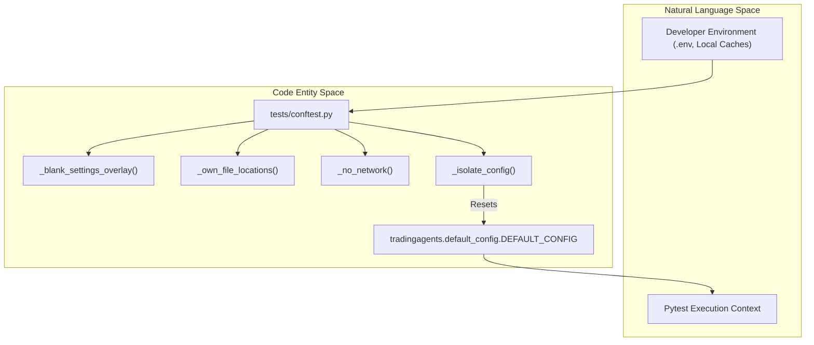
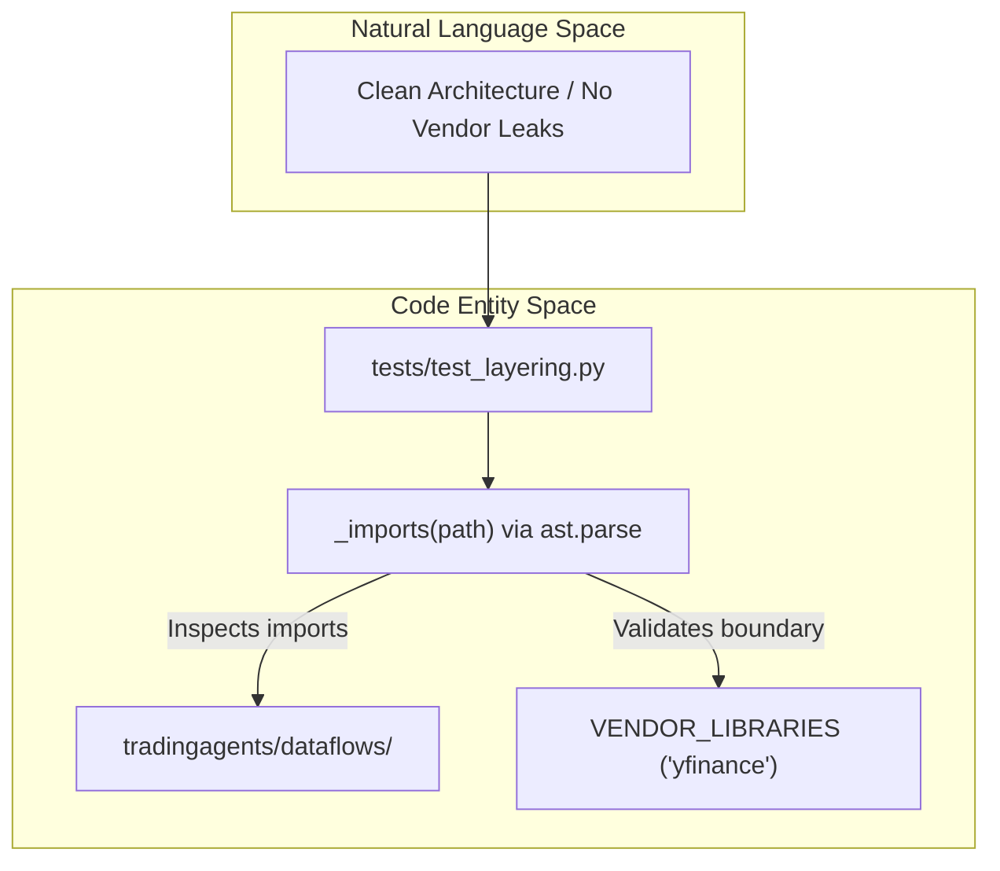

<!-- source: DeepWiki mcp.deepwiki.com · repo TauricResearch/TradingAgents · page 9.3 Testing and Debugging · fetched 2026-10-29 -->

# Testing and Debugging

Relevant source files

The following files were used as context for generating this wiki page:

- [.github/workflows/ci.yml](.github/workflows/ci.yml)
- [cli/models.py](cli/models.py)
- [tests/__init__.py](tests/__init__.py)
- [tests/conftest.py](tests/conftest.py)
- [tests/test_layering.py](tests/test_layering.py)
- [tests/test_suite_isolation.py](tests/test_suite_isolation.py)

**Purpose**: This page covers the large test suite, conftest fixtures, suite isolation guarantees, the GitHub Actions CI gate (featuring `ruff` and multiple Python versions), debug mode, and troubleshooting techniques for the TradingAgents framework.

---

## 1. Purpose and Scope

The `tests/` directory contains an extensive test suite designed to verify every subsystem of the TradingAgents framework, ranging from vendor routing and look-ahead guards to checkpoint resumption, structured agent outputs, multi-language support (i18n), and backtesting grids [tests/conftest.py:1-135](), [.github/workflows/ci.yml:1-67](), [tests/test_suite_isolation.py:1-54](). This document provides technical guidance on how test suite isolation is maintained, how the CI gate operates, what the test suite covers, and how to debug integration failures.

Sources: [tests/conftest.py:1-135](), [.github/workflows/ci.yml:1-67](), [tests/test_suite_isolation.py:1-54]()

---

## 2. Conftest Fixtures and Suite Isolation

To ensure that tests run deterministically on any developer machine or CI runner without external side effects or network dependencies, `tests/conftest.py` configures a set of robust autouse fixtures and environment overrides [tests/conftest.py:1-135]().

*   **Settings Overlay**: `_blank_settings_overlay()` blanks every `TRADINGAGENTS_*` setting before package import so contributor local `.env` files do not alter test defaults [tests/conftest.py:9-27]().
*   **File Location Isolation**: `_own_file_locations()` reroutes results, caches, and memory logs into a dedicated temporary directory (`tradingagents-tests-*`), protecting the user's home directory and existing logs [tests/conftest.py:30-44]().
*   **Network Insulation**: The `_no_network()` autouse fixture monkeypatches `socket.socket.connect`, `connect_ex`, `getaddrinfo`, and `curl_cffi` HTTP sessions to raise an `OSError` if any unit test attempts a live network request unless explicitly marked with `@pytest.mark.integration` [tests/conftest.py:59-77]().
*   **Terminal Simulation**: `_at_a_terminal()` mocks `sys.stdin.isatty` to return `True` so interactive prompt fixtures run correctly [tests/conftest.py:78-86]().
*   **CLI Preferences Isolation**: `_own_cli_prefs()` redirects `cli.prefs._PREFS_PATH` to a temporary path, preventing pollution of saved CLI session preferences [tests/conftest.py:87-91]().
*   **Dummy API Keys**: `_dummy_api_keys()` populates all provider API key environment variables with `"placeholder"` strings if they are missing or blank [tests/conftest.py:93-118]().
*   **Config Isolation**: `_isolate_config()` deep-copies `DEFAULT_CONFIG` before and after each test to prevent mutation leakage across test cases [tests/conftest.py:119-135]().

**Suite Isolation Data Flow**:

Sources: [tests/conftest.py:1-135](), [tests/test_suite_isolation.py:1-54]()

---

## 3. GitHub Actions CI Gate and Linting

The repository utilizes GitHub Actions to enforce strict automated testing and code quality on every push and pull request [.github/workflows/ci.yml:1-67]().

### Pipeline Architecture
*   **Test Matrix**: The `test` job executes `pytest -q` across Python versions `3.11`, `3.12`, `3.13`, and `3.14`, including a specific timezone matrix run set to `America/New_York` to catch local-time assumption bugs [.github/workflows/ci.yml:13-26]().
*   **Clean Install Smoke Test**: The `smoke-install` job performs a bare `pip install .` (without dev extras) on Python 3.12 and executes a verification import command (`python -c "import tradingagents, cli.main"`) to ensure runtime dependencies are correctly declared [.github/workflows/ci.yml:38-53]().
*   **Linting Gate**: The `lint` job runs `ruff check .` repo-wide under strict configuration rules, ensuring zero lint violations [.github/workflows/ci.yml:54-67]().

Sources: [.github/workflows/ci.yml:1-67]()

---

## 4. Test Suite Coverage

The comprehensive test suite covers all major components of the TradingAgents architecture:
*   **Vendor Routing**: Validates data vendor fallback chains and graceful degradation when optional providers (such as FRED or Polymarket) encounter errors or missing API keys [tests/test_suite_isolation.py:1-54]().
*   **Layering Enforcement**: `tests/test_layering.py` uses AST parsing to verify that vendor libraries (e.g., `yfinance`) are imported exclusively within the data layer (`tradingagents/dataflows`), preventing leaky abstractions [tests/test_layering.py:1-35]().
*   **Look-ahead Guards**: Ensures that dated tools, financial filtering functions, and macro series requests are strictly bounded by the execution run date.
*   **Memory Log**: Tests the append-only markdown decision log (`TradingMemoryLog`), verifying persistence, outcome updates, and history injection.
*   **Structured Agents**: Confirms that Pydantic output schemas (`ResearchPlan`, `TraderProposal`, `PortfolioDecision`, etc.) parse correctly and handle fallback free-text behavior.
*   **Checkpoints**: Simulates graph execution interruptions and verifies SQLite checkpointer state recovery.
*   **Capabilities & CLI**: Asserts model capability mappings, environment variable overrides, and CLI preference persistence.

**Layering Verification Architecture**:

Sources: [tests/test_layering.py:1-35](), [tests/conftest.py:1-135]()

---

## 5. Debug Mode and Troubleshooting

When troubleshooting execution failures, developers can utilize specific configuration flags and diagnostic patterns.

### Common Troubleshooting Matrix

| Issue Category | Symptom | Root Cause | Solution | Sources |
| :--- | :--- | :--- | :--- | :--- |
| **Network / Isolation** | `OSError: test tried to reach the network` | Test missing `@pytest.mark.integration` marker | Mark integration tests explicitly or mock client sessions | [tests/conftest.py:59-77]() |
| **Configuration** | Settings leaking across tests | Global `_config` mutation | Ensure tests run under `_isolate_config` fixture | [tests/conftest.py:119-135]() |
| **Linting** | CI failure on `ruff check` | Unformatted code or unused imports | Run `ruff check .` locally before committing | [.github/workflows/ci.yml:54-67]() |
| **Layering** | Vendor library imported in agent/cli | Violation of architectural boundaries | Keep vendor calls inside `tradingagents/dataflows/` | [tests/test_layering.py:1-35]() |

Sources: [tests/conftest.py:59-135](), [.github/workflows/ci.yml:54-67](), [tests/test_layering.py:1-35]()

---

