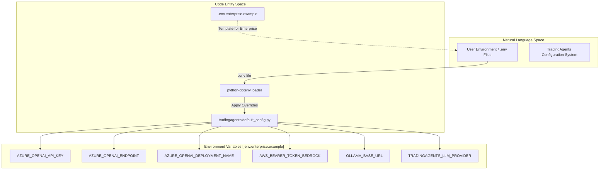
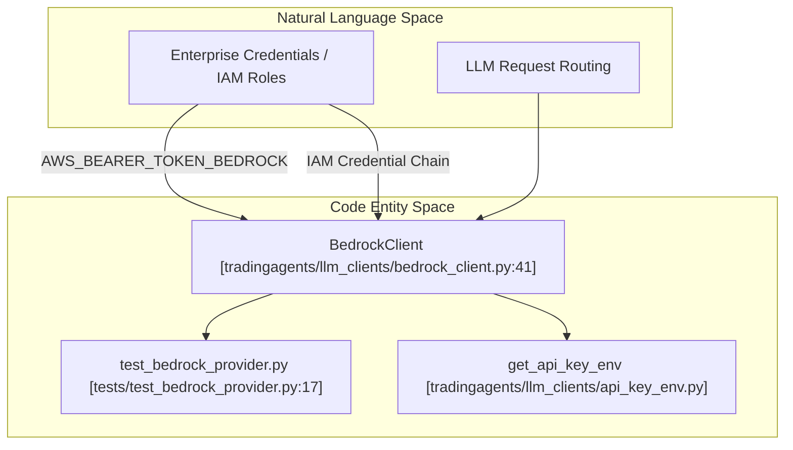
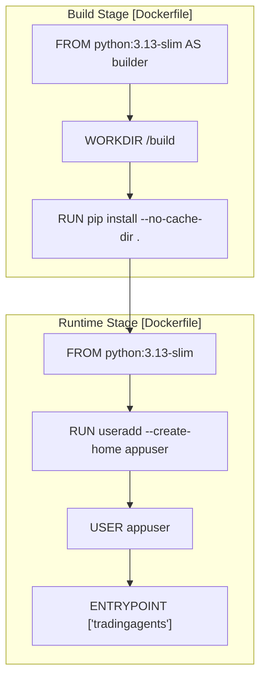

<!-- source: DeepWiki mcp.deepwiki.com · repo TauricResearch/TradingAgents · page 9.4 Deployment Considerations · fetched 2026-10-29 -->

# Deployment Considerations

Relevant source files

The following files were used as context for generating this wiki page:

- [.dockerignore](.dockerignore)
- [.env.enterprise.example](.env.enterprise.example)
- [.gitignore](.gitignore)
- [Dockerfile](Dockerfile)
- [docker-compose.yml](docker-compose.yml)
- [tests/test_bedrock_provider.py](tests/test_bedrock_provider.py)
- [tradingagents/llm_clients/bedrock_client.py](tradingagents/llm_clients/bedrock_client.py)

This document covers production deployment strategies, environment configuration, Amazon Bedrock and Azure credential management, containerization via Docker and Docker Compose, local and remote LLM setup via Ollama, dependency locking with `uv`, and operational scaling best practices for the TradingAgents framework.

---

## Environment Configuration and Secret Management

TradingAgents relies on environment variables for secure management of API keys and configuration parameters. The framework supports both `.env` files and direct environment variable exports.

**Sources**: [.env.enterprise.example:1-5](), [.gitignore:151-151]()

### Configuration Overrides and Security
The system supports overriding parameters in `DEFAULT_CONFIG` via environment variables prefixed with `TRADINGAGENTS_`. These values undergo automatic type coercion. To ensure secret safety, `.env` files, enterprise credential templates like `.env.enterprise`, and local data caches (`**/data_cache/`) are explicitly excluded from version control via `.gitignore` and `.dockerignore` [.gitignore:151-222](), [.dockerignore:3-3]().

**Sources**: [.gitignore:151-222](), [.dockerignore:1-15]()

---

## Amazon Bedrock and Azure Credentials Integration

TradingAgents supports enterprise LLM backends through specialized client classes that handle authentication securely.

### Amazon Bedrock Integration
Implemented via `BedrockClient` in `tradingagents/llm_clients/bedrock_client.py`, Amazon Bedrock is supported as a first-class native client leveraging the optional `langchain-aws` dependency `[tradingagents/llm_clients/bedrock_client.py:41-43]()`.

* **Authentication**: Supports either an explicit bearer token via `AWS_BEARER_TOKEN_BEDROCK` (which bypasses ambient AWS access keys and takes precedence) or the standard AWS credential chain (`AWS_ACCESS_KEY_ID`, `AWS_SECRET_ACCESS_KEY`, `AWS_PROFILE`, or IAM Roles) `[tradingagents/llm_clients/bedrock_client.py:44-68]()`.
* **Regional Resolution**: Bedrock requires a region; the client checks `AWS_REGION`, `AWS_DEFAULT_REGION`, or defaults to `us-west-2` `[tradingagents/llm_clients/bedrock_client.py:56-61]()`.
* **Optional Package Check**: If `langchain-aws` is missing, an explicit `ImportError` prompts the user to install the `[bedrock]` extra `[tradingagents/llm_clients/bedrock_client.py:25-29]()`.

### Azure OpenAI Credentials
Configured via environment variables such as `AZURE_OPENAI_API_KEY`, `AZURE_OPENAI_ENDPOINT`, and `AZURE_OPENAI_DEPLOYMENT_NAME` as detailed in `.env.enterprise.example` `[.env.enterprise.example:1-5]()`.

**Sources**: [tradingagents/llm_clients/bedrock_client.py:1-76](), [tests/test_bedrock_provider.py:1-80](), [.env.enterprise.example:1-5]()

---

## Containerization and Docker Setup

The repository includes a multi-stage `Dockerfile` and a `docker-compose.yml` file designed for clean separation of concerns and robust production execution.

### Dockerfile Architecture
The `Dockerfile` builds a production-ready image using `python:3.13-slim` in a multi-stage build pattern `[Dockerfile:1-28]()`. It establishes a non-root user `appuser` and provisions a persistent directory `/home/appuser/.tradingagents` for local state and logs `[Dockerfile:21-23]()`.

**Sources**: [Dockerfile:1-28]()

### Docker Compose Services
The `docker-compose.yml` file defines services for running the application standalone or integrated with local Ollama instances `[docker-comose.yml:1-37]()`.

| Service Name | Build / Image | Configuration & Profiles |
|--------------|---------------|--------------------------|
| `tradingagents` | Local `Dockerfile` | Loads `.env`, mounts `tradingagents_data` volume to `/home/appuser/.tradingagents` `[docker-compose.yml:1-10]()` |
| `ollama` | `ollama/ollama:latest` | Mounts `ollama_data` volume, gated by `ollama` profile `[docker-compose.yml:11-17]()` |
| `tradingagents-ollama` | Local `Dockerfile` | Configures `TRADINGAGENTS_LLM_PROVIDER=ollama` and `OLLAMA_BASE_URL=http://ollama:11434/v1`, gated by `ollama` profile `[docker-compose.yml:18-33]()` |

**Sources**: [docker-compose.yml:1-36](), [.dockerignore:1-15]()

---

## Local and Remote Ollama Integration

When deploying TradingAgents alongside local or remote LLM backends via Ollama, the `OLLAMA_BASE_URL` variable routes requests correctly. In `docker-compose.yml`, the `tradingagents-ollama` service targets `http://ollama:11434/v1` `[docker-compose.yml:24-24]()`. For remote setups, this variable can be pointed to any OpenAI-compatible Ollama endpoint.

**Sources**: [docker-compose.yml:18-33]()

---

## Dependency Management with uv

The project utilizes `uv` for ultra-fast dependency resolution and environment setup. While libraries often exclude lockfiles, robust binary deployments rely on locked dependencies from `pyproject.toml` to ensure reproducibility across staging and production environments `[.gitignore:97-101]()`.

* **Installation**: Dependencies are installed in the builder stage via `pip install --no-cache-dir .` `[Dockerfile:11-11]()`.
* **Optional Extras**: Feature-specific extras like `[bedrock]` are installed via `pip install "tradingagents[bedrock]"` `[tradingagents/llm_clients/bedrock_client.py:28-28]`.

**Sources**: [.gitignore:97-101](), [Dockerfile:1-28](), [tradingagents/llm_clients/bedrock_client.py:25-29]()

---

## Scaling Considerations & Production Checklist

When scaling TradingAgents in production, consider the following operational guidelines:

1. **Stateless Execution & Volumes**: The core graph execution is stateless. Ensure that `/home/appuser/.tradingagents` is mapped to a persistent volume (such as `tradingagents_data` in `docker-compose.yml`) so that SQLite checkpoints, decision logs, and generated reports persist across container restarts `[docker-compose.yml:6-7](), [Dockerfile:22-22]()`.
2. **Logging**: Keep `PYTHONUNBUFFERED=1` set in the runtime container environment to ensure real-time log flushing to orchestrators like Kubernetes or Docker Swarm `[Dockerfile:16-16]()`.
3. **Secret Hygiene**: Never commit `.env` or `.env.enterprise` files; rely on orchestrator secret injection or mounted environment files `[.gitignore:151-222](), [.dockerignore:3-3]()`.

**Sources**: [docker-compose.yml:1-36](), [Dockerfile:1-28](), [.gitignore:151-222](), [.dockerignore:1-15]()

---

