# Page: TradingAgents Overview

# TradingAgents Overview

<details>
<summary>Relevant source files</summary>

The following files were used as context for generating this wiki page:

- [CHANGELOG.md](CHANGELOG.md)
- [LICENSE](LICENSE)
- [README.md](README.md)
- [assets/TauricResearch.png](assets/TauricResearch.png)
- [assets/analyst.png](assets/analyst.png)
- [assets/cli/cli_init.png](assets/cli/cli_init.png)
- [assets/cli/cli_news.png](assets/cli/cli_news.png)
- [assets/cli/cli_technical.png](assets/cli/cli_technical.png)
- [assets/cli/cli_transaction.png](assets/cli/cli_transaction.png)
- [assets/researcher.png](assets/researcher.png)
- [assets/risk.png](assets/risk.png)
- [pyproject.toml](pyproject.toml)
- [requirements.txt](requirements.txt)
- [tests/test_version.py](tests/test_version.py)
- [tradingagents/__init__.py](tradingagents/__init__.py)

</details>


## Introduction and Purpose

TradingAgents is a multi-agent LLM financial trading framework built on **LangGraph** that coordinates specialized agents to analyze markets, simulate professional deliberations, and generate rigorous trading decisions [README.md:30-62](), [tradingagents/graph/trading_graph.py:93-178](). The system mirrors the dynamics of real-world trading firms through a structured, multi-phase collaborative workflow [README.md:60-63]().

With recent releases (including **v0.5.0** and **v0.6.0**), TradingAgents introduces major architectural and capability advancements:
- **HTML Reports:** Generates self-contained, browser-friendly single-page HTML reports (`complete_report.html`) alongside traditional Markdown outputs [CHANGELOG.md:9-15]().
- **Point-in-Time Integrity:** Ensures that historical runs never incorporate future data, clamping data acquisition, insider filings, macroeconomic vintages, and corporate profiles to the exact run date [README.md:33](), [CHANGELOG.md:11-32]().
- **Backtesting Sweep:** Enables automated pipeline execution over a grid of tickers and dates via `run_backtest` and `iter_grid`, scored by `summarize` [README.md:33](), [CHANGELOG.md:18](), [cli/main.py:46]().
- **Portfolio Context:** Integrates real holdings and cash via `PortfolioContext` (`propagate(..., portfolio=...)` and `--portfolio`), allowing trader, risk, and portfolio agents to size positions against actual capital [README.md:33](), [CHANGELOG.md:19](), [cli/main.py:56]().
- **SEC EDGAR Fundamentals:** Serves US company financial statements strictly as filed on the run date, handling restatements and suppression of unfiled periods without requiring API keys [README.md:33](), [CHANGELOG.md:17]().

This page provides a high-level overview of the framework's architecture, components, and operational patterns. For installation, see Getting Started; for detailed implementation, follow the child page links below.

**Sources:** [README.md:30-63](), [pyproject.toml:5-7](), [CHANGELOG.md:9-32](), [tradingagents/graph/trading_graph.py:93-178]()

---

## 1.1. System Architecture

TradingAgents implements a modular multi-layer architecture that separates user interfaces, orchestration, multi-agent execution, LLM provider abstraction, and data acquisition [README.md:30-63](), [tradingagents/graph/trading_graph.py:93-178](). The orchestration layer is anchored by `TradingAgentsGraph` in `tradingagents/graph/trading_graph.py`, which compiles workflows using `LangGraph` and maintains a persistent markdown decision log via `TradingMemoryLog` [tradingagents/graph/trading_graph.py:93-146]().

### High-Level Architecture

**Diagram: Five-Layer System Architecture bridging Natural Language Space to Code Entity Space**
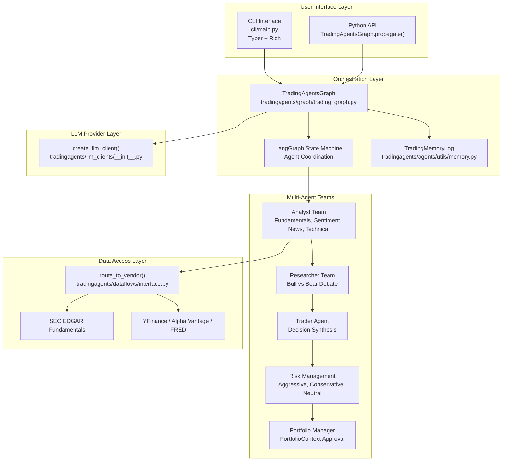

The architecture ensures strict modularity: data requests pass through vendor routers with point-in-time checks, agent teams execute a sequential graph state machine, and outputs are logged persistently. 

For detailed technical specifications, checkpointing, and component interactions, see [System Architecture](#1.1).

**Sources:** [README.md:30-63](), [tradingagents/graph/trading_graph.py:93-178](), [cli/main.py:55]()

---

## 1.2. Agent Teams and Roles

TradingAgents organizes specialized LLM-powered agents into distinct collaborative teams that mimic professional financial institutions [README.md:60-63](). Each agent utilizes tailored prompt templates, factory patterns, and bound tools to process information [tradingagents/graph/trading_graph.py:147-160]().

- **Analyst Team:** Comprises the Fundamentals Analyst (evaluating SEC EDGAR as-filed statements), Sentiment Analyst (aggregating news, StockTwits, and Reddit), News Analyst (monitoring macroeconomic and global events), and Technical Analyst (running indicators via `stockstats`) [README.md:72-76]().
- **Researcher Team:** Features bullish and bearish researchers who critique analyst reports through structured debate rounds governed by `max_debate_rounds`, overseen by a Research Manager [README.md:82-88](), [tradingagents/graph/trading_graph.py:151-154]().
- **Trader Agent:** Synthesizes insights from analysts and researchers into structured transaction proposals with grounded price-level entry and stop-loss targets [README.md:89-91](), [CHANGELOG.md:41]().
- **Risk Management Team:** Evaluates risk from multiple perspectives (Aggressive, Conservative, and Neutral analysts) to stress-test proposals against market volatility and exposure limits [README.md:62](), [cli/main.py:86]().
- **Portfolio Manager:** Finalizes the decision by evaluating the proposal against the real portfolio holdings and cash via `PortfolioContext`, enforcing governance rules and rating consistency [CHANGELOG.md:19]().

For detailed breakdowns of agent creation patterns, tools, and memory integration, see [Agent Teams and Roles](#1.2).

**Sources:** [README.md:60-95](), [tradingagents/graph/trading_graph.py:147-160](), [CHANGELOG.md:19-41](), [cli/main.py:81-88]()

---

## 1.3. Trading Decision Pipeline

The execution flow within `TradingAgentsGraph.propagate()` follows a strictly sequential five-phase workflow [tradingagents/graph/trading_graph.py:93-178](), [cli/main.py:56](). Each phase transitions state deterministically through LangGraph nodes, ensuring auditability and structured output enforcement.

### Sequential Decision Flow

**Diagram: Five-Phase Sequential Workflow bridging Natural Language Space to Code Entity Space**
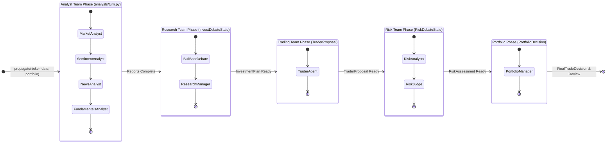

1. **Analyst Phase:** Parallel data retrieval and report generation across fundamentals, sentiment, news, and technical metrics [README.md:72-76]().
2. **Research Phase:** Bullish and bearish debate leading to a synthesized `ResearchPlan` [README.md:82-88]().
3. **Trading Phase:** Formulation of price-grounded entry and exit strategies by the Trader agent [README.md:89-91](), [CHANGELOG.md:41]().
4. **Risk Assessment Phase:** Multi-perspective risk evaluation by aggressive, conservative, and neutral analysts [README.md:62]().
5. **Portfolio Approval Phase:** Final evaluation and approval by the Portfolio Manager against the caller's `PortfolioContext` [CHANGELOG.md:19]().

For detailed explanations of state objects, debate routing, and decision logging, see [Trading Decision Pipeline](#1.3).

**Sources:** [README.md:60-95](), [tradingagents/graph/trading_graph.py:93-178](), [CHANGELOG.md:19-41](), [cli/main.py:56]()

---

# Page: System Architecture

# System Architecture

<details>
<summary>Relevant source files</summary>

The following files were used as context for generating this wiki page:

- [tests/test_graph_end_to_end.py](tests/test_graph_end_to_end.py)
- [tests/test_layering.py](tests/test_layering.py)
- [tests/test_memory_log.py](tests/test_memory_log.py)
- [tradingagents/agents/__init__.py](tradingagents/agents/__init__.py)
- [tradingagents/graph/setup.py](tradingagents/graph/setup.py)
- [tradingagents/graph/trading_graph.py](tradingagents/graph/trading_graph.py)

</details>


## Purpose and Scope
This document details the overall system architecture of the TradingAgents framework, focusing on the orchestration layer (`TradingAgentsGraph` in [tradingagents/graph/trading_graph.py:51-116]()), the LangGraph compilation model using `GraphSetup` [tradingagents/graph/setup.py:93-122](), the five-phase agent pipeline, and component interaction across graph setup, execution state management, and memory subsystems.

Sources: [tradingagents/graph/trading_graph.py:51-116](), [tradingagents/graph/setup.py:93-122]()

## Orchestration Layer: TradingAgentsGraph and LangGraph
The orchestration engine centers around `TradingAgentsGraph`, which manages runtime initialization, LLM client tiering (`create_tier_client`), memory logging (`TradingMemoryLog`), and compilation of the workflow graph [tradingagents/graph/trading_graph.py:51-116](). The workflow execution is powered by LangGraph via `StateGraph` and compiled workflow runnables [tradingagents/graph/setup.py:93-156]().

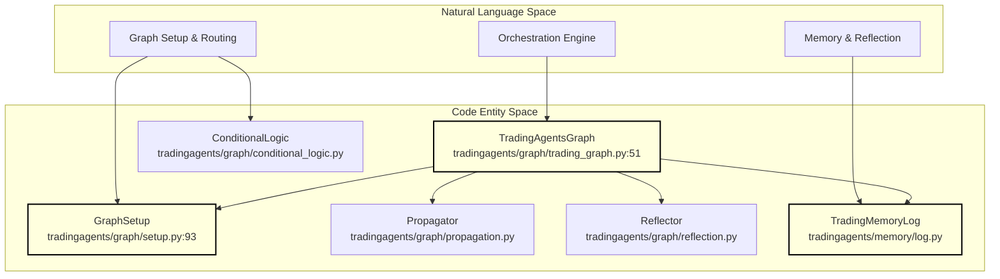

Sources: [tradingagents/graph/trading_graph.py:51-116](), [tradingagents/graph/setup.py:93-156]()

## Five-Phase Agent Pipeline
The execution pipeline progresses through distinct phases: Analyst execution, research debate, transaction proposal, risk assessment, and portfolio management. `GraphSetup.setup_graph` builds the topology using `build_analyst_execution_plan` [tradingagents/graph/setup.py:109-187](). Individual analysts are isolated via sub-graphs (`_analyst_graph`) to prevent cross-talk and bound by `max_tool_rounds` [tradingagents/graph/setup.py:53-90]().

```mermaid
graph LR
    subgraph "Phase 1: Analyst Subgraphs [setup.py:53]"
        MA["create_market_analyst<br/>tradingagents/agents/analysts/market_analyst.py"] --> SA["create_sentiment_analyst<br/>tradingagents/agents/analysts/sentiment_analyst.py"]
        SA --> NA["create_news_analyst<br/>tradingagents/agents/analysts/news_analyst.py"]
        NA --> FA["create_fundamentals_analyst<br/>tradingagents/agents/analysts/fundamentals_analyst.py"]
    end

    subgraph "Phase 2: Research Debate [setup.py:35]"
        FA --> Bull["create_bull_researcher<br/>tradingagents/agents/researchers/bull_researcher.py"]
        Bull <--- "DEBATE_PATH_MAP" ---> Bear["create_bear_researcher<br/>tradingagents/agents/researchers/bear_researcher.py"]
        Bear --> RM["create_research_manager<br/>tradingagents/agents/managers/research_manager.py"]
    end

    subgraph "Phase 3: Transaction"
        RM --> Trader["create_trader<br/>tradingagents/agents/trader/trader.py"]
    end

    subgraph "Phase 4: Risk Analysis [setup.py:40]"
        Trader --> Agg["create_aggressive_debator<br/>tradingagents/agents/risk_mgmt/aggressive_debator.py"]
        Agg <--- "RISK_ANALYSIS_PATH_MAP" ---> Neu["create_neutral_debator<br/>tradingagents/agents/risk_mgmt/neutral_debator.py"]
        Neu <--- "RISK_ANALYSIS_PATH_MAP" ---> Con["create_conservative_debator<br/>tradingagents/agents/risk_mgmt/conservative_debator.py"]
        Con --> PM["create_portfolio_manager<br/>tradingagents/agents/managers/portfolio_manager.py"]
    end

    subgraph "Phase 5: Output"
        PM --> END["Decision Log & Reporting"]
    end

    style MA fill:none,stroke:#000,stroke-width:1px
    style Bull fill:none,stroke:#000,stroke-width:1px
    style Trader fill:none,stroke:#000,stroke-width:1px
    style Agg fill:none,stroke:#000,stroke-width:1px
    style PM fill:none,stroke:#000,stroke-width:1px
```

Sources: [tradingagents/graph/setup.py:35-187](), [tradingagents/agents/__init__.py:1-31]()

## Component Interaction and Data Flow
During graph execution, state flows through `AgentState`, `InvestDebateState`, and `RiskDebateState` [tradingagents/agents/__init__.py:12](). Instrument identities are resolved upfront via `resolve_instrument_context` to ground all downstream agent turns in factual vendor profiles [tradingagents/graph/trading_graph.py:117-128](). Conditional routing paths such as `DEBATE_PATH_MAP` and `RISK_ANALYSIS_PATH_MAP` ensure fall-through safety across iterative debate cycles [tradingagents/graph/setup.py:35-46]().

Sources: [tradingagents/graph/trading_graph.py:117-128](), [tradingagents/graph/setup.py:35-46](), [tradingagents/agents/__init__.py:12]()

---

# Page: Agent Teams and Roles

# Agent Teams and Roles

<details>
<summary>Relevant source files</summary>

The following files were used as context for generating this wiki page:

- [tradingagents/agents/analysts/fundamentals_analyst.py](tradingagents/agents/analysts/fundamentals_analyst.py)
- [tradingagents/agents/analysts/market_analyst.py](tradingagents/agents/analysts/market_analyst.py)
- [tradingagents/agents/analysts/news_analyst.py](tradingagents/agents/analysts/news_analyst.py)
- [tradingagents/agents/managers/portfolio_manager.py](tradingagents/agents/managers/portfolio_manager.py)
- [tradingagents/agents/managers/research_manager.py](tradingagents/agents/managers/research_manager.py)
- [tradingagents/agents/trader/trader.py](tradingagents/agents/trader/trader.py)

</details>


This page details the specialized agent teams that comprise the TradingAgents multi-agent system and their specific roles in the trading decision pipeline. Each team represents a distinct phase of analysis, from initial data gathering through final risk assessment and execution.

## Overview of Agent Teams

The TradingAgents framework organizes LLM-powered agents into specialized teams that mirror the structure of real-world trading firms. The orchestration is managed via a graph-based state machine where each node represents an agent or a specialized manager.

| Team | Primary Function | Key Output |
|------|------------------|------------|
| **Analyst Team** | Data collection and domain analysis | `fundamentals_report`, `market_report`, `sentiment_report`, `news_report` |
| **Researcher Team** | Critical evaluation and bull/bear debate | `investment_debate_state`, `investment_plan` |
| **Trader Agent** | Decision synthesis and strategy formulation | `trader_investment_plan` |
| **Portfolio Team** | Multi-perspective risk assessment and final approval | `risk_debate_state`, `final_trade_decision` |

### System Entity Mapping
The following diagram bridges the natural language roles to the specific code entities and state keys used in the implementation.

Diagram: Natural Language to Code Entity Mapping
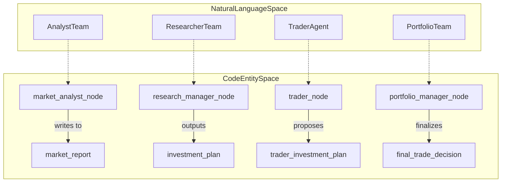

Sources: [tradingagents/agents/analysts/market_analyst.py:15-84](), [tradingagents/agents/managers/research_manager.py:14-74](), [tradingagents/agents/trader/trader.py:20-98](), [tradingagents/agents/managers/portfolio_manager.py:23-106]()

## Analyst Team

The Analyst Team consists of specialized agents that perform initial data collection. These agents are tool-enabled, allowing them to fetch real-time or cached financial data via specific functions.

### Fundamentals Analyst
The `fundamentals_analyst_node` evaluates company financials [tradingagents/agents/analysts/fundamentals_analyst.py:23-64](). It utilizes tools like `get_fundamentals`, `get_balance_sheet`, `get_cashflow`, and `get_income_statement` [tradingagents/agents/analysts/fundamentals_analyst.py:14-20]() to identify intrinsic values and red flags.

### Market Analyst
The `market_analyst_node` utilizes technical indicators to detect patterns [tradingagents/agents/analysts/market_analyst.py:15-84](). It is designed to select up to 8 complementary indicators (e.g., `close_50_sma`, `macd`, `rsi`, `atr`) [tradingagents/agents/analysts/market_analyst.py:22-52]() using `get_indicators` and `get_stock_data` [tradingagents/agents/analysts/market_analyst.py:8-12](). It treats `get_verified_market_snapshot` as the source of truth for OHLCV data [tradingagents/agents/analysts/market_analyst.py:48-48]().

### News Analyst
The `news_analyst_node` monitors global news and macroeconomic indicators [tradingagents/agents/analysts/news_analyst.py:21-63](). It uses `get_news` for ticker-specific updates, `get_global_news`, `get_macro_indicators` for FRED data (e.g., CPI, unemployment), and `get_prediction_markets` for forward-looking event probabilities via Polymarket [tradingagents/agents/analysts/news_analyst.py:13-18]().

### Sentiment Analyst
The `sentiment_analyst_node` aggregates multiple sources including Yahoo Finance news, StockTwits cashtag streams, and Reddit posts. It produces a deterministic `SentimentReport` using structured output binding.

Sources: [tradingagents/agents/analysts/fundamentals_analyst.py:14-64](), [tradingagents/agents/analysts/market_analyst.py:8-84](), [tradingagents/agents/analysts/news_analyst.py:13-63]()

## Researcher Team (The Debate System)

The Researcher Team employs a dialectic approach, comprising bullish and bearish researchers who critically assess the Analyst Team's reports.

- **Debate Management:** The Research Manager (`create_research_manager`) evaluates the debate history [tradingagents/agents/managers/research_manager.py:19-20]() and produces a structured `ResearchPlan` [tradingagents/agents/managers/research_manager.py:14-16]().
- **Rating Scale:** The manager must commit to a stance using a 5-tier scale: **Buy, Overweight, Hold, Underweight, Sell** [tradingagents/agents/managers/research_manager.py:29-34]().
- **State Transition:** The results are stored in `investment_plan` and the `investment_debate_state` is updated with the judge's decision [tradingagents/agents/managers/research_manager.py:61-72]().

Sources: [tradingagents/agents/managers/research_manager.py:14-74]()

## Trader Agent

The `trader_node` synthesizes the `investment_plan` and instrument context to formulate a concrete transaction proposal [tradingagents/agents/trader/trader.py:23-33](). It uses `bind_structured` with the `TraderProposal` schema [tradingagents/agents/trader/trader.py:20-21]() to determine the action and reasoning. 

When a technical market report is available, the agent grounds absolute price levels (entry price, stop-loss) in real ATR, support/resistance, and volatility data [tradingagents/agents/trader/trader.py:35-44](). The final output is saved to `trader_investment_plan` [tradingagents/agents/trader/trader.py:93-96]().

Sources: [tradingagents/agents/trader/trader.py:20-98]()

## Risk Management and Portfolio Manager

The final phase acts as the gatekeeper, evaluating portfolio risk and providing final authorization.

### Risk Management Team
The team evaluates strategies through three distinct perspectives (Aggressive, Conservative, Neutral), maintaining a `risk_debate_state` [tradingagents/agents/managers/portfolio_manager.py:30-31]().

### Portfolio Manager
The `portfolio_manager_node` holds final authority [tradingagents/agents/managers/portfolio_manager.py:23-106](). It synthesizes the risk analysts' debate, the `investment_plan`, the `trader_investment_plan`, and `past_context` (lessons from previous decisions) [tradingagents/agents/managers/portfolio_manager.py:30-40]().

It produces a `PortfolioDecision` via structured output binding or falls back to free-text parsing, which is rendered to markdown for the decision log [tradingagents/agents/managers/portfolio_manager.py:80-87]().

Diagram: Portfolio Decision Data Flow
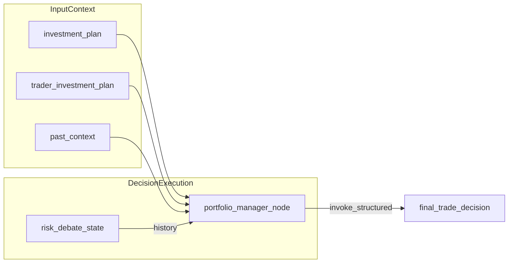

Sources: [tradingagents/agents/managers/portfolio_manager.py:23-106]()

---

# Page: Trading Decision Pipeline

# Trading Decision Pipeline

<details>
<summary>Relevant source files</summary>

The following files were used as context for generating this wiki page:

- [tests/test_graph_end_to_end.py](tests/test_graph_end_to_end.py)
- [tradingagents/agents/__init__.py](tradingagents/agents/__init__.py)
- [tradingagents/agents/risk_mgmt/aggressive_debator.py](tradingagents/agents/risk_mgmt/aggressive_debator.py)
- [tradingagents/agents/risk_mgmt/conservative_debator.py](tradingagents/agents/risk_mgmt/conservative_debator.py)
- [tradingagents/agents/risk_mgmt/neutral_debator.py](tradingagents/agents/risk_mgmt/neutral_debator.py)
- [tradingagents/graph/setup.py](tradingagents/graph/setup.py)

</details>


## Purpose and Scope

This document explains the sequential execution flow of the TradingAgents system, transforming raw market data through multi-agent analysis, research debate, trader synthesis, risk assessment, and final portfolio approval. The pipeline is implemented using LangGraph state management [tradingagents/graph/setup.py:142-142]() and a dual-model strategy (Deep vs. Quick thinking).

Sources: [tradingagents/graph/setup.py:142-142]()

---

## Pipeline Overview

The trading decision pipeline executes sequentially, updating a shared `AgentState` TypedDict [tradingagents/agents/state.py:12-12]() that carries forward accumulated reports, debate histories, and decisions across phases.

### System Execution Flow

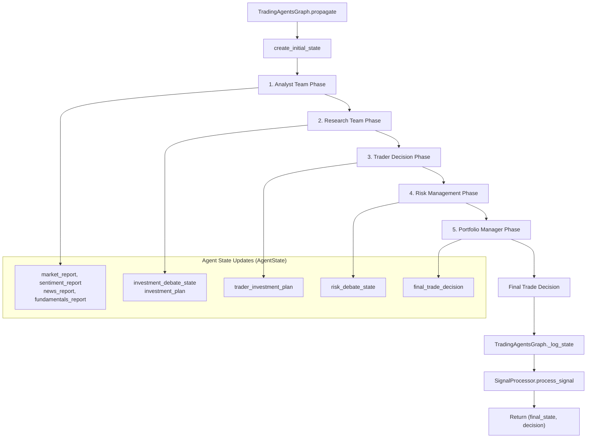

Sources: [tradingagents/graph/setup.py:142-161](), [tradingagents/agents/state.py:12-12]()

---

## Phase 1: Analyst Team Data Collection

Analyst agents execute concurrently to gather multi-faceted market data via specialized tools. Each analyst is wrapped in a private sub-graph using `_analyst_graph` [tradingagents/graph/setup.py:53-90]() to isolate message histories and bound tool execution rounds to `max_tool_rounds`.

### Analyst-to-Code Entity Mapping

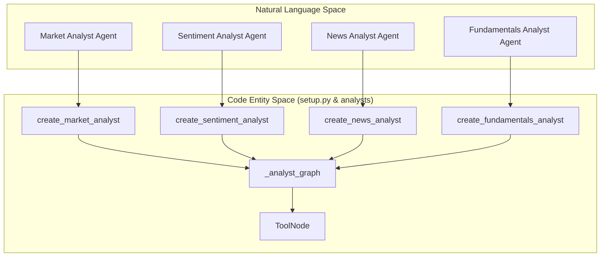

Sources: [tradingagents/graph/setup.py:53-90](), [tradingagents/graph/setup.py:125-130]()

---

## Phase 2: Research Team Debate

Once analyst reports are filed, the research phase runs a structured debate governed by `DEBATE_PATH_MAP` [tradingagents/graph/setup.py:35-39]().

1. **Iterative Debate**: `create_bull_researcher` and `create_bear_researcher` [tradingagents/agents/__init__.py:7-8]() argue opposing theses over bounded rounds.
2. **State Tracking**: Arguments are maintained in `InvestDebateState` [tradingagents/agents/state.py:12-12]().
3. **Synthesis**: The `create_research_manager` [tradingagents/agents/__init__.py:6]() node reviews the debate to synthesize a structured `investment_plan`.

Sources: [tradingagents/graph/setup.py:35-39](), [tradingagents/agents/__init__.py:6-12]()

---

## Phase 3: Trader Decision Synthesis

The `create_trader` node [tradingagents/agents/__init__.py:13]() takes the aggregated analyst reports and the research `investment_plan` to formulate the initial trading proposal (`trader_investment_plan`). This proposal grounds entries, exits, and position sizing in technical indicators and fundamental context.

Sources: [tradingagents/agents/__init__.py:13]()

---

## Phase 4: Risk Management Assessment

The risk phase subjects the trader's plan to structured challenge under `RISK_ANALYSIS_PATH_MAP` [tradingagents/graph/setup.py:40-45]().

### Risk Debate Flow and Code Entities

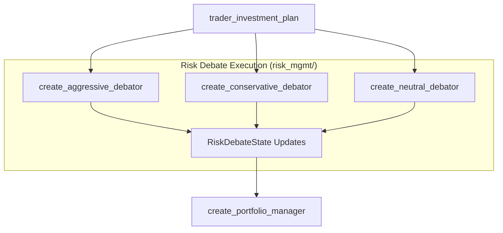

The risk debate updates `RiskDebateState` [tradingagents/agents/state.py:12-12]() through exchanges between:
* `create_aggressive_debator` [tradingagents/agents/risk_mgmt/aggressive_debator.py:10-68]()
* `create_conservative_debator` [tradingagents/agents/risk_mgmt/conservative_debator.py:10-70]()
* `create_neutral_debator` [tradingagents/agents/risk_mgmt/neutral_debator.py:10-68]()

Sources: [tradingagents/graph/setup.py:40-45](), [tradingagents/agents/state.py:12-12](), [tradingagents/agents/risk_mgmt/aggressive_debator.py:10-68](), [tradingagents/agents/risk_mgmt/conservative_debator.py:10-70](), [tradingagents/agents/risk_mgmt/neutral_debator.py:10-68]()

---

## Phase 5: Final Decision and Portfolio Approval

The `create_portfolio_manager` node [tradingagents/agents/__init__.py:5]() evaluates the `trader_investment_plan` against the `risk_debate_state` to formulate the final risk-adjusted `final_trade_decision`. 

Sources: [tradingagents/agents/__init__.py:5]()

---

## State Management and Data Flow

All pipeline phases operate on a shared `AgentState` schema [tradingagents/agents/state.py:12-12](), ensuring complete traceability from raw inputs to final trade signals.

Sources: [tradingagents/agents/state.py:12-12]()

---

# Page: Getting Started

# Getting Started

<details>
<summary>Relevant source files</summary>

The following files were used as context for generating this wiki page:

- [CHANGELOG.md](CHANGELOG.md)
- [README.md](README.md)
- [pyproject.toml](pyproject.toml)
- [requirements.txt](requirements.txt)
- [tests/test_version.py](tests/test_version.py)
- [tradingagents/__init__.py](tradingagents/__init__.py)

</details>


This page guides you through installing TradingAgents, configuring API credentials, and running your first trading analysis. It covers the essential setup steps needed to use the framework through either the command-line interface (CLI) or the programmatic Python API.

For detailed installation instructions, dependency structures, and optional extras, see [Installation and Dependencies](#2.1). For an introduction to the configuration system, environment variables, and default configuration values, see [Configuration Basics](#2.2). For concrete usage examples covering both the CLI and programmatic APIs, see [Quick Start Examples](#2.3).

---

## Prerequisites and Requirements

TradingAgents requires **Python 3.11 or higher** [pyproject.toml:10](). The framework integrates with multiple LLM provider SDKs and financial data vendors.

| Requirement | Minimum Version / Detail | Source Reference |
|------------|-------------------------|------------------|
| Python | `>=3.11` | [pyproject.toml:10]() |
| Package Manager | `pip` or `uv` | [pyproject.toml:11-28]() |
| Environment Loading | Automatic via `python-dotenv` | [tradingagents/__init__.py:5-13]() |

Sources: [pyproject.toml:10-28](), [tradingagents/__init__.py:5-13]()

---

## Installation Overview

To install TradingAgents locally, clone the repository, create a virtual environment, and install the package using standard pip workflows [pyproject.toml:11-28]():

```bash
git clone https://github.com/TauricResearch/TradingAgents.git
cd TradingAgents
python -m venv .venv
source .venv/bin/activate
pip install .
```

The core runtime dependencies defined in `pyproject.toml` include LangChain and LangGraph components, Pandas, StockStats, and Rich [pyproject.toml:11-28](). For Amazon Bedrock support using AWS SigV4 authentication, install the optional `bedrock` extra: `pip install ".[bedrock]"` [pyproject.toml:37-41](). Package versioning is dynamically retrieved from `tradingagents.__version__` [pyproject.toml:46-47](), [tradingagents/__init__.py:1-3]().

Upon package import, `tradingagents/__init__.py` automatically loads environment variables from `.env` files using `python-dotenv` so that LLM clients and configuration modules have immediate access to required credentials [tradingagents/__init__.py:5-13]().

For detailed installation flows, virtual environment setup with `uv`, and deep dependency analysis, see [Installation and Dependencies](#2.1).

Sources: [pyproject.toml:11-47](), [tradingagents/__init__.py:1-13]()

---

## Configuration Basics

TradingAgents relies on centralized configuration patterns and environment variables prefixed with `TRADINGAGENTS_` to control execution parameters, model selections, debate rounds, and output languages [CHANGELOG.md:16](). 

API keys and operational overrides can be supplied via environment exports or a `.env` file placed in the project root [tradingagents/__init__.py:5-13]().

Title: Configuration Flow from Environment and Defaults to Core Graph Components
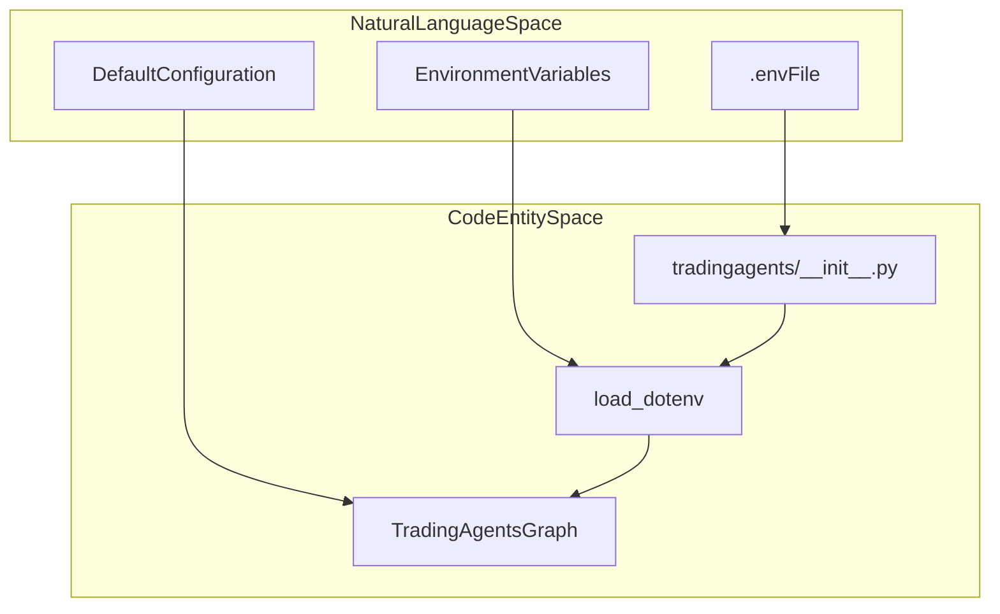
Sources: [tradingagents/__init__.py:5-13]()

For a complete breakdown of configuration keys, environment variable coercion rules, and tool-level overrides, see [Configuration Basics](#2.2).

---

## Usage Modes

TradingAgents provides two primary execution interfaces: an interactive command-line interface and a programmatic Python API.

### Command-Line Interface
The interactive CLI is configured as a console script entry point (`tradingagents = "cli.main:app"`), allowing direct invocation from the terminal once installed [pyproject.toml:43-44](). It guides users through asset selection, date ranges, and provider configuration before streaming execution logs.

### Python API
For programmatic integration, batch jobs, or headless pipelines, you can instantiate `TradingAgentsGraph` directly and invoke propagation methods [CHANGELOG.md:32]().

Title: Interface Convergence to TradingAgentsGraph Execution Pipeline
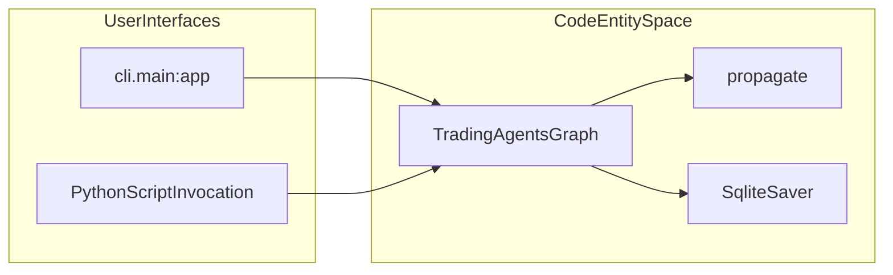
Sources: [pyproject.toml:43-44]()

For complete code examples, CLI command options, and programmatic execution scripts, see [Quick Start Examples](#2.3).

---

# Page: Installation and Dependencies

# Installation and Dependencies

<details>
<summary>Relevant source files</summary>

The following files were used as context for generating this wiki page:

- [CHANGELOG.md](CHANGELOG.md)
- [README.md](README.md)
- [pyproject.toml](pyproject.toml)
- [requirements.txt](requirements.txt)
- [tests/test_version.py](tests/test_version.py)
- [tradingagents/__init__.py](tradingagents/__init__.py)

</details>


This page provides comprehensive guidance on installing the TradingAgents framework and configuring its dependencies. It covers environment setup, dependency management via `pip` or `uv`, the dependency structure defined in `pyproject.toml`, optional extras such as `[bedrock]`, and the purpose of key runtime dependencies [pyproject.toml:11-41]().

---

## Installation Overview

The TradingAgents framework requires Python 3.11 or higher [pyproject.toml:10]() and relies on multiple external libraries for LLM inference, state management, and market data acquisition. The installation process registers the `tradingagents` command-line entry point which maps to `cli.main:app` [pyproject.toml:43-44]().

Sources: [pyproject.toml:10](), [pyproject.toml:43-44](), [README.md:98-104]()

---

## Python Version Requirements

### Version Compatibility Matrix

The project specifies `requires-python = ">=3.11"` in [pyproject.toml:10](). Continuous integration and packaging workflows validate support across modern Python runtimes.

Title: Python Version Compatibility and Requirements
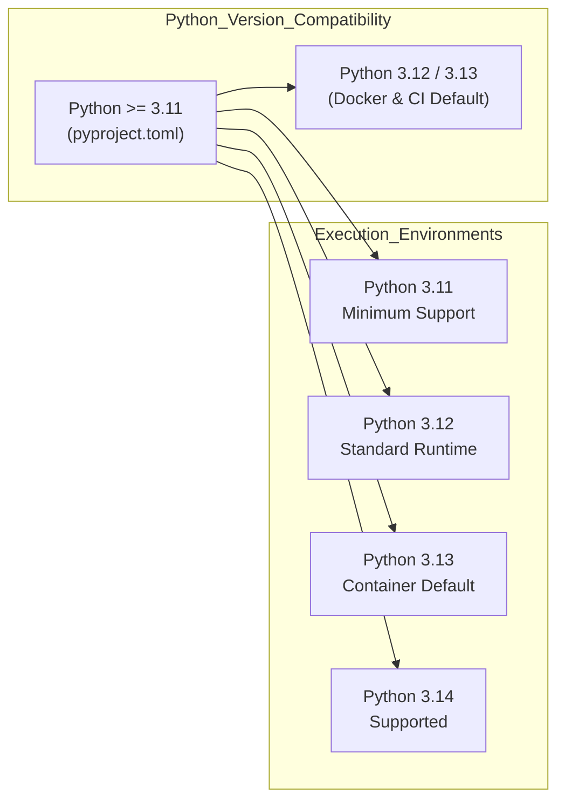

**Key version considerations**:
- **Python 3.11**: The baseline requirement for modern typing and asynchronous features [pyproject.toml:10]().
- **Python 3.13**: Used as the base environment for standard container builds and clean-install verification [CHANGELOG.md:66]().
- **Cross-Platform**: Includes built-in compatibility handling for Windows UTF-8 encoding [CHANGELOG.md:49]().

Sources: [pyproject.toml:10](), [CHANGELOG.md:49](), [CHANGELOG.md:66]()

---

## Installation Methods

### Method 1: Standard Installation (pip)

Standard installation uses the root project configuration via `pip` [pyproject.toml:5-7](). The `requirements.txt` file points to the project package [requirements.txt:1-3]().

```bash
# Clone repository
git clone https://github.com/TauricResearch/TradingAgents.git
cd TradingAgents

# Create virtual environment
python -m venv .venv
source .venv/bin/activate  # Linux/macOS or .venv\Scripts\activate on Windows

# Install package and core dependencies
pip install .
```

To include optional features such as Amazon Bedrock support (`langchain-aws`), install with the `bedrock` extra tag [pyproject.toml:39-41]():
```bash
pip install ".[bedrock]"
```

For development and testing (`ruff`, `pytest`), install with the `dev` extra [pyproject.toml:31-36]():
```bash
pip install ".[dev]"
```

Sources: [pyproject.toml:11-41](), [requirements.txt:1-3]()

### Method 2: UV Package Manager

The project configuration is fully compatible with `uv` for fast dependency resolution and environment synchronization [pyproject.toml:5-29]().

```bash
# Sync environment using uv
uv sync
```

Sources: [pyproject.toml:5-29]()

---

## Dependency Structure

### Dependency Architecture

The framework organizes its dependencies into functional tiers: core graph orchestration, LLM vendor integrations, data processing, and user interface utilities [pyproject.toml:11-29]().

Title: Dependency Functional Blocks
```mermaid
graph TB
    subgraph "Core_Orchestration"
        LangGraph["langgraph>=1.2.12"]
        LangChain["langchain-core>=1.6.5"]
        Checkpointer["langgraph-checkpoint-sqlite>=3.1.1"]
    end
    
    subgraph "LLM_Providers"
        OpenAI["langchain-openai>=1.6.6"]
        Anthropic["langchain-anthropic>=1.7.4"]
        Google["langchain-google-genai>=4.4.0"]
        Bedrock["langchain-aws>=1.7.9 (Optional)"]
    end
    
    subgraph "Data_And_Analysis"
        YFinance["yfinance>=1.7.0"]
        StockStats["stockstats>=0.6.5"]
        Pandas["pandas>=3.0.6"]
    end
    
    subgraph "UI_And_CLI"
        Rich["rich>=14.0.0"]
        Typer["typer>=0.21.0"]
        Questionary["questionary>=2.1.0"]
    end

    TA["tradingagents"] --> LangGraph
    TA --> OpenAI
    TA --> YFinance
    TA --> Rich
    TA -.-> Bedrock
```

Sources: [pyproject.toml:11-41]()

### Key Dependencies and Purpose

| Package | Version | Purpose |
|---------|---------|---------|
| `langgraph` | >=1.2.12 | Orchestrates the multi-agent state machine and cyclic execution flows [pyproject.toml:16](). |
| `langgraph-checkpoint-sqlite` | >=3.1.1 | Enables persistence and checkpoint/resume functionality for graph states using SQLite [pyproject.toml:17](). |
| `langchain-openai` | >=1.6.6 | Primary integration client for OpenAI and compatible model providers [pyproject.toml:15](). |
| `langchain-anthropic` | >=1.7.4 | Integration client for Anthropic Claude models [pyproject.toml:13](). |
| `langchain-google-genai` | >=4.4.0 | Integration client for Google Gemini models [pyproject.toml:14](). |
| `langchain-aws` | >=1.7.9 | Optional Amazon Bedrock client via `[bedrock]` extra [pyproject.toml:39-41](). |
| `yfinance` | >=1.7.0 | Retrieves market price data, ticker information, and news [pyproject.toml:28](). |
| `stockstats` | >=0.6.5 | Calculates technical indicators (e.g., MACD, RSI) over pandas DataFrames [pyproject.toml:26](). |
| `pandas` | >=3.0.6 | High-performance data structure and time-series manipulation [pyproject.toml:19](). |
| `rich` | >=14.0.0 | Renders real-time terminal UI, progress tables, and panels [pyproject.toml:24](). |
| `questionary` | >=2.1.0 | Handles interactive CLI configuration wizards and prompts [pyproject.toml:22](). |
| `typer` | >=0.21.0 | CLI application structuring and argument parsing [pyproject.toml:25](). |

Sources: [pyproject.toml:11-29]()

---

## Technical Data Flow: Dependency Interaction

The sequence diagram below illustrates how internal execution modules interact with third-party dependencies defined in `pyproject.toml` during a typical analysis cycle.

Title: Bridge - Natural Language Flow to Code Entities and Dependencies
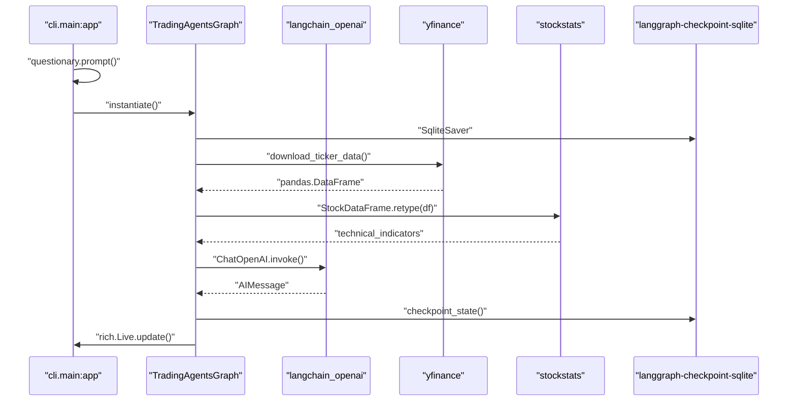

Sources: [pyproject.toml:11-29](), [pyproject.toml:43-44]()

---

## Installation Verification

### Verification via CLI
The package installs a command-line entry point named `tradingagents` [pyproject.toml:43-44](). You can verify the installation by running:

```bash
tradingagents --help
```

This command maps directly to the `app` object defined in `cli.main:app` [pyproject.toml:43-44](). Furthermore, automated package version verification runs via unit tests [tests/test_version.py:1-18]().

### Package Structure
The installation packaging includes the following core modules:
- `tradingagents`: Core logic, agent graph execution, memory systems, and data acquisition vendors [pyproject.toml:49-50]().
- `cli`: Command-line interface orchestration and static CLI assets [pyproject.toml:49-53]().

Sources: [pyproject.toml:43-54](), [tests/test_version.py:1-18]()

---

# Page: Configuration Basics

# Configuration Basics

<details>
<summary>Relevant source files</summary>

The following files were used as context for generating this wiki page:

- [.env.enterprise.example](.env.enterprise.example)
- [.env.example](.env.example)
- [main.py](main.py)
- [tests/test_tier_providers.py](tests/test_tier_providers.py)
- [tradingagents/default_config.py](tradingagents/default_config.py)
- [tradingagents/llm_clients/__init__.py](tradingagents/llm_clients/__init__.py)
- [tradingagents/llm_clients/factory.py](tradingagents/llm_clients/factory.py)

</details>


## Purpose and Scope

This document introduces the TradingAgents configuration system, detailing how to manage essential parameters, API keys, multi-model execution tiers, LLM thinking strategies, and system outputs such as `output_language`. The configuration system provides sensible defaults through `build_default_config()` and `DEFAULT_CONFIG` in `tradingagents/default_config.py` while supporting robust overrides via environment variables and runtime settings.

For installation procedures and dependencies, see [Installation and Dependencies](). For programmatic and CLI usage examples, see [Quick Start Examples](). For comprehensive details on LLM providers, see [LLM Provider Support]().

Sources: [tradingagents/default_config.py:1-137](), [.env.example:1-78]()

---

## Configuration System Architecture & Coercion

The TradingAgents configuration system operates across three tiers: base defaults defined in code, environment variables loaded from the shell or `.env` files, and explicit runtime overrides. At import time, `_apply_env_overrides()` maps `TRADINGAGENTS_*` environment variables onto the `DEFAULT_CONFIG` dictionary, performing strict type coercion using `_coerce()` to fail loudly on malformed inputs [tradingagents/default_config.py:37-75]().

Title: Configuration System Data Flow from Environment to Code Entities
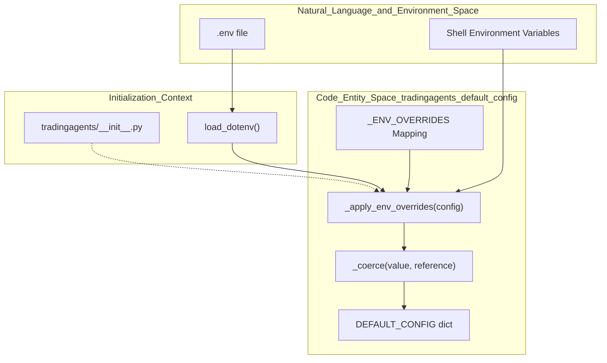

Sources: [tradingagents/default_config.py:10-34](), [tradingagents/default_config.py:37-75]()

---

## Environment Variables and API Keys

API keys and configuration overrides are managed primarily through environment variables. The package loads `.env` files automatically upon initialization.

### Required API Keys

The following environment variables correspond to various LLM providers handled by the model factory:

| Variable | Provider | Required When |
|----------|----------|---------------|
| `OPENAI_API_KEY` | OpenAI GPT models | `llm_provider: "openai"` |
| `GOOGLE_API_KEY` | Google Gemini models | `llm_provider: "google"` |
| `ANTHROPIC_API_KEY` | Anthropic Claude models | `llm_provider: "anthropic"` |
| `FRED_API_KEY` | St. Louis FED | Macro data vendor is `"fred"` |
| `SEC_EDGAR_USER_AGENT` | SEC EDGAR | SEC EDGAR fundamentals vendor is active |
| `TYPESAFE_API_KEY` | TypeSafe Jev | Sentiment analyst screening via StockTwits/Reddit |

Sources: [.env.example:1-38]()

### Automatic Configuration Overrides

The `_ENV_OVERRIDES` dictionary defines the mapping from `TRADINGAGENTS_*` environment variables to `DEFAULT_CONFIG` keys [tradingagents/default_config.py:10-34](). The `_coerce()` function validates types (booleans, integers, floats, strings) and raises a `ValueError` on malformed inputs [tradingagents/default_config.py:41-61]().

| Environment Variable | Config Key | Type |
|----------------------|------------|------|
| `TRADINGAGENTS_LLM_PROVIDER` | `llm_provider` | string |
| `TRADINGAGENTS_DEEP_THINK_LLM` | `deep_think_llm` | string |
| `TRADINGAGENTS_QUICK_THINK_LLM` | `quick_think_llm` | string |
| `TRADINGAGENTS_DEEP_THINK_PROVIDER` | `deep_think_provider` | string |
| `TRADINGAGENTS_QUICK_THINK_PROVIDER` | `quick_think_provider` | string |
| `TRADINGAGENTS_OUTPUT_LANGUAGE` | `output_language` | string |
| `TRADINGAGENTS_MAX_DEBATE_ROUNDS` | `max_debate_rounds` | integer |
| `TRADINGAGENTS_CHECKPOINT_ENABLED` | `checkpoint_enabled` | boolean |
| `TRADINGAGENTS_LLM_MAX_RETRIES` | `llm_max_retries` | integer |

Sources: [tradingagents/default_config.py:10-34](), [tradingagents/default_config.py:41-61]()

---

## DEFAULT_CONFIG Structure and Essential Parameters

The `build_default_config()` function returns the baseline dictionary combining hardcoded defaults with `TRADINGAGENTS_*` overrides [tradingagents/default_config.py:77-83]().

### Essential Configuration Parameters

| Parameter | Default | Description |
|-----------|---------|-------------|
| `llm_provider` | `"openai"` | Primary fallback LLM provider [tradingagents/default_config.py:92]() |
| `deep_think_llm` | `"gpt-6-sol"` | Model used for complex reasoning, research managers, and portfolio decisions [tradingagents/default_config.py:93]() |
| `quick_think_llm` | `"gpt-6-luna"` | Model used for analysts, researchers, debaters, and trader execution [tradingagents/default_config.py:94]() |
| `output_language` | `"English"` | Target language for analyst reports and final summaries [tradingagents/default_config.py:131]() |
| `max_debate_rounds` | `1` | Bull vs bear debate rounds in research phase [tradingagents/default_config.py:133]() |
| `checkpoint_enabled` | `False` | LangGraph state saving for resuming crashed runs [tradingagents/default_config.py:128]() |
| `llm_max_retries` | `None` | SDK retry budget (`None` uses provider default) [tradingagents/default_config.py:120]() |

### Multi-Language Support

The `output_language` parameter controls the final reported language for analyst reports and final decisions [tradingagents/default_config.py:131](). Internal agent reasoning and debates remain in English to protect logical integrity across models.

Sources: [tradingagents/default_config.py:77-137]()

---

## Dual-Model Tiers and Thinking Strategies

TradingAgents supports independent model tiers (`quick` and `deep`) via `create_tier_client()` and `tier_provider()`, allowing distinct providers and endpoints for analysts versus managers [tradingagents/llm_clients/factory.py:133-152](). Provider-specific reasoning flags are normalized via `build_llm_kwargs()` [tradingagents/llm_clients/factory.py:90-131]().

Title: Model Tier Resolution from Natural Language Request to Code Entities
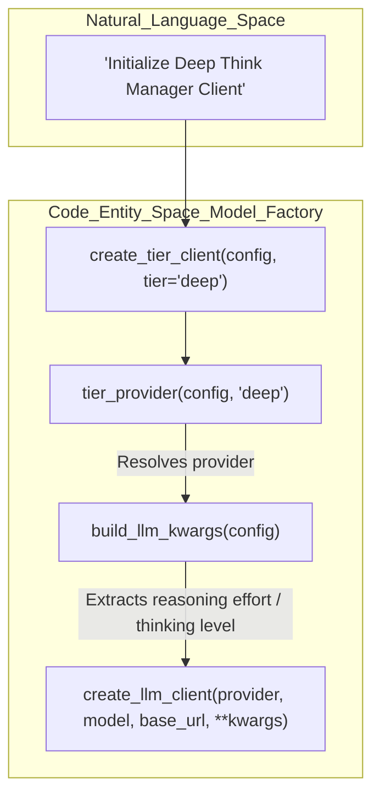

Sources: [tradingagents/llm_clients/factory.py:90-152]()

| Parameter | Provider | Values | Description |
|-----------|----------|--------|-------------|
| `openai_reasoning_effort` | OpenAI | `low`, `medium`, `high` | Reasoning effort for reasoning models [tradingagents/default_config.py:110]() |
| `google_thinking_level` | Google | `minimal`, `high`, etc. | Thinking level for Gemini models [tradingagents/default_config.py:109]() |
| `anthropic_effort` | Anthropic | `low`, `medium`, `high` | Effort budget for Claude thinking [tradingagents/default_config.py:111]() |

Sources: [tradingagents/default_config.py:108-111](), [tradingagents/llm_clients/factory.py:90-110]()

---

## Path and Directory Management

Default working directories are structured under the user home directory (`~/.tradingagents/`), configurable via environment variables [tradingagents/default_config.py:3-86]().

| Parameter | Default Path | Environment Override |
|-----------|--------------|----------------------|
| `results_dir` | `~/.tradingagents/logs` | `TRADINGAGENTS_RESULTS_DIR` [tradingagents/default_config.py:84]() |
| `data_cache_dir` | `~/.tradingagents/cache` | `TRADINGAGENTS_CACHE_DIR` [tradingagents/default_config.py:85]() |
| `memory_log_path` | `~/.tradingagents/memory/trading_memory.md` | `TRADINGAGENTS_MEMORY_LOG_PATH` [tradingagents/default_config.py:86]() |

Sources: [tradingagents/default_config.py:3-9](), [tradingagents/default_config.py:84-86]()

---

# Page: Quick Start Examples

# Quick Start Examples

<details>
<summary>Relevant source files</summary>

The following files were used as context for generating this wiki page:

- [cli/main.py](cli/main.py)
- [main.py](main.py)
- [tradingagents/default_config.py](tradingagents/default_config.py)

</details>


This page provides concrete examples of using both the Command Line Interface (CLI) and Python API interfaces to run basic trading analyses. It covers installation verification, script execution using `main.py` as the canonical Python API entry point [main.py:1-16](), and CLI options defined in `cli/main.py` [cli/main.py:25-153]().

Sources: [main.py:1-16](), [cli/main.py:25-153]()

---

## 1. Python API Quick Start (`main.py`)

The Python API enables programmatic integration, automated analysis, and batch processing [main.py:1-16](). The file `main.py` serves as the canonical reference implementation, demonstrating how to load configuration, instantiate the graph engine, and propagate an analysis request for a target instrument [main.py:1-16]().

### Implementation and Data Flow

The script imports `DEFAULT_CONFIG` from `tradingagents/default_config.py` [tradingagents/default_config.py:77-83](), which automatically applies environment variable overrides [tradingagents/default_config.py:64-74](). It then instantiates `TradingAgentsGraph` and invokes the `.propagate()` method [main.py:9-15]().

```mermaid
graph TD
    subgraph "NaturalLanguageSpace"
        UserScript[""CanonicalPythonScript""]
        ExecutionTarget[""TargetTickerAndDate""]
    end

    subgraph "CodeEntitySpace"
        ConfigLoad[""build_default_config() [tradingagents/default_config.py:77]""]
        GraphInit[""TradingAgentsGraph() [tradingagents/graph/trading_graph.py:23]""]
        PropagateCall[""propagate(ticker, date) [tradingagents/graph/trading_graph.py:202]""]
    end

    UserScript --> ConfigLoad
    ConfigLoad --> GraphInit
    ExecutionTarget --> PropagateCall
    GraphInit --> PropagateCall
```
Sources: [main.py:1-16](), [tradingagents/default_config.py:77-83](), [tradingagents/graph/trading_graph.py:23-214]()

---

## 2. Command Line Interface (CLI) Quick Start

The CLI provides an interactive, real-time visualization of the multi-agent trading pipeline and is implemented via `typer` in `cli/main.py` [cli/main.py:25-29](). It exposes an `@app.callback()` for running single-asset analyses (`analyze`) and an explicit `@app.command()` for running historical backtests (`backtest`) [cli/main.py:32-153]().

### CLI Execution and Routing

When executed without a subcommand, the CLI runs the `analyze` callback, parsing options such as `--ticker`, `--date`, `--portfolio`, `--checkpoint`, and `--html` [cli/main.py:33-67](). If options are omitted, interactive prompts collect the missing parameters [cli/main.py:68-72]().

```mermaid
graph TD
    subgraph "UserCommandSpace"
        CLIEntry[""tradingagents [cli/main.py:32]""]
        BacktestCmd[""tradingagents backtest [cli/main.py:103]""]
    end

    subgraph "CodeEntitySpace"
        AnalyzeCallback[""analyze() [cli/main.py:33]""]
        PortfolioLoader[""load_portfolio() [tradingagents/portfolio.py]""]
        RunAnalysis[""run_analysis() [cli/main.py:89]""]
        BacktestRunner[""run_backtest() [tradingagents/backtest.py]""]
    end

    CLIEntry --> AnalyzeCallback
    AnalyzeCallback --> PortfolioLoader
    PortfolioLoader --> RunAnalysis
    BacktestCmd --> BacktestRunner
```
Sources: [cli/main.py:32-153](), [tradingagents/portfolio.py:1-1](), [tradingagents/backtest.py:1-1]()

---

## 3. Configuration and Environment Integration

Both the Python API and CLI rely on the configuration subsystem defined in `tradingagents/default_config.py` [tradingagents/default_config.py:1-209](). Environment variables prefixed with `TRADINGAGENTS_*` are mapped to configuration keys via `_ENV_OVERRIDES` and coerced to match the target data type using `_coerce()` [tradingagents/default_config.py:10-61]().

This ensures that unattended scripts and automated CI pipelines can configure parameters such as `llm_provider`, `checkpoint_enabled`, and `output_language` without modifying source code [tradingagents/default_config.py:10-131]().

Sources: [tradingagents/default_config.py:10-131]()

---

# Page: User Interfaces

# User Interfaces

<details>
<summary>Relevant source files</summary>

The following files were used as context for generating this wiki page:

- [cli/main.py](cli/main.py)

</details>


## Purpose and Scope

This document provides a high-level overview of the primary methods for interacting with the TradingAgents framework: the interactive Command Line Interface (CLI), the programmatic Python API, the batch backtesting sweep, and the portfolio context management layer. These interfaces bridge natural language user intent and automated batch runs with the core multi-agent execution pipeline.

As a parent page, this section introduces each interface at a macro level. For granular implementation guides, configuration options, and deep technical details, refer to the child pages:
- For CLI workflows, preferences, and real-time display, see [Command Line Interface](#3.1).
- For programmatic graph instantiation and headless automation, see [Python API](#3.2).
- For grid sweeps, evaluation metrics, and decision log persistence, see [Backtesting and Evaluation](#3.3).
- For managing holdings, cash ledgers, and sizing against real portfolios, see [Portfolio Context](#3.4).

Sources: [cli/main.py:68-72](), [tradingagents/backtest.py:1-15](), [tradingagents/portfolio.py:1-15]()

## Interface Comparison and Architecture

The TradingAgents framework supplies multiple access vectors that all funnel through the core orchestration layer (`TradingAgentsGraph`). 

| Interaction Mode | Primary Entry Point | Configuration Mechanism | Execution Context | Output & Persistence |
|------------------|---------------------|-------------------------|-------------------|----------------------|
| **Interactive CLI** | `cli.main:analyze` [cli/main.py:32-67]() | Interactive questionnaire (`questionary`) [cli/utils.py:44-56]() + saved prefs [cli/prefs.py:35-46]() | Single-ticker, single-date run with real-time display | Rich terminal panels + markdown report tree |
| **Python API** | `TradingAgentsGraph` [tradingagents/graph/trading_graph.py:270-275]() | Programmatic configuration dictionary (`DEFAULT_CONFIG`) [tradingagents/default_config.py:1-10]() | Headless or embedded script execution | Python state dicts, return strings, and `save_reports()` [tradingagents/graph/trading_graph.py:270-300]() |
| **Backtest Sweep** | `cli.main:backtest` [cli/main.py:103-119]() | Backtest grid parameters (`--start`, `--end`, `--every`) [cli/main.py:106-108]() | Multi-ticker, multi-date grid iteration | Isolated decision log [tradingagents/backtest.py:145-148]() and aggregate hit-rate scoring |

Sources: [cli/main.py:32-119](), [tradingagents/backtest.py:127-150](), [tradingagents/graph/trading_graph.py:270-300]()

### System Interaction Diagram

```mermaid
graph TB
    subgraph "User_Interfaces"
        CLI[""cli.main:app (Typer App)""]
        API[""TradingAgentsGraph (Python API)""]
        BT[""cli.main:backtest""]
    end
    
    subgraph "Context_and_State"
        Prefs[""cli.prefs:load_last_run()""]
        Port[""tradingagents.portfolio:load_portfolio""]
        Config[""DEFAULT_CONFIG / run_config""]
    end
    
    subgraph "Core_Orchestration"
        Graph[""TradingAgentsGraph.propagate()""]
        Log[""TradingMemoryLog""]
    end
    
    CLI --> Prefs
    CLI --> Config
    API --> Config
    BT --> Config
    
    CLI --> Graph
    API --> Graph
    BT --> Graph
    
    Port -.-> Graph
    Config --> Graph
    Graph --> Log
```

Sources: [cli/main.py:32-153](), [cli/prefs.py:35-46](), [tradingagents/backtest.py:127-150](), [tradingagents/graph/trading_graph.py:270-300]()

## Command Line Interface

The Command Line Interface provides an interactive questionnaire flow for configuring and executing analyses directly from the terminal. Built using `Typer` [cli/main.py:25-29]() and `questionary` [cli/utils.py:44-56](), the CLI prompts users for ticker symbols, analysis dates, asset classifications, and LLM provider parameters via `cli.main:analyze` and `cli.main:backtest` [cli/main.py:32-119](). Previous selections are saved via `cli/prefs.py` to prefill prompts on subsequent runs without skipping validation steps [cli/prefs.py:1-15].

During execution, the CLI renders a live-updating terminal dashboard via `Rich.Live`, tracking agent state transitions (pending, in_progress, completed) through the `MessageBuffer` class [cli/main.py:76-151](). 

For full details on the questionnaire wizard, preference persistence, announcements, and display panels, see [Command Line Interface](#3.1).

Sources: [cli/main.py:25-151](), [cli/utils.py:37-133](), [cli/prefs.py:1-46]()

## Python API

The Python API offers programmatic integration for developers embedding TradingAgents into automated trading bots, notebooks, or continuous integration pipelines. By importing `TradingAgentsGraph` [tradingagents/graph/trading_graph.py:270-275](), scripts can instantiate the graph with customized dictionaries derived from `DEFAULT_CONFIG` [tradingagents/default_config.py:1-10]() and invoke `propagate(ticker, date, portfolio=...)` directly.

Headless executions utilize `save_reports()` to export structured markdown report trees to disk without requiring a terminal console or interactive prompt responses [tradingagents/graph/trading_graph.py:270-300]().

For code examples, instantiation patterns, and configuration overrides, see [Python API](#3.2).

Sources: [tradingagents/graph/trading_graph.py:270-300]()

## Backtesting and Evaluation Sweep

The backtesting subsystem (`tradingagents/backtest.py`) executes the graph over a grid of tickers and dates via `tradingagents.backtest:iter_grid` to evaluate decision quality across historical timeframes [tradingagents/backtest.py:32-49](). To avoid polluting live operational memory, backtests write to an isolated decision log directory configured via `--run-id` [cli/main.py:116-118]().

Cells already recorded in the run's memory log are automatically skipped, enabling robust resumption of interrupted sweeps [tradingagents/backtest.py:136-158](). Aggregate summaries computed via `tradingagents.backtest:summarize` evaluate directional hit rates and mean alpha returns against regional benchmarks [tradingagents/backtest.py:92-124](). Note that backtesting is strictly an evaluation tool for decision quality and explicitly avoids portfolio simulation (e.g., position sizing, cash ledgers, or execution fills) [tradingagents/backtest.py:9-15]().

For detailed coverage of grid generation, settlement passes, and hit-rate scoring, see [Backtesting and Evaluation](#3.3).

Sources: [cli/main.py:103-153](), [tradingagents/backtest.py:1-169]()

## Portfolio Context

Portfolio awareness is managed via `tradingagents/portfolio.py`, which defines the `PortfolioContext` data structure encompassing cash balances, currency types, and active positions [tradingagents/portfolio.py:1-20](). Portfolios can be injected into graph runs via the `--portfolio` CLI flag [cli/main.py:46-51]() or passed explicitly to `propagate(portfolio=...)`. 

Analyst, risk management, and portfolio approval agents inspect real holdings to size recommendations against current portfolio constraints rather than treating the account as a flat cash book [tradingagents/portfolio.py:1-30]().

For complete details on schema definition, position parsing, and integration into agent reasoning prompts, see [Portfolio Context](#3.4).

Sources: [cli/main.py:46-51](), [tradingagents/portfolio.py:1-30]()

### Interface Routing and Execution Flow

```mermaid
graph TB
    subgraph "Interface_Inputs"
        CLI_In[""cli.main:analyze""]
        API_In[""TradingAgentsGraph(config=...)""]
        BT_In[""cli.main:backtest""]
    end
    
    subgraph "Execution_Entities"
        Grid[""tradingagents.backtest:iter_grid()""]
        Prop[""TradingAgentsGraph.propagate()""]
        PortCtx[""tradingagents.portfolio:load_portfolio()""]
    end
    
    subgraph "Storage_and_Reporting"
        MemLog[""tradingagents.agents.utils.memory:TradingMemoryLog""]
        SaveRep[""TradingAgentsGraph.save_reports()""]
    end
    
    CLI_In --> Prop
    API_In --> Prop
    BT_In --> Grid
    Grid --> Prop
    
    PortCtx -.-> Prop
    Prop --> MemLog
    Prop --> SaveRep
```

Sources: [cli/main.py:32-153](), [tradingagents/backtest.py:32-165](), [tradingagents/graph/trading_graph.py:270-300](), [tradingagents/portfolio.py:1-30]()

---

# Page: Command Line Interface

# Command Line Interface

<details>
<summary>Relevant source files</summary>

The following files were used as context for generating this wiki page:

- [cli/announcements.py](cli/announcements.py)
- [cli/config.py](cli/config.py)
- [cli/main.py](cli/main.py)
- [cli/prompts.py](cli/prompts.py)
- [cli/run.py](cli/run.py)
- [cli/selections.py](cli/selections.py)
- [tests/test_cli_headless.py](tests/test_cli_headless.py)
- [tests/test_cli_memory_log.py](tests/test_cli_memory_log.py)

</details>


The Command Line Interface (CLI) provides a Typer-driven command suite for interactive single-ticker analysis (`analyze`) and multi-cell parameter sweeps (`backtest`) `[cli/main.py:25]()- [cli/main.py:103]()`. It coordinates parameter collection, atomic user preferences persistence (`cli/prefs.py`), secure API credential verification `[tradingagents/llm_clients/api_key_env.py:1]`, real-time `rich` display updating `[cli/run.py:11]()`, remote community announcements `[cli/announcements.py:11]()`, and multi-format report generation including self-contained HTML output `[cli/main.py:63]()`.

## CLI Architecture and Command Routing

The CLI application entry point is defined in `cli/main.py` using `typer.Typer` `[cli/main.py:25]()`. The root callback handles bare `tradingagent` invocations or flags (`--ticker`, `--date`, `--analysts`, `--portfolio`, `--checkpoint`, `--save`, `--show`, `--html`), defaulting to an interactive configuration wizard when inputs are absent `[cli/main.py:32-67]()`. The explicit `backtest` subcommand coordinates multi-ticker and multi-date evaluation sweeps `[cli/main.py:103-119]()`.

```mermaid
graph TD
    CLI_APP["app (typer.Typer in cli/main.py)"] -->|No Subcommand| ANALYZE_FN["analyze() [cli/main.py:32]"]
    CLI_APP -->|Subcommand| BACKTEST_CMD["backtest() [cli/main.py:103]"]
    
    ANALYZE_FN --> FETCH_ANN["fetch_announcements() [cli/announcements.py:11]"]
    FETCH_ANN --> LOAD_PREFS["load_last_run() [cli/prefs.py]"]
    LOAD_PREFS --> GET_SEL["get_user_selections() [cli/selections.py:42]"]
    GET_SEL --> RUN_ANALYSIS["run_analysis() [cli/run.py:98]"]
    
    BACKTEST_CMD --> ITER_G["iter_grid() [tradingagents/backtest.py]"]
    ITER_G --> RUN_BT["run_backtest() [tradingagents/backtest.py]"]
    RUN_BT --> SUMM["summarize() [tradingagents/backtest.py]"]
```

**Sources:** [cli/main.py:25-151](), [cli/run.py:98-127](), [cli/announcements.py:11-29]()

## Interactive Configuration Flow and Preferences

The configuration wizard (`cli/selections.py` and `cli/prompts.py`) guides users through a series of interactive prompts using `questionary` `[cli/prompts.py:6]()`. To minimize friction during repeated executions, stable configuration selections are persisted across runs via `cli/prefs.py` `[cli/prefs.py:1]()`.

### Saved Preferences (`cli/prefs.py`)

Stable parameters such as `output_language`, `analysts`, `research_depth`, `llm_provider`, `quick_think_llm`, `deep_think_llm`, and `backend_url` are saved to `~/.tradingagents/cli_prefs.json` using atomic replacement (`.tmp` file swapping) to prevent torn file writes `[cli/prefs.py:27]()`. Transient execution targets like ticker symbols and analysis dates are deliberately excluded so users never inadvertently execute a run on a stale date `[cli/prefs.py:8]`.

```mermaid
classDiagram
    class get_user_selections {
        +load_last_run() dict
        +save_last_run(selections: dict) void
    }
    
    class _prompt_selections {
        +fetch_announcements() dict
        +display_announcements() void
        +get_ticker() str
        +parse_analysis_date() str
        +select_analysts() list
        +select_research_depth() int
    }
    
    class _build_run_config {
        +DEFAULT_CONFIG dict
        +depth_from_env() bool
    }
    
    get_user_selections --> _prompt_selections : "supplies defaults"
    _prompt_selections --> _build_run_config : "returns selections"
```

**Sources:** [cli/selections.py:42-46](), [cli/prefs.py:1-50](), [cli/prompts.py:38-182]()

### Configuration Precedence and Environment Overrides

Configuration resolution adheres to an strict precedence hierarchy:
1. **Explicit Environment Variables** (`TRADINGAGENTS_*`): Take highest precedence. For example, if `TRADINGAGENTS_MAX_DEBATE_ROUNDS` is set, it overrides the research depth choice selected in the interactive wizard `[cli/run.py:69-81]()`.
2. **Command Line Flags**: Explicit options like `--ticker NVDA` or `--checkpoint` bypass prompt collection `[cli/main.py:35-66]()`.
3. **Interactive Prompts & Preferences**: Used when neither environment variables nor flags are provided, pre-filling defaults from `load_last_run()` `[cli/selections.py:42]`.

Unattended runs (where `sys.stdin` is not a TTY) validate that all required configuration gaps are satisfied by environment variables or flags before execution, raising a descriptive error via `unattended_gaps()` if variables are missing `[cli/run.py:102-108]`, `[tests/test_cli_headless.py:69-82]()`.

**Sources:** [cli/run.py:59-95](), [cli/selections.py:55-68](), [tests/test_cli_headless.py:50-82]()

## Symbol Handling, Asset Types, and Analyst Filtering

User ticker input is validated and normalized through `cli/prompts.py` and the data layer's canonical symbol utilities `[cli/prompts.py:27-136]()`:
* `is_valid_ticker_input(value: str)`: Validates alphanumeric characters, dots, underscores, dashes, carets (`^`) for indices, and equals signs (`=`) for futures (`GC=F`) and forex (`EURUSD=X`) `[cli/prompts.py:27-36]()`.
* `normalize_ticker_symbol(ticker: str)`: Delegates to `tradingagents.dataflows.symbols.normalize_symbol` to map symbol variations (e.g., `BTCUSD` or `BTCUSDT` to `BTC-USD`) `[cli/prompts.py:102-116]()`.
* `detect_asset_type(ticker: str)`: Classifies the canonical symbol into `AssetType.STOCK` or `AssetType.CRYPTO` based on suffixes like `-USD`, `-USDT` `[cli/prompts.py:118-125]()`.
* `filter_analysts_for_asset_type`: Automatically filters out the `Fundamentals Analyst` when `AssetType.CRYPTO` is detected, as SEC filings and balance sheets do not apply to cryptocurrencies `[cli/prompts.py:127-136]()`.

**Sources:** [cli/prompts.py:27-136]()

## API Key Management & Announcements

### API Key Verification

When an LLM provider is selected, the CLI verifies the corresponding environment variable defined in `PROVIDER_API_KEY_ENV` `[tradingagents/llm_clients/api_key_env.py:1]()`. If missing, `ensure_api_key()` prompts the user securely using password masking and persists the key to the local `.env` file `[cli/prompts.py:26]()`. Tier-specific providers (`quick_think_provider` and `deep_think_provider`) are independently validated via `_check_tier_providers()` before any model invocation takes place `[cli/selections.py:71-92]()`.

### Community Announcements

Before displaying prompts, the CLI fetches community bulletins from `CLI_CONFIG["announcements_url"]` with a strict timeout `[cli/announcements.py:11-14]()`. If `require_attention` is set to `True` in the JSON response payload, `display_announcements()` pauses interactive execution and blocks on `getpass.getpass("Press Enter to continue...")` to ensure operators acknowledge critical notices `[cli/announcements.py:32-52]()`.

**Sources:** [cli/selections.py:71-92](), [cli/prompts.py:26](), [cli/announcements.py:11-52](), [cli/config.py:1-6]()

## Backtest Command and Execution

The `backtest` subcommand evaluates past trading decisions over a multi-dimensional grid of tickers and analysis dates without cluttering the primary operational memory log `[cli/main.py:103]`, `[tradingagents/backtest.py:1]()`.

```mermaid
graph TD
    CLI_BACKTEST["backtest() [cli/main.py:103]"] -->|Calls| ITER_GRID["iter_grid(start, end, every) [tradingagents/backtest.py:32]"]
    ITER_GRID -->|Returns date sequence| RUN_BACKTEST["run_backtest(tickers, dates, config) [tradingagents/backtest.py:137]"]
    
    subGraph "Backtest Cell Execution Loop"
        RUN_BACKTEST --> SKIP_CHECK["Skip existing cells using backtest memory log"]
        SKIP_CHECK --> PROPAGATE["TradingAgentsGraph.propagate()"]
        PROPAGATE --> STORE_DECISION["TradingMemoryLog.store_decision()"]
    end
    
    RUN_BACKTEST --> SETTLE["Settle raw_return and alpha_return"]
    SETTLE --> SUMMARIZE["summarize(result) [tradingagents/backtest.py:91]"]
    SUMMARIZE --> RENDER["BacktestSummary.render()"]
```

* `iter_grid()`: Generates sequential analysis dates spaced by `--every` days up to the current date `[tradingagents/backtest.py:32-49]()`.
* `run_backtest()`: Instantiates isolated `TradingAgentsGraph` instances routing log entries to `results_dir/backtest/{run_id}/` `[tradingagents/backtest.py:137-148]()`.
* `summarize()`: Computes aggregate hit-rates grouped by rating direction (e.g., `Buy`, `Sell`) and mean alpha relative to benchmark mappings across resolved cells `[tradingagents/backtest.py:91-124]()`. Resumption is supported via `--run-id` to skip completed cells `[cli/main.py:116-118]()`.

**Sources:** [cli/main.py:103-153](), [tradingagents/backtest.py:32-170]()

## Real-Time Display, Memory Integration, and Output Options

### Real-Time Rendering and Metrics

During single-ticker execution (`run_analysis` in `cli/run.py`), a `MessageBuffer` tracks agent statuses (`pending`, `in_progress`, `completed`), tool invocations, and streaming report sections `[cli/run.py:98]`, `[tests/test_cli_memory_log.py:94-118]()`. The interface utilizes `rich.live.Live` to render a non-scrolling split-pane status layout `[cli/run.py:11]()`. Token consumption and LLM call rates are collected concurrently via `StatsCallbackHandler` `[cli/run.py:114]()`, `[cli/stats_handler.py:9-76]()`.

### Memory Log Integration

The CLI records decisions through `TradingAgentsGraph.record_decision()` immediately following graph execution, ensuring parity with programmatic `propagate()` runs `[tests/test_cli_memory_log.py:1-8]`, `[tests/test_cli_memory_log.py:143-154]()`. This appends a structured entry to the markdown decision log (`trading_memory.md`) to inform future trading sessions.

### Output Options and HTML Generation

Analyses generate structured file trees under `results_dir/{ticker}/{date}/`:
* `reports/complete_report.md`: Consolidated markdown analysis report.
* `reports/complete_report.html`: Self-contained, styled HTML report generated via `report_html.py` when `--html` is active (the default) `[cli/main.py:63-66]()`.
* `message_tool.log`: Detailed timestamped execution log of agent communications and tool arguments `[cli/run.py:138-163]()`.

**Sources:** [cli/run.py:98-165](), [tests/test_cli_memory_log.py:1-154](), [cli/main.py:63-66]()

---

# Page: Python API

# Python API

<details>
<summary>Relevant source files</summary>

The following files were used as context for generating this wiki page:

- [main.py](main.py)
- [tests/test_memory_log.py](tests/test_memory_log.py)
- [tradingagents/default_config.py](tradingagents/default_config.py)
- [tradingagents/graph/trading_graph.py](tradingagents/graph/trading_graph.py)

</details>


The Python API provides programmatic access to the TradingAgents framework for integration into custom applications, backtesting systems, or automated trading workflows. This interface centers around the `TradingAgentsGraph` class [tradingagents/graph/trading_graph.py:51-116]() and its `.propagate()` method, which executes the complete multi-agent pipeline and returns structured trading decisions.

For interactive command-line usage, see [Command Line Interface](#3.1). For information about backtesting sweeps, see [Backtesting and Evaluation](#3.3).

---

## 1. Overview and Canonical Example (`main.py`)

The primary programmatic entry point is documented by `main.py`, which demonstrates a minimal end-to-end execution of the graph using configuration defaults [main.py:1-16](). 

```python
from tradingagents.default_config import DEFAULT_CONFIG
from tradingagents.graph.trading_graph import TradingAgentsGraph

config = DEFAULT_CONFIG.copy()

# Initialize with custom config
ta = TradingAgentsGraph(debug=True, config=config)

# forward propagate
_, decision = ta.propagate("NVDA", "2026-09-01")
print(decision)
```

The script illustrates how `DEFAULT_CONFIG` automatically incorporates environment overrides while allowing direct programmatic manipulation before graph instantiation [main.py:1-12]().

Sources: [main.py:1-16](), [tradingagents/graph/trading_graph.py:51-116]()

---

## 2. TradingAgentsGraph Instantiation and Configuration Options

The `TradingAgentsGraph` class manages the lifecycle of LLM clients, tool nodes, memory logs, and the LangGraph workflow compilation [tradingagents/graph/trading_graph.py:51-116]().

### Constructor Signature and Parameters

```python
class TradingAgentsGraph:
    def __init__(
        self,
        selected_analysts=("market", "social", "news", "fundamentals"),
        debug=False,
        config: dict[str, Any] = None,
        callbacks: list | None = None,
    ):
```

- `selected_analysts`: Tuple of active analyst modules (`"market"`, `"social"`, `"news"`, `"fundamentals"`) [tradingagents/graph/trading_graph.py:56]()
- `debug`: Boolean flag switching graph execution modes [tradingagents/graph/trading_graph.py:57]()
- `config`: Optional dictionary overriding `DEFAULT_CONFIG` [tradingagents/graph/trading_graph.py:58]()
- `callbacks`: Optional sequence of callback handlers for tracking LLM/tool usage [tradingagents/graph/trading_graph.py:59]()

### Initialization Architecture

The following diagram maps the high-level orchestration concepts to their exact codebase entities during graph construction:

```mermaid
graph TB
    subgraph "Natural Language Space"
        UserScript["User Python Script"]
        ConfigLayer["Global Configuration Layer"]
        LLMFactory["LLM Provider Factory"]
        MemoryStore["Persistent Decision Memory"]
        WorkflowCompiler["LangGraph Workflow Compiler"]
    end

    subgraph "Code Entity Space"
        MainPy["main.py"]
        TradingGraph["TradingAgentsGraph.__init__<br/>[tradingagents/graph/trading_graph.py:54-116]()"]
        SetConfig["set_config()<br/>[tradingagents/graph/trading_graph.py:73]()"]
        CreateLLM["create_tier_client()<br/>[tradingagents/graph/trading_graph.py:17]()"]
        MemLog["TradingMemoryLog<br/>[tradingagents/graph/trading_graph.py:82]()"]
        GraphSetup["GraphSetup.setup_graph()<br/>[tradingagents/graph/trading_graph.py:112]()"]
    end

    UserScript --> MainPy
    MainPy --> TradingGraph
    TradingGraph --> SetConfig
    TradingGraph --> CreateLLM
    TradingGraph --> MemLog
    TradingGraph --> GraphSetup
```

Sources: [tradingagents/graph/trading_graph.py:51-116](), [main.py:1-16]()

---

## 3. The `propagate()` Method and Portfolio Context

The core execution method is `propagate()`, which validates input parameters, initializes execution state, runs the LangGraph workflow, and processes the final trade decision signal [tradingagents/graph/trading_graph.py:30-41]().

Input dates are strictly validated using `_validate_trade_date()` to ensure canonical `YYYY-MM-DD` formatting and prevent future-dated runs [tradingagents/graph/trading_graph.py:30-41](). Instrument identity and context resolution are handled via `resolve_instrument_context()` to anchor agents to real asset data [tradingagents/graph/trading_graph.py:117-128]().

```mermaid
graph TB
    subgraph "Execution Flow Space"
        Call["propagate()<br/>[tradingagents/graph/trading_graph.py:51]()"]
        Validate["_validate_trade_date()<br/>[tradingagents/graph/trading_graph.py:30-41]()"]
        ResolveIdentity["resolve_instrument_context()<br/>[tradingagents/graph/trading_graph.py:117-128]()"]
        InitState["Propagator.create_initial_state()<br/>[tradingagents/graph/trading_graph.py:103]()"]
        WorkflowExec["graph.invoke() / graph.stream()<br/>[tradingagents/graph/trading_graph.py:113]()"]
    end

    Call --> Validate
    Validate --> ResolveIdentity
    ResolveIdentity --> InitState
    InitState --> WorkflowExec
```

Sources: [tradingagents/graph/trading_graph.py:30-41](), [tradingagents/graph/trading_graph.py:117-128]()

---

## 4. Programmatic Reports via `save_reports()`

Headless script runs can generate the complete hierarchical markdown report tree using `save_reports()` after executing `propagate()` [tradingagents/graph/trading_graph.py:20-20]().

```python
final_state, decision = ta.propagate("NVDA", "2026-09-01")
report_dir = ta.save_reports(final_state, "NVDA")
```

This method invokes `write_report_tree()`, writing analyst outputs, bull/bear research histories, risk analyses, and portfolio decisions into structured subdirectories alongside a consolidated `complete_report.md` [tradingagents/graph/trading_graph.py:20-20]().

Sources: [tradingagents/graph/trading_graph.py:20-20]()

---

## 5. Configuration Options and Environment Integration

Configuration defaults are maintained in `build_default_config()` and `DEFAULT_CONFIG` [tradingagents/default_config.py:77-83]() and can be overridden programmatically or via environment variables defined in `_ENV_OVERRIDES` [tradingagents/default_config.py:10-34]().

Coercion helpers like `_coerce()` ensure strict type enforcement for environment overrides (booleans, integers, floats) to fail fast on malformed configurations [tradingagents/default_config.py:41-61]().

Sources: [tradingagents/default_config.py:1-137]()

---

# Page: Backtesting and Evaluation

# Backtesting and Evaluation

<details>
<summary>Relevant source files</summary>

The following files were used as context for generating this wiki page:

- [cli/main.py](cli/main.py)
- [tests/test_backtest.py](tests/test_backtest.py)
- [tests/test_cli_commands.py](tests/test_cli_commands.py)
- [tests/test_memory_pointintime.py](tests/test_memory_pointintime.py)
- [tradingagents/backtest.py](tradingagents/backtest.py)

</details>


## Purpose and Scope
This page documents the backtesting and evaluation subsystem located in `tradingagents/backtest.py`. The backtesting framework evaluates multi-agent decision quality by executing the trading graph over a grid matrix of tickers and historical dates [tradingagents/backtest.py:1-15](). 

Crucially, backtesting in TradingAgents is designed around an explicit non-goal: **it is not a portfolio simulator** [tradingagents/backtest.py:9-15](). Because the system lacks a trade execution engine, fill-price modeling, and a dynamic cash ledger, backtest cells remain independent [tradingagents/backtest.py:9-15](). When a portfolio configuration is supplied, it acts as a static standing book across all cells rather than rolling positions forward [tradingagents/backtest.py:12-14]().

Sources: `tradingagents/backtest.py:1-15]()`

---

## 1. Grid Sweep Mechanics and Date Iteration
The grid sweep is driven by `iter_grid()`, which computes the sequence of analysis dates between a start and end point given a configurable step size (`every_n_days`) [tradingagents/backtest.py:34-51]().

### Key Functions
* `iter_grid(start_date: str, end_date: str, every_n_days: int = 1) -> list[str]`: Generates a list of date strings [tradingagents/backtest.py:34-51](). It enforces that `every_n_days >= 1` and that `end >= start` [tradingagents/backtest.py:41-44]().
* `_canonical(date: str) -> datetime`: Validates that incoming dates strictly adhere to `YYYY-MM-DD` formatting, rejecting malformed inputs or strings that change after parsing [tradingagents/backtest.py:54-62]().
* **Present-Day Bounding**: The grid automatically clamps its upper bound to `min(end, datetime.strptime(get_current_date(), "%Y-%m-d"))` because future dates have no realized outcomes against which to score [tradingagents/backtest.py:35-39, 46]().

```mermaid
graph TD
    subgraph NaturalLanguageSpace
        S1["Generate Grid Analysis Dates"]
    end

    subgraph CodeEntitySpace
        IG["iter_grid(start_date, end_date, every_n_days)"] --> CAN["_canonical(date)"]
        CAN --> GCD["get_current_date()"]
        GCD --> CLAMP["Clamp Upper Bound to Present Day"]
        CLAMP --> RES["Return list[str] YYYY-MM-DD"]
    end

    S1 --> IG

    style NaturalLanguageSpace fill:none,stroke:#000,stroke-width:1px
    style CodeEntitySpace fill:none,stroke:#000,stroke-width:1px
```
*Figure 1: Natural Language to Code Entity mapping for grid iteration.*

Sources: `tradingagents/backtest.py:34-62]()`

---

## 2. Execution, Isolation, and `--run-id` Resumption
To prevent backtest sweeps from polluting live operational memory, `run_backtest()` isolates its output into a dedicated directory and decision log [tradingagents/backtest.py:129-153]().

### Isolation and Resumption Flow
1. **Directory Structure**: A unique `run_id` is validated via `safe_ticker_component()` and mapped to `results/backtest/{run_id}/` [tradingagents/backtest.py:148-150]().
2. **Dedicated Log**: A localized `trading_memory.md` is instantiated within the run directory, keeping live runs completely untouched [tradingagents/backtest.py:151-152]() [tests/test_backtest.py:79-85]().
3. **Resumption Guard**: Completed cells are identified by loading existing entries from the run log (`done = {(e["ticker"], e["date"]) for e in graph.memory_log.load_entries()}`) [tradingagents/backtest.py:156](). Interrupted sweeps resume seamlessly simply by re-invoking `run_backtest()` with the same `--run-id` [tradingagents/backtest.py:136-157]() [tests/test_backtest.py:88-96]().
4. **Fault Tolerance**: Individual cell exceptions (such as temporary vendor timeouts) are caught, logged as warnings, and appended to `BacktestResult.failures` without aborting the broader sweep [tradingagents/backtest.py:163-166]() [tests/test_backtest.py:107-113]().

```mermaid
graph TD
    subgraph NaturalLanguageSpace
        N1["Execute Grid Backtest & Resume Interrupted Sweep"]
    end

    subgraph CodeEntitySpace
        RB["run_backtest(tickers, dates, config, run_id)"] --> STC["safe_ticker_component(run_id)"]
        STC --> MK["Path(config['results_dir']) / 'backtest' / run_id"]
        MK --> TAG["TradingAgentsGraph(selected_analysts, config=run_config)"]
        TAG --> ML["graph.memory_log.load_entries()"]
        ML --> CHK{"Cell in done set?"}
        CHK -- Yes --> SKP["Increment skipped count"]
        CHK -- No --> PRG["graph.propagate(ticker, date, ...)"]
    end

    N1 --> RB

    style NaturalLanguageSpace fill:none,stroke:#000,stroke-width:1px
    style CodeEntitySpace fill:none,stroke:#000,stroke-width:1px
```
*Figure 2: Natural Language to Code Entity mapping for backtest execution and resumption.*

Sources: `tradingagents/backtest.py:129-166]()`, `tests/test_backtest.py:79-113]()`

---

## 3. Evaluation, Hit-Rate Scoring, and Point-in-Time Memory
Once grid execution completes and outcomes are settled against regional benchmarks, `summarize()` processes the decision log to compute aggregate evaluation metrics [tradingagents/backtest.py:101-127]() [tradingagents/backtest.py:129-166]().

### Rating Direction Mapping
The scoring engine maps textual ratings to directional integer codes via `_DIRECTION` [tradingagents/backtest.py:90]():
* **Bullish (`Buy`, `Overweight`)**: `+1` [tradingagents/backtest.py:90]()
* **Neutral (`Hold`)**: `0` (claims no directional alpha) [tradingagents/backtest.py:90]()
* **Bearish (`Underweight`, `Sell`)**: `-1` [tradingagents/backtest.py:90]()

### Summary Dataclasses
* `RatingScore`: Records sample count (`count`), directional hit rate (`hit_rate`), and average excess return (`mean_alpha`) [tradingagents/backtest.py:94-98]().
* `BacktestSummary`: Aggregates resolved versus pending cells, maps rating categories to `RatingScore` instances, and formats output strings via `.render()` [tradingagents/backtest.py:101-126]().

### Point-in-Time Memory Constraints
To prevent look-ahead bias in backtesting, historical graph runs restrict past context retrieval using `_memory_as_of(as_of)` [tests/test_memory_pointintime.py:82-95](). Resolved memory log entries record their resolution dates (`resolved`), and `get_past_context(as_of=...)` filters out outcomes that were unknown at the specific historical trade date [tests/test_memory_pointintime.py:1-47]().

Sources: `tradingagents/backtest.py:65-127]`, `tests/test_memory_pointintime.py:1-96]()`

---

# Page: Portfolio Context

# Portfolio Context

<details>
<summary>Relevant source files</summary>

The following files were used as context for generating this wiki page:

- [tests/test_cli_display.py](tests/test_cli_display.py)
- [tests/test_portfolio_context.py](tests/test_portfolio_context.py)
- [tests/test_rating_integrity.py](tests/test_rating_integrity.py)
- [tests/test_signal_processing.py](tests/test_signal_processing.py)
- [tradingagents/agents/rating.py](tradingagents/agents/rating.py)
- [tradingagents/agents/structured.py](tradingagents/agents/structured.py)
- [tradingagents/portfolio.py](tradingagents/portfolio.py)

</details>


## Purpose and Scope
This page documents the portfolio management and context subsystem implemented in `tradingagents/portfolio.py`. It covers the `PortfolioContext` and `Position` data schemas, how portfolio state is passed via the `--portfolio` CLI flag and the `propagate(portfolio=...)` Python API, how decision-making agents size orders against real holdings, and the semantic distinction between a missing portfolio context and a flat book.

Sources: [tradingagents/portfolio.py:1-12](), [tests/test_portfolio_context.py:1-8]()

---

## 1. Core Data Structures (`PortfolioContext` & `Position`)

The portfolio system is broker-neutral by design, using generic asset quantities and caller-defined currency labels without binding to specific execution venues. The data layout is defined using Pydantic models in `tradingagents/portfolio.py`.

### `Position` Schema
The `Position` model represents a holding in a specific instrument:
* `ticker`: Instrument symbol (e.g., `AAPL`), normalized and matched case-insensitively [tradingagents/portfolio.py:24]().
* `quantity`: Signed float units held; negative values represent short positions [tradingagents/portfolio.py:25]().
* `average_price`: Optional float representing the average entry price per unit [tradingagents/portfolio.py:26]().

### `PortfolioContext` Schema
The `PortfolioContext` model aggregates cash, currency, and a list of positions:
* `cash`: Free cash available (`float | None`) [tradingagents/portfolio.py:30]().
* `currency`: Currency label string (e.g., `USD`) [tradingagents/portfolio.py:31]().
* `positions`: List of `Position` objects (`list[Position]`) [tradingagents/portfolio.py:32]().

Key methods on `PortfolioContext`:
* `position_in(ticker: str)`: Searches `self.positions` for a case-insensitive match on the requested symbol [tradingagents/portfolio.py:34-35]().
* `render(ticker: str)`: Formats the portfolio block for agent consumption, placing the analyzed target instrument at the top, followed by cash, currency, and other holdings [tradingagents/portfolio.py:37-51]().
* `fingerprint()`: Computes a 12-character SHA-256 hash digest of the JSON-serialized book (`self.model_dump_json()`), used to ensure checkpointers invalidate or isolate runs when portfolio holdings change [tradingagents/portfolio.py:53-55]().

```mermaid
graph TD
    subgraph "Code Entity Space"
        load_portfolio["load_portfolio(path)"] --> model_validate["PortfolioContext.model_validate(data)"]
        model_validate --> PortfolioContext["PortfolioContext"]
        PortfolioContext --> Position["Position(ticker, quantity, average_price)"]
        PortfolioContext --> render["render(ticker)"]
        PortfolioContext --> fingerprint["fingerprint()"]
    end
    subgraph "Natural Language Space"
        JSONFile["Portfolio JSON File"] --> load_portfolio
        render --> AgentPrompt["Prompt Portfolio Block"]
        fingerprint --> CheckpointKey["Checkpointer Run Signature"]
    end
```
Sources: [tradingagents/portfolio.py:14-56](), [tests/test_portfolio_context.py:19-74]()

---

## 2. File Loading, Validation, and Checkpoint Isolation

Portfolios can be loaded from external JSON files using `load_portfolio(path)`. This helper reads the file and validates it before graph execution begins, catching malformed files early rather than mid-graph [tradingagents/portfolio.py:58-64]().

```python
def load_portfolio(path: str | Path) -> PortfolioContext:
    try:
        data = json.loads(Path(path).read_text(encoding="utf-8"))
        return PortfolioContext.model_validate(data)
    except (OSError, json.JSONDecodeError, ValidationError) as exc:
        raise ValueError(f"portfolio file {path} is not usable: {exc}") from exc
```

If an `OSError`, `json.JSONDecodeError`, or Pydantic `ValidationError` occurs, it is wrapped into a clean `ValueError` [tradingagents/portfolio.py:60-64](). Additionally, the `fingerprint()` method generates a unique hash used by the checkpointer run signature [tests/test_portfolio_context.py:104-110](), ensuring that modifications to holdings invalidate cached run graphs.

Sources: [tradingagents/portfolio.py:58-64](), [tests/test_portfolio_context.py:62-110]()

---

## 3. Missing Book vs. Flat Book Semantics

A critical design principle of the tradingagents portfolio subsystem is that **missing context is never conflated with a flat book**. Three distinct states exist:
1. **Position held**: Specific units, quantities, and average prices are known.
2. **Flat book**: The portfolio context is provided explicitly with zero positions (`positions: []`), meaning cash is held but no units of the target asset are owned [tests/test_portfolio_context.py:37-40]().
3. **No context provided**: The portfolio parameter is omitted entirely (`portfolio=None`).

Treating a missing context as a flat book would hallucinate facts about the caller's account (e.g., assuming zero inventory and available cash). When absent, `get_portfolio_context_from_state()` reports the portfolio as "not provided" rather than "no position" [tests/test_portfolio_context.py:49-53]().

```mermaid
graph TD
    subgraph "Code Entity Space"
        StateCheck["get_portfolio_context_from_state(state)"] --> HasContext{"state['portfolio_context'] present?"}
        HasContext -- Yes --> ReturnBlock["Return Rendered Portfolio Block"]
        HasContext -- No --> ReturnMissing["Return 'Portfolio context not provided'"]
    end
    subgraph "Natural Language Space"
        DecisionAgents["Trader & Risk Agents"] -->|See Actual Holdings| ReturnBlock
        DecisionAgents -->|Blind to Portfolio Size| ReturnMissing
    end
```
Sources: [tradingagents/portfolio.py:1-12](), [tests/test_portfolio_context.py:16-53]()

---

## 4. Agent Sizing and Research Blindness

Portfolio context is selectively routed to decision-making agents so they can calibrate position sizing, stop-loss levels, and risk tolerance against real holdings. However, **research agents remain deliberately blind** to prevent bias in bull and bear theses [tests/test_portfolio_context.py:7-8]().

### Agents with Portfolio Visibility
The portfolio block is injected into the prompts of execution and risk evaluation nodes:
* Trader: `create_trader()` [tests/test_portfolio_context.py:114]()
* Portfolio Manager: `create_portfolio_manager()` [tests/test_portfolio_context.py:115]()
* Aggressive Risk Debator: `create_aggressive_debator()` [tests/test_portfolio_context.py:116]()
* Conservative Risk Debator: `create_conservative_debator()` [tests/test_portfolio_context.py:117]()
* Neutral Risk Debator: `create_neutral_debator()` [tests/test_portfolio_context.py:118]()

### Agents Kept Blind
To maintain analytical independence, the research team is explicitly prohibited from accessing portfolio state:
* Bull Researcher: `bull_researcher` [tests/test_portfolio_context.py:157]()
* Bear Researcher: `bear_researcher` [tests/test_portfolio_context.py:157]()

```mermaid
graph TD
    subgraph "Code Entity Space"
        GraphState["AgentState['portfolio_context']"] --> TraderNode["create_trader()"]
        GraphState --> PortfolioMgr["create_portfolio_manager()"]
        GraphState --> RiskAgg["create_aggressive_debator()"]
        GraphState --> RiskCons["create_conservative_debator()"]
        GraphState --> RiskNeut["create_neutral_debator()"]
        
        NoAccess["Excluded from Scope"] --> BullRes["bull_researcher"]
        NoAccess --> BearRes["bear_researcher"]
    end
    subgraph "Natural Language Space"
        TraderNode --> SizingDecision["Adjust Sizing Against Existing Inventory"]
        PortfolioMgr --> FinalApproval["Evaluate Book Risk Exposure"]
        BullRes --> IndependentThesis["Objective Market Thesis (Blind to Holdings)"]
        BearRes --> IndependentBearCase["Objective Bear Case (Blind to Holdings)"]
    end
```
Sources: [tradingagents/portfolio.py:37-51](), [tests/test_portfolio_context.py:96-160]()

---

# Page: Data Layer

# Data Layer

<details>
<summary>Relevant source files</summary>

The following files were used as context for generating this wiki page:

- [tests/test_vendor_errors.py](tests/test_vendor_errors.py)
- [tests/test_vendor_routing.py](tests/test_vendor_routing.py)
- [tradingagents/dataflows/__init__.py](tradingagents/dataflows/__init__.py)
- [tradingagents/dataflows/errors.py](tradingagents/dataflows/errors.py)
- [tradingagents/dataflows/router.py](tradingagents/dataflows/router.py)

</details>


The Data Layer provides a flexible, resilient abstraction for acquiring market data from multiple vendor sources. It routes data requests from agents to appropriate vendor implementations using a configurable fallback mechanism, ensuring data availability even when individual vendors fail or hit rate limits. The system implements a verified data-access contract that prevents silent fallbacks to unconfigured sources, introduces graceful degradation for optional data categories like macroeconomics and prediction markets, integrates SEC EDGAR fundamentals, and enforces strict point-in-time integrity.

For information about how agents consume data through tools, see [Agent Tools and Utilities](#5.6). For configuration of data vendors, see [Configuration System](#7.1).

Sources: [tradingagents/dataflows/router.py:1-187](), [tradingagents/dataflows/errors.py:1-58]()

---

## Architecture Overview

The data layer sits between the agent system and external data vendors, providing a unified interface through routing functions defined in `router.py`. This architecture decouples agent logic from vendor-specific implementations, enabling vendor switching and multi-vendor fallback chains without code changes.

### Data Layer Architecture

```mermaid
graph TB
    subgraph "Agent Layer"
        MA[MarketAnalyst]
        FA[FundamentalsAnalyst]
        NA[NewsAnalyst]
        EA[Macro/EventAnalyst]
    end
    
    subgraph "Interface Layer [tradingagents/dataflows/router.py]"
        RV["route_to_vendor()"]
        GV["get_vendor()"]
        TC["TOOLS_CATEGORIES"]
        VM["VENDOR_METHODS"]
        OC["OPTIONAL_CATEGORIES"]
    end
    
    subgraph "Configuration Hierarchy"
        DV["data_vendors (category-level)"]
        TV["tool_vendors (tool-level)"]
    end
    
    subgraph "Vendor Implementations"
        YF["yfinance (yahoo/market.py)"]
        AV["Alpha Vantage (alpha_vantage.py)"]
        SEC["SEC EDGAR (sec_edgar.py)"]
        FRED["FRED (fred.py)"]
        POLY["Polymarket (polymarket.py)"]
    end
    
    MA --> RV
    FA --> RV
    NA --> RV
    EA --> RV
    
    RV --> GV
    GV --> DV
    GV --> TV
    
    RV --> TC
    RV --> VM
    
    VM --> YF
    VM --> AV
    VM --> SEC
    VM --> FRED
    VM --> POLY
```

Sources: [tradingagents/dataflows/router.py:45-149](), [tradingagents/dataflows/router.py:152-187]()

---

## Data Categories and Vendor Mapping

The system organizes data requests into six categories defined in `TOOLS_CATEGORIES` [tradingagents/dataflows/router.py:45-87](). This categorization enables category-level vendor configuration while allowing tool-level overrides via `tool_vendors` [tradingagents/dataflows/router.py:167-170]().

| Category | Description | Primary Methods | Vendors |
|----------|-------------|-----------------|---------|
| `core_stock_apis` | OHLCV stock price data | `get_stock_data` | `yfinance`, `alpha_vantage` |
| `technical_indicators` | Technical analysis indicators | `get_indicators` | `yfinance`, `alpha_vantage` |
| `fundamental_data` | Company financials | `get_fundamentals`, `get_balance_sheet`, `get_cashflow`, `get_income_statement` | `yfinance`, `alpha_vantage`, `sec_edgar` |
| `news_data` | News and insider data | `get_news`, `get_global_news`, `get_insider_transactions` | `yfinance`, `alpha_vantage` |
| `macro_data` | Macroeconomic indicators | `get_macro_indicators` | `fred` |
| `prediction_markets` | Event probabilities | `get_prediction_markets` | `polymarket` |

### Optional Enrichment vs. Core Data
A critical distinction in the data layer is the `OPTIONAL_CATEGORIES` set [tradingagents/dataflows/router.py:94](). 
- **Core Categories**: If `core_stock_apis`, `fundamental_data`, or `news_data` fail across all vendors, the system raises an error to prevent uninformed trading decisions [tests/test_vendor_routing.py:114-121]().
- **Optional Categories**: `macro_data` and `prediction_markets` are treated as enrichment. If these vendors fail (e.g., missing API keys or network errors), the system degrades to a sentinel rather than aborting the analysis [tradingagents/dataflows/router.py:89-94](), [tests/test_vendor_routing.py:103-112]().

Sources: [tradingagents/dataflows/router.py:45-94](), [tradingagents/dataflows/router.py:96-149]()

---

## Vendor Selection, Error Handling, and Point-in-Time Integrity

The routing logic implemented in `router.py` ensures deterministic vendor selection and error propagation. The system respects explicit single-vendor configurations and supports ordered fallback chains when configured [tests/test_vendor_routing.py:58-73]().

### Vendor Routing and Resolution Flow

```mermaid
graph LR
    Req["Method Call"] --> GV["get_vendor()"]
    
    subgraph "Selection Logic [router.py]"
        GV --> C1{"tool_vendors configured?"}
        C1 -->|Yes| TV["Return Tool Vendor"]
        C1 -->|No| C2{"data_vendors configured?"}
        C2 -->|Yes| DVC["Return Category Vendor"]
        C2 -->|No| DEF["Return 'default'"]
    end
    
    TV --> RTC["route_to_vendor()"]
    DVC --> RTC
    DEF --> RTC
    
    subgraph "Error Taxonomy [errors.py]"
        RTC --> Chain["Build Vendor Chain"]
        Chain --> Loop["Try Vendors in Order"]
        Loop --> Err{"VendorError subclasses"}
        Err -->|VendorUnavailableError / NoMarketDataError| Loop
        Err -->|Success| Res["Return Data"]
    end
```

1. **Chain Construction**: Vendor configurations are parsed to build an execution order. If set to `"default"`, all available vendors for that method are used [tradingagents/dataflows/router.py:160-174]().
2. **Error Taxonomy**: The system uses a unified `VendorError` hierarchy defined in `tradingagents/dataflows/errors.py`, including `NoMarketDataError`, `VendorUnavailableError`, and `VendorNotConfiguredError` [tradingagents/dataflows/errors.py:21-58]().
3. **Point-in-Time Integrity**: Dated tools take the run date from graph state, filtering financials and pricing to prevent look-ahead bias.

Sources: [tradingagents/dataflows/router.py:152-187](), [tradingagents/dataflows/errors.py:21-58](), [tests/test_vendor_errors.py:29-44]()

---

## Child Pages

For detailed information on specific components of the Data Layer, see the following child pages:

*   **[Data Vendor System](#4.1)** — Detail `route_to_vendor`, `VENDOR_METHODS`, `TOOLS_CATEGORIES`, `OPTIONAL_CATEGORIES`, `VendorError` taxonomy, vendor chains, sentinels, and configuration hierarchy.
*   **[Yahoo Finance Integration](#4.2)** — Document the `yfinance` implementation: OHLCV retrieval, technical indicators via `stockstats`, fundamentals with `withhold_live_profile`, news, and caching.
*   **[Alpha Vantage Integration](#4.3)** — Explain the Alpha Vantage modules, `_make_api_request`, rate-limit detection and `VendorRateLimitError`, and its role as a fallback vendor.
*   **[Fallback and Error Handling](#4.4)** — Describe the automatic fallback mechanism, `VendorError` taxonomy, `OPTIONAL_CATEGORIES` graceful degradation, and vendor-failure honesty guarantees.
*   **[Technical Indicators and Caching](#4.5)** — Explain `StockstatsUtils`, `load_ohlcv`, bulk indicator calculation, one-cache-file-per-symbol policy, TTL, retries, and stale-OHLCV rejection.
*   **[FRED and Polymarket Vendors](#4.6)** — Document the FRED macro vendor and Polymarket prediction-market vendor (both `OPTIONAL_CATEGORIES`).
*   **[SEC EDGAR Fundamentals](#4.7)** — Document the keyless SEC EDGAR fundamentals vendor: as-filed point-in-time statements, unfiled-period suppression, restatement handling, and `SEC_EDGAR_USER_AGENT`.
*   **[Social and News Sources](#4.8)** — Document Reddit, StockTwits resilience, yfinance/Alpha Vantage news feeds, and look-ahead bounds on social and news windows.
*   **[Point-in-Time Integrity and Symbol Resolution](#4.9)** — Explain how look-ahead bias is prevented end-to-end and detail symbol normalization (`symbol_utils`).

---

# Page: Data Vendor System

# Data Vendor System

<details>
<summary>Relevant source files</summary>

The following files were used as context for generating this wiki page:

- [tests/test_dataflows_config.py](tests/test_dataflows_config.py)
- [tests/test_statement_knowledge_time.py](tests/test_statement_knowledge_time.py)
- [tests/test_vendor_errors.py](tests/test_vendor_errors.py)
- [tests/test_vendor_routing.py](tests/test_vendor_routing.py)
- [tradingagents/dataflows/config.py](tradingagents/dataflows/config.py)
- [tradingagents/dataflows/errors.py](tradingagents/dataflows/errors.py)
- [tradingagents/dataflows/router.py](tradingagents/dataflows/router.py)
- [tradingagents/dataflows/vendors/alpha_vantage/news.py](tradingagents/dataflows/vendors/alpha_vantage/news.py)
- [tradingagents/graph/__init__.py](tradingagents/graph/__init__.py)
- [tradingagents/memory/__init__.py](tradingagents/memory/__init__.py)

</details>


## Purpose and Scope

The Data Vendor System provides a flexible abstraction layer for data acquisition in TradingAgents. It enables agents to request financial data through a unified interface while the system automatically routes requests to appropriate data providers based on configuration. This architecture supports multiple vendors (`yfinance`, `alpha_vantage`, `sec_edgar`, `fred`, `polymarket`) with automatic fallback when a vendor is unavailable, rate-limited, or unconfigured.

The system enforces a verified data-access contract that prevents silent cross-vendor inconsistencies and provides graceful degradation for optional enrichment data.

Sources: `[tradingagents/dataflows/router.py:1-42]`, `[tradingagents/dataflows/router.py:160-187]()`

## Architecture Overview

The vendor system consists of core components defined in `tradingagents/dataflows/router.py` and `tradingagents/dataflows/config.py` that work together to route data requests:

1. **Tool Categories**: Logical grouping of data methods by domain defined in `TOOLS_CATEGORIES` `[tradingagents/dataflows/router.py:45-87]()`.
2. **Optional Categories**: A set of enrichment categories (`macro_data`, `prediction_markets`) that degrade to a sentinel string instead of raising an error on failure `[tradingagents/dataflows/router.py:94-94]()`.
3. **Vendor Methods Registry**: A mapping (`VENDOR_METHODS`) of tool method names to vendor-specific implementation functions `[tradingagents/dataflows/router.py:97-149]()`.
4. **Configuration System**: Hierarchical configuration supporting category-level (`data_vendors`) and tool-specific (`tool_vendors`) vendor selection via `get_vendor()` `[tradingagents/dataflows/router.py:160-174]()`.
5. **Routing Engine**: Functions that orchestrate selection, fallback chains, and error handling `[tradingagents/dataflows/router.py:152-187]()`.

### Component Architecture Diagram

This diagram bridges natural language tool concepts to the exact code entities responsible for configuration, registry lookup, and routing execution.

```mermaid
graph TB
    subgraph "NaturalLanguageSpace"
        Tools["AgentTools<br/>(get_stock_data, get_macro_indicators, etc.)"]
    end
    
    subgraph "CodeEntitySpace"
        TOOLS_CATEGORIES["TOOLS_CATEGORIES<br/>router.py:45-87"]
        OPTIONAL_CATEGORIES["OPTIONAL_CATEGORIES<br/>router.py:94"]
        GetVendor["get_vendor()<br/>router.py:160-174"]
        Config["get_config()<br/>config.py:65-73"]
        ToolVendors["config['tool_vendors']<br/>(Tool-Level)"]
        DataVendors["config['data_vendors']<br/>(Category-Level)"]
        VENDOR_METHODS["VENDOR_METHODS<br/>router.py:97-149"]
        GetCategory["get_category_for_method()<br/>router.py:152-157"]
        Implementations["VendorImplementations<br/>(get_YFin_data_online, get_fred_macro_data, etc.)"]
        
        TOOLS_CATEGORIES --> GetCategory
        OPTIONAL_CATEGORIES -.->|"GracefulDegradation"| GetCategory
        GetVendor --> Config
        Config --> ToolVendors
        Config --> DataVendors
        Tools --> GetVendor
        GetVendor --> VENDOR_METHODS
        VENDOR_METHODS --> Implementations
    end
```

Sources: `[tradingagents/dataflows/router.py:45-149]`, `[tradingagents/dataflows/config.py:65-73]()`

## Tool Organization and Categories

The system organizes data acquisition tools into logical categories defined in `TOOLS_CATEGORIES` `[tradingagents/dataflows/router.py:45-87]()`:

| Category | Description | Tools (`method` names) |
| :--- | :--- | :--- |
| `core_stock_apis` | OHLCV stock price data | `get_stock_data` `[tradingagents/dataflows/router.py:46-51]()` |
| `technical_indicators` | Technical analysis indicators | `get_indicators` `[tradingagents/dataflows/router.py:52-57]()` |
| `fundamental_data` | Company fundamentals | `get_fundamentals`, `get_balance_sheet`, `get_cashflow`, `get_income_statement` `[tradingagents/dataflows/router.py:58-66]()` |
| `news_data` | News and insider data | `get_news`, `get_global_news`, `get_insider_transactions` `[tradingagents/dataflows/router.py:67-74]()` |
| `macro_data` | Macroeconomic indicators | `get_macro_indicators` `[tradingagents/dataflows/router.py:75-80]()` |
| `prediction_markets` | Market-implied probabilities | `get_prediction_markets` `[tradingagents/dataflows/router.py:81-86]()` |

### Optional Categories and Graceful Degradation

`OPTIONAL_CATEGORIES` (defined as `{"macro_data", "prediction_markets"}`) are treated as non-critical enrichment data `[tradingagents/dataflows/router.py:94-94]()`. If all vendors in these categories fail (e.g., missing API keys or network blocks), the system returns a sentinel string (`DATA_UNAVAILABLE`) instead of crashing the workflow run. Core categories (`core_stock_apis`, `fundamental_data`, `news_data`) raise exceptions to ensure broken primary data sources fail loudly.

Sources: `[tradingagents/dataflows/router.py:45-94]()`

## Configuration Hierarchy (Tool-Level vs Category-Level)

The function `get_vendor(category: str, method: str = None)` resolves which vendor or vendor chain should service a request `[tradingagents/dataflows/router.py:160-174]()`. It implements a strict hierarchy:

1. **Tool-Level Configuration (`tool_vendors`)**: Checked first. If a specific tool method (e.g., `get_balance_sheet`) is mapped in `config["tool_vendors"]`, that configuration takes absolute precedence `[tradingagents/dataflows/router.py:167-170]()`.
2. **Category-Level Configuration (`data_vendors`)**: If no tool-level override exists, the system falls back to `config["data_vendors"][category]` `[tradingagents/dataflows/router.py:172-173]()`.
3. **Default Sentinel**: If neither is explicitly configured, it defaults to `"default"` `[tradingagents/dataflows/router.py:173]()`.

Sources: `[tradingagents/dataflows/router.py:160-174]`, `[tradingagents/dataflows/config.py:65-73]()`

## Vendor Error Taxonomy

TradingAgents uses a unified hierarchy for data errors so the routing layer reacts to behavior rather than vendor-specific exception classes `[tradingagents/dataflows/errors.py:1-16]()`.

```
    VendorError
    ├── NoMarketDataError          no usable rows (empty result OR stale data)
    ├── VendorUnavailableError     throttled or failed request -> skip to next vendor
    └── VendorNotConfiguredError   missing API key/config -> vendor unavailable
```

| Error Class | Purpose | Router Reaction |
| :--- | :--- | :--- |
| `VendorError` | Base class for all data acquisition errors `[tradingagents/dataflows/errors.py:21-23]()` | Caught by router across all implementations |
| `NoMarketDataError` | Vendor returned empty or stale rows `[tradingagents/dataflows/errors.py:25-44]()` | Advances to the next vendor in the fallback chain |
| `VendorUnavailableError` | Transient API throttling or failure `[tradingagents/dataflows/errors.py:46-50]()` | Advances to the next vendor in the fallback chain |
| `VendorNotConfiguredError` | Missing API key or configuration `[tradingagents/dataflows/errors.py:53-58]()` | Treats vendor as unavailable; advances or surfaces if sole vendor |

Sources: `[tradingagents/dataflows/errors.py:1-58]`, `[tests/test_vendor_errors.py:30-116]()`

## Vendor Routing, Chains, and Sentinels

The routing mechanism manages execution flow, vendor chain resolution, error handling, and fallback behavior across registered implementations `[tradingagents/dataflows/router.py:97-187]()`.

### Vendor Chains
- **Explicit Chains**: Configured as comma-separated strings (e.g., `"alpha_vantage,yfinance"`). The router attempts vendors strictly in the specified sequence. Silent fallbacks to unselected vendors are strictly prohibited to prevent cross-vendor data contamination.
- **Default Sentinel**: When configured as `"default"`, the router evaluates all registered vendors available for that method inside `VENDOR_METHODS` `[tradingagents/dataflows/router.py:97-149]()`.

### Routing and Execution Flow Diagram

```mermaid
graph TD
    Start["route_to_vendor(method)"] --> GetCat["get_category_for_method(method)<br/>router.py:152-157"]
    GetCat --> GetVend["get_vendor(category, method)<br/>router.py:160-174"]
    GetVend --> BuildChain["BuildVendorChain<br/>(Explicit Comma-Separated or Default)"]
    
    BuildChain --> Loop["ForVendorInVendorChain"]
    Loop --> TryExec["TryVendorImplementation()"]
    
    TryExec --> Success["ReturnResult"]
    TryExec --> CatchError["CatchVendorError<br/>(NoMarketDataError, VendorUnavailableError, VendorNotConfiguredError)<br/>errors.py:21-58"]
    
    CatchError --> Loop
    
    Loop --> AllFailed{"AllVendorsFailed?"}
    AllFailed -->|Yes, OptionalCategory| Sentinel["Return DATA_UNAVAILABLE Sentinel<br/>router.py:176-183"]
    AllFailed -->|Yes, CoreCategory| RaiseError["Raise Underlying Exception"]
```

Sources: `[tradingagents/dataflows/router.py:97-187]`, `[tradingagents/dataflows/errors.py:21-58]`, `[tests/test_vendor_routing.py:58-121]()`

---

# Page: Yahoo Finance Integration

# Yahoo Finance Integration

<details>
<summary>Relevant source files</summary>

The following files were used as context for generating this wiki page:

- [tests/test_fundamentals_units.py](tests/test_fundamentals_units.py)
- [tests/test_yahoo_rate_limit.py](tests/test_yahoo_rate_limit.py)
- [tests/test_yahoo_snapshot.py](tests/test_yahoo_snapshot.py)
- [tradingagents/dataflows/vendors/alpha_vantage/indicator.py](tradingagents/dataflows/vendors/alpha_vantage/indicator.py)
- [tradingagents/dataflows/vendors/yahoo/fundamentals.py](tradingagents/dataflows/vendors/yahoo/fundamentals.py)
- [tradingagents/dataflows/vendors/yahoo/market.py](tradingagents/dataflows/vendors/yahoo/market.py)
- [tradingagents/dataflows/vendors/yahoo/snapshot.py](tradingagents/dataflows/vendors/yahoo/snapshot.py)

</details>


## Purpose and Scope

This document details the Yahoo Finance implementation within the TradingAgents data layer. It covers historical OHLCV retrieval, technical indicators via `stockstats`, fundamental data processing with `withhold_live_profile` and unit normalization, deterministic market verification snapshots, and caching/rate-limit resilience via `yf_retry`. Yahoo Finance operates as a primary unauthenticated data vendor for broad asset coverage.

Sources: [tradingagents/dataflows/vendors/yahoo/market.py:1-66](), [tradingagents/dataflows/vendors/yahoo/fundamentals.py:1-105](), [tradingagents/dataflows/vendors/yahoo/snapshot.py:1-127]()

---

## Architecture Overview and Code Entities

The Yahoo Finance integration is partitioned across modular files under `tradingagents/dataflows/vendors/yahoo/`. The following diagram bridges the Natural Language Space of agent requests to the Code Entity Space of the Yahoo Finance vendor modules.

```mermaid
graph TB
    subgraph "NaturalLanguageSpace"
        ToolStock["get_stock_data"]
        ToolInd["get_indicators"]
        ToolFund["get_fundamentals"]
        ToolSnap["get_verified_market_snapshot"]
    end
    
    subgraph "CodeEntitySpace"
        MarketData["get_YFin_data_online() [tradingagents/dataflows/vendors/yahoo/market.py:18]"]
        IndWindow["get_stock_stats_indicators_window() [tradingagents/dataflows/vendors/yahoo/market.py:68]"]
        FundGet["get_fundamentals() [tradingagents/dataflows/vendors/yahoo/fundamentals.py:23]"]
        SnapBuild["build_verified_market_snapshot() [tradingagents/dataflows/vendors/yahoo/snapshot.py:66]"]
        OHLCVLoad["load_ohlcv() [tradingagents/dataflows/vendors/yahoo/ohlcv.py]"]
    end
    
    subgraph "ExternalLibraries"
        YFinance["yfinance.Ticker"]
        StockStats["stockstats.wrap"]
    end
    
    ToolStock --> MarketData
    ToolInd --> IndWindow
    ToolFund --> FundGet
    ToolSnap --> SnapBuild
    
    MarketData --> YFinance
    IndWindow --> OHLCVLoad
    FundGet --> YFinance
    SnapBuild --> OHLCVLoad
    OHLCVLoad --> YFinance
    OHLCVLoad --> StockStats
```

**Diagram: Routing from agent tool requests to Yahoo Finance vendor code entities.**

Sources: [tradingagents/dataflows/vendors/yahoo/market.py:18-75](), [tradingagents/dataflows/vendors/yahoo/fundamentals.py:23-45](), [tradingagents/dataflows/vendors/yahoo/snapshot.py:66-78]()

---

## OHLCV Retrieval and Online Data

Historical price series are retrieved through `get_YFin_data_online` in `tradingagents/dataflows/vendors/yahoo/market.py`. 

### Key Implementation Details
1. **Symbol Normalization**: Resolves broker and forex symbols using `normalize_symbol` [tradingagents/dataflows/vendors/yahoo/market.py:28]().
2. **Inclusive Date Windows**: Because `yfinance` treats the `end` parameter as exclusive, the system requests one day past `end_date` (`end_dt + relativedelta(days=1)`) to ensure the requested end-date session is fully captured [tradingagents/dataflows/vendors/yahoo/market.py:30-33]().
3. **Execution & Validation**: Requests are wrapped in `yf_retry` [tradingagents/dataflows/vendors/yahoo/market.py:34](). Empty results trigger `raise_for_empty` [tradingagents/dataflows/vendors/yahoo/market.py:39-40](), while stale frames are rejected via `_assert_ohlcv_not_stale` [tradingagents/dataflows/vendors/yahoo/market.py:46-49]().
4. **Formatting**: Timezone information is stripped from the index, and numerical columns (`Open`, `High`, `Low`, `Close`, `Adj Close`) are rounded to two decimal places before CSV serialization [tradingagents/dataflows/vendors/yahoo/market.py:42-65]().

Sources: [tradingagents/dataflows/vendors/yahoo/market.py:18-65]()

---

## Technical Indicators and `stockstats`

Technical indicators are calculated using `stockstats` wrapped around historical price frames.

### Indicator Window Execution
`get_stock_stats_indicators_window` maps indicator keys (such as `close_50_sma`, `rsi`, `boll`, `macd`, and `atr`) to rich natural language definitions that guide analyst agents [tradingagents/dataflows/vendors/yahoo/market.py:68-145](). Behind the scenes, `load_ohlcv` retrieves cached or fresh price panels, which are then processed via `stockstats.wrap()` [tradingagents/dataflows/vendors/yahoo/snapshot.py:76-77]().

Sources: [tradingagents/dataflows/vendors/yahoo/market.py:68-145](), [tradingagents/dataflows/vendors/yahoo/snapshot.py:76-78]()

---

## Fundamentals and Point-in-Time Protection

Fundamental metrics, balance sheets, cash flow statements, and income statements are retrieved via modules in `tradingagents/dataflows/vendors/yahoo/fundamentals.py`.

### Point-in-Time Guard
`get_fundamentals` checks historical date constraints by invoking `withhold_live_profile(as_of_date, canonical)` [tradingagents/dataflows/vendors/yahoo/fundamentals.py:37-39](). Because `yf.Ticker.info` represents a present-day snapshot without historical vintage, past runs withhold live profile data to preserve point-in-time integrity.

### Unit Normalization
Yahoo Finance returns several metrics in heterogeneous scales and units. The fundamentals module explicitly normalizes these:
- **Percentages**: `dividendYield` and `debtToEquity` are reported in percentage scale (e.g. `78.4` meaning 78.4%, or a 0.78 ratio), and carry explicit percentage units [tradingagents/dataflows/vendors/yahoo/fundamentals.py:45-48](), [tests/test_fundamentals_units.py:1-6]().
- **Currency Units**: Minor units (such as London pence `GBp`) are mapped via `_MAIN_UNIT` to their main currency units (`GBP`), while market caps, EPS, and reporting currencies are explicitly formatted [tradingagents/dataflows/vendors/yahoo/fundamentals.py:19-61](), [tests/test_fundamentals_units.py:43-55]().

Sources: [tradingagents/dataflows/vendors/yahoo/fundamentals.py:1-105](), [tests/test_fundamentals_units.py:1-79]()

---

## Deterministic Market-Data Verification Snapshot

To prevent LLM analyst hallucination of exact prices and indicators, `tradingagents/dataflows/vendors/yahoo/snapshot.py` builds a deterministic ground-truth snapshot [tradingagents/dataflows/vendors/yahoo/snapshot.py:1-9]().

```mermaid
graph TB
    subgraph "NaturalLanguageSpace"
        ToolSnap["get_verified_market_snapshot"]
    end
    
    subgraph "CodeEntitySpace"
        BuildSnap["build_verified_market_snapshot() [tradingagents/dataflows/vendors/yahoo/snapshot.py:66]"]
        VerifiedRows["_verified_rows() [tradingagents/dataflows/vendors/yahoo/snapshot.py:30]"]
        LoadOHLCV["load_ohlcv() [tradingagents/dataflows/vendors/yahoo/ohlcv.py]"]
        StockWrap["stockstats.wrap()"]
    end
    
    ToolSnap --> BuildSnap
    BuildSnap --> VerifiedRows
    VerifiedRows --> LoadOHLCV
    BuildSnap --> StockWrap
```

**Diagram: Flow for generating deterministic verified market snapshots.**

### Snapshot Mechanics
1. **Row Filtering**: `_verified_rows` loads OHLCV data with gap filling disabled (`fill_gaps=False`), dropping any rows occurring after `as_of_date` [tradingagents/dataflows/vendors/yahoo/snapshot.py:30-49]().
2. **Indicator Calculation**: Evaluates a standard set of indicators (`DEFAULT_SNAPSHOT_INDICATORS`) against the latest verified row [tradingagents/dataflows/vendors/yahoo/snapshot.py:23-27, 76-87]().
3. **Markdown Rendering**: Outputs a structured markdown table containing open, high, low, close, volume, indicator values, and recent closes, instructing agents to treat it as the absolute source of truth [tradingagents/dataflows/vendors/yahoo/snapshot.py:93-127]().

Sources: [tradingagents/dataflows/vendors/yahoo/snapshot.py:1-127](), [tests/test_yahoo_snapshot.py:1-75]()

---

## Caching, Retry, and Rate Limit Resilience

Network failures and rate limits from Yahoo Finance are handled robustly:
- **Rate Limit Handling**: HTTP 429 errors (`YFRateLimitError`) are intercepted by `yf_retry`, performing exponential backoff or bubbling up as a typed `VendorUnavailableError` when exhaustion occurs [tests/test_yahoo_rate_limit.py:1-91]().
- **Empty & Error Distinction**: Unknown or delisted symbols yield empty frames, distinguishing structural missing data from transient connection errors or vendor throttling [tests/test_yahoo_rate_limit.py:117-176]().

Sources: [tests/test_yahoo_rate_limit.py:1-176]()

---

# Page: Alpha Vantage Integration

# Alpha Vantage Integration

<details>
<summary>Relevant source files</summary>

The following files were used as context for generating this wiki page:

- [tests/test_alpha_vantage_hardening.py](tests/test_alpha_vantage_hardening.py)
- [tradingagents/dataflows/vendors/alpha_vantage/common.py](tradingagents/dataflows/vendors/alpha_vantage/common.py)
- [tradingagents/dataflows/vendors/alpha_vantage/fundamentals.py](tradingagents/dataflows/vendors/alpha_vantage/fundamentals.py)
- [tradingagents/dataflows/vendors/alpha_vantage/stock.py](tradingagents/dataflows/vendors/alpha_vantage/stock.py)

</details>


## Purpose and Scope

This document details the Alpha Vantage data vendor integration within the `TradingAgents` framework. Alpha Vantage serves as a modular data provider supporting stock price histories, technical indicators, fundamental financial statements, and news sentiment data. It integrates into the broader dataflow architecture as either a primary vendor or an automated fallback provider when primary sources encounter rate limits or connection errors.

---

## Architecture Overview and Modules

The Alpha Vantage integration is structured into dedicated submodules housed under `tradingagents/dataflows/vendors/alpha_vantage/`. Shared utilities like request execution, timeout management, credential handling, and date formatting reside in `common.py`.

### System Entity Mapping

The following diagram bridges the natural language data categories to their corresponding implementation files and functions within the Alpha Vantage vendor package.

```mermaid
graph TB
    subgraph "Natural Language Space"
        PriceData["Stock Prices"]
        TechInd["Technical Indicators"]
        FinStatements["Financial Statements"]
        NewsData["News and Sentiment"]
    end

    subgraph "Code Entity Space (Alpha Vantage)"
        AVStock["tradingagents/dataflows/vendors/alpha_vantage/stock.py<br/>get_stock()"]
        AVIndicator["tradingagents/dataflows/vendors/alpha_vantage/indicator.py<br/>get_indicator()"]
        AVFundamentals["tradingagents/dataflows/vendors/alpha_vantage/fundamentals.py<br/>get_fundamentals(), get_balance_sheet()"]
        AVCommon["tradingagents/dataflows/vendors/alpha_vantage/common.py<br/>_make_api_request()"]
    end

    PriceData -.-> AVStock
    TechInd -.-> AVIndicator
    FinStatements -.-> AVFundamentals

    AVStock --> AVCommon
    AVIndicator --> AVCommon
    AVFundamentals --> AVCommon
```

**Sources**: [tradingagents/dataflows/vendors/alpha_vantage/common.py:1-166](), [tradingagents/dataflows/vendors/alpha_vantage/stock.py:1-42](), [tradingagents/dataflows/vendors/alpha_vantage/fundamentals.py:1-54]()

---

## Core API Request Infrastructure and `_make_api_request()`

All HTTP communication with Alpha Vantage is routed through `_make_api_request()` defined in `tradingagents/dataflows/vendors/alpha_vantage/common.py`. This function injects the required API key and source identifiers, enforces network timeouts, and inspects responses for rate limits or rejections.

```mermaid
graph TD
    Start["_make_api_request(function_name, params)"]
    GetKV["get_api_key()<br/>common.py:28"]
    BuildParams["Merge function, apikey,<br/>and source: 'trading_agents'"]
    Request["get_scrubbed(API_BASE_URL)<br/>Timeout: 30s"]
    CheckJSON{"Is JSON response?"}
    CheckInfo{"'Information' or 'Note'<br/>present in JSON?"}
    DetectLimit{"Contains rate limit<br/>or frequency text?"}
    DetectKey{"Contains api key<br/>error text?"}
    RaiseLimit["raise AlphaVantageRateLimitError"]
    RaiseConfig["raise AlphaVantageNotConfiguredError"]
    ReturnBody["Return response text (CSV/JSON)"]

    Start --> GetKV
    GetKV --> BuildParams
    BuildParams --> Request
    Request --> CheckJSON
    CheckJSON -->|Yes| CheckInfo
    CheckJSON -->|No| ReturnBody
    CheckInfo -->|Yes| DetectLimit
    DetectLimit -->|Yes| RaiseLimit
    DetectLimit -->|No| DetectKey
    DetectKey -->|Yes| RaiseConfig
    DetectKey -->|No| ReturnBody
```

### Key Request Behaviors and Hardening
*   **Request Timeout**: A network timeout of 30 seconds (`REQUEST_TIMEOUT`) prevents stalled requests from hanging execution flows indefinitely [tradingagents/dataflows/vendors/alpha_vantage/common.py:15-15]().
*   **Rate-Limit Detection**: Alpha Vantage frequently returns HTTP status `200 OK` even when throttling requests. The response body is scanned for phrases like `"rate limit"`, `"requests per day"`, or `"call frequency"` to raise an `AlphaVantageRateLimitError` [tradingagents/dataflows/vendors/alpha_vantage/common.py:116-121]().
*   **Invalid Key Classification**: Notices referencing invalid or missing API keys are intercepted and translated into `AlphaVantageNotConfiguredError` rather than being misclassified as transient rate limits [tradingagents/dataflows/vendors/alpha_vantage/common.py:122-125]().
*   **Credential Scrubbing**: The underlying `get_scrubbed` mechanism ensures that the raw API key is never exposed in exception messages or system logs [tradingagents/dataflows/vendors/alpha_vantage/common.py:95-97](), [tests/test_alpha_vantage_hardening.py:162-167]().

**Sources**: [tradingagents/dataflows/vendors/alpha_vantage/common.py:28-134](), [tests/test_alpha_vantage_hardening.py:38-65]()

---

## Stock and Fundamental Data Modules

### Stock Data (`stock.py`)
The `get_stock()` function retrieves daily adjusted time-series data using the `TIME_SERIES_DAILY_ADJUSTED` API endpoint [tradingagents/dataflows/vendors/alpha_vantage/stock.py:9-42](). Depending on the distance between the requested start date and the current date, it automatically toggles the `outputsize` parameter between `compact` (latest 100 data points) and `full` [tradingagents/dataflows/vendors/alpha_vantage/stock.py:31-32](). The returned CSV data is subsequently filtered via `_filter_csv_by_date_range()` to strip out unrequested bars or future data points [tradingagents/dataflows/vendors/alpha_vantage/common.py:137-166](), [tradingagents/dataflows/vendors/alpha_vantage/stock.py:42-42]().

### Fundamentals (`fundamentals.py`)
The fundamentals module exposes endpoints for company overviews, balance sheets, cash flows, and income statements [tradingagents/dataflows/vendors/alpha_vantage/fundamentals.py:5-53](). To preserve point-in-time integrity and prevent look-ahead bias during backtesting, company profiles and undated financial statements are guarded using date window checks (`withhold_live_profile` and `withhold_undated_statements`) [tradingagents/dataflows/vendors/alpha_vantage/fundamentals.py:21-23]().

**Sources**: [tradingagents/dataflows/vendors/alpha_vantage/stock.py:9-42](), [tradingagents/dataflows/vendors/alpha_vantage/common.py:137-166](), [tradingagents/dataflows/vendors/alpha_vantage/fundamentals.py:5-54]()

---

## Error Taxonomy and Fallback Role

Alpha Vantage errors derive from the system's broader vendor error taxonomy (`tradingagents/dataflows/errors.py`), supporting graceful fallback behavior across vendor router chains.

*   **`AlphaVantageRateLimitError`**: Inherits from `VendorUnavailableError`. When raised, it signals to the vendor router that the request failed due to rate throttling, prompting an automatic failover to alternative providers (such as Yahoo Finance) [tradingagents/dataflows/vendors/alpha_vantage/common.py:65-67]().
*   **`AlphaVantageNotConfiguredError`**: Inherits from `VendorNotConfiguredError` and `ValueError`, indicating that `ALPHA_VANTAGE_API_KEY` is missing or invalid [tradingagents/dataflows/vendors/alpha_vantage/common.py:18-25]().

**Sources**: [tradingagents/dataflows/vendors/alpha_vantage/common.py:18-67](), [tests/test_alpha_vantage_hardening.py:46-65]()

---

# Page: Fallback and Error Handling

# Fallback and Error Handling

<details>
<summary>Relevant source files</summary>

The following files were used as context for generating this wiki page:

- [tests/test_no_data_handling.py](tests/test_no_data_handling.py)
- [tests/test_vendor_errors.py](tests/test_vendor_errors.py)
- [tests/test_vendor_routing.py](tests/test_vendor_routing.py)
- [tradingagents/dataflows/errors.py](tradingagents/dataflows/errors.py)
- [tradingagents/dataflows/router.py](tradingagents/dataflows/router.py)

</details>


This page details the automated fallback mechanisms, the unified `VendorError` taxonomy, graceful degradation protocols for optional categories, and data-integrity guarantees implemented in `tradingagents/dataflows/router.py` and `tradingagents/dataflows/errors.py`. The system ensures that transient network failures, missing credentials, or empty vendor datasets are handled transparently and honestly, preventing LLM agents from hallucinating financial data or crashing system runs.

Sources: [tradingagents/dataflows/router.py:1-187](), [tradingagents/dataflows/errors.py:1-58]()

---

## Automatic Fallback Mechanism

Data retrieval requests are orchestrated through `route_to_vendor` in `tradingagents/dataflows/router.py`, which consults configured vendor chains for each tool category or specific tool method [tradingagents/dataflows/router.py:160-174](). When an active vendor fails due to throttling or unavailability, the router systematically advances to the next configured fallback vendor without user intervention.

### Fallback Execution Flow

```mermaid
flowchart TD
    START["RouteToVendor(method, symbol, dates)"] --> GET_CAT["GetCategoryForMethod(method)"]
    GET_CAT --> GET_VEND["GetVendor(category, method)"]
    GET_VEND --> PARSE["ParseCommaSeparatedVendors"]
    PARSE --> LOOP["IterateThroughVendorChain"]
    LOOP --> TRY["InvokeVendorImplementation"]
    TRY -- "Success" --> RETURN["ReturnDataset"]
    TRY -- "VendorUnavailableError / RateLimit" --> CATCH_UNAVAIL["LogWarningAndContinue"]
    CATCH_UNAVAIL --> LOOP
    TRY -- "NoMarketDataError" --> CATCH_NODATA["RecordNoData"]
    CATCH_NODATA --> LOOP
    LOOP -- "ChainExhausted (All NoData)" --> SENTINEL_NODATA["ReturnNoDataAvailableSentinel"]
    LOOP -- "ChainExhausted (Unreachable/Errors)" --> SENTINEL_UNAVAIL["ReturnDataUnavailableSentinel"]
```

Sources: [tradingagents/dataflows/router.py:1-187](), [tests/test_vendor_routing.py:58-121]()

### Code Entity Mapping: Routing and Error Handling

```mermaid
graph LR
    subgraph "Router Interface [router.py]"
        RV["route_to_vendor()"]
        GV["get_vendor()"]
        VU["vendor_unavailable()"]
        NDA["no_data_available()"]
    end

    subgraph "Error Hierarchy [errors.py]"
        VE["VendorError"]
        NMD["NoMarketDataError"]
        VUA["VendorUnavailableError"]
        VNC["VendorNotConfiguredError"]
    end

    subgraph "Test Suites"
        TND["test_no_data_handling.py"]
        TVR["test_vendor_routing.py"]
        TVE["test_vendor_errors.py"]
    end

    TND --> RV
    TVR --> RV
    TVE --> VE
    RV -->|raises/catches| VE
    VE --> NMD
    VE --> VUA
    VE --> VNC
    RV --> VU
    RV --> NDA
```

Sources: [tradingagents/dataflows/router.py:1-187](), [tradingagents/dataflows/errors.py:1-58](), [tests/test_no_data_handling.py:1-94](), [tests/test_vendor_routing.py:1-124]()

---

## The VendorError Taxonomy

To decouple error recovery from vendor-specific libraries, TradingAgents organizes all data-acquisition failures under a single inheritance hierarchy rooted at `VendorError` [tradingagents/dataflows/errors.py:21-23](). 

```mermaid
classDiagram
class VendorError {
    <<abstract>>
}
class NoMarketDataError {
    +str symbol
    +str canonical
    +str detail
    +__init__(symbol, canonical, detail)
}
class VendorUnavailableError {
    <<abstract>>
}
class VendorNotConfiguredError {
    +__init__(msg)
}

VendorError <|-- NoMarketDataError
VendorError <|-- VendorUnavailableError
VendorError <|-- VendorNotConfiguredError
VendorNotConfiguredError --|> ValueError : "back-compat alias"
```

The error classes and their router behaviors are defined as follows:

1. **`NoMarketDataError`**: Raised when a vendor successfully connects but returns no usable rows or stale data [tradingagents/dataflows/errors.py:25-44](). It captures both the user-requested symbol and the canonical vendor-resolved symbol, along with free-text `detail` [tradingagents/dataflows/errors.py:34-37]().
2. **`VendorUnavailableError`**: Raised when a vendor throttles requests (e.g., HTTP 429) or fails due to network partitions [tradingagents/dataflows/errors.py:46-50](). This indicates that data availability is temporarily unknown rather than absent, causing the router to advance to the next configured fallback vendor [tests/test_vendor_errors.py:97-115]().
3. **`VendorNotConfiguredError`**: Raised when a selected vendor lacks necessary API keys or credentials [tradingagents/dataflows/errors.py:53-58](). It also inherits from `ValueError` to preserve backward compatibility with legacy callers catching generic value errors [tradingagents/dataflows/errors.py:53-58]().

Sources: [tradingagents/dataflows/errors.py:1-58](), [tests/test_vendor_errors.py:1-119]()

---

## Graceful Degradation via `OPTIONAL_CATEGORIES`

Not all data categories are equally critical for generating a trading decision. Categories designated as core (such as core stock prices, technical indicators, fundamentals, and core news) must raise loud exceptions if their primary sources fail [tradingagents/dataflows/router.py:93](). 

In contrast, enrichment categories are classified under `OPTIONAL_CATEGORIES` [tradingagents/dataflows/router.py:94]():

```python
OPTIONAL_CATEGORIES = {"macro_data", "prediction_markets"}
```

When an optional vendor (such as FRED for macro indicators or Polymarket for prediction markets) fails due to missing keys or network errors, the router intercepts the failure and returns a `DATA_UNAVAILABLE` sentinel string rather than crashing the agent workflow [tests/test_vendor_routing.py:103-113](). This ensures secondary context providers do not block primary financial analysis.

Sources: [tradingagents/dataflows/router.py:89-94](), [tests/test_vendor_routing.py:103-113]()

---

## Unavailable-Window Reporting vs. Absence

A core design principle of the TradingAgents data layer is **vendor-failure honesty**: distinguishing between a symbol that genuinely does not exist or have data versus a vendor that failed to report due to rate limiting or timeouts.

- **Absence (`NO_DATA_AVAILABLE`)**: Triggered when all configured vendors for a core method successfully answer but confirm zero coverage or rows for a ticker [tests/test_no_data_handling.py:56-72](). The returned sentinel explicitly instructs the LLM: *"Do not estimate or fabricate values"* [tests/test_no_data_handling.py:71]().
- **Unavailable Window (`DATA_UNAVAILABLE`)**: Triggered when all vendors in the fallback chain fail or time out without returning a definitive answer [tests/test_vendor_routing.py:74-82](). This guarantees that temporary network outages or throttling are never misinterpreted by agents as a stock having zero price history or missing fundamentals.

Sources: [tradingagents/dataflows/router.py:176-187](), [tests/test_no_data_handling.py:56-91](), [tests/test_vendor_routing.py:74-86]()

---

## Cache Poisoning Prevention

To prevent empty or malformed downloads from corrupting local storage, data-loading functions (such as `load_ohlcv` for Yahoo Finance) enforce strict anti-poisoning checks:

1. An empty dataframe returned by a remote download does not get written to the data cache directory [tests/test_no_data_handling.py:36-46]().
2. The function immediately raises `NoMarketDataError`, ensuring subsequent requests re-attempt fetching from upstream vendors rather than serving stale empty cache files [tests/test_no_data_handling.py:48-53]().

Sources: [tests/test_no_data_handling.py:1-54]()

---

# Page: Technical Indicators and Caching

# Technical Indicators and Caching

<details>
<summary>Relevant source files</summary>

The following files were used as context for generating this wiki page:

- [tests/test_date_boundaries.py](tests/test_date_boundaries.py)
- [tests/test_ohlcv_cache_freshness.py](tests/test_ohlcv_cache_freshness.py)
- [tests/test_ohlcv_date_column.py](tests/test_ohlcv_date_column.py)
- [tests/test_ohlcv_latest_bar.py](tests/test_ohlcv_latest_bar.py)
- [tests/test_yfinance_stale_ohlcv_guard.py](tests/test_yfinance_stale_ohlcv_guard.py)
- [tradingagents/dataflows/vendors/yahoo/ohlcv.py](tradingagents/dataflows/vendors/yahoo/ohlcv.py)

</details>


## Purpose and Scope

This document describes the technical indicator calculation system and caching strategies used in TradingAgents. The system computes technical indicators (RSI, MACD, Bollinger Bands, etc.) from stock price data and employs a multi-layered caching mechanism to optimize performance and minimize redundant API calls. The integration leverages the `stockstats` library for robust financial calculations and implements a bulk-processing strategy to handle high-volume data requests from analyst agents. It also includes strict freshness guards and gap-filling logic to prevent stale or malformed data from polluting trading decisions.

**Sources:** [tradingagents/dataflows/vendors/yahoo/ohlcv.py:1-163](), [tests/test_ohlcv_cache_freshness.py:1-113]()

---

## Technical Indicator Architecture

The system uses the `stockstats` Python library to calculate technical indicators from OHLCV (Open, High, Low, Close, Volume) price data. The architecture consists of core utility functions in the Yahoo vendor module and tool bindings used by agents.

### Core Components

| Component | File | Purpose |
|-----------|------|---------|
| `load_ohlcv` | [tradingagents/dataflows/vendors/yahoo/ohlcv.py:161-163]() | Fetching, date-filtering, and file-based caching of historical price data. |
| `_cache_is_fresh` | [tradingagents/dataflows/vendors/yahoo/ohlcv.py:146-159]() | Enforces `OHLCV_CACHE_TTL_SECONDS` for same-day cache validation. |
| `_assert_ohlcv_not_stale` | [tradingagents/dataflows/vendors/yahoo/ohlcv.py:109-144]() | Rejects data if the latest row is older than `MAX_OHLCV_STALE_DAYS`. |
| `_clean_dataframe` & `_fill_price_gaps` | [tradingagents/dataflows/vendors/yahoo/ohlcv.py:68-89]() | Normalizes date columns, parses timestamps, handles NaN values, and fills price gaps. |
| `yf_retry` | [tradingagents/dataflows/vendors/yahoo/common.py:11-11]() | Decorator for exponential backoff on Yahoo Finance rate limits. |

**Sources:** [tradingagents/dataflows/vendors/yahoo/ohlcv.py:1-163](), [tradingagents/dataflows/vendors/yahoo/common.py:1-12]()

---

## Indicator Request Flow

The following diagram illustrates how indicator and price requests flow from the agent layer through the caching and data normalization utilities.

```mermaid
graph TB
    subgraph AgentSpace["Agent Layer"]
        MA["Analyst Agent<br/>(Market/Technical)"]
    end

    subgraph ToolSpace["Tool & Utility Layer"]
        GetInd["get_indicators<br/>technical_indicators_tools.py"]
        LoadOHLCV["load_ohlcv<br/>ohlcv.py:161"]
    end

    subgraph DataSpace["Data & Calculation Layer"]
        CacheCheck["_cache_is_fresh<br/>ohlcv.py:146"]
        YF["yf_retry(yf.download)<br/>common.py:11"]
        Clean["_clean_dataframe<br/>ohlcv.py:68"]
        Fill["_fill_price_gaps<br/>ohlcv.py:82"]
        StaleCheck["_assert_ohlcv_not_stale<br/>ohlcv.py:109"]
        Wrap["stockstats.wrap(data)"]
    end

    MA --> GetInd
    GetInd --> LoadOHLCV
    LoadOHLCV --> CacheCheck
    CacheCheck -- "Stale / Missing" --> YF
    CacheCheck -- "Fresh" --> Clean
    YF --> Clean
    Clean --> Fill
    Fill --> StaleCheck
    StaleCheck --> Wrap
    Wrap --> MA
```

**Sources:** [tradingagents/dataflows/vendors/yahoo/ohlcv.py:68-163](), [tradingagents/dataflows/vendors/yahoo/common.py:11-12]()

---

## Caching Mechanism and Freshness Guards

The system implements a persistent file-based caching strategy, robust retry logic, and strict staleness checks.

### Cache Strategy
1. **One Cache File Per Symbol**: Data is stored as CSV files in the directory specified by `config["data_cache_dir"]`. Each symbol has a single cache file (e.g., `AAPL-YFin-data.csv`), preventing the cache from accumulating a separate file per symbol per day [tests/test_ohlcv_cache_freshness.py:97-113]().
2. **Look-ahead Bias Prevention**: Cached historical frames are filtered during `load_ohlcv` to ensure data does not exceed the requested `as_of_date` cutoff.
3. **Same-Day Refresh TTL (`OHLCV_CACHE_TTL_SECONDS`)**: For current-day requests, the system enforces an `OHLCV_CACHE_TTL_SECONDS` (default `900` seconds / 15 minutes) [tradingagents/dataflows/vendors/yahoo/ohlcv.py:24](). This ensures intraday runs pick up updated closing or in-progress candles shortly after publication without hammering the vendor during non-trading hours or repeated calls [tests/test_ohlcv_cache_freshness.py:48-65]().

### Staleness and Data Integrity
To prevent feeding agents outdated prices (such as a vendor returning a year-old frame):
* **Staleness Threshold**: `_assert_ohlcv_not_stale` rejects data if the latest row is more than `MAX_OHLCV_STALE_DAYS` (default `10` days) before the requested date [tradingagents/dataflows/vendors/yahoo/ohlcv.py:18](), [tradingagents/dataflows/vendors/yahoo/ohlcv.py:109-144]().
* **Typed Rejection**: Raises `NoMarketDataError` with a specific detail string, enabling the router to fall back to alternative vendors or surface a clear unavailability notice [tests/test_yfinance_stale_ohlcv_guard.py:92-110]().

### The `yf_retry` Decorator
To handle rate limits and transient connection failures from the `yfinance` library, the system wraps network calls with `yf_retry`, applying exponential backoff across retries [tradingagents/dataflows/vendors/yahoo/common.py:11-11]().

**Sources:** [tradingagents/dataflows/vendors/yahoo/ohlcv.py:18-163](), [tests/test_ohlcv_cache_freshness.py:48-113](), [tests/test_yfinance_stale_ohlcv_guard.py:92-110]()

---

## Data Normalization, Gap Filling, and Date Handling

Raw data downloaded from external APIs often contains formatting inconsistencies, timezone variances, or missing session rows. The `ohlcv.py` module includes rigorous preprocessing steps:

* **Date Column Normalization (`_ensure_date_column`)**: Standardizes unnamed indices, `Datetime`, or `date` columns into a uniform `Date` column [tradingagents/dataflows/vendors/yahoo/ohlcv.py:27-39]().
* **Timezone and Midnight Normalization (`_normalize_dates`)**: Parses timestamps into naive, midnight-normalized `pd.Timestamp` objects, correctly handling multi-year DST transitions and non-US positive-offset markets without shifting calendar days [tradingagents/dataflows/vendors/yahoo/ohlcv.py:55-65](), [tests/test_ohlcv_latest_bar.py:36-74]().
* **Unsettled Bar Handling**: If the newest session has a `NaN` close (such as an unfinalized or glitched intraday session), the loader serves the last settled bar instead of discarding the entire symbol or carrying a fabricated close [tests/test_ohlcv_latest_bar.py:114-125]().
* **Gap Filling (`_fill_price_gaps`)**: Drops rows lacking any `Close` price and applies forward-fill (`ffill()`) and back-fill (`bfill()`) operations across price columns to maintain a continuous series for `stockstats` indicator calculations [tradingagents/dataflows/vendors/yahoo/ohlcv.py:82-89]().

**Sources:** [tradingagents/dataflows/vendors/yahoo/ohlcv.py:27-89](), [tests/test_ohlcv_latest_bar.py:36-125]()

---

## Bulk Calculation Optimization

Indicator calculations across historical windows are optimized using vectorized operations via `stockstats`.

```mermaid
sequenceDiagram
    participant Agent as Analyst Agent
    participant Load as load_ohlcv(symbol, as_of_date)
    participant Clean as _clean_dataframe / _fill_price_gaps
    participant SS as stockstats.wrap(data)

    Agent->>Load: Request OHLCV & Indicators
    Load->>Clean: Read CSV Cache or Fetch via yf_retry
    Clean->>SS: Pass Continuous DataFrame
    SS-->>SS: Bulk Indicator Series Calculation
    SS-->>Agent: Return Processed Indicator Series
```

**Sources:** [tradingagents/dataflows/vendors/yahoo/ohlcv.py:68-163](), [tests/test_ohlcv_date_column.py:64-73]()

---

# Page: FRED and Polymarket Vendors

# FRED and Polymarket Vendors

<details>
<summary>Relevant source files</summary>

The following files were used as context for generating this wiki page:

- [tests/test_fred.py](tests/test_fred.py)
- [tests/test_polymarket.py](tests/test_polymarket.py)
- [tests/test_social_lookahead.py](tests/test_social_lookahead.py)
- [tradingagents/dataflows/vendors/fred.py](tradingagents/dataflows/vendors/fred.py)
- [tradingagents/dataflows/vendors/polymarket.py](tradingagents/dataflows/vendors/polymarket.py)

</details>


## Purpose and Scope
This page documents the integration of macroeconomic data via FRED (Federal Reserve Economic Data) [tradingagents/dataflows/vendors/fred.py:1-10]() and prediction market insights via Polymarket [tradingagents/dataflows/vendors/polymarket.py:1-11](). Both vendors belong to `OPTIONAL_CATEGORIES` within the data acquisition architecture, meaning they provide graceful degradation: if an API key is missing or an external service fails, the system returns a sentinel message to the calling agent rather than raising a fatal exception or aborting the run.

---

## FRED Macro Data Vendor

The FRED vendor fetches macroeconomic time series—such as interest rates, inflation, employment data, and gross domestic product—from the St. Louis Fed's public API [tradingagents/dataflows/vendors/fred.py:1-10](). It is primarily utilized by the News and Fundamentals Analysts to ground economic commentary in quantitative historical records.

### Configuration and Authentication
- **Environment Variable**: `FRED_API_KEY` is required [tradingagents/dataflows/fred.py:102-110]().
- **Error Handling**: If the key is absent, the system raises `FredNotConfiguredError` (a subclass of `VendorNotConfiguredError` and `ValueError`), which is caught by the routing layer to flag the vendor as unavailable without halting execution [tradingagents/dataflows/fred.py:93-110]().
- **Default Window**: If no explicit lookback is specified by an agent, the system defaults to a trailing window of 365 days (`DEFAULT_LOOKBACK_DAYS`) [tradingagents/dataflows/fred.py:34-36]().

### Macro Series Aliases
To simplify agent prompts and tool calls, the vendor implements a `MACRO_SERIES` lookup dictionary mapping user-friendly aliases to official FRED series IDs [tradingagents/dataflows/fred.py:44-90]().

| Category | Friendly Aliases | FRED Series ID |
| :--- | :--- | :--- |
| **Rates** | `fed_funds_rate`, `10y_treasury`, `yield_curve` | `FEDFUNDS`, `DGS10`, `T10Y2Y` |
| **Inflation** | `cpi`, `core_pce`, `inflation_expectations` | `CPIAUCSL`, `PCEPILFE`, `T10YIE` |
| **Labor** | `unemployment_rate`, `nonfarm_payrolls` | `UNRATE`, `PAYEMS` |
| **Sentiment** | `vix`, `consumer_sentiment` | `VIXCLS`, `UMCSENT` |

### Implementation Details
- **Alias Resolution**: The `_resolve_series_id` function normalizes inputs to lowercase, maps known aliases, and validates raw series IDs. It rejects descriptive natural language phrases (e.g., "bank of japan rate") up front to prevent unnecessary HTTP 400 errors from the FRED API [tradingagents/dataflows/fred.py:113-133]().
- **Vintage Pinning and Vendor Clock**: To prevent look-ahead bias during historical backtests, FRED queries use `realtime_start` and `realtime_end` pinned to the graph state date (`as_of_date`). Because FRED's internal clock operates on US Central time (`America/Chicago`), the vintage pin is clamped using `_fred_today` to avoid requesting future dates that the API rejects [tradingagents/dataflows/fred.py:24-29, 136-144]().
- **Data Rendering**: Observations are formatted into a markdown report containing the latest value, net change over the requested span, and a structured table of recent data points capped at `MAX_ROWS = 40` [tradingagents/dataflows/fred.py:38-41, 167-177]().

Sources: [tradingagents/dataflows/vendors/fred.py:1-177](), [tests/test_fred.py:1-158]()

---

## Polymarket Prediction Market Vendor

The Polymarket vendor provides live, market-implied probabilities for forward-looking events (such as central bank decisions, elections, geopolitical outcomes, and crypto milestones) [tradingagents/dataflows/vendors/polymarket.py:1-11]().

### Technical Specification
- **API Endpoint**: Utilizes Polymarket's public Gamma API (`https://gamma-api.polymarket.com`) [tradingagents/dataflows/vendors/polymarket.py:22]().
- **Authentication**: No API key or authentication is required [tradingagents/dataflows/vendors/polymarket.py:8-11]().
- **Volume Ranking**: Retrieved markets are sorted by `volumeNum` to prioritize liquid, high-confidence prediction streams [tradingagents/dataflows/vendors/polymarket.py:27-28, 111]().

### Forward-Looking Filter and Run-Date Bounded Odds
To ensure data integrity, `_is_forward_looking` filters candidate markets to exclude:
1. Markets marked as `closed` [tradingagents/dataflows/vendors/polymarket.py:56-57]().
2. Markets with an `endDate` in the past relative to current system time [tradingagents/dataflows/vendors/polymarket.py:58-64]().
3. Markets lacking valid `outcomePrices` or `outcomes` arrays [tradingagents/dataflows/vendors/polymarket.py:65-67]().

Additionally, `get_prediction_markets` enforces run-date bounds: if `as_of_date` is historical (in the past relative to real-world time), odds are explicitly withheld [tradingagents/dataflows/vendors/polymarket.py:86-91](). Because Polymarket serves only live, real-time odds without historical vintage records, releasing live odds during a historical backtest would introduce severe look-ahead bias [tradingagents/dataflows/vendors/polymarket.py:86-91]().

### Data Transformation and Output
The `get_prediction_markets` function queries the `public-search` endpoint, filters open forward-looking events, extracts outcome prices, converts decimals to percentages (e.g., `0.76` to `76%`), and appends 1-week price changes expressed in percentage points (`pp`) [tradingagents/dataflows/vendors/polymarket.py:70-149]().

Sources: [tradingagents/dataflows/vendors/polymarket.py:1-149](), [tests/test_polymarket.py:1-128]()

---

## System Integration and Data Flow

Both FRED and Polymarket vendors integrate into the system via the data routing layer. Agents interact with them exclusively through LangChain-decorated tools (`get_macro_indicators` and `get_prediction_markets`) [tradingagents/agents/utils/macro_data_tools.py:10-39](), [tradingagents/agents/utils/prediction_markets_tools.py:9-33]().

### Natural Language to Code Entity Mapping

The diagram below illustrates how agent tool calls bridge natural language requests to specific vendor implementations within the codebase.

**Data Retrieval Flow: Agent to Vendor**
```mermaid
graph TD
    subgraph "Natural Language Space (Agent Tools)"
        A["get_macro_indicators"] -- "indicator='cpi'" --> B["macro_data_tools.py"]
        C["get_prediction_markets"] -- "topic='Fed'" --> D["prediction_markets_tools.py"]
    end

    subgraph "Code Entity Space (Data Layer)"
        B --> E["router.route_to_vendor"]
        D --> E
        E -- "category: 'macro_data'" --> F["fred.py: get_macro_data"]
        E -- "category: 'prediction_markets'" --> G["polymarket.py: get_prediction_markets"]
    end

    subgraph "External API Space"
        F --> H["api.stlouisfed.org"]
        G --> I["gamma-api.polymarket.com"]
    end
```
Sources: [tradingagents/dataflows/vendors/fred.py:1-177](), [tradingagents/dataflows/vendors/polymarket.py:1-149](), [tradingagents/dataflows/router.py]()

### Optional Category Degradation

Because both modules reside under `OPTIONAL_CATEGORIES`, exceptions during execution (such as missing API keys, rate limits, or network timeouts) are caught and converted into informative sentinel strings [tradingagents/dataflows/fred.py:93-110](), [tradingagents/dataflows/vendors/polymarket.py:95-102]().

**Graceful Degradation Logic**
```mermaid
graph TD
    A["router.route_to_vendor"] --> B{"Is Category Optional?"}
    B -- "Yes (macro_data/prediction_markets)" --> C["Try Vendor Implementation"]
    C -- "Success" --> D["Return Markdown Report"]
    C -- "Error or Missing Key" --> E["Return Sentinel Message"]
    B -- "No (core_stock_apis)" --> F["Propagate Exception to Agent"]
```
Sources: [tradingagents/dataflows/vendors/fred.py:93-110](), [tradingagents/dataflows/vendors/polymarket.py:95-102](), [tradingagents/dataflows/router.py]()

### Summary Table: Tool to Implementation

| Tool Function | File Path | Implementation Function | Category |
| :--- | :--- | :--- | :--- |
| `get_macro_indicators` | `tradingagents/agents/utils/macro_data_tools.py` | `fred.get_macro_data` | `macro_data` |
| `get_prediction_markets` | `tradingagents/agents/utils/prediction_markets_tools.py` | `polymarket.get_prediction_markets` | `prediction_markets` |

Sources: [tradingagents/dataflows/vendors/fred.py:167-177](), [tradingagents/dataflows/vendors/polymarket.py:70-149]()

---

# Page: SEC EDGAR Fundamentals

# SEC EDGAR Fundamentals

<details>
<summary>Relevant source files</summary>

The following files were used as context for generating this wiki page:

- [tests/test_fundamentals_lookahead.py](tests/test_fundamentals_lookahead.py)
- [tests/test_sec_edgar.py](tests/test_sec_edgar.py)
- [tradingagents/dataflows/vendors/sec_edgar.py](tradingagents/dataflows/vendors/sec_edgar.py)
- [tradingagents/dataflows/vendors/yahoo/common.py](tradingagents/dataflows/vendors/yahoo/common.py)

</details>


This page documents the integration of SEC EDGAR as a keyless vendor for fundamental financial data (`tradingagents/dataflows/vendors/sec_edgar.py`). It details how the system leverages EDGAR's unique characteristics to provide as-filed, point-in-time financial statements, handles unfiled periods and restatements, uses `SEC_EDGAR_USER_AGENT`, and integrates via the vendor chain configuration.

## Overview of SEC EDGAR Integration

The SEC EDGAR vendor provides company financial statements as they were originally filed with the SEC, rather than current values that might reflect later restatements or unfiled periods. This approach ensures point-in-time integrity, crucial for historical analysis and backtesting, by preventing look-ahead bias [tradingagents/dataflows/vendors/sec_edgar.py:1-16]().

Unlike other fundamental data vendors that might provide a period's current value or cut statements at the fiscal period end, EDGAR reports every fact with its filing date. This allows the system to serve exactly what was publicly available by a given date, including restatements at the vintage that was current at that time [tradingagents/dataflows/vendors/sec_edgar.py:8-12]().

The SEC EDGAR vendor is keyless, meaning it does not require an API key. However, it mandates a `User-Agent` header for all requests to identify the caller. This vendor only covers US filers; any non-US filer falls through to the next configured vendor [tradingagents/dataflows/vendors/sec_edgar.py:13-16]().

### Key Features

* **As-Filed Point-in-Time Statements**: Data reflects what was publicly available on the filing date, preserving historical accuracy [tradingagents/dataflows/vendors/sec_edgar.py:8-12]().
* **Unfiled Period Suppression**: Financial data for periods that have ended but not yet been filed is not served, preventing look-ahead bias [tests/test_sec_edgar.py:83-89]().
* **Restatement Handling**: Restated figures are presented as they were known at the time of the analysis date, not their later corrected values [tests/test_sec_edgar.py:74-81]().
* **`SEC_EDGAR_USER_AGENT`**: Requires a user-agent string for identification, configurable via an environment variable [tradingagents/dataflows/vendors/sec_edgar.py:92-102]().
* **Vendor Chain Integration**: Configured as part of the `fundamental_data` vendor chain [tradingagents/dataflows/vendors/sec_edgar.py:14-16]().

Sources:
* [tradingagents/dataflows/vendors/sec_edgar.py:1-16]()
* [tests/test_sec_edgar.py:74-89]()

## Implementation Details

The `sec_edgar` module (`tradingagents/dataflows/vendors/sec_edgar.py`) is responsible for fetching and processing data from SEC EDGAR.

### Data Flow

The process of retrieving fundamental data from SEC EDGAR involves several steps:

1. **Ticker to CIK Resolution**: The system resolves the given stock ticker to its Central Index Key (CIK) using a cached mapping from SEC (`cik_for`) [tradingagents/dataflows/vendors/sec_edgar.py:135-142]().
2. **Company Facts Retrieval**: Once the CIK is known, the system fetches the company's XBRL facts (`_cached_json`) [tradingagents/dataflows/vendors/sec_edgar.py:122-133]().
3. **Point-in-Time Filtering**: The fetched facts are filtered based on the `curr_date` to ensure only data filed on or before that date is considered [tradingagents/dataflows/vendors/sec_edgar.py:8-12]().
4. **Statement Construction**: The filtered facts construct the requested financial statements (balance sheet, income statement, cash flow) by mapping XBRL tags (`_STATEMENTS`) [tradingagents/dataflows/vendors/sec_edgar.py:46-73]().
5. **Period Span Validation**: The system validates the duration of reported periods to distinguish between quarterly and annual reports (`_SPANS`) [tradingagents/dataflows/vendors/sec_edgar.py:75-78]() [tests/test_sec_edgar.py:92-97]().

```mermaid
graph TD
    "get_balance_sheet" --> "cik_for";
    "cik_for" --> "_cached_json";
    "_cached_json" --> "_fetch_json";
    "_fetch_json" --> "requests.get";
    "requests.get" --> "_as_of";
    "_as_of" --> "NoMarketDataError";
    
    style "get_balance_sheet" fill:#f9f,stroke:#333,stroke-width:2px
    style "cik_for" fill:#f9f,stroke:#333,stroke-width:2px
    style "_cached_json" fill:#f9f,stroke:#333,stroke-width:2px
    style "_fetch_json" fill:#f9f,stroke:#333,stroke-width:2px
    style "_as_of" fill:#f9f,stroke:#333,stroke-width:2px
    style "NoMarketDataError" fill:#f9f,stroke:#333,stroke-width:2px
```
Sources:
* [tradingagents/dataflows/vendors/sec_edgar.py:46-78]()
* [tradingagents/dataflows/vendors/sec_edgar.py:122-142]()
* [tests/test_sec_edgar.py:92-97]()

### Key Functions and Classes

* `_user_agent()`: Constructs the `User-Agent` string required by SEC EDGAR. Prioritizes the `SEC_EDGAR_USER_AGENT` environment variable, falling back to a default with the package version [tradingagents/dataflows/vendors/sec_edgar.py:92-102]().
* `_fetch_json(url: str)`: Handles HTTP requests to SEC EDGAR, ensuring the `User-Agent` header is set. Raises `VendorUnavailableError` if requests fail [tradingagents/dataflows/vendors/sec_edgar.py:107-120]().
* `_cached_json(url: str, name: str)`: Manages caching of SEC EDGAR JSON responses to disk with a 24-hour TTL (`_CACHE_TTL_SECONDS`) [tradingagents/dataflows/vendors/sec_edgar.py:41-41], [tradingagents/dataflows/vendors/sec_edgar.py:122-133]().
* `cik_for(ticker: str)`: Resolves a stock ticker to its 10-digit CIK string using the cached `company_tickers.json` [tradingagents/dataflows/vendors/sec_edgar.py:135-142]().

Sources:
* [tradingagents/dataflows/vendors/sec_edgar.py:41-41]()
* [tradingagents/dataflows/vendors/sec_edgar.py:92-142]()

### `SEC_EDGAR_USER_AGENT`

The SEC requires all requests to public data endpoints to include a `User-Agent` header identifying the caller with a contact email. The `_user_agent()` function constructs this header [tradingagents/dataflows/vendors/sec_edgar.py:92-102](). Setting `SEC_EDGAR_USER_AGENT` in the environment overrides the default `TradingAgents/<version> (contact@example.com)` string [tradingagents/dataflows/vendors/sec_edgar.py:101-102]().

Sources:
* [tradingagents/dataflows/vendors/sec_edgar.py:92-102]()

### Point-in-Time Integrity and Look-Ahead Prevention

The `sec_edgar` module ensures point-in-time integrity by evaluating facts against filing dates rather than period end dates:

* **Filing Date Filtering**: Only facts filed on or before `curr_date` are returned, preserving historical restatements [tests/test_sec_edgar.py:74-81]().
* **Unfiled Periods**: If a fiscal period ended before `curr_date` but was not filed until after, data is withheld to prevent look-ahead bias [tests/test_sec_edgar.py:83-89]().

```mermaid
graph TD
    "requests.get" --> "VendorUnavailableError";
    "get_balance_sheet" --> "get_config";
    "get_config" --> "_cached_json";
    
    style "requests.get" fill:#f9f,stroke:#333,stroke-width:2px
    style "VendorUnavailableError" fill:#f9f,stroke:#333,stroke-width:2px
    style "get_balance_sheet" fill:#f9f,stroke:#333,stroke-width:2px
    style "get_config" fill:#f9f,stroke:#333,stroke-width:2px
    style "_cached_json" fill:#f9f,stroke:#333,stroke-width:2px
```
Sources:
* [tests/test_sec_edgar.py:74-89]()

## Opting In via the Vendor Chain

To use SEC EDGAR for fundamental data, configure it within the `data_vendors` settings in your configuration [tradingagents/dataflows/vendors/sec_edgar.py:13-16](). 

```toml
[data_vendors]
fundamental_data = ["sec_edgar", "alpha_vantage", "yfinance"]
```

In this setup, the system attempts to fetch fundamental data from `sec_edgar` first. Non-US filers or rate-limited requests fall through to `alpha_vantage` and subsequently `yfinance` [tradingagents/dataflows/vendors/sec_edgar.py:14-16]().

Sources:
* [tradingagents/dataflows/vendors/sec_edgar.py:13-16]()

---

# Page: Social and News Sources

# Social andne News Sources

<details>
<summary>Relevant source files</summary>

The following files were used as context for generating this wiki page:

- [tests/test_news_lookahead.py](tests/test_news_lookahead.py)
- [tests/test_post_screen.py](tests/test_post_screen.py)
- [tests/test_reddit_fallback.py](tests/test_reddit_fallback.py)
- [tests/test_stocktwits_resilience.py](tests/test_stocktwits_resilience.py)
- [tests/test_structured_agent_prompts.py](tests/test_structured_agent_prompts.py)
- [tradingagents/agents/analysts/sentiment_analyst.py](tradingagents/agents/analysts/sentiment_analyst.py)
- [tradingagents/agents/post_screen.py](tradingagents/agents/post_screen.py)
- [tradingagents/dataflows/vendors/reddit.py](tradingagents/dataflows/vendors/reddit.py)
- [tradingagents/dataflows/vendors/stocktwits.py](tradingagents/dataflows/vendors/stocktwits.py)
- [tradingagents/dataflows/vendors/yahoo/news.py](tradingagents/dataflows/vendors/yahoo/news.py)

</details>


This page details the integration and handling of social media and news data within the TradingAgents framework. It covers data acquisition from Reddit, StockTwits, yfinance, and Alpha Vantage, post screening via TypeSafe Jev, and the strict enforcement of look-ahead bounds on historical windows.

## Reddit Integration

The system fetches ticker-specific discussion posts from Reddit's public Atom/RSS search feed. This approach is required because Reddit's JSON search endpoint is blocked for anonymous clients [tradingagents/dataflows/vendors/reddit.py:4-6](). The RSS feed carries no score or comment counts but provides a reliable textual stream.

### Implementation Details

Reddit posts are fetched via `_fetch_subreddit_rss` [tradingagents/dataflows/reddit.py:68]() which builds URLs using `_search_qs` [tradingagents/dataflows/vendors/reddit.py:105-112]() across `DEFAULT_SUBREDDITS` (`wallstreetbets`, `stocks`, `investing`) [tradingagents/dataflows/vendors/reddit.py:79]() or crypto-specific communities via `subreddits_for` [tradingagents/dataflows/vendors/reddit.py:87-94]().

Key resilience mechanisms include:
* **Rate Limiting (HTTP 429):** Handled by retrying once after waiting for the duration specified in the `Retry-After` header or falling back to a jittered `_RETRY_FALLBACK_SECONDS` (60 seconds) to prevent synchronized retries across concurrent runs [tradingagents/dataflows/vendors/reddit.py:142-165]().
* **Chunked-Transfer and Parsing Errors:** Transport errors such as `http.client.IncompleteRead` or malformed XML are caught gracefully, returning `None` so the sentiment analyst receives an explicit unavailable notice rather than a silent failure [tests/test_reddit_fallback.py:140-147]().
* **Content Extraction:** The function `_strip_html` strips embedded HTML and parses Atom entries into structured dictionaries [tradingagents/dataflows/vendors/reddit.py:126-135]().
* **Look-ahead Prevention:** `_within_window` ensures posts are strictly bounded by `start_date` and `end_date` [tradingagents/dataflows/vendors/reddit.py:38-48]().

### Reddit Data Flow

```mermaid
graph TD
    A["sentiment_analyst.py: sentiment_analyst_node"] --> B["reddit.py: fetch_reddit_posts()"];
    B --> C["reddit.py: subreddits_for(ticker)"];
    C --> D["reddit.py: _fetch_subreddit_rss()"];
    D -- "HTTP GET search.rss" --> E["Reddit Server"];
    E -- "HTTP 429 Too Many Requests" --> F["reddit.py: _retry_after_seconds()"];
    F --> D;
    E -- "HTTP 200 OK Atom XML" --> G["reddit.py: _strip_html()"];
    G --> H["reddit.py: _within_window()"];
    H --> I["Formatted Plaintext Posts"];
```
Sources:
* [tradingagents/dataflows/vendors/reddit.py:4-6]()
* [tradingagents/dataflows/vendors/reddit.py:38-48]()
* [tradingagents/dataflows/vendors/reddit.py:68]()
* [tradingagents/dataflows/vendors/reddit.py:79]()
* [tradingagents/dataflows/vendors/reddit.py:87-94]()
* [tradingagents/dataflows/vendors/reddit.py:105-112]()
* [tradingagents/dataflows/vendors/reddit.py:126-135]()
* [tradingagents/dataflows/vendors/reddit.py:142-165]()
* [tests/test_reddit_fallback.py:140-147]()

## StockTwits Resilience

StockTwits exposes an unauthenticated symbol-stream API at `api.stocktwits.com/api/2/streams/symbol/{ticker}.json` [tradingagents/dataflows/vendors/stocktwits.py:3-5](). 

### Implementation Details

* **Crypto Symbol Mapping:** The function `_stocktwits_symbol` maps cryptocurrency tickers (e.g., `BTC-USD`) to StockTwits' required `<BASE>.X` convention (`BTC.X`), while passing equity symbols through upper-cased [tradingagents/dataflows/vendors/stocktwits.py:63-71]().
* **Transport and Error Handling:** `fetch_stocktwits_messages` catches `OSError`, `http.client.HTTPException`, and `json.JSONDecodeError`, logging a warning and returning a standardized placeholder string (`<stocktwits unavailable: ...>`) [tradingagents/dataflows/vendors/stocktwits.py:99-106]().
* **Look-ahead & Gap Reporting:** Messages are filtered through `_within_window` [tradingagents/dataflows/vendors/stocktwits.py:44-55](). If no messages match the window but historical feed metadata exists, `coverage_gap` formats an informative notice [tradingagents/dataflows/vendors/stocktwits.py:111-119]().

### StockTwits Data Flow

```mermaid
graph TD
    A["sentiment_analyst.py: sentiment_analyst_node"] --> B["stocktwits.py: fetch_stocktwits_messages()"];
    B --> C["stocktwits.py: _stocktwits_symbol()"];
    C --> D["StockTwits API Request"];
    D -- "Success JSON" --> E["stocktwits.py: _within_window()"];
    D -- "Transport Error / HTTPException" --> F["Return Placeholder String"];
    E --> G["stocktwits.py: _body() & Sentiment Summary"];
    G --> H["Formatted StockTwits Block"];
```
Sources:
* [tradingagents/dataflows/vendors/stocktwits.py:3-5]()
* [tradingagents/dataflows/vendors/stocktwits.py:44-55]()
* [tradingagents/dataflows/vendors/stocktwits.py:63-71]()
* [tradingagents/dataflows/vendors/stocktwits.py:99-106]()
* [tradingagents/dataflows/vendors/stocktwits.py:111-119]()

## Post Screening via Jev

When `TYPESAFE_API_KEY` is configured, social media posts fetched from Reddit and StockTwits undergo automated relevance and stance screening via TypeSafe's Jev model (`system_one`) [tradingagents/agents/post_screen.py:1-13]().

### Implementation Details

* **Screening Criteria:** `jev_screen` initializes a closure that evaluates individual posts against two primary prompts: whether the post is about the instrument (`about`) and what stance the author takes on the stock price (`stance`) [tradingagents/agents/post_screen.py:41-61]().
* **Thresholds:** Posts with an `about` score below `_OFF_TOPIC_BELOW` (0.3) are dropped [tradingagents/agents/post_screen.py:36-37](). Stances (`bullish`, `bearish`, `neutral`, `unclear`) require a confidence level exceeding `_STANCE_CONFIDENCE` (0.5) [tradingagents/agents/post_screen.py:38-39]().
* **Graceful Fallback:** If the TypeSafe API encounters transient network errors or rate limits (HTTP 429, 529), `system_one` performs retries with exponential backoff and jitter [tradingagents/agents/post_screen.py:75-99](). If screening fails entirely, posts are passed through unscreened with a warning banner [tradingagents/agents/post_screen.py:162-165]().

Sources:
* [tradingagents/agents/post_screen.py:1-13]()
* [tradingagents/agents/post_screen.py:36-61]()
* [tradingagents/agents/post_screen.py:75-99]()
* [tradingagents/agents/post_screen.py:162-165]()

## yfinance and Alpha Vantage News Feeds

News feeds provide structured context for the market and sentiment analysts.

### yfinance News Integration

* **Ticker News:** `get_news_yfinance` fetches news using `yf.Ticker(canonical).get_news()` [tradingagents/dataflows/vendors/yahoo/news.py:107](). If the ticker feed is empty, it queries `yf.Search` for related articles [tradingagents/dataflows/vendors/yahoo/news.py:110]().
* **Global News:** `get_global_news_yfinance` aggregates macro economic headlines using configured query terms and search limits [tradingagents/dataflows/vendors/yahoo/news.py:137-161]().
* **Timestamp Parsing:** `_extract_article_data` parses nested content structures or epoch timestamps as UTC-aware datetimes to prevent host-timezone drift [tradingagents/dataflows/vendors/yahoo/news.py:16-54]().

### Alpha Vantage News Integration

Alpha Vantage acts as an auxiliary news and sentiment vendor via `tradingagents.dataflows.alphavantage` modules, managed through vendor fallback chains.

Sources:
* [tradingagents/dataflows/vendors/yahoo/news.py:16-54]()
* [tradingagents/dataflows/vendors/yahoo/news.py:107-161]()

## Look-Ahead Bounds on Social and News Windows

Preventing look-ahead bias is critical for backtesting integrity.

### Core Principles

* **Strict Window Boundaries:** `in_window` evaluates whether article or post timestamps fall within `[start_date, end_date)` [tradingagents/dataflows/date_window.py:10-11]().
* **Exclusive Upper Bound:** The upper boundary is exclusive, preventing articles published at midnight immediately following the `end_date` from leaking into historical analyses [tests/test_news_lookahead.py:53-62]().
* **Undated Content Policy:** In historical backtests, content lacking explicit timestamps is omitted to prevent unverified future data leaks. In live runs, undated items are retained [tests/test_news_lookahead.py:35-50]().
* **Coverage Gap Distinction:** The system separates genuine absence of news from feed unavailability across historical horizons using `coverage_gap` [tradingagents/dataflows/vendors/yahoo/news.py:130-134]().

### Look-Ahead Prevention Flow

```mermaid
graph TD
    A["Raw Social or News Feed Item"] --> B["Timestamp Extraction (UTC-Aware)"];
    B -- "Missing Timestamp" --> C{"Is Historical Run?"};
    C -- "Yes" --> D["Exclude Item (Look-Ahead Guard)"];
    C -- "No" --> E["Include Item (Live Window)"];
    B -- "Valid Timestamp" --> F["date_window.in_window(pub_date, start_dt, end_dt)"];
    F -- "Inside Window" --> G["Include Item"];
    F -- "Outside Window" --> D;
    G --> H["Prompt Injection Block"];
    D --> H;
```
Sources:
* [tradingagents/dataflows/date_window.py:10-11]()
* [tradingagents/dataflows/vendors/yahoo/news.py:130-134]()
* [tests/test_news_lookahead.py:35-62]()

---

# Page: Point-in-Time Integrity and Symbol Resolution

# Point-in-Time Integrity and Symbol Resolution

<details>
<summary>Relevant source files</summary>

The following files were used as context for generating this wiki page:

- [tests/test_crypto_asset_mode.py](tests/test_crypto_asset_mode.py)
- [tests/test_safe_ticker_component.py](tests/test_safe_ticker_component.py)
- [tests/test_symbols.py](tests/test_symbols.py)
- [tests/test_undated_tools_as_of.py](tests/test_undated_tools_as_of.py)
- [tradingagents/dataflows/date_window.py](tradingagents/dataflows/date_window.py)
- [tradingagents/dataflows/symbols.py](tradingagents/dataflows/symbols.py)

</details>


This page details how the TradingAgents framework prevents look-ahead bias and ensures point-in-time integrity across its data sources. It covers the mechanisms that ensure agents only access information available up to a specified `trade_date`, including dated tools, date window helpers, financial data filtering, market data verification snapshots, and robust symbol normalization.

## Preventing Look-Ahead Bias

Look-ahead bias occurs when a model or agent uses information that would not have been available at the time a decision was made. In financial trading, this is critical for accurate backtesting and realistic simulations. TradingAgents implements several safeguards to ensure that all data presented to agents is strictly point-in-time.

### Dated Tools and Graph State

Many data retrieval tools within TradingAgents are designed to accept a `trade_date` or `curr_date` parameter. This date is typically derived from the graph's current state, ensuring that all data fetched by the tool is bounded by this date.

For example, tools like insider transactions and prediction markets implicitly receive the `trade_date` from the graph state, even if it is not explicitly part of the tool's execution schema [tests/test_undated_tools_as_of.py:61-65](). 

This ensures that:
*   Insider filings are filtered to only include transactions that occurred on or before the `trade_date` [tests/test_undated_tools_as_of.py:32-36]().
*   Polymarket prediction market odds are withheld for historical runs, as they represent live, real-time information [tests/test_undated_tools_as_of.py:45-48](). Only current runs (where `curr_date` matches `get_current_date()`) are allowed to fetch live odds [tests/test_undated_tools_as_of.py:52-55]().

Sources:
* [tests/test_undated_tools_as_of.py:32-65]()

### Date Window Helpers

The `tradingagents.dataflows.date_window` module provides utilities to manage and filter dated content, ensuring that information falls within the specified analysis window [tradingagents/dataflows/date_window.py:1-11]().

*   `to_utc(dt: datetime)`: Normalizes a datetime object to UTC-aware, assuming naive datetimes are already UTC [tradingagents/dataflows/date_window.py:18-20]().
*   `in_window(pub_dt: datetime | None, start_dt: datetime, end_dt: datetime) -> bool`: Determines if a publication datetime `pub_dt` falls within a half-open window `[start_dt, end_dt + 1 day)`. Undated items are only kept if the window reaches the present [tradingagents/dataflows/date_window.py:23-31]().
*   `as_of(requested: str | None, trade_date: str) -> str | None`: Clamps a requested date to be no later than the `trade_date` [tradingagents/dataflows/date_window.py:78-88]().
*   `as_of_window(start_date: str, end_date: str, trade_date: str) -> tuple[str, str]`: Adjusts a date range `[start, end]` so that its end is clamped to the `trade_date` [tradingagents/dataflows/date_window.py:91-106]().
*   `withhold_live_profile(as_of_date: str | None, label: str) -> str | None`: Withholds live company profiles that lack historical vintage when running historical analyses [tradingagents/dataflows/date_window.py:108-132]().

#### Date Window Flow Diagram
```mermaid
graph TD
    A["Tool Call with requested_date"] --> B{"Is trade_date provided?"}
    B -- Yes --> C["Parse requested_date and trade_date"]
    C --> D{"requested_date <= trade_date?"}
    D -- Yes --> E["Return requested_date"]
    D -- No --> F["Return trade_date"]
    B -- No --> G["Return requested_date (passthrough)"]
```
Sources:
* [tradingagents/dataflows/date_window.py:18-106]()

### Filtering Financials by Date

Fundamental data, such as balance sheets, income statements, and cash flow statements, must adhere to point-in-time integrity. Fundamental vendors withhold present-day profiles (`withhold_live_profile`) during historical runs to prevent leaking current market caps, valuation multiples, and sector reclassifications into past dates [tradingagents/dataflows/date_window.py:108-132](). SEC EDGAR fundamentals provide as-filed statements where the filing date is strictly tracked.

Sources:
* [tradingagents/dataflows/date_window.py:108-132]()

### Market Data Validator Verification Snapshots

The market data validator module provides a deterministic, LLM-independent snapshot of market data to serve as ground truth for agents, loading OHLCV data strictly up to the run date and computing technical indicators safely.

Sources:
* [tradingagents/dataflows/date_window.py:1-11]()

## Symbol Resolution and Normalization

Accurate symbol resolution is critical for fetching the correct market data. Users may input symbols in various formats (broker-specific, different exchanges, crypto pairs). The `tradingagents.dataflows.symbols` module standardizes these inputs to Yahoo Finance's canonical format [tradingagents/dataflows/symbols.py:1-21]().

### `normalize_symbol(raw: str) -> str`

This function maps user-provided or broker-specific symbols to their canonical Yahoo Finance equivalents [tradingagents/dataflows/symbols.py:103-144](). The resolution order is:

1.  **Explicit Alias Table**: Handles common aliases for metals (`XAUUSD` -> `GC=F`), energy (`USOIL` -> `CL=F`), and index CFDs (`SPX500` -> `^GSPC`) [tradingagents/dataflows/symbols.py:51-68]().
2.  **Crypto Rule**: Converts known crypto bases quoted in USD/USDT/USDC (`BTCUSD`, `BTC-USDT`) to `BASE-USD` (`BTC-USD`) [tradingagents/dataflows/symbols.py:97-100]().
3.  **Forex Rule**: Six-letter symbols consisting of two ISO currency codes (`EURUSD`) are suffixed with `=X` (`EURUSD=X`) [tradingagents/dataflows/symbols.py:34-40]().
4.  **HK Rule**: Hong Kong Exchange (HKEX) codes (`09992.HK`, `700.HK`) are zero-padded to four digits (`9992.HK`, `0700.HK`) [tradingagents/dataflows/symbols.py:71-71]().
5.  **Shanghai Rule**: Shanghai Stock Exchange symbols (`600519.SH`) are mapped to Yahoo's `.SS` suffix (`600519.SS`) [tradingagents/dataflows/symbols.py:72-72]().
6.  **Default**: If no specific rule applies, the symbol is upper-cased and returned as is [tradingagents/dataflows/symbols.py:139-140]().

Sources:
* [tradingagents/dataflows/symbols.py:34-144]()

### `safe_ticker_component(value: str, *, max_len: int = 32) -> str`

This utility function in `tradingagents.dataflows.symbols` validates that a ticker symbol is safe to use as a filesystem path component, preventing directory traversal attacks (`../../../etc/foo`) [tradingagents/dataflows/symbols.py:152-180]().

Sources:
* [tradingagents/dataflows/symbols.py:152-180]()

### Symbol Resolution Flow Diagram
```mermaid
graph TD
    A["User or LLM Input Raw Symbol"] --> B["safe_ticker_component(raw_symbol)"]
    B -- Valid --> C["normalize_symbol(raw_symbol)"]
    B -- Invalid --> D["Raise ValueError: Unsafe Symbol"]
    C --> E{"Check _ALIASES (Metals, Energy, Indices)"}
    E -- Match --> F["Return Canonical Alias"]
    E -- No Match --> G{"Check Crypto Rule"}
    G -- Match --> H["Return BASE-USD"]
    G -- No Match --> I{"Check Forex Rule"}
    I -- Match --> J["Return PAIR=X"]
    I -- No Match --> K{"Check HK or Shanghai Rules"}
    K -- Match --> L["Return Padded Exchange Symbol"]
    K -- No Match --> M["Return Uppercased Raw Symbol"]
```
Sources:
* [tradingagents/dataflows/symbols.py:103-180]()

---

# Page: Agent System

# Agent System

<details>
<summary>Relevant source files</summary>

The following files were used as context for generating this wiki page:

- [tests/test_graph_end_to_end.py](tests/test_graph_end_to_end.py)
- [tradingagents/agents/__init__.py](tradingagents/agents/__init__.py)
- [tradingagents/graph/setup.py](tradingagents/graph/setup.py)

</details>


## Purpose and Scope

This document provides a comprehensive high-level overview of the agent architecture in TradingAgents, including agent types, common implementation patterns, tool systems, and state management. It covers how agents are structured, how they interact with tools, and how they process and transform state through the multi-phase trading pipeline.

For deep technical details, see the child pages:
- [Agent Architecture Patterns](#5.1)
- [Analyst Agents](#5.2)
- [Researcher and Debate System](#5.3)
- [Trader and Risk Management Agents](#5.4)
- [Memory and Decision Log](#5.5)
- [Agent Tools and Utilities](#5.6)
- [Structured Output and Rating System](#5.7)

---

## Agent Architecture Overview

The TradingAgents system implements a **factory pattern** for agent creation, where each agent type is defined by a factory function that returns a node function. These nodes are orchestrated within a LangGraph workflow managed by `GraphSetup` [tradingagents/graph/setup.py:93-108]() and `TradingAgentsGraph`.

### Diagram: Agent Pipeline to Code Entity Mapping
```mermaid
graph TB
    subgraph "NaturalLanguageSpace"
        MarketAnalyst["Market Analyst Agent"]
        BullResearcher["Bull Researcher Agent"]
        ResearchManager["Research Manager Judge"]
    end
    
    subgraph "CodeEntitySpace"
        CreateMarket["create_market_analyst(quick_thinking_llm)<br/>tradingagents/agents/analysts/market_analyst.py"]
        CreateBull["create_bull_researcher(quick_thinking_llm)<br/>tradingagents/agents/researchers/bull_researcher.py"]
        CreateManager["create_research_manager(deep_thinking_llm)<br/>tradingagents/agents/managers/research_manager.py"]
        GraphSetupCls["GraphSetup.setup_graph()<br/>tradingagents/graph/setup.py:109"]
    end

    MarketAnalyst --> CreateMarket
    BullResearcher --> CreateBull
    ResearchManager --> CreateManager
    CreateMarket --> GraphSetupCls
    CreateBull --> GraphSetupCls
    CreateManager --> GraphSetupCls
```
**Sources:** [tradingagents/graph/setup.py:93-141](), [tradingagents/agents/__init__.py:1-14]()

---

## Agent Teams and Roles

The system organizes agents into specialized teams covering analysis, debate, trading, and risk management.

### Diagram: Multi-Agent Workflow State Transition
```mermaid
graph TB
    subgraph "CodeEntitySpace"
        AnalystPlan["build_analyst_execution_plan()<br/>tradingagents/graph/analyst_execution.py"]
        AnalystGraph["_analyst_graph()<br/>tradingagents/graph/setup.py:53"]
        DebateMap["DEBATE_PATH_MAP<br/>tradingagents/graph/setup.py:35"]
        RiskMap["RISK_ANALYSIS_PATH_MAP<br/>tradingagents/graph/setup.py:40"]
    end

    subgraph "NaturalLanguageSpace"
        Analysts["Analyst Team Reports"]
        Researchers["Bull vs Bear Debate"]
        Trader["Trader Decision Synthesis"]
        Risk["Risk Management Team"]
    end

    AnalystPlan --> AnalystGraph
    AnalystGraph --> Analysts
    Analysts --> Researchers
    Researchers --> DebateMap
    DebateMap --> Trader
    Trader --> Risk
    Risk --> RiskMap
```
**Sources:** [tradingagents/graph/setup.py:35-90](), [tradingagents/graph/analyst_execution.py:1-50]()

For complete details on specific teams, refer to:
- **Analysts**: See [Analyst Agents](#5.2) and `build_analyst_execution_plan` in [tradingagents/graph/analyst_execution.py]().
- **Researchers**: See [Researcher and Debate System](#5.3) and `DEBATE_PATH_MAP` in [tradingagents/graph/setup.py:35-39]().
- **Trader & Risk**: See [Trader and Risk Management Agents](#5.4) and `RISK_ANALYSIS_PATH_MAP` in [tradingagents/graph/setup.py:40-45]().

---

## Common Implementation Patterns

All agents share core implementation patterns to ensure deterministic execution, prevent look-ahead bias, and support structured outputs:
- **Factory Pattern**: Encapsulates prompt compilation, tool binding, and LLM instantiation [tradingagents/graph/setup.py:125-141]().
- **Instrument Anchoring**: Injects resolved identity metadata into system prompts.
- **Multi-Language Support**: Applies localized instructions via `get_language_instruction`.

For full implementation details, see [Agent Architecture Patterns](#5.1).

**Sources:** [tradingagents/graph/setup.py:125-141](), [tests/test_graph_end_to_end.py:50-91]()

---

## Memory and Decision Logging

The agent system tracks historical performance using an append-only markdown log (`TradingMemoryLog`). Past decisions are settled and injected into the execution context for downstream reflection by the `Portfolio Manager`.

For details, see [Memory and Decision Log](#5.5).

**Sources:** [tradingagents/graph/setup.py:157-161]()

---

## Tools, Utilities, and Structured Output

Agents interact with financial data vendors through a categorized tool system, utilizing `@tool` decorators, run-date enforcement, and structured Pydantic schemas (`ResearchPlan`, `TraderProposal`, `PortfolioDecision`, `SentimentReport`).

For detailed documentation, see:
- [Agent Tools and Utilities](#5.6)
- [Structured Output and Rating System](#5.7)

**Sources:** [tests/test_graph_end_to_end.py:34-44]()

---

# Page: Agent Architecture Patterns

# Agent Architecture Patterns

<details>
<summary>Relevant source files</summary>

The following files were used as context for generating this wiki page:

- [tests/test_debate_opening.py](tests/test_debate_opening.py)
- [tests/test_i18n_coverage.py](tests/test_i18n_coverage.py)
- [tests/test_instrument_identity.py](tests/test_instrument_identity.py)
- [tests/test_prompt_integrity.py](tests/test_prompt_integrity.py)
- [tests/test_symbol_normalization_paths.py](tests/test_symbol_normalization_paths.py)
- [tradingagents/agents/context.py](tradingagents/agents/context.py)

</details>


## Purpose and Scope

This page documents the common architectural patterns used across all agent implementations in the `TradingAgents` system. These patterns establish a consistent structure for creating agents, managing their state, binding tools, ensuring multi-language output, and maintaining strict point-in-time instrument identity within the LangGraph workflow.

The architecture relies on a structured execution pipeline where agents transition from data retrieval and analysis through research debate, trading decision formulation, risk assessment, and portfolio approval.

Sources: [tradingagents/agents/context.py:1-166]()

## Factory Pattern

All agents in the system follow a consistent **factory pattern** where agent creation is encapsulated in `create_*` functions. These functions accept language model instances and return node functions compatible with LangGraph.

```mermaid
graph TB
    Factory["create_*_agent(llm)"]
    NodeFunction["agent_node(state)"]
    Tools["Tool Definitions"]
    Prompt["ChatPromptTemplate"]
    Chain["Chain Construction (prompt | llm.bind_tools)"]
    Result["Return State Dict"]

    Factory --> NodeFunction
    NodeFunction --> Tools
    NodeFunction --> Prompt
    Prompt --> Chain
    Tools --> Chain
    Chain --> Result

    Factory -.returns.-> NodeFunction
```

**Diagram: Factory Pattern Structure**

Each factory function:
1. Accepts an `llm` parameter representing the language model instance.
2. Defines an inner node function (e.g., `market_analyst_node(state)`) that takes the current `AgentState`.
3. Returns the node function for integration into the LangGraph orchestration flow.

Sources: [tradingagents/agents/context.py:1-166]()

## Prompt Template Architecture

Agents use LangChain's `ChatPromptTemplate` with a standardized structure consisting of a system message and a `MessagesPlaceholder` for conversation history.

```mermaid
graph LR
    subgraph "ChatPromptTemplate Structure"
        SystemMsg["system (role: system)"]
        Placeholder["MessagesPlaceholder (variable_name: messages)"]
    end

    subgraph "System Message Components"
        TaskPrompt["Task-Specific Prompt"]
        ToolNames["Available Tools List"]
        Context["Context Variables (trade_date, instrument_context)"]
        LangInstr["get_language_instruction()"]
    end

    subgraph "Runtime Parameterization"
        Partial["prompt.partial()"]
        Variables["Inject State Variables"]
    end

    SystemMsg --> TaskPrompt
    SystemMsg --> ToolNames
    SystemMsg --> Context
    SystemMsg --> LangInstr

    ChatPromptTemplate --> SystemMsg
    ChatPromptTemplate --> Placeholder
    ChatPromptTemplate --> Partial
    Partial --> Variables
```

**Diagram: Prompt Template Structure and Parameterization**

### Template Construction Pattern
The `.partial()` method injects state variables and configuration settings at runtime. This allows prompt templates to dynamically receive contextual data such as trade dates, instrument identity definitions, and language instructions.

Sources: [tradingagents/agents/context.py:14-49]()

## Tool Binding and Data Access

Agents gain access to specialized data retrieval capabilities through tool binding. Tools are categorized by domain (core stock, technical indicators, fundamental data, news, macro, and prediction markets) and attached to the LLM using `.bind_tools()`.

```mermaid
graph LR
    Agent["Agent Node"]
    Chain["chain = prompt | llm.bind_tools(tools)"]
    Result["result = chain.invoke(state['messages'])"]
    ToolCall["result.tool_calls"]
    Report["state['report_key'] = result.content"]

    Agent -- "executes" --> Chain
    Chain -- "returns" --> Result
    Result -- "contains" --> ToolCall
    ToolCall -- "if empty" --> Report
```

**Diagram: Code Entity Space (Agent-Tool Interaction)**

Sources: [tradingagents/agents/context.py:1-50]()

## State and Context Handling

The system uses specialized utilities in `tradingagents/agents/context.py` to manage multi-language output, instrument identity grounding, and debate turn openings.

### Multi-Language Output Support
The `get_language_instruction()` function retrieves the `output_language` from the global configuration [tradingagents/agents/context.py:23-24](). If the language is English (the default), it returns an empty string to avoid wasting token overhead [tradingagents/agents/context.py:25-26](). For non-English configurations, it injects a directive requiring the model to write its response in the target language while strictly preserving required formatting labels (such as `**Rating**:` and `FINAL TRANSACTION PROPOSAL`) in English [tradingagents/agents/context.py:30-34]().

```mermaid
graph TD
    A[Agent Node] --> B{get_language_instruction()};
    B --> C{output_language == "English"?};
    C -- Yes --> D[Return ""];
    C -- No --> E[Return Language Directive];
    D --> F[Prompt Construction];
    E --> F;
```
**Diagram: `get_language_instruction()` Data Flow**

Sources: [tradingagents/agents/context.py:14-34](), [tests/test_i18n_coverage.py:37-57]()

### Instrument Context and Identity Resolution
To prevent agents from hallucinating incorrect company profiles or confusing tickers, `resolve_instrument_identity(ticker)` fetches deterministic metadata (company name, sector, industry, exchange, quote type) via yfinance [tradingagents/agents/context.py:61-104](). Symbol normalization handles alternative asset formats such as `XAUUSD` mapping to `GC=F` [tests/test_symbol_normalization_paths.py:16-34]().

The `build_instrument_context(...)` utility constructs an explicit prompt segment instructing agents to adhere strictly to the resolved ticker and company metadata, ensuring cross-agent consistency throughout the analysis pipeline [tradingagents/agents/context.py:107-166]().

```mermaid
graph TD
    A[Ticker Input] --> B{resolve_instrument_identity(ticker)};
    B -- Calls --> C[yfinance Profile Lookup];
    C -- Returns --> D[Identity Metadata];
    D --> E{build_instrument_context(ticker, asset_type, identity)};
    E -- Generates --> F[Instrument Context String];
    F --> G[Agent Prompt];
```
**Diagram: Instrument Context Generation**

Sources: [tradingagents/agents/context.py:61-166](), [tests/test_instrument_identity.py:18-74]()

### Debate Opening Handling
In multi-agent debates and discussions, the first speaker in each round receives an empty opponent response. The `opponent_argument_or_opening(text, opponent)` utility intercepts empty responses and substitutes an explicit marker (e.g., `(The opponent has not spoken yet — open the debate with your own case.)`) to prevent language models from hallucinating opposing arguments [tradingagents/agents/context.py:37-49]().

Sources: [tradingagents/agents/context.py:37-49](), [tests/test_debate_opening.py:61-64]()

---

# Page: Analyst Agents

# Analyst Agents

<details>
<summary>Relevant source files</summary>

The following files were used as context for generating this wiki page:

- [cli/display.py](cli/display.py)
- [tests/test_analyst_execution.py](tests/test_analyst_execution.py)
- [tradingagents/agents/analysts/fundamentals_analyst.py](tradingagents/agents/analysts/fundamentals_analyst.py)
- [tradingagents/agents/analysts/market_analyst.py](tradingagents/agents/analysts/market_analyst.py)
- [tradingagents/agents/analysts/news_analyst.py](tradingagents/agents/analysts/news_analyst.py)
- [tradingagents/agents/analysts/turn.py](tradingagents/agents/analysts/turn.py)
- [tradingagents/graph/analyst_execution.py](tradingagents/graph/analyst_execution.py)
- [tradingagents/graph/conditional_logic.py](tradingagents/graph/conditional_logic.py)

</details>


This document covers the implementation and architecture of the specialized analyst agents that form the data analysis layer of the TradingAgents system. These agents are responsible for gathering, processing, and analyzing different types of financial data to generate comprehensive reports that inform trading decisions.

## Analyst Agent Architecture

The analyst agent system consists of specialized agents, each focused on a specific domain of financial analysis. All analysts follow a consistent architectural pattern using factory functions to create LangGraph-compatible nodes. These nodes process the shared `AgentState` and return specific report strings once their analysis is complete [tradingagents/agents/analysts/fundamentals_analyst.py:23-63](), [tradingagents/agents/analysts/market_analyst.py:15-84](), [tradingagents/agents/analysts/news_analyst.py:21-63]().

Title: Analyst Node Generation and Data Flow
```mermaid
graph TB
    subgraph "Analyst Agent Factory Functions"
        create_fundamentals_analyst["create_fundamentals_analyst(llm)"]
        create_market_analyst["create_market_analyst(llm)"]
        create_news_analyst["create_news_analyst(llm)"]
    end
    
    subgraph "Generated Analyst Nodes"
        fundamentals_analyst_node["fundamentals_analyst_node(state)"]
        market_analyst_node["market_analyst_node(state)"]
        news_analyst_node["news_analyst_node(state)"]
    end
    
    subgraph "State Input AgentState"
        state_input["trade_date<br/>asset_type<br/>messages"]
    end
    
    subgraph "Processing Logic"
        get_instrument_context_from_state["get_instrument_context_from_state()"]
        get_language_instruction["get_language_instruction()"]
        create_prompt["ChatPromptTemplate.from_messages()"]
        take_turn["take_turn(prompt, llm, tools, messages)"]
    end
    
    subgraph "Output Reports"
        fundamentals_report["fundamentals_report"]
        market_report["market_report"]
        news_report["news_report"]
    end
    
    create_fundamentals_analyst --> fundamentals_analyst_node
    create_market_analyst --> market_analyst_node
    create_news_analyst --> news_analyst_node
    
    state_input --> fundamentals_analyst_node
    state_input --> market_analyst_node
    state_input --> news_analyst_node
    
    fundamentals_analyst_node --> get_instrument_context_from_state
    market_analyst_node --> get_instrument_context_from_state
    news_analyst_node --> get_instrument_context_from_state
    
    get_instrument_context_from_state --> create_prompt
    get_language_instruction --> create_prompt
    create_prompt --> take_turn
    
    fundamentals_analyst_node --> fundamentals_report
    market_analyst_node --> market_report
    news_report --> news_report
```

Sources: [tradingagents/agents/analysts/fundamentals_analyst.py:23-63](), [tradingagents/agents/analysts/market_analyst.py:15-84](), [tradingagents/agents/analysts/news_analyst.py:21-63]()

## Individual Analyst Implementations

### Fundamentals Analyst

The `fundamentals_analyst_node` analyzes core financial health and corporate governance [tradingagents/agents/analysts/fundamentals_analyst.py:24-29]().

| Aspect | Implementation Details |
|--------|----------------------|
| Factory Function | `create_fundamentals_analyst(llm)` [tradingagents/agents/analysts/fundamentals_analyst.py:23-23]() |
| Bound Tools | `get_fundamentals`, `get_balance_sheet`, `get_cashflow`, `get_income_statement`, `get_insider_transactions` [tradingagents/agents/analysts/fundamentals_analyst.py:14-20]() |
| Output Key | `fundamentals_report` [tradingagents/agents/analysts/fundamentals_analyst.py:61-61]() |
| Report Content | Financial documents, company profile, basic financials, and insider transactions [tradingagents/agents/analysts/fundamentals_analyst.py:28-31]() |

Sources: [tradingagents/agents/analysts/fundamentals_analyst.py:1-64]()

### Market Analyst

The `market_analyst_node` performs technical analysis, selecting up to 8 complementary indicators across categories such as Moving Averages, MACD, Momentum, Volatility, and Volume-Based indicators [tradingagents/agents/analysts/market_analyst.py:21-46]().

| Aspect | Implementation Details |
|--------|----------------------|
| Factory Function | `create_market_analyst(llm)` [tradingagents/agents/analysts/market_analyst.py:15-15]() |
| Bound Tools | `get_stock_data`, `get_indicators`, `get_verified_market_snapshot` [tradingagents/agents/analysts/market_analyst.py:8-12]() |
| Source of Truth | `get_verified_market_snapshot` is treated as the source of truth for exact price levels and OHLCV data [tradingagents/agents/analysts/market_analyst.py:48-48]() |
| Output Key | `market_report` [tradingagents/agents/analysts/market_analyst.py:81-81]() |

The analyst is instructed to call `get_stock_data` first to retrieve the necessary CSV before calling `get_indicators` [tradingagents/agents/analysts/market_analyst.py:46-46]().

Sources: [tradingagents/agents/analysts/market_analyst.py:1-84]()

### News Analyst

The `news_analyst_node` provides macroeconomic context and news tracking, differentiating between company-specific news and broader global trends [tradingagents/agents/analysts/news_analyst.py:21-32]().

| Aspect | Implementation Details |
|--------|----------------------|
| Factory Function | `create_news_analyst(llm)` [tradingagents/agents/analysts/news_analyst.py:21-21]() |
| Bound Tools | `get_news`, `get_global_news`, `get_macro_indicators`, `get_prediction_markets` [tradingagents/agents/analysts/news_analyst.py:13-18]() |
| Output Key | `news_report` [tradingagents/agents/analysts/news_analyst.py:60-60]() |
| Analysis Focus | Recent news trends, macroeconomic state via FRED indicators, and prediction market probabilities [tradingagents/agents/analysts/news_analyst.py:28-29]() |

Sources: [tradingagents/agents/analysts/news_analyst.py:1-63]()

## Execution Planning and Turn Management

The system uses an `AnalystExecutionPlan` to manage which analysts run and their corresponding graph node configurations [tradingagents/graph/analyst_execution.py:16-18]().

### Execution Specifications

Each analyst is defined by an `AnalystNodeSpec` which maps internal keys to graph node names, report keys, and tool sets [tradingagents/graph/analyst_execution.py:7-13]().

* **Market**: `market` -> `Market Analyst` (reports to `market_report`) [tradingagents/graph/analyst_execution.py:21-26]()
* **Sentiment**: `social` -> `Sentiment Analyst` (reports to `sentiment_report`, pre-fetches sources without tools) [tradingagents/graph/analyst_execution.py:27-33]()
* **News**: `news` -> `News Analyst` (reports to `news_report`) [tradingagents/graph/analyst_execution.py:34-39]()
* **Fundamentals**: `fundamentals` -> `Fundamentals Analyst` (reports to `fundamentals_report`) [tradingagents/graph/analyst_execution.py:40-45]()

Title: Analyst Execution Plan Structure
```mermaid
graph TB
    subgraph "AnalystExecutionPlan"
        plan["AnalystExecutionPlan(specs)"]
    end
    
    subgraph "ANALYST_NODE_SPECS Registry"
        market_spec["AnalystNodeSpec: market"]
        social_spec["AnalystNodeSpec: social"]
        news_spec["AnalystNodeSpec: news"]
        fundamentals_spec["AnalystNodeSpec: fundamentals"]
    end
    
    build_plan["build_analyst_execution_plan(selected_analysts)"] --> plan
    plan --> market_spec
    plan --> social_spec
    plan --> news_spec
    plan --> fundamentals_spec
```

Sources: [tradingagents/graph/analyst_execution.py:1-63]()

### Turn-Taking Mechanics (`analysts/turn.py`)

Analyst execution during tool rounds is managed by `take_turn` in `tradingagents/agents/analysts/turn.py` [tradingagents/agents/analysts/turn.py:13-27]().

* **`take_turn(prompt, llm, tools, messages)`**: Binds tools to the LLM and invokes it with the message history [tradingagents/agents/analysts/turn.py:13-27](). If tool rounds are exhausted and a wrap-up message (`WRAP_UP`) is reached, it invokes the model without tool bindings, formatting previous tool calls and outputs as plain text via `_as_text` [tradingagents/agents/analysts/turn.py:20-27]().
* **`_as_text(messages)`**: Converts tool call histories and `ToolMessage` outputs into plain text `HumanMessage` and `AIMessage` objects to ensure compatibility with providers that reject tool history when tools are unbound [tradingagents/agents/analysts/turn.py:30-42]().

Sources: [tradingagents/agents/analysts/turn.py:1-42]()

## Report Generation Process and Date Anchoring

### Date-Anchored Prompts

Analysts that use tool-calling include explicit date anchoring in their prompts to prevent models from using training cutoff dates for time-sensitive data requests [tradingagents/agents/analysts/market_analyst.py:65](), [tradingagents/agents/analysts/news_analyst.py:44](), [tradingagents/agents/analysts/fundamentals_analyst.py:45]():

```text
Today's date is {current_date}; treat it as 'now' for all analysis and tool-call date ranges.
```

### Final Report Extraction

When an analyst node executes, it invokes the model using `take_turn` [tradingagents/agents/analysts/market_analyst.py:77](), [tradingagents/agents/analysts/news_analyst.py:56](), [tradingagents/agents/analysts/fundamentals_analyst.py:57](). If the result contains tool calls, the report string remains empty (`""`), and graph conditional logic routes execution to the tool execution node [tradingagents/agents/analysts/turn.py:27](). Once tool rounds are complete and the model produces a text response without tool calls, that text is captured as the final report [tradingagents/agents/analysts/turn.py:27]().

Sources: [tradingagents/agents/analysts/market_analyst.py:77-82](), [tradingagents/agents/analysts/news_analyst.py:56-61](), [tradingagents/agents/analysts/fundamentals_analyst.py:57-62](), [tradingagents/agents/analysts/turn.py:13-28]()

---

# Page: Researcher and Debate System

# Researcher and Debate System

<details>
<summary>Relevant source files</summary>

The following files were used as context for generating this wiki page:

- [tradingagents/agents/managers/portfolio_manager.py](tradingagents/agents/managers/portfolio_manager.py)
- [tradingagents/agents/managers/research_manager.py](tradingagents/agents/managers/research_manager.py)
- [tradingagents/agents/researchers/bear_researcher.py](tradingagents/agents/researchers/bear_researcher.py)
- [tradingagents/agents/researchers/bull_researcher.py](tradingagents/agents/researchers/bull_researcher.py)
- [tradingagents/agents/trader/trader.py](tradingagents/agents/trader/trader.py)

</details>


## Purpose and Scope

The Researcher and Debate System implements adversarial reasoning through structured debates between bull (optimistic) and bear (pessimistic) researchers. This system critically evaluates the insights produced by the Analyst Team through multi-round debates, ultimately producing a balanced research conclusion and investment plan that informs trading decisions.

This page covers the debate mechanism, researcher agent roles, round management, crash-safe routing via `DEBATE_PATH_MAP`, and the structured output of the Research Manager.

**Sources:** [tradingagents/agents/managers/research_manager.py:1-46](), [tradingagents/agents/researchers/bull_researcher.py:27-45](), [tradingagents/agents/researchers/bear_researcher.py:27-47]()

---

## Debate Architecture Overview

The debate system creates a structured adversarial environment where two specialized researchers examine the same market data from opposing perspectives. This multi-agent debate pattern ensures comprehensive risk assessment and prevents confirmation bias.

### System Components

| Component | Role | Key Responsibility | File Pointer |
|-----------|------|-------------------|--------------|
| **Bull Researcher** | Optimistic Perspective | Identifies growth opportunities, positive catalysts, and upside potential. | [tradingagents/agents/researchers/bull_researcher.py:9-65]() |
| **Bear Researcher** | Pessimistic Perspective | Identifies risks, downside scenarios, and reasons for caution. | [tradingagents/agents/researchers/bear_researcher.py:10-67]() |
| **Research Manager** | Debate Facilitator & Judge | Evaluates arguments, makes a definitive decision using a 5-tier scale, and creates an investment plan. | [tradingagents/agents/managers/research_manager.py:17-74]() |
| **InvestDebateState** | State Container | Tracks `history`, `bull_history`, `bear_history`, `current_response`, and `count`. | [tradingagents/agents/researchers/bull_researcher.py:11-12](), [tradingagents/agents/researchers/bull_researcher.py:51-57]() |
| **DEBATE_PATH_MAP** | Crash-Safety Map | Maps all possible router returns to valid graph nodes to prevent mid-run failures. | [tradingagents/graph/setup.py:32-36]() |

### Code Entity Space Mapping

```mermaid
graph TB
    subgraph "Natural Language Space"
        BullArg["Bullish Argument"]
        BearArg["Bearish Argument"]
        FinalDecision["Investment Plan (Markdown)"]
        InstrumentContext["Instrument Context"]
    end

    subgraph "Code Entity Space: tradingagents"
        direction TB
        BullNode["bull_node<br/>(bull_researcher.py)"]
        BearNode["bear_node<br/>(bear_researcher.py)"]
        ManagerNode["research_manager_node<br/>(research_manager.py)"]
        UtilContext["get_instrument_context_from_state<br/>(agent_utils.py)"]
        
        Schema["ResearchPlan<br/>(schemas.py)"]
        State["InvestDebateState<br/>(agent_states.py)"]
        Router["should_continue_debate<br/>(conditional_logic.py)"]
        PathMap["DEBATE_PATH_MAP<br/>(setup.py)"]
    end

    BullNode -- "llm.invoke(prompt)" --> State
    BearNode -- "llm.invoke(prompt)" --> State
    State -- "passed to" --> ManagerNode
    ManagerNode -- "bind_structured" --> Schema
    Schema -- "render_research_plan" --> FinalDecision
    
    UtilContext -- "returns" --> InstrumentContext
    InstrumentContext -- "injected into prompt" --> ManagerNode
    
    State -- "checked by" --> Router
    Router -- "uses" --> PathMap
    
    BullArg -. "generated by" .-> BullNode
    BearArg -. "generated by" .-> BearNode
```

**Diagram: Mapping Concepts to Code Nodes**

**Sources:** [tradingagents/agents/researchers/bull_researcher.py:9-65](), [tradingagents/agents/researchers/bear_researcher.py:10-67](), [tradingagents/agents/managers/research_manager.py:17-74](), [tradingagents/graph/setup.py:32-36](), [tradingagents/agents/context.py:1-11]()

---

## Researcher Agent Roles

### Bull Researcher (`bull_node`)
The bull researcher advocates for investing by focusing on growth potential, competitive advantages, and positive indicators. It leverages the market, sentiment, news, and fundamentals reports [tradingagents/agents/researchers/bull_researcher.py:18-21](). It specifically engages with the `current_response` (the last bear argument) to refute concerns [tradingagents/agents/researchers/bull_researcher.py:46-47]().

### Bear Researcher (`bear_node`)
The bear researcher emphasizes risks, financial instability, and competitive weaknesses [tradingagents/agents/researchers/bear_researcher.py:31-33](). It is tasked with exposing over-optimistic assumptions in the bull's case by analyzing the `current_response` (the last bull argument) [tradingagents/agents/researchers/bear_researcher.py:48-49]().

### Debate Opening Behavior
A critical aspect of the debate system is how agents handle the initial round when no opponent argument exists. The `opponent_argument_or_opening` utility function [tradingagents/agents/context.py:4]() ensures that the first speaker in a debate round does not attempt to rebut a non-existent argument. Instead, it inserts a placeholder like "has not spoken yet" into the prompt. This prevents the LLM from fabricating an opponent's position, leading to more grounded and realistic debate progression. When a real argument is present, it is passed through unchanged.

### Instrument Context
Both researchers and the manager use `get_instrument_context_from_state` to include specific details about the ticker symbol, ensuring the LLM is aware of the specific company or crypto asset of interest [tradingagents/agents/researchers/bull_researcher.py:22-22](), [tradingagents/agents/managers/research_manager.py:21-21]().

**Sources:** [tradingagents/agents/researchers/bull_researcher.py:27-45](), [tradingagents/agents/researchers/bear_researcher.py:27-47](), [tradingagents/agents/managers/research_manager.py:21-21](), [tradingagents/agents/context.py:1-11]()

---

## Debate Flow and State Management

### State Transitions
The debate progresses by updating the `InvestDebateState` within the global `AgentState`. Each researcher node appends its argument to the shared history and increments the round count.

| Field | Update Logic | Source |
|-------|--------------|--------|
| `history` | `history + "\n" + argument` | [tradingagents/agents/researchers/bull_researcher.py:56]() |
| `bull_history` | `bull_history + "\n" + argument` | [tradingagents/agents/researchers/bull_researcher.py:57]() |
| `bear_history` | `bear_history + "\n" + argument` | [tradingagents/agents/researchers/bear_researcher.py:59]() |
| `count` | `investment_debate_state["count"] + 1` | [tradingagents/agents/researchers/bull_researcher.py:60]() |
| `current_response`| Stores the very last argument for the next agent | [tradingagents/agents/researchers/bear_researcher.py:61]() |

### Crash-Safe Routing
To prevent `LangGraph` from crashing due to unexpected speaker labels (e.g., from translation or refactor drift), the system uses `DEBATE_PATH_MAP`. This map explicitly defines all valid targets for the debate router [tradingagents/graph/setup.py:32-36]().

```mermaid
sequenceDiagram
    participant State as AgentState
    participant Bull as Bull Researcher
    participant Bear as Bear Researcher
    participant Logic as should_continue_debate
    participant Manager as Research Manager

    Note over State: count = 0
    State->>Bull: invoke(state)
    Bull->>State: update(count=1)
    
    State->>Logic: route(state)
    Logic-->>State: return "Bear Researcher" (via DEBATE_PATH_MAP)
    
    State->>Bear: invoke(state)
    Bear->>State: update(count=2)
    
    State->>Logic: route(state)
    Note over Logic: If count >= max_rounds
    Logic-->>State: return "Research Manager" (via DEBATE_PATH_MAP)
    
    State->>Manager: invoke(state)
    Manager->>State: update(investment_plan)
```

**Diagram: Node Interaction and State Update Sequence**

**Sources:** [tradingagents/agents/researchers/bull_researcher.py:55-63](), [tradingagents/agents/researchers/bear_researcher.py:57-65](), [tradingagents/graph/setup.py:32-36]()

---

## Research Manager Synthesis

### The "Judge" Role and Structured Output
The `research_manager_node` acts as the final arbiter. It uses `bind_structured` to wrap the LLM with the `ResearchPlan` schema [tradingagents/agents/managers/research_manager.py:14-15](). This ensures the output is a typed object containing a recommendation, rationale, and strategic actions [tradingagents/agents/managers/research_manager.py:43-51]().

### 5-Tier Rating Scale
The manager must choose exactly one rating from the defined scale [tradingagents/agents/managers/research_manager.py:29-34]():
*   **Buy**: Strong conviction in the bull thesis.
*   **Overweight**: Constructive view; gradually increase exposure.
*   **Hold**: Balanced view; maintain current position.
*   **Underweight**: Cautious view; trim exposure.
*   **Sell**: Strong conviction in the bear thesis.

The manager is explicitly instructed to reserve **Hold** for genuinely balanced evidence and to commit to a clear stance whenever the debate's strongest arguments warrant one [tradingagents/agents/managers/research_manager.py:36-36]().

### Strategic Hand-off
The `investment_plan` generated by the manager is stored in the global state [tradingagents/agents/managers/research_manager.py:69-72](). This plan is then retrieved by the `trader_node` to formulate a concrete transaction proposal [tradingagents/agents/trader/trader.py:26-33]().

**Sources:** [tradingagents/agents/managers/research_manager.py:14-74](), [tradingagents/agents/trader/trader.py:20-98](), [tradingagents/agents/structured.py:13-20]()

---

## Configuration: max_debate_rounds

The length of the debate is governed by the `max_debate_rounds` configuration parameter.

- **Round Tracking**: Each researcher incrementing the `count` allows the graph orchestrator to determine when to transition from the researcher loop to the `Research Manager` [tradingagents/agents/researchers/bull_researcher.py:60]().
- **Adversarial Refinement**: More rounds allow researchers to specifically address counterpoints. This iterative process forces the LLMs to move beyond surface-level data and engage with the weaknesses of their respective positions.

**Sources:** [tradingagents/agents/researchers/bull_researcher.py:55-63](), [tradingagents/agents/researchers/bear_researcher.py:57-65]()

---

# Page: Trader and Risk Management Agents

# Trader and Risk Management Agents

<details>
<summary>Relevant source files</summary>

The following files were used as context for generating this wiki page:

- [tests/test_risk_router_path_map.py](tests/test_risk_router_path_map.py)
- [tradingagents/agents/managers/portfolio_manager.py](tradingagents/agents/managers/portfolio_manager.py)
- [tradingagents/agents/managers/research_manager.py](tradingagents/agents/managers/research_manager.py)
- [tradingagents/agents/risk_mgmt/aggressive_debator.py](tradingagents/agents/risk_mgmt/aggressive_debator.py)
- [tradingagents/agents/risk_mgmt/conservative_debator.py](tradingagents/agents/risk_mgmt/conservative_debator.py)
- [tradingagents/agents/risk_mgmt/neutral_debator.py](tradingagents/agents/risk_mgmt/neutral_debator.py)
- [tradingagents/agents/trader/trader.py](tradingagents/agents/trader/trader.py)

</details>


## Purpose and Scope

This document details the **Trader Agent** and the **Risk Management Team**, which comprise the final stages of the `TradingAgents` decision pipeline. The Trader Agent synthesizes analyst reports and research outputs into a concrete transaction proposal using structured output with price-level entry and stop-loss grounding. The Risk Management Team then evaluates this proposal through a multi-perspective debate (Aggressive, Conservative, and Neutral) managed via `RiskDebateState` and `RISK_ANALYSIS_PATH_MAP` routing before a final portfolio approval and decision is reached by the Portfolio Manager against real portfolio holdings.

The system incorporates historical context via the `TradingMemoryLog`, providing lessons learned from prior decisions directly to the Portfolio Manager [tradingagents/agents/managers/portfolio_manager.py:35-41]().

---

## Trader Agent Architecture

### Role and Responsibilities

The Trader Agent acts as the bridge between research strategy and execution. It transforms the Research Manager's investment plan into a concrete transaction proposal.

**Key Responsibilities:**
- **Decision Synthesis**: Consumes the `investment_plan` and `instrument_context` to formulate a transaction [tradingagents/agents/trader/trader.py:24-27]().
- **Price-Level Grounding**: Explicitly instructed to ground entry, stop-loss, and position sizing in concrete price levels derived from the `market_report` (e.g., current price, support/resistance, ATR) [tradingagents/agents/trader/trader.py:31-42](). It converts percentage-based levels to absolute prices or omits them if a numerical price cannot be stated [tradingagents/agents/trader/trader.py:57-61]().
- **Structured Proposal**: Produces a `TraderProposal` containing an action (Buy/Hold/Sell), reasoning, and execution levels [tradingagents/agents/schemas.py:9-10]().
- **Constraint Enforcement**: Explicitly includes the `NO_EXTERNAL_TOOLS` instruction to prevent the LLM from attempting tool calls during the structured output phase [tradingagents/agents/trader/trader.py:60]().
- **Graceful Fallback**: Uses `invoke_structured_or_freetext` to ensure a decision is reached even if the LLM provider fails to return valid JSON [tradingagents/agents/trader/trader.py:85-91]().

### Implementation and Data Flow

The `trader_node` is generated via the `create_trader` factory [tradingagents/agents/trader/trader.py:20](). It uses `bind_structured` to attach the `TraderProposal` schema to the LLM [tradingagents/agents/trader/trader.py:21](). The `market_report` is conditionally included in the prompt to provide grounding for price levels [tradingagents/agents/trader/trader.py:35-44]().

```mermaid
graph TD
    subgraph "trader_node [tradingagents/agents/trader/trader.py]"
        A["AgentState Input"] --> B["get_instrument_context_from_state"]
        A --> C["get_portfolio_context_from_state"]
        A --> D["state['investment_plan']"]
        A --> E["state['market_report'] (optional)"]
        E -- "If present" --> F["Add price-level grounding instruction"]
        F --> G["Construct System & User Messages"]
        B & C & D & G --> H["invoke_structured_or_freetext"]
        H -- "Uses TraderProposal schema" --> I["render_trader_proposal"]
        I --> J["Return trader_investment_plan & AIMessage"]
    end
```
**Diagram: Trader Node Logic Flow**

**Sources:** [tradingagents/agents/trader/trader.py:20-98](), [tradingagents/agents/schemas.py:9-12]()

---

## Risk Management Team

The Risk Management phase introduces a checks-and-balances system where the Trader's plan is scrutinized by three specialized analysts with conflicting risk appetites, coordinated via `RiskDebateState`.

### The Risk Debate Perspectives

The system uses three distinct nodes to simulate a professional risk committee. These nodes update the `RiskDebateState` dictionary tracking conversation history, individual analyst histories, latest speaker, and round counts [tradingagents/agents/risk_mgmt/aggressive_debator.py:52-65](), [tradingagents/agents/risk_mgmt/conservative_debator.py:52-66](), [tradingagents/agents/risk_mgmt/neutral_debator.py:52-64]().

| Agent | File Path | Philosophy |
| :--- | :--- | :--- |
| **Aggressive Analyst** | [tradingagents/agents/risk_mgmt/aggressive_debator.py]() | Champions high-reward opportunities; critiques caution as missed growth [tradingagents/agents/risk_mgmt/aggressive_debator.py:31-32](). Actively counters conservative and neutral arguments [tradingagents/agents/risk_mgmt/aggressive_debator.py:45-46](). |
| **Conservative Analyst** | [tradingagents/agents/risk_mgmt/conservative_debator.py]() | Prioritizes capital preservation; highlights volatility and downside risks [tradingagents/agents/risk_mgmt/conservative_debator.py:31-32](). Actively counters aggressive and neutral arguments [tradingagents/agents/risk_mgmt/conservative_debator.py:45-46](). |
| **Neutral Analyst** | [tradingagents/agents/risk_mgmt/neutral_debator.py]() | Seeks a balanced approach; challenges both over-optimism and over-caution [tradingagents/agents/risk_mgmt/neutral_debator.py:31-32](). Actively challenges aggressive and conservative arguments [tradingagents/agents/risk_mgmt/neutral_debator.py:45-46](). |

Each debator receives the `trader_investment_plan` and the four analyst reports (`market_report`, `sentiment_report`, `news_report`, `fundamentals_report`) as context [tradingagents/agents/risk_mgmt/neutral_debator.py:23-30](). They also receive `instrument_context` and `portfolio_context` to ground their arguments [tradingagents/agents/risk_mgmt/neutral_debator.py:27-28](). The `opponent_argument_or_opening` utility ensures that if an opponent has not spoken yet, the debator presents their own opening argument based on data [tradingagents/agents/risk_mgmt/neutral_debator.py:16-21]().

**Sources:** [tradingagents/agents/risk_mgmt/aggressive_debator.py:10-68](), [tradingagents/agents/risk_mgmt/conservative_debator.py:10-70](), [tradingagents/agents/risk_mgmt/neutral_debator.py:10-68]()

### Portfolio Manager (Judge) and Portfolio Approval

The `portfolio_manager_node` acts as the final judge. It synthesizes the risk debate and historical lessons into a final `PortfolioDecision` [tradingagents/agents/managers/portfolio_manager.py:26-34]().

**Decision Logic:**
1. **Context Gathering**: Retrieves `risk_debate_state["history"]`, `investment_plan`, and `trader_plan` [tradingagents/agents/managers/portfolio_manager.py:30-33]().
2. **Historical Injection**: Incorporates `past_context` (lessons from prior outcomes retrieved from `TradingMemoryLog`) directly into the prompt [tradingagents/agents/managers/portfolio_manager.py:35-41]().
3. **Structured Output**: Uses the `PortfolioDecision` schema to produce a 5-tier rating (Buy, Overweight, Hold, Underweight, Sell), an executive summary, and an investment thesis [tradingagents/agents/managers/portfolio_manager.py:24-55]().
4. **Rendering**: Converts the structured Pydantic object back to markdown via `render_pm_decision` for storage and UI display [tradingagents/agents/managers/portfolio_manager.py:82]().
5. **Portfolio Approval Against Real Holdings**: The Portfolio Manager evaluates the decision with full awareness of the current `portfolio_context` (cash, currency, positions), sizing adjustments against actual holdings rather than assuming a flat book [tradingagents/agents/managers/portfolio_manager.py:28]().

**Sources:** [tradingagents/agents/managers/portfolio_manager.py:23-106]()

---

## Technical Integration

### State Transition and Orchestration

The transition from the Trader's synthesis to the Risk Management debate is managed within the graph. The debate cycles through the three analysts until the configured round limit is reached. `RISK_ANALYSIS_PATH_MAP` ensures crash-safety by mapping all possible return values from the `should_continue_risk_analysis` router to valid target nodes [tests/test_risk_router_path_map.py:1-14](). This map covers all variant speaker labels and the terminal "Portfolio Manager" state [tests/test_risk_router_path_map.py:25-37]().

```mermaid
graph LR
    subgraph "Trader Phase"
        T_Node["create_trader"]
        T_Plan["state['trader_investment_plan']"]
    end

    subgraph "Risk Debate Phase (RISK_ANALYSIS_PATH_MAP)"
        A_Node["create_aggressive_debator"]
        C_Node["create_conservative_debator"]
        N_Node["create_neutral_debator"]
        RDS["state['risk_debate_state']"]
        Router{{"should_continue_risk_analysis"}}
    end

    subgraph "Final Approval"
        PM_Node["create_portfolio_manager"]
        Final["state['final_trade_decision']"]
    end

    T_Node --> T_Plan
    T_Plan --> A_Node
    A_Node --> RDS
    C_Node --> RDS
    N_Node --> RDS
    RDS --> Router
    Router -- "latest_speaker == 'Aggressive'" --> C_Node
    Router -- "latest_speaker == 'Conservative'" --> N_Node
    Router -- "latest_speaker == 'Neutral'" --> A_Node
    Router -- "max_risk_discuss_rounds reached" --> PM_Node
    PM_Node --> Final
```
**Diagram: Transition from Trader Synthesis to Portfolio Approval with RISK_ANALYSIS_PATH_MAP**

**Sources:** [tradingagents/agents/trader/trader.py:20-98](), [tradingagents/agents/risk_mgmt/aggressive_debator.py:10-68](), [tradingagents/agents/risk_mgmt/conservative_debator.py:10-70](), [tradingagents/agents/risk_mgmt/neutral_debator.py:10-68](), [tradingagents/agents/managers/portfolio_manager.py:23-106](), [tests/test_risk_router_path_map.py:11-57]()

### Signal Processing and Rating Heuristics

Once the Portfolio Manager issues a decision, the system extracts the canonical 5-tier rating for downstream systems.

- **Rating Scale**: Enforces a strict 5-tier scale: **Buy**, **Overweight**, **Hold**, **Underweight**, **Sell** [tradingagents/agents/managers/portfolio_manager.py:50-55]().
- **Reliability**: Validates the rating against the `PortfolioDecision` schema before rendering to markdown [tradingagents/agents/managers/portfolio_manager.py:24-83]().
- **Constraint Consistency**: All decision agents include the `NO_EXTERNAL_TOOLS` constraint in their prompts to avoid hallucinated tool calls [tradingagents/agents/trader/trader.py:60](), [tradingagents/agents/managers/portfolio_manager.py:76]().

**Sources:** [tradingagents/agents/managers/portfolio_manager.py:23-106](), [tradingagents/agents/trader/trader.py:20-98]()

---

# Page: Memory and Decision Log

# Memory and Decision Log

<details>
<summary>Relevant source files</summary>

The following files were used as context for generating this wiki page:

- [tests/test_cache_writes.py](tests/test_cache_writes.py)
- [tests/test_memory_log.py](tests/test_memory_log.py)
- [tradingagents/dataflows/files.py](tradingagents/dataflows/files.py)
- [tradingagents/graph/trading_graph.py](tradingagents/graph/trading_graph.py)
- [tradingagents/memory/log.py](tradingagents/memory/log.py)
- [tradingagents/memory/reflection.py](tradingagents/memory/reflection.py)
- [tradingagents/memory/settlement.py](tradingagents/memory/settlement.py)

</details>


## Purpose and Scope

This document explains the **TradingMemoryLog** system, which provides a persistent, append-only markdown record of all trading decisions and their subsequent performance reflections. Managed in `tradingagents/memory/log.py`, this system offers a human-readable and robust audit trail for multi-agent trading sessions [tradingagents/memory/log.py:1-12]().

The memory system operates across a two-phase lifecycle: **Phase A (Propagation)**, where decisions are recorded as `pending`, and **Phase B (Reflection/Settlement)**, where realized market returns are evaluated against a benchmark to generate LLM-powered reflections that are injected into future agent prompt contexts [tradingagents/memory/log.py:32-143](), [tradingagents/memory/settlement.py:1-147]().

Sources: [tradingagents/memory/log.py:1-12](), [tradingagents/memory/settlement.py:1-147]()

---

## Architecture and Data Flow

The `TradingMemoryLog` manages the decision log file (typically configured via `memory_log_path`). It handles structured markdown parsing via precompiled regex patterns, atomic file updates via `tradingagents/dataflows/files.py`, and cross-thread/cross-process locking [tradingagents/memory/log.py:13-29](), [tradingagents/dataflows/files.py:14-50]().

### Decision-to-Reflection Lifecycle Diagram

```mermaid
graph TD
    subgraph "Phase A: Propagation (trading_graph.py)"
        PN["portfolio_manager_node"] -->|"PortfolioDecision"| SP["SignalProcessor"]
        SP -->|"final_trade_decision"| TML_S["TradingMemoryLog.store_decision()"]
        TML_S -->|"Write [pending]"| MD[("trading_memory.md")]
    end

    subgraph "Phase B: Settlement & Reflection (settlement.py)"
        SETTLE["settle_pending()"] -->|"fetch_returns()"| YF["Yahoo Finance Closes"]
        SETTLE -->|"reflect_on_final_decision()"| REFL_C["Reflector"]
        REFL_C -->|"quick_thinking_llm"| LLM["LLM Provider"]
        LLM -->|"reflection text"| TML_U["TradingMemoryLog.update_with_outcome()"]
        TML_U -->|"Atomic Update"| MD
    end

    subgraph "Future Phase A"
        MD -->|"get_past_context()"| PM_PROMPT["Portfolio Manager Agent"]
    end
```

Sources: [tradingagents/memory/log.py:32-143](), [tradingagents/memory/settlement.py:109-147](), [tradingagents/memory/reflection.py:36-63](), [tradingagents/graph/trading_graph.py:82]()

---

## TradingMemoryLog Implementation

The `TradingMemoryLog` class structures log entries separated by hard delimiters (`_SEPARATOR = "\n\n<!-- ENTRY_END -->\n\n"`) to prevent parsing ambiguities from LLM prose output [tradingagents/memory/log.py:11-18]().

### Key Class Methods

| Method | Role | Implementation Detail |
|:---|:---|:---|
| `store_decision` | **Phase A Write** | Appends a new block with a `[pending]` tag and the `DECISION:` text [tradingagents/memory/log.py:32-60](). Includes an idempotency guard that scans for existing entries of the same date/ticker to prevent duplicate evaluations [tradingagents/memory/log.py:46-55](). |
| `update_with_outcome` | **Phase B Update** | Replaces the `pending` tag with realized returns and appends a `REFLECTION:` section via atomic write [tradingagents/memory/log.py:134-165](). |
| `get_past_context` | **Read/Injection** | Retrieves $N$ same-ticker and $M$ cross-ticker entries for agent prompt injection, supporting point-in-time filtering [tradingagents/memory/log.py:89-130](). |
| `settling` | **Locking Context** | Acquires an exclusive settlement lock (`.settle`) so concurrent runs never duplicate reflection API costs [tradingagents/memory/log.py:62-73](). |

Sources: [tradingagents/memory/log.py:11-165]()

### Entry Structure
A completed entry in the log follows this format:
```markdown
[2026-01-10 | NVDA | Buy | +5.2% | +1.1% | 5d | resolved:2026-01-17]

DECISION:
Rating: Buy
... (Full Portfolio Manager Output) ...

REFLECTION:
The decision to buy was correct as data center demand exceeded expectations. However, the entry price was slightly high.

<!-- ENTRY_END -->
```
The `resolved:YYYY-MM-DD` tag records when the outcome became known, maintaining point-in-time integrity [tradingagents/memory/log.py:142-143]().

Sources: [tradingagents/memory/log.py:134-165]()

---

## Deferred Reflection and Idempotent Settlement

Trading decisions are initially stored without performance metrics (`pending`). Once the holding window specified by `holding_period_days` has elapsed, outcomes are settled asynchronously during subsequent runs via `settle_pending` [tradingagents/memory/settlement.py:109-147]().

1. **Benchmark Resolution**: `resolve_benchmark` selects the appropriate baseline index (e.g., `SPY` for US equities, regional equivalents via `benchmark_map`, or an explicit `benchmark_ticker`) [tradingagents/memory/settlement.py:14-36]().
2. **Return Calculation**: `fetch_returns` computes the raw price change of the asset and compares it against the benchmark over the exact trading sessions spanned by `holding_days` [tradingagents/memory/settlement.py:52-98]().
3. **Idempotent Settlement**: If a settlement pass is interrupted or executed concurrently across processes, atomic operations ensure entries are marked as resolved only once, preventing duplicate scoring [tradingagents/memory/log.py:134-165](), [tradingagents/memory/settlement.py:109-147]().

Sources: [tradingagents/memory/settlement.py:1-147]()

---

## Context Injection and Point-in-Time Constraints

During agent execution, `get_past_context` builds injection strings from historical memory entries [tradingagents/memory/log.py:89-130]().

### Point-in-Time Constraints
To prevent look-ahead bias during backtesting, `get_past_context` accepts an `as_of` parameter [tradingagents/memory/log.py:93-94](). When specified, only entries whose `resolved` date is on or before `as_of` are injected [tradingagents/memory/log.py:98-107](). Live runs set `as_of=None` to disable this filter [tradingagents/memory/log.py:101-103](). The graph automatically derives this cutoff using `TradingAgentsGraph._memory_as_of` [tradingagents/graph/trading_graph.py:130-139]().

### Injection Composition
The injection combines two tiers of experience:
* **Same-Ticker History**: The last $N$ (default 5) analyses of the target ticker [tradingagents/memory/log.py:111-116]().
* **Cross-Ticker Lessons**: The last $M$ (default 3) reflections from alternative tickers [tradingagents/memory/log.py:117-119]().

Sources: [tradingagents/memory/log.py:89-130](), [tradingagents/graph/trading_graph.py:130-139]()

---

## Log Rotation (`memory_log_max_entries`)

The memory log supports size management via the `memory_log_max_entries` configuration setting [tradingagents/memory/log.py:27-28](). When configured, the system prunes older resolved entries while strictly preserving all `pending` entries to guarantee that every executed trade eventually receives an outcome reflection and settles properly [tradingagents/memory/log.py:27-28]().

Sources: [tradingagents/memory/log.py:27-28]()

---

# Page: Agent Tools and Utilities

# Agent Tools and Utilities

<details>
<summary>Relevant source files</summary>

The following files were used as context for generating this wiki page:

- [tests/test_get_scrubbed.py](tests/test_get_scrubbed.py)
- [tests/test_news_analyst_prompt.py](tests/test_news_analyst_prompt.py)
- [tests/test_tool_date_enforcement.py](tests/test_tool_date_enforcement.py)
- [tradingagents/agents/tools.py](tradingagents/agents/tools.py)

</details>


## Purpose and Scope

This page documents the agent tool system that provides standardized access to market data, news, fundamentals, and technical analysis. It covers the per-category tool modules, `@tool` decorators, run-date enforcement to prevent look-ahead bias, structured output helpers, and state management utilities such as `create_msg_delete`.

---

## Tool Organization and Architecture

Agent capabilities are exposed via LangChain `@tool` decorators defined in `tradingagents/agents/tools.py`. These tools automatically inject context variables from the graph state—such as `company_of_interest` and `trade_date`—using LangGraph's `InjectedState` [tradingagents/agents/tools.py:19-24]().

```mermaid
graph TB
    subgraph "Natural Language Space"
        NL1["'Get stock price data for our company'"]
        NL2["'Fetch RSI and MACD indicators'"]
    end

    subgraph "Code Entity Space"
        T1["tradingagents.agents.tools.get_stock_data"]
        T2["tradingagents.agents.tools.get_indicators"]
        RT["tradingagents.dataflows.router.route_to_vendor"]
    end

    NL1 --> T1
    NL2 --> T2
    T1 --> RT
    T2 --> RT
```

**Sources:** [tradingagents/agents/tools.py:1-162]()

---

## Run-Date Enforcement and Point-in-Time Integrity

To prevent look-ahead bias, all dated tools enforce point-in-time integrity using the `trade_date` injected from graph state [tradingagents/agents/tools.py:3-5](). The `trade_date` and instrument identity are hidden from the model-visible tool call schema, ensuring that models cannot bypass historical constraints by passing future dates or external tickers [tests/test_tool_date_enforcement.py:67-85]().

```mermaid
graph LR
    subgraph "Natural Language Space"
        MReq["Model requests future date: 2026-09-14"]
    end

    subgraph "Code Entity Space"
        AW["tradingagents.dataflows.date_window.as_of"]
        GS["graph state trade_date: 2026-08-14"]
        Clamped["Clamped Date: 2026-08-14"]
    end

    MReq --> AW
    GS --> AW
    AW --> Clamped
```

*   **`as_of()`**: Clamps any requested date to be no later than the run's `trade_date` [tests/test_tool_date_enforcement.py:32-33]().
*   **`as_of_window()`**: Adjusts date ranges (`start_date`, `end_date`) to ensure the `end_date` does not exceed `trade_date` [tests/test_tool_date_enforcement.py:47-48]().

**Sources:** [tradingagents/agents/tools.py:3-5](), [tests/test_tool_date_enforcement.py:1-172]()

---

## Per-Category Tool Modules

Tools are categorized by domain to serve different analyst roles:

*   **Core Stock Data**: `get_stock_data()` retrieves OHLCV price series over an enforced date range [tradingagents/agents/tools.py:19-38]().
*   **Technical Indicators**: `get_indicators()` parses single or comma-separated indicator requests and retrieves historical indicator data [tradingagents/agents/tools.py:42-69]().
*   **Market Validation**: `get_verified_market_snapshot()` provides a deterministic verification snapshot for exact price and indicator claims [tradingagents/agents/tools.py:73-95]().
*   **Fundamental Data**: `get_fundamentals()`, `get_balance_sheet()`, `get_cashflow()`, and `get_income_statement()` retrieve point-in-time financial statements and fundamental metrics [tradingagents/agents/tools.py:98-162]().

**Sources:** [tradingagents/agents/tools.py:1-162]()

---

## Structured Output and State Utilities

The tool and agent ecosystem relies on robust output parsing and state maintenance helpers:

*   **Structured Output & Fallbacks**: Utilizes Pydantic schemas (`ResearchPlan`, `TraderProposal`, `PortfolioDecision`) with helpers like `bind_structured()` and `invoke_structured_or_freetext()` to guarantee robust parsing even when LLM providers do not natively support structured outputs.
*   **Message Management**: Utilities like `create_msg_delete()` clear conversation history using `RemoveMessage` operations and append placeholder messages, preventing context window bloat and ensuring compatibility across LLM providers (e.g., Anthropic).

**Sources:** [tradingagents/agents/tools.py:1-162](), [tests/test_tool_date_enforcement.py:1-172]()

---

# Page: Structured Output and Rating System

# Structured Output and Rating System

<details>
<summary>Relevant source files</summary>

The following files were used as context for generating this wiki page:

- [tests/test_cli_display.py](tests/test_cli_display.py)
- [tests/test_portfolio_context.py](tests/test_portfolio_context.py)
- [tests/test_rating_integrity.py](tests/test_rating_integrity.py)
- [tests/test_signal_processing.py](tests/test_signal_processing.py)
- [tests/test_structured_agents.py](tests/test_structured_agents.py)
- [tradingagents/agents/rating.py](tradingagents/agents/rating.py)
- [tradingagents/agents/schemas.py](tradingagents/agents/schemas.py)
- [tradingagents/agents/structured.py](tradingagents/agents/structured.py)

</details>


This page details the structured output mechanisms used by key agents in the TradingAgents framework, focusing on the Pydantic schemas defined in `tradingagents/agents/schemas.py` [tradingagents/agents/schemas.py:1-17](). It covers how these schemas enforce consistent output formats, the role of enums and render helpers, the `bind_structured`/`invoke_structured_or_freetext` fallback in `tradingagents/agents/structured.py` [tradingagents/agents/structured.py:1-17]() for robustness, and the coercion of nullish float values. Additionally, it explains the rating system in `tradingagents/agents/rating.py` [tradingagents/agents/rating.py:1-14](), including the `RATING_REVIEW` sentinel for unreadable decisions, ensuring clarity and preventing misinterpretation of agent outputs.

## Pydantic Schemas for Agent Output

The TradingAgents framework leverages Pydantic schemas to enforce a consistent structure for the outputs of its decision-making agents: the Research Manager, Trader, and Portfolio Manager. This approach ensures that downstream processes and human users receive predictable and parseable information, regardless of the underlying LLM provider.

The primary schemas are:
*   `ResearchPlan`: Produced by the Research Manager, outlining investment recommendations [tradingagents/agents/schemas.py:95-127]().
*   `TraderProposal`: Generated by the Trader, detailing concrete transaction proposals [tradingagents/agents/schemas.py:146-174]().
*   `PortfolioDecision`: Output by the Portfolio Manager, representing the final portfolio action.
*   `SentimentReport`: Used by the Sentiment Analyst to summarize market sentiment.

These schemas serve several critical purposes [tradingagents/agents/schemas.py:8-16]():
*   **Consistency**: Ensures uniform section headers and data types across different runs and LLM providers.
*   **Provider Agnostic**: Utilizes each provider's native structured output capabilities (e.g., `json_schema` for OpenAI, `response_schema` for Gemini, tool-use for Anthropic).
*   **Clear Instructions**: Schema field descriptions directly guide the LLM's output, allowing prompts to focus on context and reasoning.
*   **Render Helpers**: Convert the Pydantic instances back into markdown, maintaining compatibility with existing display, memory log, and reporting systems.

### `ResearchPlan`

The `ResearchPlan` schema [tradingagents/agents/schemas.py:95-127]() captures the Research Manager's investment recommendation. It includes:
*   `recommendation`: A `PortfolioRating` enum value (Buy, Overweight, Hold, Underweight, Sell) [tradingagents/agents/schemas.py:66-74]().
*   `rationale`: A conversational summary of the bull/bear debate [tradingagents/agents/schemas.py:113-119]().
*   `strategic_actions`: Concrete steps for the trader to implement the recommendation [tradingagents/agents/schemas.py:120-127]().

The `render_research_plan` function [tradingagents/agents/schemas.py:130-138]() converts a `ResearchPlan` instance into a markdown string for display and use as context by the Trader agent.

### `TraderProposal`

The `TraderProposal` schema [tradingagents/agents/schemas.py:146-174]() defines the Trader's transaction proposal. Key fields include:
*   `action`: A `TraderAction` enum value (Buy, Hold, Sell) [tradingagents/agents/schemas.py:76-87]().
*   `reasoning`: A concise justification for the proposed action [tradingagents/agents/schemas.py:158-163]().
*   `entry_price`: An optional target entry price as a float [tradingagents/agents/schemas.py:164-171]().
*   `stop_loss`: An optional stop-loss price as a float [tradingagents/agents/schemas.py:172-179]().
*   `position_sizing`: An optional string describing position sizing guidance.

The `render_trader_proposal` function formats a `TraderProposal` into markdown, explicitly stating "not provided" for omitted optional fields to ensure clarity [tests/test_structured_agents.py:64-71]().

### `PortfolioDecision`

The `PortfolioDecision` schema represents the Portfolio Manager's final decision. It contains:
*   `rating`: A `PortfolioRating` enum value [tradingagents/agents/schemas.py:66-74]().
*   `executive_summary`: A brief overview of the decision.
*   `investment_thesis`: The underlying rationale for the decision.
*   `price_target`: An optional price target as a float.

### `SentimentReport`

The `SentimentReport` schema is used by the Sentiment Analyst to provide a structured summary of market sentiment. It includes:
*   `overall_band`: A `SentimentBand` enum value (e.g., `VERY_BULLISH`, `BULLISH`, `NEUTRAL`, `BEARISH`, `VERY_BULLISH`) [tradingagents/agents/schemas.py:290-297]().
*   `overall_score`: A float representing the sentiment score.
*   `confidence`: A string indicating the confidence level.
*   `narrative`: A textual explanation of the sentiment.

Sources:
* `tradingagents/agents/schemas.py:1-17`
* `tradingagents/agents/schemas.py:8-16`
* `tradingagents/agents/schemas.py:66-74`
* `tradingagents/agents/schemas.py:76-87`
* `tradingagents/agents/schemas.py:95-127`
* `tradingagents/agents/schemas.py:130-138`
* `tradingagents/agents/schemas.py:146-174`
* `tests/test_structured_agents.py:64-71`

## Enums and Render Helpers

The schemas utilize Python `StrEnum` types to constrain agent outputs to a predefined set of values, improving consistency and parseability.

### `PortfolioRating`

This enum [tradingagents/agents/schemas.py:66-74]() defines the 5-tier rating scale used by the Research Manager and Portfolio Manager: `Buy`, `Overweight`, `Hold`, `Underweight`, `Sell`.

### `TraderAction`

This enum [tradingagents/agents/schemas.py:76-87]() specifies the 3-tier transaction direction for the Trader: `Buy`, `Hold`, `Sell`. The Trader's role is to propose a concrete transaction, with nuanced sizing and overweight/underweight calls handled by the Portfolio Manager.

### `SentimentBand`

This enum categorizes sentiment into `VERY_BULLISH`, `BULLISH`, `NEUTRAL`, `BEARISH`, and `VERY_BEARISH` [tradingagents/agents/schemas.py:290-297]().

### Render Helpers

Each schema has a corresponding `render_` helper function (e.g., `render_research_plan` [tradingagents/agents/schemas.py:130-138](), `render_trader_proposal`, `render_pm_decision`, `render_sentiment_report`). These functions take a Pydantic instance and convert it into a human-readable markdown string. This ensures that even when structured output is used internally, the final output presented to users and stored in memory logs remains consistent with the prose-based reports generated by other agents.

Sources:
* `tradingagents/agents/schemas.py:66-74`
* `tradingagents/agents/schemas.py:76-87`
* `tradingagents/agents/schemas.py:130-138`
* `tradingagents/agents/schemas.py:290-297`

## Structured Output Invocation and Fallback

The `tradingagents/agents/structured.py` module [tradingagents/agents/structured.py:1-17]() provides shared utilities for invoking an agent with structured output and a graceful fallback. This pattern is applied to the Portfolio Manager, Trader, and Research Manager.

### `bind_structured`

The `bind_structured` function [tradingagents/agents/structured.py:42-57]() attempts to return `llm.with_structured_output(schema)`. If the LLM provider does not support structured output (such as older Ollama models), a warning is logged, and `None` is returned [tradingagents/agents/structured.py:50-56](), indicating that the agent will fall back to free-text generation.

### `invoke_structured_or_freetext`

The `invoke_structured_or_freetext` function [tradingagents/agents/structured.py:84-95]() is the core of the robust structured output mechanism. It delegates to `invoke_structured` [tradingagents/agents/structured.py:59-81]() and handles outcomes:
1.  **Structured Invocation**: Calls `structured_llm.invoke(prompt)` [tradingagents/agents/structured.py:69]().
2.  **Result Handling**: If a Pydantic instance is successfully returned, it is rendered to markdown using the provided `render` function [tradingagents/agents/structured.py:92-94]().
3.  **Fallback on Failure**: If the structured invocation fails (e.g., malformed JSON, transient provider issues, or the model returns `None` [tradingagents/agents/structured.py:70-74]()), a warning is logged [tradingagents/agents/structured.py:76-80](), and the system falls back to invoking `plain_llm.invoke(prompt)` [tradingagents/agents/structured.py:95]().

```mermaid
graph TD
    A["Agent Invocation"] --> B{"Is structured_llm available?"};
    B -- Yes --> C{"Attempt structured_llm.invoke(prompt)"};
    C -- Success --> D{"Render Pydantic instance to Markdown"};
    C -- Failure --> E["Log Warning: Structured output failed"];
    E --> F["Invoke plain_llm.invoke(prompt)"];
    B -- No --> F;
    F --> G["Return plain_llm response content"];
    D --> H["Return rendered Markdown"];

    style A fill:none,stroke:#333,stroke-width:2px;
    style B fill:none,stroke:#333,stroke-width:2px;
    style C fill:none,stroke:#333,stroke-width:2px;
    style D fill:none,stroke:#333,stroke-width:2px;
    style E fill:none,stroke:#333,stroke-width:2px;
    style F fill:none,stroke:#333,stroke-width:2px;
    style G fill:none,stroke:#333,stroke-width:2px;
    style H fill:none,stroke:#333,stroke-width:2px;
```
**Diagram: "Structured Output Invocation Flow in tradingagents/agents/structured.py"**

### `NO_EXTERNAL_TOOLS` Constraint

For agents using schema-only structured output, it's critical that the LLM does not attempt to call external tools. The `NO_EXTERNAL_TOOLS` constant [tradingagents/agents/structured.py:36-39]() is appended to prompts for these agents, explicitly instructing the model to rely only on provided context and not search the web or call other tools, preventing unknown tool errors.

Sources:
* `tradingagents/agents/structured.py:1-17`
* `tradingagents/agents/structured.py:36-39`
* `tradingagents/agents/structured.py:42-57`
* `tradingagents/agents/structured.py:59-81`
* `tradingagents/agents/structured.py:84-96`

## Nullish Float Coercion

LLMs sometimes output placeholder strings like "None", "N/A", or percentages ("15%") when an optional numeric field is expected, instead of omitting the field [tradingagents/agents/schemas.py:26-31](). If passed directly to Pydantic, validation would fail.

The `_coerce_optional_float` function [tradingagents/agents/schemas.py:33-59]() addresses this by:
*   **Identifying Nullish Strings**: Converts common placeholder strings (e.g., `_NULLISH_FLOAT` values like `"None"`, `"N/A"`, `"-"`, `"tbd"`) to `None` [tradingagents/agents/schemas.py:30-53]().
*   **Handling Percentages**: Treats percentages ending with `%` as `None` because they cannot be reliably converted to absolute price levels [tradingagents/agents/schemas.py:38-42]().
*   **Cleaning Formatted Prices**: Removes currency symbols and commas from human-formatted prices [tradingagents/agents/schemas.py:54]().
*   **Graceful Failure**: If a value cannot be converted to a float after cleaning, it is coerced to `None` [tradingagents/agents/schemas.py:55-58]().

```mermaid
graph TD
    A["LLM Output: Optional Numeric Field"] --> B{"Is value a string?"};
    B -- No --> C["Return original value"];
    B -- Yes --> D["Clean string and check _NULLISH_FLOAT / %"];
    D --> E{"Is nullish or percentage?"};
    E -- Yes --> F["Coerce to None"];
    E -- No --> G["Remove currency symbols and commas"];
    G --> H{"Attempt float conversion"};
    H -- Success --> I["Return float value"];
    H -- ValueError --> F;
    F --> J["Return None"];
    I --> K["Pydantic Validation"];
    J --> K;
    C --> K;
```
**Diagram: "Nullish Float Coercion Logic in tradingagents/agents/schemas.py"**

Sources:
* `tradingagents/agents/schemas.py:26-31`
* `tradingagents/agents/schemas.py:33-59`
* `tests/test_structured_agents.py:75-139`

## Rating Module and `RATING_REVIEW`

The `tradingagents/agents/rating.py` module [tradingagents/agents/rating.py:1-14]() centralizes the 5-tier rating vocabulary and provides a deterministic heuristic for extracting ratings from prose.

### `RATINGS_5_TIER` and `RATING_REVIEW`

*   `RATINGS_5_TIER` defines the canonical 5-tier rating scale: `Buy`, `Overweight`, `Hold`, `Underweight`, `Sell` [tradingagents/agents/rating.py:22-24]().
*   `RATING_REVIEW` is a sentinel value (`"REVIEW"`) returned when an agent's decision cannot be unambiguously parsed into one of the 5-tier ratings [tradingagents/agents/rating.py:26-30](). This flags outputs requiring human review or re-runs rather than silently defaulting to a tradeable position like `Hold` [tradingagents/agents/rating.py:10-14]().

### Rating Functions

*   `extract_rating(text)`: Extracts a 5-tier rating from explicit labels or returns `None` [tradingagents/agents/rating.py:55-93]().
*   `parse_rating(text, default)`: Wraps `extract_rating`, returning the rating or `RATING_REVIEW` [tradingagents/agents/rating.py:96-104]().
*   `run_rating(final_state)`: Retrieves the completed run's rating from state or parses the final decision [tradingagents/agents/rating.py:106-113]().
*   `is_review(signal)`: Checks if a signal equals `RATING_REVIEW` [tradingagents/agents/rating.py:115-117]().

Sources:
* `tradingagents/agents/rating.py:1-14`
* `tradingagents/agents/rating.py:22-24`
* `tradingagents/agents/rating.py:26-30`
* `tradingagents/agents/rating.py:55-93`
* `tradingagents/agents/rating.py:96-104`
* `tradingagents/agents/rating.py:106-113`
* `tradingagents/agents/rating.py:115-118`

---

# Page: Core Orchestration

# Core Orchestration

<details>
<summary>Relevant source files</summary>

The following files were used as context for generating this wiki page:

- [tests/test_memory_log.py](tests/test_memory_log.py)
- [tradingagents/graph/trading_graph.py](tradingagents/graph/trading_graph.py)

</details>


## Purpose and Scope

This document covers the core orchestration system of TradingAgents, focusing on how the `TradingAgentsGraph` class coordinates the entire multi-agent trading analysis framework [tradingagents/graph/trading_graph.py:51-52](). The orchestration system manages the execution flow from initial data gathering through multi-agent analysis, debate, and final trading decisions.

The orchestration layer sits between the user interfaces ([User Interfaces](#3)) and the individual agent implementations ([Agent System](#5)), providing a unified execution pipeline that coordinates data flow, agent interactions, and decision synthesis using LangGraph.

For detailed information about the `TradingAgentsGraph` class architecture, see [TradingAgentsGraph Architecture](#6.1). For details on how the state transitions through the pipeline, see [State Management and Propagation](#6.2). For the learning and feedback loop, see [Reflection and Memory Updates](#6.3). For checkpointing capabilities, see [Checkpointing and Resume](#6.4). For signal extraction and report outputs, see [Signal Processing and Reporting Output](#6.5).

Sources: `[tradingagents/graph/trading_graph.py:51-52]()`

---

## Main Orchestration Flow

The core orchestration follows a structured pipeline that coordinates multiple agent teams through distinct phases of analysis, research, and decision-making [tradingagents/graph/trading_graph.py:51-116](). The graph construction initializes LangGraph workflows, binding tier-specific LLM clients and tool nodes.

### High-Level Execution Pipeline

```mermaid
flowchart TD
    UserRequest["User Request<br/>ticker, date"] --> Initialize["TradingAgentsGraph.propagate()"]
    
    Initialize --> InitState["Propagator.create_initial_state()<br/>AgentState initialization"]
    
    InitState --> AnalystPhase["Analyst Team Phase"]
    
    subgraph AnalystPhase["Sequential Analyst Execution"]
        MarketAnalyst["market_analyst_node"]
        FundamentalsAnalyst["fundamentals_analyst_node"]
        SocialAnalyst["social_media_analyst_node"]
        NewsAnalyst["news_analyst_node"]
    end
    
    AnalystPhase --> ResearchPhase["Research Team Phase"]
    
    subgraph ResearchPhase["Investment Research Debate"]
        BullResearcher["Bull Researcher"]
        BearResearcher["Bear Researcher"]
        ResearchManager["Research Manager"]
    end
    
    ResearchPhase --> TradingPhase["Trading Decision Phase"]
    
    subgraph TradingPhase["Trading Agent"]
        TraderAgent["Trader"]
    end
    
    TradingPhase --> RiskPhase["Risk Management Phase"]
    
    subgraph RiskPhase["Risk Assessment Team"]
        AggressiveAnalyst["Aggressive Analyst"]
        ConservativeAnalyst["Conservative Analyst"]
        NeutralAnalyst["Neutral Analyst"]
        PortfolioManager["Portfolio Manager"]
    end
    
    RiskPhase --> FinalDecision["final_trade_decision"]
    FinalDecision --> ProcessSignal["SignalProcessor.process_signal()"]
    ProcessSignal --> Output["Processed trading signal"]
    
    FinalDecision --> StateLogging["_log_state()<br/>JSON persistence"]
```

For details on the underlying setup, see [TradingAgentsGraph Architecture](#6.1).

Sources: `[tradingagents/graph/trading_graph.py:51-116]()`

---

## State Management and Data Flow

The orchestration system manages complex state transitions through the multi-agent pipeline, ensuring data consistency and proper information flow between agent teams. The graph maintains run state, debate states (`InvestDebateState`, `RiskDebateState`), and checkpoint signatures [tradingagents/graph/trading_graph.py:140-154]().

### State Flow Architecture

```mermaid
graph TB
    subgraph "Input Layer"
        UserInput["ticker: str<br/>trade_date: str"]
        Config["config: Dict<br/>DEFAULT_CONFIG"]
    end
    
    subgraph "State Initialization"
        InitState["Propagator.create_initial_state()<br/>AgentState object"]
    end
    
    subgraph "Agent State Management"
        AnalystReports["market_report<br/>sentiment_report<br/>news_report<br/>fundamentals_report"]
        DebateStates["investment_debate_state<br/>InvestDebateState"]
        TradingDecision["trader_investment_plan"]
        RiskStates["risk_debate_state<br/>RiskDebateState"]
        FinalState["final_trade_decision"]
    end
    
    subgraph "Persistence Layer"
        CurrentState["self.curr_state<br/>reflection context"]
        MemoryLog["TradingMemoryLog<br/>markdown log file"]
    end
    
    UserInput --> InitState
    Config --> InitState
    
    InitState --> AnalystReports
    AnalystReports --> DebateStates
    DebateStates --> TradingDecision
    TradingDecision --> RiskStates
    RiskStates --> FinalState
    
    FinalState --> CurrentState
    FinalState --> MemoryLog
```

For details on state propagation, data structures, and streaming vs. invocation modes, see [State Management and Propagation](#6.2).

Sources: `[tradingagents/graph/trading_graph.py:51-154]()`

---

## Execution Modes and Checkpointing

The orchestration system supports standard batch execution via `.invoke()` and streaming execution for debug modes, alongside durable per-ticker SQLite checkpointers to resume interrupted or cached runs [tradingagents/graph/trading_graph.py:22-26]() [tradingagents/graph/trading_graph.py:112-116]().

### Execution Mode Selection

```mermaid
flowchart TD
    PropagateCall["TradingAgentsGraph.propagate(ticker, trade_date)"] --> DebugCheck{"self.debug?"}
    
    DebugCheck -->|True| DebugMode["Debug Mode<br/>Streaming Execution"]
    DebugCheck -->|False| StandardMode["Standard Mode<br/>Batch Execution"]
    
    subgraph DebugMode["Debug Mode Implementation"]
        StreamCall["self.workflow.stream(init_state, config)"]
        DebugResult["final_state = trace[-1]"]
    end
    
    subgraph StandardMode["Standard Mode Implementation"]
        InvokeCall["self.graph.invoke(init_state, config)"]
        StandardResult["final_state = result"]
    end
    
    DebugResult --> PostProcess["Post-processing & Checkpoint"]
    StandardResult --> PostProcess
    
    PostProcess --> SignalProcess["SignalProcessor.process_signal()"]
```

For details on SQLite checkpointers, run signatures, and resumption logic, see [Checkpointing and Resume](#6.4).

Sources: `[tradingagents/graph/trading_graph.py:22-26](), [tradingagents/graph/trading_graph.py:112-116]()`

---

## Learning, Signal Processing, and Reporting

After graph execution completes, the orchestration layer invokes signal processing, outcome settlement, and report tree generation. The `Reflector` evaluates final outcomes against historical benchmarks (`benchmark_map`), appending structured lessons to `TradingMemoryLog` [tradingagents/graph/trading_graph.py:18-20]() [tradingagents/graph/trading_graph.py:106-106]().

### Reflection and Memory Update Flow

```mermaid
sequenceDiagram
    participant User
    participant TradingAgentsGraph
    participant Reflector
    participant TradingMemoryLog
    
    User->>TradingAgentsGraph: "reflect_on_final_decision(ticker, trade_date)"
    TradingAgentsGraph->>TradingAgentsGraph: "_fetch_returns(ticker, trade_date)"
    Note over TradingAgentsGraph: "Calculates raw_return and alpha_return"
    
    TradingAgentsGraph->>Reflector: "reflect_on_final_decision(state, returns)"
    Reflector->>TradingAgentsGraph: "Returns reflection text"
    
    TradingAgentsGraph->>TradingMemoryLog: "update_with_outcome(ticker, trade_date, outcome_data)"
    Note over TradingMemoryLog: "Appends outcome and reflection to markdown log"
```

For details on outcome settlement and reflection resilience, see [Reflection and Memory Updates](#6.3). For signal extraction, review flagging, and HTML report generation, see [Signal Processing and Reporting Output](#6.5).

Sources: `[tradingagents/graph/trading_graph.py:18-20](), [tradingagents/graph/trading_graph.py:106-106]()`

---

## Child Pages
- [TradingAgentsGraph Architecture](#6.1) — Explain the TradingAgentsGraph class, initialization parameters, component setup (LLMs, memories, tool nodes), GraphSetup, ConditionalLogic, Propagator, Reflector, SignalProcessor, _log_state, and save_reports()
- [State Management and Propagation](#6.2) — Detail AgentState, InvestDebateState, RiskDebateState, create_run_state/create_initial_state, instrument identity resolution, propagate(), and graph streaming vs invocation
- [Reflection and Memory Updates](#6.3) — Explain the Reflector, reflect_on_final_decision, outcome settlement (raw_return, alpha_return, holding_period_days window), configurable benchmark_map alpha baselines, and resilience when reflection fails
- [Checkpointing and Resume](#6.4) — Document graph/checkpointer.py, per-ticker SQLite checkpointers, begin_checkpoint/end_checkpoint, run signature graph-shape identity, clear_checkpoint_on_success, and the --checkpoint / checkpoint_enabled options
- [Signal Processing and Reporting Output](#6.5) — Explain signal_processing.py extraction of the final rating, labelled-rating precedence and review flagging, tradingagents/reporting.py write_report_tree / missing-report handling, and report_html.py self-contained HTML report generation with embedded logo assets

---

# Page: TradingAgentsGraph Architecture

# TradingAgentsGraph Architecture

<details>
<summary>Relevant source files</summary>

The following files were used as context for generating this wiki page:

- [tests/test_graph_end_to_end.py](tests/test_graph_end_to_end.py)
- [tests/test_memory_log.py](tests/test_memory_log.py)
- [tradingagents/agents/__init__.py](tradingagents/agents/__init__.py)
- [tradingagents/graph/setup.py](tradingagents/graph/setup.py)
- [tradingagents/graph/trading_graph.py](tradingagents/graph/trading_graph.py)

</details>


## Purpose and Scope
The `TradingAgentsGraph` class serves as the central orchestration engine for the TradingAgents framework, coordinating multi-agent LLM financial analyses, state propagation, memory logging, tool execution, and reporting output. This document details its internal class structure, initialization sequence, component relationships (including `GraphSetup`, `ConditionalLogic`, `Propagator`, `Reflector`, and `SignalProcessor`), state logging (`_log_state`), and report persistence via `save_reports()`.

Sources: [tradingagents/graph/trading_graph.py:51-116]()

---

## Core Class Structure

The `TradingAgentsGraph` class brings together LLMs, persistent memory logs, conditional routing logic, and execution propagators into a unified LangGraph workflow.

### Class Architecture Diagram

```mermaid
classDiagram
    class TradingAgentsGraph {
        -config: Dict
        -debug: bool
        -callbacks: List
        -deep_thinking_llm: ChatModel
        -quick_thinking_llm: ChatModel
        -memory_log: TradingMemoryLog
        -conditional_logic: ConditionalLogic
        -graph_setup: GraphSetup
        -propagator: Propagator
        -reflector: Reflector
        -graph: CompiledGraph
        +__init__(selected_analysts, debug, config, callbacks)
        +resolve_instrument_context(ticker, asset_type, trade_date)
        +_memory_as_of(trade_date)
        +_run_signature(asset_type, portfolio)
    }
    
    class ConditionalLogic {
        +max_debate_rounds: int
        +max_risk_discuss_rounds: int
    }
    
    class GraphSetup {
        -quick_thinking_llm: ChatModel
        -deep_thinking_llm: ChatModel
        -conditional_logic: ConditionalLogic
        -max_tool_rounds: int
        +setup_graph(selected_analysts, memory_node)
    }
    
    class Propagator {
        -max_recur_limit: int
    }
    
    class Reflector {
        -quick_thinking_llm: ChatModel
        +reflect_on_final_decision(...)
    }
    
    class TradingMemoryLog {
        -config: Dict
        +store_decision(...)
        +update_with_outcome(...)
        +load_entries()
    }
    
    TradingAgentsGraph --> ConditionalLogic : uses
    TradingAgentsGraph --> GraphSetup : uses
    TradingAgentsGraph --> Propagator : uses
    TradingAgentsGraph --> Reflector : uses
    TradingAgentsGraph --> TradingMemoryLog : uses
```

Sources: [tradingagents/graph/trading_graph.py:51-116](), [tradingagents/graph/setup.py:93-111]()

---

## Initialization Process and Component Setup

The `__init__` method of `TradingAgentsGraph` instantiates configuration parameters, directories, tier-based LLM clients, memory logs, and helper graph managers [tradingagents/graph/trading_graph.py:54-116]().

### Initialization Flow

```mermaid
flowchart TD
    Init["TradingAgentsGraph.__init__(selected_analysts, debug, config, callbacks)"] --> SetConfig["set_config(self.config)<br/>[tradingagents/graph/trading_graph.py:73]"]
    SetConfig --> MakeDirs["os.makedirs(data_cache_dir, results_dir)<br/>[tradingagents/graph/trading_graph.py:75-76]"]
    MakeDirs --> CreateClients["create_tier_client(self.config, 'deep'/'quick')<br/>[tradingagents/graph/trading_graph.py:79-80]"]
    CreateClients --> InitMemory["memory_log = TradingMemoryLog(self.config)<br/>[tradingagents/graph/trading_graph.py:82]"]
    InitMemory --> InitLogic["conditional_logic = ConditionalLogic(...)<br/>[tradingagents/graph/trading_graph.py:84]"]
    InitLogic --> InitSetup["graph_setup = GraphSetup(..., max_tool_rounds)<br/>[tradingagents/graph/trading_graph.py:96]"]
    InitSetup --> InitProps["propagator = Propagator(...) & reflector = Reflector(...)<br/>[tradingagents/graph/trading_graph.py:103-106]"]
    InitProps --> CompileGraph["workflow = graph_setup.setup_graph(...)<br/>self.graph = workflow.compile()<br/>[tradingagents/graph/trading_graph.py:112-113]"]
```

Sources: [tradingagents/graph/trading_graph.py:54-116]()

---

## Component Details

### GraphSetup
`GraphSetup` [tradingagents/graph/setup.py:93-111]() is responsible for assembling the `StateGraph` workflow. It iterates over the `build_analyst_execution_plan(selected_analysts)` specification, builds encapsulated analyst subgraphs with tool round limits, and wires up researcher debates (`Bull Researcher`, `Bear Researcher`, `Research Manager`), trader nodes, risk debate teams (`Aggressive Analyst`, `Conservative Analyst`, `Neutral Analyst`), and the `Portfolio Manager` [tradingagents/graph/setup.py:123-156]().

It defines critical safety structures such as `DEBATE_PATH_MAP` and `RISK_ANALYSIS_PATH_MAP` to prevent fall-through router errors during graph execution [tradingagents/graph/setup.py:35-45]().

Sources: [tradingagents/graph/setup.py:35-156]()

### ConditionalLogic
`ConditionalLogic` manages execution flow decisions, including determining whether an analyst needs another round of tool execution via `_tools_or_done`, tracking debate convergence rounds against `max_debate_rounds`, and evaluating risk discussion limits against `max_risk_discuss_rounds` [tradingagents/graph/trading_graph.py:84-87]().

Sources: [tradingagents/graph/trading_graph.py:84-87](), [tradingagents/graph/setup.py:48-51]()

### Propagator
`Propagator` coordinates the execution of compiled LangGraph instances, handling recursion limits (`max_recur_limit`), state creation (`create_initial_state`), and execution propagation [tradingagents/graph/trading_graph.py:103-105]().

Sources: [tradingagents/graph/trading_graph.py:103-105]()

### Reflector
`Reflector` utilizes the quick thinking LLM client to generate qualitative reflections on trade outcomes once holding periods and market returns are realized [tradingagents/graph/trading_graph.py:106]().

Sources: [tradingagents/graph/trading_graph.py:106]()

### SignalProcessor
`SignalProcessor` parses raw LLM output text or structured payloads into standardized portfolio signals and ratings (e.g., Buy, Sell, Hold, Overweight, Underweight) [tradingagents/graph/trading_graph.py:12]().

Sources: [tradingagents/graph/trading_graph.py:12]()

---

## State Logging and Report Persistence

### State Logging (`_log_state`)
During execution, the system captures snapshots of graph states keyed by ticker and trade date. This internal tracking supports debugging, replay analysis, and step-by-step state inspection.

### Report Persistence (`save_reports()`)
The `save_reports()` method interacts with `tradingagents.reporting.write_report_tree` to export structured markdown hierarchies and consolidated reports across all execution phases (analysts, research debates, trading plans, risk discussions, and portfolio decisions) [tradingagents/reporting.py:1-101](), [tradingagents/graph/trading_graph.py:20]().

Sources: [tradingagents/reporting.py:1-101](), [tradingagents/graph/trading_graph.py:20]()

---

# Page: State Management and Propagation

# State Management and Propagation

<details>
<summary>Relevant source files</summary>

The following files were used as context for generating this wiki page:

- [tests/test_debate_opening.py](tests/test_debate_opening.py)
- [tests/test_i18n_coverage.py](tests/test_i18n_coverage.py)
- [tests/test_instrument_identity.py](tests/test_instrument_identity.py)
- [tests/test_symbol_normalization_paths.py](tests/test_symbol_normalization_paths.py)
- [tradingagents/agents/context.py](tradingagents/agents/context.py)
- [tradingagents/agents/state.py](tradingagents/agents/state.py)
- [tradingagents/graph/propagation.py](tradingagents/graph/propagation.py)

</details>


## Purpose and Scope

This document details the state management system and propagation pipeline in TradingAgents. It covers the core data structures (`AgentState`, `InvestDebateState`, and `RiskDebateState`), initial state construction via `Propagator.create_initial_state()`, deterministic instrument identity resolution, the execution flow within `TradingAgentsGraph.propagate()`, and the distinction between graph streaming and single invocation modes.

Sources: [tradingagents/agents/state.py:1-73](), [tradingagents/graph/propagation.py:1-80]()

---

## AgentState and Nested State Structures

The execution state of the multi-agent pipeline is modeled using typed dictionaries that inherit from LangGraph's base state types.

### `AgentState` Definition

`AgentState` extends `MessagesState` [tradingagents/agents/state.py:45]() to maintain the conversation history alongside domain-specific fields for financial analysis, debate histories, risk evaluations, and execution metadata.

```mermaid
graph TB
    subgraph "AgentState [tradingagents/agents/state.py:45-74]"
        MessagesState["MessagesState (Inherited)"]
        Inputs["Inputs: company_of_interest, asset_type, instrument_context, trade_date, portfolio_context"]
        Reports["Analyst Reports: market_report, sentiment_report, news_report, fundamentals_report"]
        Research["Research Phase: investment_debate_state, investment_plan"]
        Trading["Trading Phase: trader_investment_plan"]
        Risk["Risk Phase: risk_debate_state, final_trade_decision, final_rating"]
        Memory["Memory Context: past_context, memory_note"]
    end
    
    MessagesState --> Inputs
    Inputs --> Reports
    Reports --> Research
    Research --> Trading
    Trading --> Risk
    Risk --> Memory
```
Sources: [tradingagents/agents/state.py:45-73]()

### Nested Debate States

The researcher and risk management teams utilize specialized sub-states to track multi-turn arguments:

*   **`InvestDebateState`**: Captures the bull-versus-bear research debate [tradingagents/agents/state.py:8-18]().
*   **`RiskDebateState`**: Captures the multi-analyst risk evaluation debate across aggressive, conservative, and neutral perspectives [tradingagents/agents/state.py:21-43]().

Sources: [tradingagents/agents/state.py:8-43]()

---

## State Initialization (`create_initial_state`)

The `Propagator` class [tradingagents/graph/propagation.py:6-66]() constructs the initial state dictionary passed into the LangGraph execution engine.

### Initialization Flow

```mermaid
graph TB
    Call["Propagator.create_initial_state()"]
    InputParams["Input parameters: company_name, trade_date, asset_type, past_context, instrument_context, portfolio_context"]
    InitDict["Build AgentState dict with initialized debate states and empty report strings"]
    
    Call --> InputParams
    InputParams --> InitDict
```
Sources: [tradingagents/graph/propagation.py:13-65]()

The `create_initial_state` method initializes the root message list with a human prompt containing the target company, assigns metadata fields, and seeds empty strings for all analyst reports and debate histories [tradingagents/graph/propagation.py:30-65]().

Sources: [tradingagents/graph/propagation.py:13-65]()

---

## Instrument Identity Resolution

To prevent LLMs from hallucinating corporate identities or misattributing tickers, the system resolves deterministic metadata before execution begins [tradingagents/agents/context.py:61-77]().

```mermaid
graph TB
    Resolve["resolve_instrument_identity(ticker)"]
    Normalize["Normalize symbol e.g. XAUUSD -> GC=F"]
    Fetch["get_company_profile(ticker) from yfinance"]
    Build["build_instrument_context()"]
    State["Inject instrument_context into AgentState"]
    
    Resolve --> Normalize
    Normalize --> Fetch
    Fetch --> Build
    Build --> State
```
Sources: [tradingagents/agents/context.py:61-163](), [tests/test_symbol_normalization_paths.py:16-58]()

`resolve_instrument_identity()` fetches corporate profile data via yfinance (with automatic symbol normalization such as mapping `XAUUSD` to `GC=F`) [tradingagents/agents/context.py:61-88](), [tests/test_symbol_normalization_paths.py:16-34](). If the lookup fails, the function fails open by returning an empty dictionary, allowing the pipeline to proceed using ticker-only context [tradingagents/agents/context.py:80-82]().

Sources: [tradingagents/agents/context.py:61-104](), [tests/test_symbol_normalization_paths.py:16-34]()

---

## The `propagate()` Method and Execution Modes

Graph execution is orchestrated via `TradingAgentsGraph`, which wraps the underlying LangGraph compiled graph and manages state propagation.

### Execution Modes

The propagator configures execution parameters via `Propagator.get_graph_args()` [tradingagents/graph/propagation.py:67-80](). Depending on configuration settings, execution runs in one of two modes:

1.  **Debug Mode (`stream_mode="values"`)**: Streams state updates incrementally, allowing real-time message inspection and logging [tradingagents/graph/propagation.py:78-80]().
2.  **Standard Mode (`invoke`)**: Executes the graph atomically to completion, optimizing performance for headless runs and backtesting sweeps.

Sources: [tradingagents/graph/propagation.py:67-80]()

---

## Summary of State Fields

| Field Name | Type | Description |
| :--- | :--- | :--- |
| `company_of_interest` | `str` | Ticker or asset identifier being analyzed [tradingagents/agents/state.py:46]() |
| `asset_type` | `str` | Asset class (e.g., `stock`, `crypto`) [tradingagents/agents/state.py:47]() |
| `instrument_context` | `str` | Resolved corporate identity description [tradingagents/agents/state.py:48]() |
| `trade_date` | `str` | Anchor date for point-in-time data retrieval [tradingagents/agents/state.py:49]() |
| `investment_debate_state` | `InvestDebateState` | Bull/bear debate transcript and counters [tradingagents/agents/state.py:58-60]() |
| `risk_debate_state` | `RiskDebateState` | Risk management debate transcript and counters [tradingagents/agents/state.py:66-68]() |
| `final_rating` | `str` | Portfolio manager's 5-tier rating or `REVIEW` fallback [tradingagents/agents/state.py:70]() |

Sources: [tradingagents/agents/state.py:45-73]()

---

# Page: Reflection and Memory Updates

# Reflection and Memory Updates

<details>
<summary>Relevant source files</summary>

The following files were used as context for generating this wiki page:

- [tests/test_cache_writes.py](tests/test_cache_writes.py)
- [tests/test_memory_log.py](tests/test_memory_log.py)
- [tradingagents/dataflows/files.py](tradingagents/dataflows/files.py)
- [tradingagents/graph/trading_graph.py](tradingagents/graph/trading_graph.py)
- [tradingagents/memory/log.py](tradingagents/memory/log.py)
- [tradingagents/memory/reflection.py](tradingagents/memory/reflection.py)
- [tradingagents/memory/settlement.py](tradingagents/memory/settlement.py)

</details>


## Purpose and Scope

This document explains the reflection and memory update system in TradingAgents, which enables agent workflows to learn from past trading decisions. The system utilizes a persistent, append-only markdown decision log managed by the `TradingMemoryLog` class [tradingagents/memory/log.py:11-12](), paired with deferred outcome settlement and LLM-driven reflection [tradingagents/memory/settlement.py:1-3]().

The learning cycle operates across two distinct temporal phases:
1.  **Phase A (Decision Storage):** Storing the final trade decision, its rating, and its context as `pending` immediately after graph propagation completes [tradingagents/memory/log.py:32-60]().
2.  **Phase B (Deferred Reflection):** Scoring settled decisions against market returns (`raw_return`, `alpha_return`) over a configurable holding window (`holding_period_days`) once sufficient price history is available, generating a concise textual reflection via the `Reflector` class [tradingagents/memory/reflection.py:6-11](), [tradingagents/memory/settlement.py:1-3]().

**Sources:** [tradingagents/memory/log.py:11-60](), [tradingagents/memory/reflection.py:6-11](), [tradingagents/memory/settlement.py:1-3]()

---

## Memory System Architecture

The `TradingAgentsGraph` initializes a single `TradingMemoryLog` instance (`self.memory_log`) during graph setup [tradingagents/graph/trading_graph.py:82](). This log serves as an append-only audit trail and supplies historical context (`get_past_context`) for agent prompts [tradingagents/memory/log.py:94-130]().

### Data Structure: TradingMemoryLog
The log file uses structured markdown blocks separated by HTML comments (`<!-- ENTRY_END -->`) to allow safe, robust parsing without complex database dependencies [tradingagents/memory/log.py:14-18]().

| Component | Code Entity / Pattern | Description |
| :--- | :--- | :--- |
| **Entry Tag** | `f"[{trade_date} \| {ticker} \| {rating} \| pending]"` | Header for pending entries before outcome settlement [tradingagents/memory/log.py:57](). |
| **Decision** | `DECISION:` block | The verbatim markdown output of the final trade decision [tradingagents/memory/log.py:58](). |
| **Reflection** | `REFLECTION:` block | 2-4 sentences of LLM analysis added during Phase B settlement [tradingagents/memory/log.py:18-18](). |
| **Outcome Tag** | `f"[{trade_date} \| {ticker} \| {rating} \| {raw_pct} \| {alpha_pct} \| {holding_days}d]"` | Replaces the pending tag once financial outcomes are computed [tradingagents/memory/log.py:180-195](). |

**Diagram: Memory and Reflection Entity Mapping**

This diagram bridges the conceptual reflection workflow with concrete code entities across the memory and reflection modules.

```mermaid
graph TD
    subgraph "Code Entity Space: tradingagents/memory/reflection.py"
        ReflectorClass["Reflector"]
        ReflectMethod["Reflector.reflect_on_final_decision()"]
        SystemPrompt["Reflector._system_prompt()"]
    end

    subgraph "Code Entity Space: tradingagents/memory/log.py"
        TMLog["TradingMemoryLog"]
        StoreDec["TradingMemoryLog.store_decision()"]
        UpdateOut["TradingMemoryLog.update_with_outcome()"]
        GetPending["TradingMemoryLog.get_pending_entries()"]
        GetPast["TradingMemoryLog.get_past_context()"]
    end

    subgraph "Code Entity Space: tradingagents/memory/settlement.py"
        SettlePending["settle_pending()"]
        FetchRet["fetch_returns()"]
        ResolveBench["resolve_benchmark()"]
    end

    subgraph "Code Entity Space: tradingagents/graph/trading_graph.py"
        TAGraph["TradingAgentsGraph"]
    end

    TAGraph -- "initializes" --> TMLog
    SettlePending -- "gets pending" --> GetPending
    SettlePending -- "fetches returns" --> FetchRet
    FetchRet -- "resolves index" --> ResolveBench
    SettlePending -- "invokes" --> ReflectMethod
    ReflectMethod -- "prompt rules" --> SystemPrompt
    SettlePending -- "writes outcome" --> UpdateOut
    TMLog -- "injects lessons" --> GetPast

    style TMLog stroke-width:2px
```

**Sources:** [tradingagents/memory/log.py:11-130](), [tradingagents/memory/reflection.py:6-63](), [tradingagents/memory/settlement.py:14-145](), [tradingagents/graph/trading_graph.py:82]()

---

## Outcome Settlement and Benchmark Resolution

Once trading periods elapse, pending decisions are evaluated via `settle_pending()` in `tradingagents/memory/settlement.py` [tradingagents/memory/settlement.py:109-118]().

### Benchmark Mapping and Alpha Baselines
To calculate alpha return, the system determines the appropriate benchmark ticker via `resolve_benchmark(ticker, config)` [tradingagents/memory/settlement.py:14-35]():
1.  **Explicit Override:** If `config["benchmark_ticker"]` is provided, it takes precedence after normalization [tradingagents/memory/settlement.py:25-29]().
2.  **Suffix Mapping:** The system checks `config["benchmark_map"]` against exchange suffixes (e.g., `.T` for Tokyo maps to `^N225`) [tradingagents/memory/settlement.py:30-34]().
3.  **Default Baseline:** Unmapped US tickers or standard symbols default to `SPY` [tradingagents/memory/settlement.py:35]().

### Return Calculation and Holding Window
The function `fetch_returns(ticker, trade_date, holding_days, benchmark)` handles price retrieval and return calculations [tradingagents/memory/settlement.py:52-98]():
- Fetches daily close prices for both the asset and the benchmark using Yahoo Finance utilities (`get_closes`) [tradingagents/memory/settlement.py:73-76]().
- **Window Validation:** Enforces that the full holding window (`holding_days` trading sessions) has actually traded. If the window is incomplete, it returns `(None, None, None, None)` so the entry remains pending for future runs rather than recording a premature partial return [tradingagents/memory/settlement.py:81-82]().
- Computes `raw_return` (asset price change) and `alpha_return` (`raw_return - benchmark_return`), capturing the `resolution_date` of the final bar [tradingagents/memory/settlement.py:91-97]().

**Diagram: Outcome Settlement Data Flow**

```mermaid
graph LR
    subgraph "External Data"
        YF["get_closes() (Yahoo Finance)"]
    end

    subgraph "Code Entity Space: tradingagents/memory/settlement.py"
        SP["settle_pending()"]
        RB["resolve_benchmark()"]
        FR["fetch_returns()"]
    end

    subgraph "Code Entity Space: tradingagents/memory/reflection.py"
        Refl["Reflector.reflect_on_final_decision()"]
    end

    subgraph "Code Entity Space: tradingagents/memory/log.py"
        TMLog["TradingMemoryLog.update_with_outcome()"]
    end

    SP -- "queries pending" --> TMLog
    SP -- "resolves baseline" --> RB
    SP -- "computes metrics" --> FR
    YF -- "OHLCV closes" --> FR
    FR -- "returns & alpha" --> Refl
    Refl -- "prose reflection" --> TMLog
```

**Sources:** [tradingagents/memory/settlement.py:14-145]()

---

## The Reflector and LLM Reflection

The `Reflector` class (`tradingagents/memory/reflection.py`) transforms numerical returns and investment decisions into compact qualitative lessons [tradingagents/memory/reflection.py:6-11]().

- **System Prompting:** `_system_prompt(holding_days)` instructs the quick-thinking LLM to produce exactly 2–4 sentences of plain prose covering directional alpha, thesis validation, and a concrete future lesson [tradingagents/memory/reflection.py:13-34]().
- **Reflection Execution:** `reflect_on_final_decision()` formats the raw return, alpha return against the benchmark name, and final decision text into messages for the quick-thinking LLM client [tradingagents/memory/reflection.py:36-63]().

**Sources:** [tradingagents/memory/reflection.py:6-63]()

---

## Resilience and Error Handling

The reflection and settlement architecture is engineered to tolerate external disruptions without corrupting state or halting pipelines:

1.  **Transient Reflection Failures:** If an LLM call fails during `reflect_on_final_decision()`, the exception is caught, logged as a warning, and the entry is left in a `pending` state (`result.failed.append(...)`) to be retried on subsequent runs rather than aborting settlement or writing partial data [tradingagents/memory/settlement.py:138-147]().
2.  **Atomic File Writes:** `TradingMemoryLog` uses file locking (`locked`) and atomic replacement (`replace_file`) via temporary files (`.tmp`) in `tradingagents/dataflows/files.py` to prevent race conditions across concurrent processes or threads and eliminate half-written log corruption [tradingagents/dataflows/files.py:14-34](), [tradingagents/memory/log.py:46, 156]().
3.  **Idempotency Protection:** `store_decision()` performs a fast raw-text scan to prevent duplicate entries for the same ticker and date, ensuring settled or pending records are never double-counted in past context injection [tradingagents/memory/log.py:51-55]().

**Sources:** [tradingagents/dataflows/files.py:14-34](), [tradingagents/memory/log.py:46-55, 156](), [tradingagents/memory/settlement.py:138-147]()

---

# Page: Checkpointing and Resume

# Checkpointing and Resume

<details>
<summary>Relevant source files</summary>

The following files were used as context for generating this wiki page:

- [tests/test_checkpoint_lifecycle.py](tests/test_checkpoint_lifecycle.py)
- [tests/test_checkpoint_resume.py](tests/test_checkpoint_resume.py)
- [tests/test_memory_log.py](tests/test_memory_log.py)
- [tradingagents/graph/checkpointer.py](tradingagents/graph/checkpointer.py)
- [tradingagents/graph/trading_graph.py](tradingagents/graph/trading_graph.py)

</details>


This page details the checkpointing and resume functionality within the TradingAgents framework, implemented primarily in `tradingagents/graph/checkpointer.py` [tradingagents/graph/checkpointer.py:1-99]() and managed through `TradingAgentsGraph` [tradingagents/graph/trading_graph.py:51-116](). The checkpointing system allows long-running analysis tasks to be interrupted and resumed from the last successfully completed step, preventing loss of progress and ensuring resilience against transient failures or interruptions.

## Checkpointing Architecture and Components

The core persistence logic relies on LangGraph's `SqliteSaver` combined with per-ticker database separation to prevent concurrency conflicts.

```mermaid
graph TD
    subgraph "Code Entity Space"
        TAG["TradingAgentsGraph"] --> BC["begin_checkpoint()"]
        BC --> GCP["get_checkpointer(data_dir, ticker)"]
        GCP --> SS["SqliteSaver(conn)"]
        SS --> DB["_db_path(data_dir, ticker)"]
    end

    subgraph "File System Storage"
        DB --> FDB["data_cache_dir/checkpoints/TICKER.db"]
        FDB --> WAL["TICKER.db-wal"]
        FDB --> SHM["TICKER.db-shm"]
    end

    Sources: tradingagents/graph/checkpointer.py:19-52, tradingagents/graph/trading_graph.py:51-116
```
**Diagram: Checkpointing Subsystem Architecture**

### Per-Ticker SQLite Checkpointers
To isolate states and avoid file locking or database contention when running multiple tickers concurrently, each symbol gets a dedicated SQLite database [tradingagents/graph/checkpointer.py:1-4](). 
- The `_db_path` function [tradingagents/graph/checkpointer.py:19-25]() resolves the path under `data_cache_dir/checkpoints/{safe_ticker}.db`.
- It invokes `safe_ticker_component` [tradingagents/graph/checkpointer.py:22]() to sanitize ticker symbols against directory traversal attacks.
- The `get_checkpointer` context manager [tradingagents/graph/checkpointer.py:42-52]() initializes an `sqlite3` connection with `check_same_thread=False` [tradingagents/graph/checkpointer.py:45](), instantiates `SqliteSaver(conn)` [tradingagents/graph/checkpointer.py:47](), runs `saver.setup()` [tradingagents/graph/checkpointer.py:48](), and ensures connections are reliably closed in a `finally` block [tradingagents/graph/checkpointer.py:50-51]().

Sources: [tradingagents/graph/checkpointer.py:1-52]()

---

## Run Signature and Graph-Shape Identity

To prevent resuming an incompatible graph state when configuration settings change (such as modifying analyst selections or debate depths), the system computes a deterministic run signature [tradingagents/graph/trading_graph.py:140-154]().

- `_run_signature(asset_type, portfolio)` [tradingagents/graph/trading_graph.py:140-154]() collects configuration parameters, excluding non-structural options like directory paths and retry counts (`_NOT_IN_SIGNATURE`) [tradingagents/graph/trading_graph.py:46-48](). It serializes them into a sorted JSON string and hashes them with SHA-256 [tradingagents/graph/trading_graph.py:151]().
- The `thread_id(ticker, date, signature)` function [tradingagents/graph/checkpointer.py:28-38]() combines the ticker, date, and signature hash into a 16-character hexadecimal thread ID [tradingagents/graph/checkpointer.py:38]() used by LangGraph to scope checkpoint records.

```mermaid
graph TD
    subgraph "Code Entity Space"
        TRAG["TradingAgentsGraph._run_signature()"] --> CONF["self.config (filtered by _NOT_IN_SIGNATURE)"]
        CONF --> HASH["hashlib.sha256(json.dumps(...))"]
        HASH --> SIG["Signature String"]
        SIG --> TID["thread_id(ticker, date, signature)"]
        TID --> LG["LangGraph Checkpoint Thread"]
    end

    Sources: tradingagents/graph/checkpointer.py:28-38, tradingagents/graph/trading_graph.py:46-48, tradingagents/graph/trading_graph.py:140-154
```
**Diagram: Run Signature and Thread ID Generation**

Sources: [tradingagents/graph/checkpointer.py:28-38](), [tradingagents/graph/trading_graph.py:46-48](), [tradingagents/graph/trading_graph.py:140-154]()

---

## Checkpoint Lifecycle: begin_checkpoint, checkpoint_input, and end_checkpoint

`TradingAgentsGraph` coordinates the lifecycle of checkpoints during execution via specific boundary methods [tests/test_checkpoint_lifecycle.py:1-10]().

- `begin_checkpoint(ticker, date, asset_type)`: If `checkpoint_enabled` is active, this calculates the run signature and thread ID, recompiles the workflow graph with the `SqliteSaver` checkpointer, and checks whether prior checkpoints exist for that thread ID [tests/test_checkpoint_lifecycle.py:72-82](). If disabled, it returns `None` as a no-op [tests/test_checkpoint_lifecycle.py:62-70]().
- `checkpoint_input(initial_state)`: Determines whether to pass the fresh initial state or `None`. If `_resuming` is `True`, it returns `None`, signaling LangGraph to reload state from the database rather than re-introducing initial messages [tests/test_checkpoint_lifecycle.py:86-115]().
- `end_checkpoint()`: Cleans up the checkpointer context, restoring the graph to its original uncheckpointed instance [tests/test_checkpoint_lifecycle.py:81-82]().

```mermaid
graph TD
    subgraph "Code Entity Space"
        BC["TradingAgentsGraph.begin_checkpoint()"] --> ENAB{"checkpoint_enabled?"}
        ENAB -- "No" --> NOOP["Return None (No-op)"]
        ENAB -- "Yes" --> COMP["Recompile workflow with SqliteSaver"]
        COMP --> CHK{"Check point exists?"}
        CHK -- "Yes" --> RES["Set _resuming = True"]
        CHK -- "No" --> NEW["Set _resuming = False"]
        RES --> CIN["checkpoint_input() -> returns None"]
        NEW --> CIN2["checkpoint_input() -> returns initial_state"]
        CIN & CIN2 --> EXEC["Execute Graph Stream / Invoke"]
        EXEC --> ENDC["end_checkpoint() / cleanup"]
    end

    Sources: tests/test_checkpoint_lifecycle.py:62-115
```
**Diagram: Checkpoint Lifecycle Execution Flow**

Sources: [tests/test_checkpoint_lifecycle.py:1-156]()

---

## Success Cleanup and Sidecar Management

When an analysis finishes successfully, checkpoints must be cleared so subsequent runs on the same day start fresh rather than reading obsolete decisions [tests/test_checkpoint_lifecycle.py:118-154]().

- `clear_checkpoint_on_success(ticker, date, asset_type)`: Invoked upon successful completion, calling `clear_checkpoint` [tradingagents/graph/checkpointer.py:85-99]() to remove database rows corresponding to the thread ID.
- `clear_checkpoint(data_dir, ticker, date, signature)`: Executes SQL `DELETE FROM` statements across tables like `writes` and `checkpoints` for the specific `thread_id` [tradingagents/graph/checkpointer.py:93-94]().
- Sidecar File Cleanup: SQLite WAL mode generates `-wal` and `-shm` sidecar files alongside `.db` files. `clear_all_checkpoints` [tradingagents/graph/checkpointer.py:68-83]() and individual removal helpers explicitly unlink these sidecars (`.db-wal`, `.db-shm`) to prevent lingering state from surviving a reset [tests/test_checkpoint_lifecycle.py:157-170]().

Sources: [tradingagents/graph/checkpointer.py:68-99](), [tests/test_checkpoint_lifecycle.py:118-170]()

---

## Configuration Options: --checkpoint and checkpoint_enabled

The checkpoint feature is governed by two main configuration interfaces:
1. `checkpoint_enabled`: A boolean key inside the configuration dictionary (`DEFAULT_CONFIG` / custom dict) that toggles persistence globally [tests/test_checkpoint_lifecycle.py:48-58]().
2. `--checkpoint`: A CLI flag that enables checkpoint resumption and saving during command-line execution. When supplied, the CLI passes the checkpoint context into the runner workflow.

Sources: [tests/test_checkpoint_lifecycle.py:48-58]()

---

# Page: Signal Processing and Reporting Output

# Signal Processing and Reporting Output

<details>
<summary>Relevant source files</summary>

The following files were used as context for generating this wiki page:

- [tests/test_cli_display.py](tests/test_cli_display.py)
- [tests/test_portfolio_context.py](tests/test_portfolio_context.py)
- [tests/test_rating_integrity.py](tests/test_rating_integrity.py)
- [tests/test_report_html.py](tests/test_report_html.py)
- [tests/test_reporting.py](tests/test_reporting.py)
- [tests/test_signal_processing.py](tests/test_signal_processing.py)
- [tradingagents/agents/rating.py](tradingagents/agents/rating.py)
- [tradingagents/agents/structured.py](tradingagents/agents/structured.py)
- [tradingagents/assets/tauric-logo.svg](tradingagents/assets/tauric-logo.svg)
- [tradingagents/report_html.py](tradingagents/report_html.py)
- [tradingagents/reporting.py](tradingagents/reporting.py)

</details>


## Purpose and Scope

This page details the signal processing and reporting pipeline of the TradingAgents framework. It explains how final investment ratings are deterministically extracted from the Portfolio Manager's decision text via `tradingagents/agents/rating.py`, how labelled-rating precedence and review flagging (`RATING_REVIEW`) operate to prevent incorrect directional assumptions, how `tradingagents/reporting.py` coordinates the writing of a structured report tree (`write_report_tree`) with robust missing-report handling, and how `tradingagents/report_html.py` produces self-contained, secure HTML reports with embedded SVG logo assets.

Sources:
* [tradingagents/agents/rating.py:1-117]()
* [tradingagents/reporting.py:1-120]()
* [tradingagents/report_html.py:1-150]()

---

## Signal Processing and Rating Extraction

The `tradingagents/agents/rating.py` module defines the canonical 5-tier rating vocabulary and the deterministic heuristic parser that extracts the final investment call from unstructured or semi-structured model output [tradingagents/agents/rating.py:1-14](). 

### The 5-Tier Rating System and Vocabulary

The framework utilizes a strict, ordered 5-tier scale:
- `Buy`
- `Overweight`
- `Hold`
- `Underweight`
- `Sell`

This vocabulary is shared across the Research Manager, the Portfolio Manager, the signal processor, and the `TradingMemoryLog` to prevent drift [tradingagents/agents/rating.py:3-8]().

Sources:
* [tradingagents/agents/rating.py:21-25]()

### Heuristic Parser: `extract_rating`, `parse_rating`, and `run_rating`

Rather than invoking an expensive secondary LLM call to classify a decision, `extract_rating(text: str)` uses a deterministic, two-pass regular expression strategy on NFKC-normalized text [tradingagents/agents/rating.py:55-93]().

1. **Opening / Labelled Rating Precedence**: The parser scans non-heading lines for explicit labels (e.g., `Rating: X`, `**Rating**: X`, or fullwidth colons like `Rating：Overweight`) using `_RATING_LINE_RE` and `_RATING_LABEL_RE` [tradingagents/agents/rating.py:34-50](). Lines matching `_RATING_SCALE_RE` (such as echoed legends like `Rating Scale: Buy, Overweight...`) are explicitly filtered out [tradingagents/agents/rating.py:53-74]().
2. **Ambiguity & Prose Guardrails**: If text contains multiple rating words without an explicit label, `extract_rating` returns `None` rather than guessing [tradingagents/agents/rating.py:89-93](). This prevents prose arguing against a rating (e.g., *“We would not Sell here; the dip is a chance to add”* or *“The bull wants Buy, the bear wants Sell...”*) from being misread as the final call [tests/test_rating_integrity.py:31-52]().

`parse_rating(text: str, default: str = RATING_REVIEW)` wraps `extract_rating`, substituting unextractable ratings with the non-tradeable sentinel `RATING_REVIEW` (`"REVIEW"`) [tradingagents/agents/rating.py:96-104](). `run_rating(final_state: dict)` extracts the rating from a completed run state dictionary, falling back to parsing `final_trade_decision` if `final_rating` is absent [tradingagents/agents/rating.py:106-113]().

Sources:
* [tradingagents/agents/rating.py:34-113]()
* [tests/test_rating_integrity.py:16-52]()

### Review Flagging and Unreadable Decisions

When a decision cannot be reliably parsed (e.g., model refusals like `I'm sorry, I can't provide a rating for this security` or ambiguous multi-rating debates), `parse_rating` yields `RATING_REVIEW` [tradingagents/agents/rating.py:26-30](), [tests/test_rating_integrity.py:20-58](). 

- **Non-Tradeable Sentinel**: `RATING_REVIEW` ensures that parsing failures never silently degrade into a default `Hold` or tradeable position [tradingagents/agents/rating.py:11-14]().
- **Memory and Backtest Filtering**: In `TradingMemoryLog`, decisions tagged with `RATING_REVIEW` record `REVIEW` rather than a fabricated hold [tests/test_rating_integrity.py:73-81](). In `tradingagents/backtest.py`, unscored decisions (`REVIEW`) are excluded from win/loss and hit-rate scoring because they lack directional intent [tests/test_rating_integrity.py:98-111]().

Sources:
* [tradingagents/agents/rating.py:11-30]()
* [tests/test_rating_integrity.py:73-111]()

```mermaid
graph TD
    A["PortfolioDecision Text / Final State"] --> B["extract_rating(text) in rating.py"]
    B --> C{Normalized Text Pass}
    C -->|Explicit Label Found| D["Labelled Rating Precedence"]
    C -->|No Explicit Label| E["Standalone Word Search"]
    D --> F{Valid 5-Tier Word?}
    E --> G{Single Unique 5-Tier Word?}
    F -- Yes --> H["Return Capitalized Tier"]
    F -- No --> I["Return None"]
    G -- Yes --> H
    G -- No --> I
    H --> J["parse_rating() -> Rating String"]
    I --> K["parse_rating() -> RATING_REVIEW"]
    J --> L["run_rating() / MemoryLog / CLI Display"]
    K --> L
```
**Diagram 1: Natural Language Space to Code Entity Space: Rating Extraction Pipeline (`tradingagents/agents/rating.py`)**

Sources:
* [tradingagents/agents/rating.py:55-113]()
* [tests/test_rating_integrity.py:16-68]()

---

## Reporting Output Structure: `write_report_tree`

The `tradingagents/reporting.py` module exposes `write_report_tree`, a shared utility called by both the CLI (`cli/run.py`) and programmatic API (`TradingAgentsGraph.save_reports`) to serialize run artifacts uniformly [tradingagents/reporting.py:1-7]().

### Report Directory Tree and Sections

`write_report_tree` accepts `final_state`, `ticker`, `save_path`, `settings`, and an `html` flag [tradingagents/reporting.py:92-93](). It structures output into hierarchical subdirectories defined by `_SECTIONS` [tradingagents/reporting.py:50-73]():

| Section Heading | Subdirectory | Component Agents and State Paths |
| :--- | :--- | :--- |
| **I. Analyst Team Reports** | `1_analysts` | Market (`market_report`), Sentiment (`sentiment_report`), News (`news_report`), Fundamentals (`fundamentals_report`) [tradingagents/reporting.py:51-56]() |
| **II. Research Team Decision** | `2_research` | Bull Researcher (`bull_history`), Bear Researcher (`bear_history`), Research Manager (`investment_plan`) [tradingagents/reporting.py:57-61]() |
| **III. Trading Team Plan** | `3_trading` | Trader (`trader_investment_plan`) [tradingagents/reporting.py:62-64]() |
| **IV. Risk Management Team Decision** | `4_risk` | Aggressive (`aggressive_history`), Conservative (`conservative_history`), Neutral (`neutral_history`) [tradingagents/reporting.py:65-69]() |
| **V. Portfolio Manager Decision** | `5_portfolio` | Portfolio Manager (`final_trade_decision`) [tradingagents/reporting.py:70-72]() |

Sources:
* [tradingagents/reporting.py:50-73]()

### Missing-Report Handling and Consolidated Output

- **Graceful Omission**: `_report_parts(final_state)` inspects state paths recursively (`(value or {}).get(key)`). If a report or debate history is absent (e.g., when specific analysts are omitted from a run configuration), it is omitted without raising `KeyError` [tradingagents/reporting.py:76-89]().
- **Header Metadata**: The consolidated `complete_report.md` is prepended with `_header()`, detailing the analysis date, extracted rating, generation timestamp, model providers and specific deep/quick model identifiers, active analysts, debate rounds, and data vendor chains [tradingagents/reporting.py:20-46](). Sensitive credentials or local absolute paths are scrubbed from settings summaries [tests/test_reporting.py:79-94]().

Sources:
* [tradingagents/reporting.py:20-89]()
* [tests/test_reporting.py:79-94]()

```mermaid
graph TD
    A["final_state dict & save_path"] --> B["write_report_tree() in reporting.py"]
    B --> C["_report_parts() filtering active state keys"]
    C --> D["Create Subdirectories (1_analysts, 2_research, etc.)"]
    D --> E["Write Individual Markdown Files (.md)"]
    E --> F["Generate _header() with metadata & model specs"]
    F --> G["Concatenate Sections into complete_report.md"]
    G --> H{html=True?}
    H -- Yes --> I["Invoke tradingagents/report_html.py render_report()"]
    H -- No --> J["Return complete_report.md Path"]
    I --> J
```
**Diagram 2: Natural Language Space to Code Entity Space: Report Generation and Tree Writer (`tradingagents/reporting.py`)**

Sources:
* [tradingagents/reporting.py:92-120]()

---

## Self-Contained HTML Report Generation: `report_html.py`

When `html=True` is passed to `write_report_tree`, `tradingagents/report_html.py` generates a single self-contained `complete_report.html` page alongside the markdown tree [tradingagents/reporting.py:114-119](), [tradingagents/report_html.py:1-6]().

### Security and Asset Embedding Constraints

To guarantee offline readability, zero network dependency, and strict protection against prompt injection:
- **Content Security Policy (CSP)**: The generated HTML includes a strict `<meta http-equiv="Content-Security-Policy" content="default-src 'none'">` header [tradingagents/report_html.py:57]().
- **Zero Scripts and External Fetches**: No JavaScript is included (`<script>` tags are absent), and external resources (`img`, `link`, `iframe`, `object`, `embed`) are forbidden [tradingagents/report_html.py:3-6](), [tests/test_report_html.py:55-59]().
- **Embedded Logo Assets**: The Tauric Research logo SVG (`tradingagents/assets/tauric-logo.svg`) is loaded via `importlib.resources` and inlined directly into the masthead HTML [tradingagents/report_html.py:21-23](), [tests/test_report_html.py:142-149]().
- **Markdown Sanitization**: Report text is rendered using `markdown_it.MarkdownIt` with raw HTML and remote image fetching disabled, preventing model-generated prompt text from injecting markup [tradingagents/report_html.py:13](), [tests/test_report_html.py:63-70]().

Sources:
* [tradingagents/report_html.py:1-140]()
* [tests/test_report_html.py:55-70]()

### Layout and Responsive Navigation

- **Tone Indicator**: Ratings are mapped to visual tones (`up` for Buy/Overweight, `down` for Underweight/Sell, `level` for Hold, `review` for italicized review states) [tradingagents/report_html.py:18-19]().
- **Responsive Section Rail**: On wide viewports (`min-width: 60rem`), an interactive left-edge navigation rail displays section numbers (`I` through `V`) and agent bars, expanding smoothly on hover or keyboard focus to reveal agent titles [tradingagents/report_html.py:82-123](), [tests/test_report_html.py:115-123](). On narrow viewports, it collapses gracefully.

Sources:
* [tradingagents/report_html.py:82-132]()
* [tests/test_report_html.py:106-132]()

---

## Sources

* [tradingagents/agents/rating.py:1-117]()
* [tradingagents/reporting.py:1-120]()
* [tradingagents/report_html.py:1-150]()
* [tests/test_rating_integrity.py:1-173]()
* [tests/test_reporting.py:1-135]()
* [tests/test_report_html.py:1-149]()

---

# Page: Configuration and LLM Integration

# Configuration and LLM Integration

<details>
<summary>Relevant source files</summary>

The following files were used as context for generating this wiki page:

- [.env.example](.env.example)
- [main.py](main.py)
- [tests/test_tier_providers.py](tests/test_tier_providers.py)
- [tradingagents/default_config.py](tradingagents/default_config.py)
- [tradingagents/llm_clients/__init__.py](tradingagents/llm_clients/__init__.py)
- [tradingagents/llm_clients/factory.py](tradingagents/llm_clients/factory.py)

</details>


## Purpose and Scope

This page provides a high-level overview of TradingAgents' configuration system, multi-provider LLM integration architecture, and dual-model thinking strategy. It introduces how runtime options are managed via centralized dictionaries and environment variables, how diverse language model backends are instantiated uniformly, and how model tiers balance reasoning depth against execution performance.

As a parent page, this document summarizes core concepts and links to detailed child pages:
- For comprehensive configuration structures, environment overrides, and type coercion pipelines, see [Configuration System](#7.1).
- For multi-provider client architectures, registry specifications, and vendor SDK bindings, see [LLM Provider Support](#7.2).
- For dual-tier execution strategies, reasoning effort parameters, and model capabilities, see [Deep vs Quick Thinking Strategy](#7.3).

Sources: [tradingagents/default_config.py:1-137](), [tradingagents/llm_clients/factory.py:1-152]()

---

## 7.1 Configuration System Overview

The TradingAgents configuration architecture is anchored by `build_default_config()` in `tradingagents/default_config.py`, which constructs the canonical runtime configuration dictionary [tradingagents/default_config.py:77-83](). Settings control logging paths, data caching directories, LLM provider choices, multi-language output preferences, and iteration limits [tradingagents/default_config.py:83-137]().

Runtime options can be overridden via `TRADINGAGENTS_*` environment variables mapped through `_ENV_OVERRIDES` [tradingagents/default_config.py:10-34](). Incoming environment values are automatically coerced to match the type of the default value using `_coerce()` [tradingagents/default_config.py:41-61](). If type coercion fails (such as providing an invalid boolean string), a `ValueError` is raised immediately to prevent misconfigured runs [tradingagents/default_config.py:44-56]().

```mermaid
graph TD
    subcode ["Natural Language & Config Space"]
        EnvFile[".env File / Environment"]
        UserConfig["User Configuration Dict"]
    end

    subcode_code ["Code Entity Space"]
        EnvOverrides["_ENV_OVERRIDES<br/>default_config.py:10"]
        CoerceFunc["_coerce()<br/>default_config.py:41"]
        ApplyEnv["_apply_env_overrides()<br/>default_config.py:64"]
        BuildConfig["build_default_config()<br/>default_config.py:77"]
        GlobalConf["DEFAULT_CONFIG<br/>default_config.py"]
    end

    EnvFile --> EnvOverrides
    EnvOverrides --> ApplyEnv
    CoerceFunc --> ApplyEnv
    UserConfig --> BuildConfig
    ApplyEnv --> BuildConfig
    BuildConfig --> GlobalConf

    style EnvFile fill:none,stroke:#000,stroke-width:1px
    style GlobalConf fill:none,stroke:#000,stroke-width:1px
```

*Diagram 1: Bridging configuration inputs to the `build_default_config()` pipeline.*

For complete details on parameter schemas, data vendor tool mappings, memory log rotations, and environment override keys, see [Configuration System](#7.1).

Sources: [tradingagents/default_config.py:1-137](), [.env.example:1-78]()

---

## 7.2 LLM Provider Support Architecture

TradingAgents integrates with a wide spectrum of LLM providers through a unified abstraction layer. The core client interface `BaseLLMClient` defines the standard contract for chat completions, while the factory function `create_llm_client()` dynamically instantiates provider-specific clients based on configuration settings [tradingagents/llm_clients/factory.py:7-56]().

To avoid heavy SDK imports during module loading or test collection, provider modules are imported lazily inside `create_llm_client()` [tradingagents/llm_clients/factory.py:15-17](). OpenAI-compatible endpoints are routed through a shared registry and validated via `is_openai_compatible()` [tradingagents/llm_clients/factory.py:52-54]().

```mermaid
graph TD
    subcode ["Provider Selection Space"]
        ConfigProv["llm_provider / deep_think_provider"]
        ModelStr["Model Identifier String"]
        BaseUrl["Optional Endpoint URL"]
    end

    subcode_code ["Code Entity Space"]
        Factory["create_llm_client()<br/>factory.py:7"]
        TierClient["create_tier_client()<br/>factory.py:138"]
        AnthropicCl["AnthropicClient<br/>anthropic_client.py"]
        GoogleCl["GoogleClient<br/>google_client.py"]
        AzureCl["AzureOpenAIClient<br/>azure_client.py"]
        BedrockCl["BedrockClient<br/>bedrock_client.py"]
        OpenAICl["OpenAIClient<br/>openai_client.py"]
        BaseClass["BaseLLMClient<br/>base_client.py"]
    end

    ConfigProv --> Factory
    ModelStr --> Factory
    BaseUrl --> Factory
    TierClient --> Factory

    Factory --> AnthropicCl
    Factory --> GoogleCl
    Factory --> AzureCl
    Factory --> BedrockCl
    Factory --> OpenAICl

    AnthropicCl --> BaseClass
    GoogleCl --> BaseClass
    AzureCl --> BaseClass
    BedrockCl --> BaseClass
    OpenAICl --> BaseClass

    style ConfigProv fill:none,stroke:#000,stroke-width:1px
    style BaseClass fill:none,stroke:#000,stroke-width:1px
```

*Diagram 2: Mapping configuration parameters to `create_llm_client()` implementations.*

For detailed information regarding provider specifications, custom model catalogs, API key environment resolution, and local Ollama or AWS Bedrock setups, see [LLM Provider Support](#7.2).

Sources: [tradingagents/llm_clients/factory.py:1-152](), [tests/test_tier_providers.py:1-90]()

---

## 7.3 Deep vs Quick Thinking Strategy

To optimize between execution speed and reasoning depth, TradingAgents utilizes a dual-model tier architecture controlled by `deep_think_llm` and `quick_think_llm` [tradingagents/default_config.py:93-94](). Complex tasks—such as multi-agent bull/bear debates, risk management evaluations, and portfolio approvals—leverage the deep reasoning tier. Auxiliary operations, summary formatting, and signal extraction utilize the quick processing tier.

Each tier can optionally operate on distinct provider backends via `create_tier_client()` and `tier_provider()` [tradingagents/llm_clients/factory.py:133-152](). Furthermore, provider-specific reasoning knobs (such as Google's `google_thinking_level`, OpenAI's `openai_reasoning_effort`, and Anthropic's `anthropic_effort`) are dynamically injected into client requests through `build_llm_kwargs()` [tradingagents/llm_clients/factory.py:90-130]().

For detailed breakdowns of model capabilities, token limits, retry budgets, and tier-specific provider routing, see [Deep vs Quick Thinking Strategy](#7.3).

Sources: [tradingagents/default_config.py:93-112](), [tradingagents/llm_clients/factory.py:90-152](), [tests/test_tier_providers.py:1-90]()

---

# Page: Configuration System

# Configuration System

<details>
<summary>Relevant source files</summary>

The following files were used as context for generating this wiki page:

- [main.py](main.py)
- [tests/test_dataflows_config.py](tests/test_dataflows_config.py)
- [tests/test_llm_max_retries.py](tests/test_llm_max_retries.py)
- [tests/test_llm_max_tokens.py](tests/test_llm_max_tokens.py)
- [tests/test_statement_knowledge_time.py](tests/test_statement_knowledge_time.py)
- [tests/test_temperature_config.py](tests/test_temperature_config.py)
- [tradingagents/dataflows/config.py](tradingagents/dataflows/config.py)
- [tradingagents/dataflows/vendors/alpha_vantage/news.py](tradingagents/dataflows/vendors/alpha_vantage/news.py)
- [tradingagents/default_config.py](tradingagents/default_config.py)
- [tradingagents/graph/__init__.py](tradingagents/graph/__init__.py)
- [tradingagents/memory/__init__.py](tradingagents/memory/__init__.py)

</details>


## Purpose and Scope

This document details the centralized configuration system that controls all runtime parameters, paths, LLM selections, vendor bindings, and execution properties across the TradingAgents framework. It covers the `DEFAULT_CONFIG` structure defined in `tradingagents/default_config.py`, the environment variable override and strict coercion pipeline, and the thread-safe `tradingagents/dataflows/config.py` module which manages process-wide and run-scoped configurations via `ContextVar`.

---

## 1. Configuration Architecture Overview

The configuration system relies on a single source of truth: `DEFAULT_CONFIG`, initialized at package import time [tradingagents/default_config.py:77-83](). Environment variables prefixed with `TRADINGAGENTS_*` are automatically folded into the configuration dictionary via `_apply_env_overrides()` [tradingagents/default_config.py:64-74](). 

At runtime, the `tradingagents/dataflows/config.py` module manages configuration state. It supports thread-safe and asynchronous execution isolation through `ContextVar` (`_run_config`), ensuring that concurrent graph runs or individual tool executions inherit their specific graph-bound configuration without leaking state across threads or tasks [tradingagents/dataflows/config.py:11-14]().

### Configuration Entity Mapping

```mermaid
graph TB
    subgraph "Code_Entity_Space"
        DefCfg["DEFAULT_CONFIG<br/>tradingagents/default_config.py"]
        EnvMap["_ENV_OVERRIDES<br/>Map: EnvVar -> ConfigKey"]
        Coerce["_coerce()<br/>Type conversion"]
        GetCfg["get_config()<br/>tradingagents/dataflows/config.py"]
        SetCfg["set_config()<br/>tradingagents/dataflows/config.py"]
        InitCfg["initialize_config()<br/>tradingagents/dataflows/config.py"]
        ApplyEnv["_apply_env_overrides()<br/>tradingagents/default_config.py"]
        RunCfg["run_config()<br/>tradingagents/dataflows/config.py"]
        RunContext["_run_config<br/>ContextVar"]
    end

    subgraph "Natural_Language_Space"
        EnvVars["TRADINGAGENTS_*<br/>Environment Variables"]
        UserConfig["User Configuration<br/>(CLI / Python API)"]
        SysDefaults["System Defaults"]
    end

    EnvVars -- "Read by" --> ApplyEnv
    ApplyEnv -- "Modifies" --> DefCfg
    SysDefaults -- "Static definition" --> DefCfg
    DefCfg -- "deepcopy" --> InitCfg
    InitCfg -- "Populates" --> GetCfg
    UserConfig -- "one-level deep merge" --> SetCfg
    EnvMap -- "Defines logic for" --> Coerce
    ApplyEnv -- "Uses" --> Coerce
    RunCfg -- "Sets" --> RunContext
    RunContext -- "Scopes" --> GetCfg
```

Sources: [tradingagents/default_config.py:10-74](), [tradingagents/dataflows/config.py:11-73]()

---

## 2. Directory and Path Configuration

System persistence, caching, and output directories default to a hidden `.tradingagents` folder located in the user's home directory (`~/.tradingagents`), managed by `_TRADINGAGENTS_HOME` [tradingagents/default_config.py:3]() and environment overrides [tradingagents/default_config.py:84-86]().

| Configuration Key | Purpose | Default Value | Environment Override |
|------------------|---------|---------------|---------------------|
| `results_dir` | Output and report storage path | `~/.tradingagents/logs` | `TRADINGAGENTS_RESULTS_DIR` |
| `data_cache_dir` | Cached API responses for vendor data | `~/.tradingagents/cache` | `TRADINGAGENTS_CACHE_DIR` |
| `memory_log_path` | Persistent markdown decision log | `~/.tradingagents/memory/trading_memory.md` | `TRADINGAGENTS_MEMORY_LOG_PATH` |
| `memory_log_max_entries` | Optional cap on resolved memory log entries (`None` disables rotation) | `None` | None |

Sources: [tradingagents/default_config.py:3](), [tradingagents/default_config.py:84-90]()

---

## 3. Environment Variable Overrides and Coercion Pipeline

The `_ENV_OVERRIDES` dictionary maps `TRADINGAGENTS_*` environment variables to their corresponding `DEFAULT_CONFIG` keys [tradingagents/default_config.py:10-34](). 

When `build_default_config()` runs, `_apply_env_overrides()` iterates through `_ENV_OVERRIDES` [tradingagents/default_config.py:64-74](). If an environment variable is set, `_coerce()` converts the raw string value to match the type of the existing default reference value [tradingagents/default_config.py:41-61]():
- **Booleans**: Evaluated against strict positive (`true`, `1`, `yes`, `on`) and negative (`false`, `0`, `no`, `off`) string sets. Invalid booleans raise a `ValueError` rather than defaulting [tradingagents/default_config.py:37-56]().
- **Integers / Floats**: Coerced via `int()` or `float()`. Malformed numeric strings fail loudly with a `ValueError` [tradingagents/default_config.py:57-61]().
- **Strings**: Passed through directly.

Sources: [tradingagents/default_config.py:10-74](), [tests/test_temperature_config.py:43-56](), [tests/test_llm_max_retries.py:75-95]()

---

## 4. LLM and Reasoning Configuration

TradingAgents employs a dual-model architecture separating deep reasoning tasks (research synthesis, manager debate, portfolio decisions) from quick processing tasks (analyst tool calling, raw data parsing).

### Core LLM Parameters
- `llm_provider`: Primary default provider (e.g., `"openai"`, `"google"`, `"anthropic"`, `"deepseek"`) [tradingagents/default_config.py:92]().
- `deep_think_llm`: Model used by managers, debaters, and trader proposal synthesis [tradingagents/default_config.py:93]().
- `quick_think_llm`: Model used by analyst agents and tool orchestration [tradingagents/default_config.py:94]().
- `backend_url`: Custom base URL for the primary LLM client (`None` uses the provider SDK default) [tradingagents/default_config.py:95-100]().
- Tiered overrides (`quick_think_provider`, `deep_think_provider`, `quick_think_backend_url`, `deep_think_backend_url`): Allow specific model tiers to target distinct providers or custom proxy endpoints [tradingagents/default_config.py:101-107]().
- `temperature`: Sampling temperature forwarded across providers when set (`None` leaves each provider at its default) [tradingagents/default_config.py:112-116]().
- `llm_max_retries`: SDK retry budget forwarded to chat clients to ride out bursty 429 throttling (`None` leaves default, typically 2) [tradingagents/default_config.py:117-120]().
- `max_tokens`: Upper bound on model output tokens (`None` leaves provider default) [tradingagents/default_config.py:121-125]().

### Provider-Specific Reasoning Parameters
- `google_thinking_level`: Thinking budget/level for Gemini models (e.g., `"high"`, `"minimal"`) [tradingagents/default_config.py:31](), [tradingagents/default_config.py:109]().
- `openai_reasoning_effort`: Controls `reasoning_effort` for OpenAI o-series models (`"low"`, `"medium"`, `"high"`) [tradingagents/default_config.py:32](), [tradingagents/default_config.py:110]().
- `anthropic_effort`: Reasoning effort setting for Anthropic models [tradingagents/default_config.py:33](), [tradingagents/default_config.py:111]().

Sources: [tradingagents/default_config.py:10-34](), [tradingagents/default_config.py:91-125](), [tests/test_temperature_config.py:14-41](), [tests/test_llm_max_retries.py:47-65](), [tests/test_llm_max_tokens.py:49-76]()

---

## 5. Data Vendor and Benchmark System

Data acquisition is governed by hierarchical routing rules separating broad category defaults from fine-grained tool overrides.

### Vendor and Benchmark Parameters
- `data_vendors`: Category-level routing strings mapping categories (`core_stock_apis`, `technical_indicators`, `fundamental_data`, `news_data`, `macro_data`, `prediction_markets`) to comma-separated vendor chains (e.g., `"sec_edgar,yfinance"`) [tradingagents/default_config.py:135-140]().
- `tool_vendors`: Tool-specific overrides mapping individual function names (e.g., `get_stock_data`) directly to a preferred vendor [tradingagents/default_config.py:142-144]().
- `holding_period_days`: Number of days a trade is assumed held for settlement and alpha return calculation [tradingagents/default_config.py:150]().
- `benchmark_map`: Mapping of asset classes (e.g., `"stock"`) to benchmark tickers (e.g., `"SPY"`) used in alpha calculations [tradingagents/default_config.py:153-156]().
- `output_language`: Language used for analyst reports and final trading decisions (internal debate remains in English) [tradingagents/default_config.py:129-131]().
- `max_debate_rounds` & `max_risk_discuss_rounds`: Limits on bull/bear and risk committee discussion loops [tradingagents/default_config.py:133-134]().
- `checkpoint_enabled`: Boolean flag enabling LangGraph state checkpointing for crash recovery [tradingagents/default_config.py:126-128]().

Sources: [tradingagents/default_config.py:126-156]()

---

## 6. Dataflows Config Module and Run-Level Scoping

The `tradingagents/dataflows/config.py` module exposes functions to query and modify active configuration states safely [tradingagents/dataflows/config.py:1-75]().

### Key Functions
- `initialize_config()`: Populates the process-wide `_config` store with a deep copy of `DEFAULT_CONFIG` [tradingagents/dataflows/config.py:16-21]().
- `set_config(config: dict)`: Merges partial configuration updates one level deep (preserving nested dictionary keys like `data_vendors` while overwriting scalars) [tradingagents/dataflows/config.py:33-42]().
- `get_config() -> dict`: Returns a deep copy of the active run configuration if bound to the current context (`_run_config`), otherwise returning the process-wide configuration [tradingagents/dataflows/config.py:65-73]().
- `run_config(config: dict)` / `run_config_context(config: dict)`: Context managers and context providers that bind a specific configuration dictionary to a LangGraph execution block via `ContextVar`, ensuring safe concurrent multi-graph execution [tradingagents/dataflows/config.py:44-63]().

Sources: [tradingagents/dataflows/config.py:1-75](), [tests/test_dataflows_config.py:17-140]()

---

# Page: LLM Provider Support

# LLM Provider Support

<details>
<summary>Relevant source files</summary>

The following files were used as context for generating this wiki page:

- [tests/test_anthropic_effort.py](tests/test_anthropic_effort.py)
- [tests/test_api_key_env.py](tests/test_api_key_env.py)
- [tests/test_bedrock_provider.py](tests/test_bedrock_provider.py)
- [tests/test_env_overrides.py](tests/test_env_overrides.py)
- [tests/test_model_validation.py](tests/test_model_validation.py)
- [tests/test_ollama_base_url.py](tests/test_ollama_base_url.py)
- [tests/test_openai_compatible_provider.py](tests/test_openai_compatible_provider.py)
- [tests/test_openrouter_model_select.py](tests/test_openrouter_model_select.py)
- [tests/test_provider_registry.py](tests/test_provider_registry.py)
- [tradingagents/llm_clients/anthropic_client.py](tradingagents/llm_clients/anthropic_client.py)
- [tradingagents/llm_clients/api_key_env.py](tradingagents/llm_clients/api_key_env.py)
- [tradingagents/llm_clients/azure_client.py](tradingagents/llm_clients/azure_client.py)
- [tradingagents/llm_clients/base_client.py](tradingagents/llm_clients/base_client.py)
- [tradingagents/llm_clients/bedrock_client.py](tradingagents/llm_clients/bedrock_client.py)
- [tradingagents/llm_clients/google_client.py](tradingagents/llm_clients/google_client.py)
- [tradingagents/llm_clients/model_catalog.py](tradingagents/llm_clients/model_catalog.py)
- [tradingagents/llm_clients/openai_client.py](tradingagents/llm_clients/openai_client.py)
- [tradingagents/llm_clients/validators.py](tradingagents/llm_clients/validators.py)

</details>


## Purpose and Scope

This document explains the LLM provider architecture in TradingAgents, detailing how the system supports a wide array of LLM providers through a unified interface. It covers the `create_llm_client` factory, specialized client implementations (OpenAI, Anthropic, Google, Azure, Amazon Bedrock, etc.), the `NormalizedChat*` subclasses, the `OPENAI_COMPATIBLE_PROVIDERS` registry, `api_key_env` resolution, validators, remote Ollama handling, and the `model_catalog` including custom model IDs.

The architecture abstracts provider-specific differences in authentication, endpoint routing, and reasoning parameters (such as `reasoning_effort` for OpenAI, `thinking_level` for Google, `effort` for Anthropic, and `thinking` for GLM) while providing a consistent `BaseLLMClient` interface for the rest of the framework.

**Sources:** [tradingagents/llm_clients/base_client.py:25-62](), [tradingagents/llm_clients/factory.py:5-54]()

## Supported Providers Overview

TradingAgents supports a diverse set of LLM providers, including global APIs, regional China-specific endpoints, and local inference engines. Most providers follow the OpenAI-compatible specification.

| Provider | Client Implementation | Base URL / Endpoint | API Key Env Var |
|----------|-----------------------|---------------------|-----------------|
| `openai` | `OpenAIClient` | `api.openai.com` | `OPENAI_API_KEY` |
| `anthropic`| `AnthropicClient` | `api.anthropic.com` | `ANTHROPIC_API_KEY` |
| `google` | `GoogleClient` | Google Generative AI | `GOOGLE_API_KEY` |
| `azure` | `AzureOpenAIClient` | Resource-specific | `AZURE_OPENAI_API_KEY` |
| `bedrock` | `BedrockClient` | AWS Converse API | `AWS_BEARER_TOKEN_BEDROCK` |
| `deepseek` | `DeepSeekChatOpenAI` | `api.deepseek.com` | `DEEPSEEK_API_KEY` |
| `xai` | `OpenAIClient` | `api.x.ai/v1` | `XAI_API_KEY` |
| `qwen` / `-cn` | `OpenAIClient` | DashScope (Intl / CN) | `DASHSCOPE_API_KEY` |
| `glm` / `-cn` | `OpenAIClient` | Z.AI / BigModel.cn | `ZHIPU_API_KEY` |
| `minimax` / `-cn`| `MinimaxChatOpenAI` | MiniMax (.io / .com) | `MINIMAX_API_KEY` |
| `ollama` | `OpenAIClient` | `OLLAMA_BASE_URL` | None |
| `openrouter`| `OpenAIClient` | `openrouter.ai/api/v1` | `OPENROUTER_API_KEY` |
| `openai_compatible` | `OpenAIClient` | User-supplied `base_url` | `OPENAI_COMPATIBLE_API_KEY` |

**Sources:** [tradingagents/llm_clients/api_key_env.py:14-44](), [tradingagents/llm_clients/factory.py:34-52](), [tradingagents/llm_clients/bedrock_client.py:41-50]()

## Provider Architecture

The following diagram illustrates how the `create_llm_client` factory instantiates the appropriate client and how those clients interact with the capability system and external providers.

### Provider Mapping and Data Flow
```mermaid
graph TB
    subgraph "Factory Layer"
        Factory["create_llm_client(provider, model, **kwargs)"]
    end

    subgraph "Client Implementations [Code Entity Space]"
        OAIC["OpenAIClient<br/>(tradingagents/llm_clients/openai_client.py)"]
        ANTC["AnthropicClient<br/>(tradingagents/llm_clients/anthropic_client.py)"]
        GOOGC["GoogleClient<br/>(tradingagents/llm_clients/google_client.py)"]
        AZC["AzureOpenAIClient<br/>(tradingagents/llm_clients/azure_client.py)"]
        BEDC["BedrockClient<br/>(tradingagents/llm_clients/bedrock_client.py)"]
    end

    subgraph "Specialized Subclasses [Code Entity Space]"
        DSCOA["DeepSeekChatOpenAI<br/>(reasoning_content roundtrip)"]
        MMCOA["MinimaxChatOpenAI<br/>(reasoning_split support)"]
        NCOA["NormalizedChatOpenAI<br/>(Capability-aware binding)"]
        LOCCOA["LocalCompatibleChatOpenAI<br/>(Generic local / relays)"]
        NCA["NormalizedChatAnthropic<br/>(Content normalization)"]
        NCG["NormalizedChatGoogleGenerativeAI<br/>(Content normalization)"]
        NCAZ["NormalizedAzureChatOpenAI<br/>(Content normalization)"]
        NCB["NormalizedChatBedrockConverse<br/>(Content normalization)"]
    end

    subgraph "Capability System"
        MCAP["ModelCapabilities<br/>(tradingagents/llm_clients/capabilities.py)"]
        CATAL["MODEL_OPTIONS<br/>(tradingagents/llm_clients/model_catalog.py)"]
    end

    Factory -->|"is_openai_compatible(provider)"| OAIC
    Factory -->|"provider='anthropic'"| ANTC
    Factory -->|"provider='google'"| GOOGC
    Factory -->|"provider='azure'"| AZC
    Factory -->|"provider='bedrock'"| BEDC

    OAIC --> NCOA
    OAIC --> LOCCOA
    NCOA --> DSCOA
    NCOA --> MMCOA
    ANTC --> NCA
    GOOGC --> NCG
    AZC --> NCAZ
    BEDC --> NCB
    
    DSCOA -.->|"consults"| MCAP
    MMCOA -.->|"consults"| MCAP
    OAIC -.->|"uses"| CATAL
    ANTC -.->|"uses"| CATAL
    GOOGC -.->|"uses"| CATAL
    AZC -.->|"uses"| CATAL
    BEDC -.->|"uses"| CATAL
```

**Sources:** [tradingagents/llm_clients/factory.py:34-52](), [tradingagents/llm_clients/openai_client.py:16-151](), [tradingagents/llm_clients/bedrock_client.py:31-72](), [tradingagents/llm_clients/anthropic_client.py:41-50](), [tradingagents/llm_clients/google_client.py:23-31](), [tradingagents/llm_clients/azure_client.py:14-18]()

## Client Factory, Base Interface, and API Key Resolution

The system utilizes an abstract base class `BaseLLMClient` [tradingagents/llm_clients/base_client.py:25-62]() to define the contract for all LLM integrations, requiring implementations of `get_llm()` and `validate_model()`.

### Content Normalization
Multiple providers return content as a list of typed blocks (text, reasoning, etc.). The `normalize_content` function [tradingagents/llm_clients/base_client.py:6-22]() extracts and joins text blocks into a plain string. Subclasses like `NormalizedChatOpenAI` [tradingagents/llm_clients/openai_client.py:16-51](), `LocalCompatibleChatOpenAI` [tradingagents/llm_clients/openai_client.py:54-69](), `NormalizedChatAnthropic` [tradingagents/llm_clients/anthropic_client.py:41-50](), `NormalizedChatGoogleGenerativeAI` [tradingagents/llm_clients/google_client.py:23-31](), `NormalizedAzureChatOpenAI` [tradingagents/llm_clients/azure_client.py:14-18](), and `NormalizedChatBedrockConverse` [tradingagents/llm_clients/bedrock_client.py:31-35]() override `invoke` to apply this normalization automatically.

### `create_llm_client()` and Provider Registry
The `create_llm_client` function routes requests based on the `provider` string using `OPENAI_COMPATIBLE_PROVIDERS` and provider specifications (`ProviderSpec`):
- **Native SDKs:** Dedicated clients for `AnthropicClient` [tradingagents/llm_clients/factory.py:34-36](), `GoogleClient` [tradingagents/llm_clients/factory.py:38-40](), `AzureOpenAIClient` [tradingagents/llm_clients/factory.py:42-44](), and `BedrockClient` [tradingagents/llm_clients/factory.py:46-48]().
- **OpenAI-Compatible:** Any provider registered as compatible routes through `OpenAIClient` [tradingagents/llm_clients/factory.py:50-52](), leveraging registry properties such as default base URLs and whether keys are optional (`key_optional`).

### API Key Resolution
The mapping between providers and their corresponding environment variables is centralized in `PROVIDER_API_KEY_ENV` [tradingagents/llm_clients/api_key_env.py:14-44](). The helper function `get_api_key_env(provider)` [tradingagents/llm_clients/api_key_env.py:47-53]() retrieves the appropriate environment variable name (e.g., `OPENAI_API_KEY`, `DASHSCOPE_API_KEY`, or `None` for keyless local runtimes like Ollama and Bedrock which use IAM). The interactive CLI uses `ensure_api_key` to prompt for missing credentials and safely write them back to local `.env` files with strict permissions [tests/test_api_key_env.py:98-170]().

**Sources:** [tradingagents/llm_clients/base_client.py:6-62](), [tradingagents/llm_clients/factory.py:5-54](), [tradingagents/llm_clients/api_key_env.py:14-53](), [tests/test_api_key_env.py:76-179]()

## Capability-Driven OpenAI Client and Specialized Subclasses

The `OpenAIClient` uses `NormalizedChatOpenAI` [tradingagents/llm_clients/openai_client.py:16-51]() which consults a per-model capability table (`get_capabilities`) to handle model-specific quirks, such as picking structured-output methods and determining whether `tool_choice` may be sent.

### Local and Generic OpenAI-Compatible Clients
`LocalCompatibleChatOpenAI` [tradingagents/llm_clients/openai_client.py:54-69]() handles arbitrary local servers (LM Studio, vLLM, llama.cpp via `openai_compatible` or `ollama`) where tool-calling support varies. It binds schemas as tools but suppresses object-form `tool_choice` to prevent rejections [tests/test_openai_compatible_provider.py:76-98]().

### DeepSeek Support
`DeepSeekChatOpenAI` [tradingagents/llm_clients/openai_client.py:88-130]() implements the "reasoning content roundtrip." When DeepSeek thinking models return `reasoning_content`, it must be captured and echoed back in the message history on the next turn to avoid HTTP 400 errors [tradingagents/llm_clients/openai_client.py:91-96]().

### MiniMax Support
`MinimaxChatOpenAI` [tradingagents/llm_clients/openai_client.py:132-161]() handles the `reasoning_split` parameter via `extra_body`. For M2.x reasoning models, setting `reasoning_split=True` redirects the `<think>` block into `reasoning_details`, keeping the main `content` field clean for downstream analysis [tradingagents/llm_clients/openai_client.py:135-141]().

**Sources:** [tradingagents/llm_clients/openai_client.py:16-161](), [tests/test_openai_compatible_provider.py:76-98]()

## Google, Anthropic, Azure, and Bedrock Clients

### Google Client
`GoogleClient` [tradingagents/llm_clients/google_client.py:38-79]() initializes `NormalizedChatGoogleGenerativeAI` [tradingagents/llm_clients/google_client.py:23-31]() with a robust default timeout (`REQUEST_TIMEOUT_SECONDS = 600`) and processes thinking parameters like `thinking_level`, falling back from `"minimal"` to `"low"` on models that reject it [tradingagents/llm_clients/google_client.py:65-73]().

### Anthropic Client
`AnthropicClient` [tradingagents/llm_clients/anthropic_client.py:53-78]() configures `NormalizedChatAnthropic` [tradingagents/llm_clients/anthropic_client.py:41-50](). It enforces an effort parameter gate (`_supports_effort`) ensuring extended-thinking `effort` parameters are only forwarded to compatible models (Opus 4.5+, Sonnet 4.6+, and Claude 5 family), preventing HTTP 400 errors on models like Haiku or older Sonnet versions [tradingagents/llm_clients/anthropic_client.py:14-39]().

### Amazon Bedrock Support
The `BedrockClient` supports AWS Bedrock via the `langchain-aws` integration using either bearer tokens (`AWS_BEARER_TOKEN_BEDROCK`) or the standard AWS IAM credential chain, defaulting to region `us-west-2` [tradingagents/llm_clients/bedrock_client.py:41-72]().

**Sources:** [tradingagents/llm_clients/google_client.py:38-79](), [tradingagents/llm_clients/anthropic_client.py:14-78](), [tradingagents/llm_clients/bedrock_client.py:41-72]()

## Remote Ollama and Dual-Region Providers

### Remote Ollama
Ollama support is dynamic via the `OLLAMA_BASE_URL` environment variable.
- **Default:** `http://localhost:11434/v1` [tests/test_ollama_base_url.py:35]().
- **Override:** Setting `OLLAMA_BASE_URL` updates both the CLI configuration flow and the underlying client at call time [tests/test_ollama_base_url.py:38-50]().

### Dual-Region Providers
Providers such as Qwen, GLM, and MiniMax maintain separate international and China-region endpoints (e.g., `qwen` vs `qwen-cn`), utilizing distinct API key environment variables because accounts are not shared across regions [tradingagents/llm_clients/api_key_env.py:25-30]().

**Sources:** [tests/test_ollama_base_url.py:32-80](), [tradingagents/llm_clients/api_key_env.py:25-30]()

## Model Catalog and Validation

The `MODEL_OPTIONS` catalog [tradingagents/llm_clients/model_catalog.py:96-257]() centralizes recommended models for "quick" and "deep" modes, organized into `ModelOption` tuples `(display_name, model_id)` [tradingagents/llm_clients/model_catalog.py:5-7](). 

### Custom Model IDs
For frequently changing providers or custom deployments, `_CUSTOM_ONLY` and provider-specific catalogs include explicit `"Custom model ID"` (`"custom"`) options allowing users to supply arbitrary model identifiers [tradingagents/llm_clients/model_catalog.py:10-13]().

### Model Validation
The `validate_model` function [tradingagents/llm_clients/validators.py:20-33]() checks if a given model name is valid for its provider.
- **`_ANY_MODEL_PROVIDERS`**: For providers like `ollama`, `openrouter`, `openai_compatible`, `mistral`, `kimi`, `groq`, `nvidia`, and `bedrock`, any model string is accepted without warning since model names are user-defined or dynamic [tradingagents/llm_clients/validators.py:8-11]().
- **Known Models**: For strict providers, validation checks against `VALID_MODELS` [tradingagents/llm_clients/validators.py:13-17]() derived from `get_known_models()` [tradingagents/llm_clients/model_catalog.py:3-7](). Unknown models emit a `RuntimeWarning` via `warn_if_unknown_model()` [tradingagents/llm_clients/base_client.py:40-52]() while still permitting execution for zero-day model support.

```mermaid
graph LR
    subgraph "Validation Logic [Code Entity Space]"
        VM["validate_model(provider, model)<br/>(tradingagents/llm_clients/validators.py)"]
        VMOD["VALID_MODELS dict<br/>(tradingagents/llm_clients/validators.py)"]
        GKMOD["get_known_models()<br/>(tradingagents/llm_clients/model_catalog.py)"]
        ANYPROV["_ANY_MODEL_PROVIDERS tuple<br/>(tradingagents/llm_clients/validators.py)"]
    end

    subgraph "Catalog [Data Space]"
        MCAT["MODEL_OPTIONS<br/>(tradingagents/llm_clients/model_catalog.py)"]
        CUSTONLY["_CUSTOM_ONLY<br/>(tradingagents/llm_clients/model_catalog.py)"]
        GLMMOD["_GLM_MODELS<br/>(tradingagents/llm_clients/model_catalog.py)"]
        QWENMOD["_QWEN_MODELS<br/>(tradingagents/llm_clients/model_catalog.py)"]
        KIMIMOD["_KIMI_MODELS<br/>(tradingagents/llm_clients/model_catalog.py)"]
        MINIMAXMOD["_MINIMAX_MODELS<br/>(tradingagents/llm_clients/model_catalog.py)"]
    end

    VM --> ANYPROV
    VM --> VMOD
    VMOD --> GKMOD
    GKMOD --> MCAT
    GKMOD --> CUSTONLY
    GKMOD --> GLMMOD
    GKMOD --> QWENMOD
    GKMOD --> KIMIMOD
    GKMOD --> MINIMAXMOD
    VM -->|Unknown Model| Warn["warn_if_unknown_model()<br/>(RuntimeWarning)"]
```

**Sources:** [tradingagents/llm_clients/model_catalog.py:1-13](), [tradingagents/llm_clients/model_catalog.py:96-124](), [tradingagents/llm_clients/validators.py:8-33](), [tradingagents/llm_clients/base_client.py:40-52]()

---

# Page: Deep vs Quick Thinking Strategy

# Deep vs Quick Thinking Strategy

<details>
<summary>Relevant source files</summary>

The following files were used as context for generating this wiki page:

- [.env.example](.env.example)
- [tests/test_capabilities.py](tests/test_capabilities.py)
- [tests/test_deepseek_reasoning.py](tests/test_deepseek_reasoning.py)
- [tests/test_google_api_key.py](tests/test_google_api_key.py)
- [tests/test_google_thinking_level.py](tests/test_google_thinking_level.py)
- [tests/test_minimax.py](tests/test_minimax.py)
- [tests/test_openai_reasoning_effort.py](tests/test_openai_reasoning_effort.py)
- [tests/test_openai_responses_base_url.py](tests/test_openai_responses_base_url.py)
- [tests/test_tier_providers.py](tests/test_tier_providers.py)
- [tradingagents/llm_clients/__init__.py](tradingagents/llm_clients/__init__.py)
- [tradingagents/llm_clients/capabilities.py](tradingagents/llm_clients/capabilities.py)
- [tradingagents/llm_clients/factory.py](tradingagents/llm_clients/factory.py)

</details>


## Purpose and Scope

This document explains the dual-model LLM strategy employed by TradingAgents, where different tasks use either `deep_think_llm` vs `quick_think_llm` based on complexity requirements. The system optimizes for both quality and performance by routing complex analytical tasks to powerful reasoning models while delegating simple formatting, reflection, and utility tasks to faster, cheaper models. This page covers model selection criteria, configuration parameters, implementation details in the orchestration and factory layers, provider-specific reasoning parameters (`reasoning_effort`, `thinking_level`, `effort`, `thinking_budget`), the `ModelCapabilities` table, and retry/token limit management.

Sources: [tradingagents/llm_clients/factory.py:1-152](), [tradingagents/llm_clients/capabilities.py:1-140]()

---

## Dual-Model Architecture Overview

TradingAgents implements a two-tier LLM strategy that balances analytical depth with operational efficiency. The system maintains separate model configurations for different cognitive workloads, instantiated via `create_tier_client` [tradingagents/llm_clients/factory.py:138-152]().

### Model Usage Pattern

The following diagram illustrates how natural language configuration options map directly to code entities and functions in `tradingagents/llm_clients/factory.py` and graph orchestration modules.

**Dual-Model Task Distribution and Code Mapping**
```mermaid
graph TB
    subgraph "ConfigurationSpace"
        Config["DEFAULT_CONFIG"]
        DeepModelName["deep_think_llm"]
        QuickModelName["quick_think_llm"]
    end
    
    subgraph "CodeEntitySpace"
        TierProvider["factory.py:tier_provider()"]
        CreateTier["factory.py:create_tier_client()"]
        BuildKwargs["factory.py:build_llm_kwargs()"]
        CreateClient["factory.py:create_llm_client()"]
    end
    
    subgraph "ExecutionTiers"
        DeepLLM["DeepThinker: Analyst/Researcher/Trader/Risk"]
        QuickLLM["QuickThinker: Reflector/SignalProcessor"]
    end
    
    Config --> DeepModelName
    Config --> QuickModelName
    
    DeepModelName --> TierProvider
    QuickModelName --> TierProvider
    
    TierProvider --> CreateTier
    CreateTier --> BuildKwargs
    BuildKwargs --> CreateClient
    
    CreateClient --> DeepLLM
    CreateClient --> QuickLLM
```

Sources: [tradingagents/llm_clients/factory.py:133-152](), [tests/test_tier_providers.py:31-64]()

---

## Deep vs Quick Tier Selection

The system separates workloads into two distinct tiers:

1. **Deep Thinking Tier (`deep_think_llm`)**: Used for core analytical workloads that require deep reasoning, multi-step planning, and complex decision-making. This includes the Analyst team, Researcher adversarial debates, Trader decision synthesis, and Risk Management evaluation.
2. **Quick Thinking Tier (`quick_think_llm`)**: Used for structured extraction, reflection, and signal processing tasks where latency and throughput are prioritized over deep multi-turn contemplation. This includes `Reflector` outcome logging and `SignalProcessor` parsing.

Each tier can optionally operate on its own provider via `tier_provider()` [tradingagents/llm_clients/factory.py:133-136]() and `create_tier_client()` [tradingagents/llm_clients/factory.py:138-152](). If a tier specifies a separate provider (e.g., `deep_think_provider = "anthropic"`), it retrieves that provider's specific API settings and custom backend URL independently of the main run configuration [tests/test_tier_providers.py:42-64]().

Sources: [tradingagents/llm_clients/factory.py:90-152](), [tests/test_tier_providers.py:15-64]()

---

## Model Capabilities and Structured Output

TradingAgents uses a declarative capability table to handle model-specific API restrictions and structured output methods without cluttering client code with conditional logic [tradingagents/llm_clients/capabilities.py:1-13]().

### The `ModelCapabilities` Dataclass

The `ModelCapabilities` dataclass defines what an OpenAI-compatible model accepts at the API level [tradingagents/llm_clients/capabilities.py:30-46]().

```python
@dataclass(frozen=True)
class ModelCapabilities:
    supports_tool_choice: bool
    supports_json_mode: bool
    supports_json_schema: bool
    preferred_structured_method: StructuredMethod
    requires_reasoning_content_roundtrip: bool = False
    requires_reasoning_split: bool = False
```

Capabilities are resolved via `get_capabilities(model_name)` [tradingagents/llm_clients/capabilities.py:124-140](), which strips OpenRouter namespaces (e.g., `deepseek/`) [tradingagents/llm_clients/capabilities.py:132-133](), matches exact model IDs in `_BY_ID`, falls back to regex patterns in `_BY_PATTERN`, and defaults to permissive settings via `_DEFAULT` [tradingagents/llm_clients/capabilities.py:94-140]().

**Model Capabilities Resolution Workflow**
```mermaid
graph LR
    subgraph "NaturalLanguageSpace"
        ModelInput["ModelIDString"]
    end

    subgraph "CodeEntitySpace"
        GetCaps["capabilities.py:get_capabilities()"]
        CheckID["capabilities.py:_BY_ID lookup"]
        CheckPattern["capabilities.py:_BY_PATTERN match"]
        DefaultCaps["capabilities.py:_DEFAULT fallback"]
    end

    subgraph "OutputCapabilities"
        CapsObj["ModelCapabilities Object"]
    end

    ModelInput --> GetCaps
    GetCaps --> CheckID
    CheckID -- "Found" --> CapsObj
    CheckID -- "Miss" --> CheckPattern
    CheckPattern -- "Matched" --> CapsObj
    CheckPattern -- "Miss" --> DefaultCaps
    DefaultCaps --> CapsObj
```

Sources: [tradingagents/llm_clients/capabilities.py:30-140](), [tests/test_capabilities.py:12-160]()

---

## Provider-Specific Reasoning Parameters

Different LLM providers expose varying parameters to control reasoning effort and depth. TradingAgents normalizes these parameters inside `build_llm_kwargs` [tradingagents/llm_clients/factory.py:90-130]() and provider-specific client wrappers.

### Parameter Mapping Overview

| Provider | Config Key | Parameter Passed to Client | Notes |
|----------|------------|----------------------------|-------|
| OpenAI / Azure | `openai_reasoning_effort` | `reasoning_effort` (`low`, `medium`, `high`) | Gated via `_supports_reasoning_effort` to prevent 400 errors on non-reasoning models [tests/test_openai_reasoning_effort.py:16-28](). |
| Google Gemini | `google_thinking_level` | `thinking_level` / `thinking_budget` | Gemini 3.x uses string levels; Pro and 3.8 Flash automatically remap `"minimal"` to `"low"` [tests/test_google_thinking_level.py:26-45](). |
| Anthropic | `anthropic_effort` | `effort` (`low`, `medium`, `high`) | Gated via `_supports_effort` for compatible Claude models [tests/test_anthropic_effort.py:1-20](). |
| MiniMax | N/A | `reasoning_split=True` via `extra_body` | Injected for M2.x reasoning models so `<think>` blocks populate `reasoning_details` [tests/test_minimax.py:27-34](). |

Sources: [tradingagents/llm_clients/factory.py:90-130](), [tests/test_openai_reasoning_effort.py:16-43](), [tests/test_google_thinking_level.py:26-63](), [tests/test_minimax.py:27-44]()

---

## Retry Budgets, Token Limits, and Timeout Configuration

Robust execution requires strict validation and coercion of retry budgets and token constraints.

### Coercion and Validation Functions

* **`_coerce_max_retries(value)`**: Validates `llm_max_retries` from environment variables or config dictionaries. Rejects booleans and negative integers loudly at startup rather than failing silently [tradingagents/llm_clients/factory.py:59-74]().
* **`_coerce_max_tokens(value)`**: Validates `max_tokens` (or `max_output_tokens` for Google) to ensure they are strictly positive integers [tradingagents/llm_clients/factory.py:77-88]().
* **Timeout Enforcement**: Clients enforce default network timeouts (e.g., 600 seconds) to prevent stalled requests from hanging graph execution [tests/test_google_thinking_level.py:66-70]().

Sources: [tradingagents/llm_clients/factory.py:59-130](), [tests/test_google_thinking_level.py:66-70]()

---

## Content Normalization and Thinking Round-Trip

Reasoning models like DeepSeek require special message round-trip handling.

### DeepSeek Reasoning Propagation

DeepSeek reasoning models return `reasoning_content` blocks that must be echoed back in subsequent assistant message turns, or the API returns an HTTP 400 error [tests/test_deepseek_reasoning.py:65-116]().
1. **Capture**: `_create_chat_result` captures incoming reasoning chunks into `AIMessage.additional_kwargs["reasoning_content"]` [tests/test_deepseek_reasoning.py:65-88]().
2. **Round-Trip**: `_get_request_payload` re-attaches the captured content to outgoing assistant message payloads across conversation turns [tests/test_deepseek_reasoning.py:89-116]().

Sources: [tradingagents/llm_clients/openai_client.py:1-158](), [tests/test_deepseek_reasoning.py:65-164]()

---

# Page: CLI Deep Dive

# CLI Deep Dive

<details>
<summary>Relevant source files</summary>

The following files were used as context for generating this wiki page:

- [cli/__init__.py](cli/__init__.py)
- [cli/prompts.py](cli/prompts.py)
- [cli/run.py](cli/run.py)
- [cli/selections.py](cli/selections.py)
- [tests/test_cli_headless.py](tests/test_cli_headless.py)
- [tests/test_cli_memory_log.py](tests/test_cli_memory_log.py)

</details>


## Purpose and Scope

The TradingAgents CLI provides an interactive, real-time terminal interface for orchestrating multi-agent financial analysis. It manages the complete lifecycle of a trading session, from user configuration collection [cli/selections.py:42-46]() and prompt validation [cli/prompts.py:66-81]() to real-time graph execution monitoring [cli/run.py:98-127]() and report generation [cli/run.py:115](). This parent page outlines the high-level architecture of the CLI subsystems, linking to child pages for in-depth technical details.

Sources:
- [cli/run.py:98-127]()
- [cli/selections.py:42-46]()
- [cli/prompts.py:66-81]()

## System Architecture Overview

The CLI relies on Typer for command-line parsing [tests/test_cli_headless.py:153-156](), Questionary for interactive prompts [cli/prompts.py:45-57](), and Rich for terminal dashboards [cli/run.py:11-12](). It bridges user selections into a running `TradingAgentsGraph` instance [cli/run.py:122-127]() while maintaining state logs and message buffers.

### UI to Code Entity Mapping

The following diagram bridges the user-facing CLI concepts to the specific modules and functions that implement them.

```mermaid
graph TD
    subgraph "Natural Language Space (User Interaction)"
        USER_IN["User Input / Ticker Selection"]
        DASH["Real-time Dashboard (Rich Live)"]
        REP["Final Investment Report"]
        ANNOUNCE["System Announcements"]
    end

    subgraph "Code Entity Space (Implementation)"
        UT["cli/prompts.py: get_ticker(), parse_analysts()"]
        SEL["cli/selections.py: get_user_selections()"]
        RN["cli/run.py: run_analysis()"]
        MB["cli/display.py: message_buffer"]
        TAG["tradingagents/graph/trading_graph.py: TradingAgentsGraph"]
        ANN["cli/announcements.py: fetch_announcements()"]
    end

    USER_IN -.-> UT
    UT --> SEL
    SEL --> RN
    RN --> TAG
    TAG -- "Streaming State Updates" --> MB
    MB -- "Render Layout" --> DASH
    ANN -.-> ANNOUNCE
```

Sources:
- [cli/announcements.py]()
- [cli/display.py]()
- [cli/prompts.py:45-57]()
- [cli/run.py:98-127]()
- [cli/selections.py:42-46]()
- [tradingagents/graph/trading_graph.py:33]()

## Interactive Configuration Flow

Before execution begins, the CLI conducts a multi-step configuration wizard. This flow gathers parameters such as ticker symbols [cli/prompts.py:38-63](), analysis dates [cli/prompts.py:73-81](), agent rosters [cli/prompts.py:144-176](), and LLM provider settings. It incorporates asset type detection [cli/prompts.py:118-125](), `.env` persistence for API keys [cli/prompts.py:8](), and preference caching [cli/prefs.py]() to streamline subsequent runs.

For details, see [Interactive Configuration Flow](#8.1).

Sources:
- [cli/prompts.py:8]()
- [cli/prompts.py:38-63]()
- [cli/prompts.py:73-81]()
- [cli/prompts.py:118-125]()
- [cli/prompts.py:144-176]()
- [cli/prefs.py]()

## Real-time Display System

Once graph execution starts, the CLI enters a real-time display mode using `rich.live.Live` [cli/run.py:11-12](). This subsystem manages progress panels, message streams, analyst status updates, and live token usage metrics via `StatsCallbackHandler` [cli/run.py:26](), falling back gracefully when run without a terminal [cli/run.py:102-108]().

For details, see [Real-time Display System](#8.2).

Sources:
- [cli/run.py:11-12]()
- [cli/run.py:26]()
- [cli/run.py:102-108]()

## Message Buffer and State Tracking

The message buffer tracks agent execution status (pending, in_progress, completed) and intercepts tool calls [tests/test_cli_memory_log.py:94-118]() and text messages to populate report sections [tests/test_cli_memory_log.py:98](). It ensures that the CLI execution path interacts with the memory log and decision recording mechanisms identically to programmatic runs [tests/test_cli_memory_log.py:1-8]().

### State Tracking and Execution Mapping

```mermaid
graph TD
    subgraph "Execution Flow"
        RUN["cli/run.py: run_analysis()"]
        GRAPH["trading_graph.py: TradingAgentsGraph"]
        MEM["TradingMemoryLog"]
    end

    subgraph "Tracking Entities"
        MB["MessageBuffer"]
        BUF["cli/display.py: message_buffer"]
        LOG["message_tool.log"]
    end

    RUN --> GRAPH
    GRAPH --> MEM
    GRAPH -- "Stream Events" --> MB
    MB --> BUF
    RUN --> LOG
```

For details, see [Message Buffer and State Tracking](#8.3).

Sources:
- [cli/run.py:1-165]()
- [tests/test_cli_memory_log.py:1-8]()
- [tests/test_cli_memory_log.py:94-118]()

## Report Generation and Output

At the conclusion of a run, the CLI compiles collected report sections into a structured directory tree [cli/run.py:134-137]() or outputs consolidated markdown and self-contained HTML files. It handles final decision displays, unreadable rating reviews, and state log persistence.

For details, see [Report Generation and Output](#8.4).

Sources:
- [cli/run.py:134-137]()

---

# Page: Interactive Configuration Flow

# Interactive Configuration Flow

<details>
<summary>Relevant source files</summary>

The following files were used as context for generating this wiki page:

- [cli/announcements.py](cli/announcements.py)
- [cli/config.py](cli/config.py)
- [cli/prefs.py](cli/prefs.py)
- [cli/prompts.py](cli/prompts.py)
- [cli/run.py](cli/run.py)
- [cli/selections.py](cli/selections.py)
- [tests/test_cli_config_precedence.py](tests/test_cli_config_precedence.py)
- [tests/test_cli_env_skip.py](tests/test_cli_env_skip.py)
- [tests/test_cli_headless.py](tests/test_cli_headless.py)
- [tests/test_cli_memory_log.py](tests/test_cli_memory_log.py)
- [tests/test_cli_prefs.py](tests/test_cli_prefs.py)
- [tests/test_cli_symbol_handling.py](tests/test_cli_symbol_handling.py)
- [tests/test_ticker_symbol_handling.py](tests/test_ticker_symbol_handling.py)

</details>


## Purpose and Scope

This document details the interactive configuration collection process in the CLI interface of TradingAgents. Before launching the real-time analysis display, the CLI guides users through a structured questionnaire to gather all necessary parameters: ticker symbol, analysis date, analyst team composition, research depth, LLM provider, reasoning tier parameters, and model selections. This flow transforms user inputs and saved preferences into configuration overrides that customize the `TradingAgentsGraph` execution.

The configuration collection logic is distributed across several modules: `cli/selections.py` orchestrates the prompt sequence, `cli/prompts.py` handles individual interactive widgets via `questionary` and validates user input, `cli/prefs.py` manages persistent defaults, and `cli/run.py` synthesizes selections with environment variables and CLI flags.

---

## Configuration Collection Architecture

The configuration flow is orchestrated by the `get_user_selections()` function inside `cli/selections.py`, which executes a sequential series of prompts before any analysis begins. This ensures all parameters are collected upfront, enabling immediate execution without interruption.

```mermaid
graph TD
    Start["CLI Entry<br/>cli/main.py"] --> GetSelections["get_user_selections()<br/>cli/selections.py:42"]
    
    GetSelections --> PromptSelections["_prompt_selections()<br/>cli/selections.py:103"]
    
    PromptSelections --> Step1["Step 1: get_ticker()<br/>cli/prompts.py:38"]
    Step1 --> Step2["Step 2: get_analysis_date()<br/>cli/prompts.py:73"]
    Step2 --> Step3["Step 3: select_analysts()<br/>cli/prompts.py:144"]
    Step3 --> Step4["Step 4: select_research_depth()<br/>cli/prompts.py:179"]
    Step4 --> Step5["Step 5: select_llm_provider()<br/>cli/selections.py"]
    
    Step5 --> TierCheck["_check_tier_providers()<br/>cli/selections.py:71"]
    TierCheck --> BuildDict["Build selections dict<br/>cli/selections.py:42"]
    BuildDict --> SavePrefs["save_last_run()<br/>cli/prefs.py:49"]
    SavePrefs --> Return["Return selections to<br/>cli/run.py"]
    
    Step1 -.-> Validate1["Validation: is_valid_ticker_input()<br/>cli/prompts.py:27"]
    Step1 -.-> Norm["normalize_ticker_symbol()<br/>cli/prompts.py:102"]
    Step2 -.-> Validate2["Validation: parse_analysis_date()<br/>cli/prompts.py:73"]
    Step3 -.-> AssetCheck["detect_asset_type()<br/>cli/prompts.py:118"]
    Step5 -.-> APIKeyDetect["ensure_api_key()<br/>cli/prompts.py"]
```

**Sources:** [cli/selections.py:42-46](), [cli/selections.py:71-92](), [cli/selections.py:103-173](), [cli/prompts.py:27-124]()

---

## Step-by-Step Input Collection

### Step 1: Ticker Symbol Input and Normalization

The ticker symbol input accepts a wide range of symbols (stocks, indices, crypto, futures) and normalizes them to the canonical Yahoo Finance format.

| Function | `get_ticker()` / `parse_ticker()` |
|----------|---------------------------------|
| **Location** | [cli/prompts.py:38-71]() |
| **Widget** | `questionary.text()` |
| **Validation** | `is_valid_ticker_input()` (alnum + `._-^=`) [cli/prompts.py:27-36]() |
| **Normalization** | `normalize_ticker_symbol()` [cli/prompts.py:102-116]() |

The normalization process delegates to the data layer's `normalize_symbol` function so the symbol the CLI passes through the pipeline matches what the data path prices (e.g., `BTCUSD` -> `BTC-USD`, `XAUUSD` -> `GC=F`) [cli/prompts.py:102-116](). If the data layer is unavailable, it falls back to plain upper-case conversion [cli/prompts.py:114-115]().

**Sources:** [cli/prompts.py:27-116](), [tests/test_cli_symbol_handling.py:15-63]()

---

### Step 2: Analysis Date Input

The analysis date input validates temporal formatting and ensures the selected date is not in the future.

| Function | `parse_analysis_date()` |
|----------|------------------------|
| **Location** | [cli/prompts.py:73-82]() |
| **Format** | `YYYY-MM-DD` |

```mermaid
graph TD
    Input["User enters date string"] --> ParseDate["datetime.strptime()<br/>cli/prompts.py:76"]
    ParseDate --> ParseCheck{"Valid date and <= today?"}
    ParseCheck -->|ValueError or Future| RaiseErr["Raise ValueError<br/>cli/prompts.py:77-80"]
    ParseCheck -->|Success| Accept["Return isoformat date string<br/>cli/prompts.py:81"]
```

**Sources:** [cli/prompts.py:73-82]()

---

### Step 3: Analyst Team Selection

The analyst selection uses an interactive checkbox widget. The system automatically detects the asset type via `detect_asset_type()` [cli/prompts.py:118-124]() and filters available analysts via `filter_analysts_for_asset_type()` [cli/prompts.py:127-136](). For instance, `AnalystType.FUNDAMENTALS` is automatically excluded for cryptocurrency assets [cli/prompts.py:130-136]().

| Analyst Option | Enum Value |
|----------------|------------|
| Market Analyst | `AnalystType.MARKET` |
| Sentiment Analyst | `AnalystType.SOCIAL` |
| News Analyst | `AnalystType.NEWS` |
| Fundamentals Analyst | `AnalystType.FUNDAMENTALS` |

**Sources:** [cli/prompts.py:17-22](), [cli/prompts.py:118-136](), [cli/prompts.py:144-176]()

---

### Step 4: Research Depth Selection

Research depth controls the scale of debate and risk discussion rounds within the agent graph.

| Depth Level | Value | Description |
|-------------|-------|-------------|
| **Shallow** | `1` | Quick research, minimal debate [cli/prompts.py:180]() |
| **Medium** | `3` | Moderate debate and strategy rounds [cli/prompts.py:181]() |
| **Deep** | `5` | Comprehensive research and in-depth debate [cli/prompts.py:182]() |

The selected research depth sets both `max_debate_rounds` and `max_risk_discuss_rounds` unless overridden by explicit environment variables (`TRADINGAGENTS_MAX_DEBATE_ROUNDS` or `TRADINGAGENTS_MAX_RISK_ROUNDS`) [cli/run.py:66-81]().

**Sources:** [cli/prompts.py:179-195](), [cli/run.py:66-81](), [tests/test_cli_config_precedence.py:28-56]()

---

### Step 5: LLM Provider, Tier Validation, and API Key Persistence

The CLI supports multi-provider LLM integration with automatic API key validation and persistence.

*   **Tier Provider Checking:** `_check_tier_providers()` inspects quick and deep thinking tiers before execution, verifying that any secondary provider has its corresponding API key present in the environment [cli/selections.py:71-92]().
*   **API Key Persistence:** `ensure_api_key(provider)` checks `os.environ` for the required API key variable. If missing, it prompts the user interactively and saves the key to the local `.env` file using python-dotenv's `set_key` utility [cli/prompts.py]().
*   **Regional Selection:** For providers like GLM, Qwen, and MiniMax, regional prompts distinguish between international endpoints and domestic China endpoints [cli/selections.py:19-23]().

**Sources:** [cli/selections.py:71-92](), [cli/prompts.py](), [tests/test_cli_env_skip.py:37-77]()

---

## Headless and Unattended Mode Execution

When run in environments without an interactive terminal (`sys.stdin.isatty()` evaluates to `False`), the CLI checks for unattended gaps via `unattended_gaps(flags)` [cli/run.py:100-108](). If required flags or environment variables are missing, it halts execution and explicitly lists the missing parameters [cli/run.py:102-108](), preventing blocked prompt hangs.

**Sources:** [cli/run.py:98-109](), [cli/selections.py:55-68](), [tests/test_cli_headless.py:69-81]()

---

## Announcements System

Before collecting selections, the CLI fetches and displays remote announcements to communicate critical system updates or notices.

*   **Fetching:** `fetch_announcements()` performs an HTTP GET request to the announcements endpoint with a configurable timeout [cli/announcements.py:11-29]().
*   **Display:** Renders a Rich `Panel`. If `require_attention` is `True`, the CLI prompts the user to press Enter before continuing [cli/announcements.py:32-53]().

**Sources:** [cli/announcements.py:11-53](), [cli/config.py]()

---

## Saved Preferences as Defaults

Preferences from the last successful run are persisted to preferences storage and offered as defaults on subsequent runs [cli/prefs.py:1-15]().

*   **Storage Path:** Preferences are serialized as JSON at `~/.tradingagents/cli_prefs.json` [cli/prefs.py:28]().
*   **Remembered Fields:** Stored keys are constrained to `REMEMBERED` fields (`output_language`, `analysts`, `research_depth`, `llm_provider`, `quick_think_llm`, `deep_think_llm`, `backend_url`) [cli/prefs.py:30-33](). Dynamic parameters like tickers and dates are excluded [cli/prefs.py:8-10]().
*   **Sanitization:** `sanitize()` checks remembered values against current valid options in the model catalog and asset constraints, dropping stale or retired model IDs [cli/prefs.py:62-91]().
*   **Atomicity:** Writes are performed atomically using `replace_file()` to prevent torn or corrupted JSON files during concurrent invocations [cli/prefs.py:54-57]().

**Sources:** [cli/prefs.py:1-91](), [tests/test_cli_prefs.py:31-90]()

---

## Configuration Precedence

When assembling the final runtime configuration dictionary inside `_build_run_config()`, the system applies a strict precedence hierarchy [cli/run.py:59-95]():

```mermaid
graph TD
    Env["1. Environment Variables<br/>TRADINGAGENTS_*"] --> CLI["2. CLI Flags / Arguments<br/>--checkpoint, etc."]
    CLI --> Interactive["3. Interactive Selections<br/>cli/selections.py"]
    Interactive --> Prefs["4. Saved Preferences<br/>cli/prefs.json"]
    Prefs --> Base["5. DEFAULT_CONFIG<br/>tradingagents/default_config.py"]
```

**Sources:** [cli/run.py:59-95](), [tests/test_cli_config_precedence.py:28-70]()

---

# Page: Real-time Display System

# Real-time Display System

<details>
<summary>Relevant source files</summary>

The following files were used as context for generating this wiki page:

- [cli/display.py](cli/display.py)
- [cli/static/welcome.txt](cli/static/welcome.txt)
- [cli/stats_handler.py](cli/stats_handler.py)
- [tests/test_analyst_execution.py](tests/test_analyst_execution.py)
- [tests/test_cli_no_console.py](tests/test_cli_no_console.py)
- [tradingagents/graph/analyst_execution.py](tradingagents/graph/analyst_execution.py)
- [tradingagents/graph/conditional_logic.py](tradingagents/graph/conditional_logic.py)

</details>


## Purpose and Scope

This document describes the real-time display system used by the TradingAgents CLI to provide live visual feedback during multi-agent trading analysis. The system leverages the `Rich` library to create a structured terminal interface with multiple panels showing agent progress, message logs, tool calls, and generated reports, all updated in real-time as the analysis executes.

The display system is encapsulated primarily within `cli/display.py` and invoked via `cli/main.py`, utilizing a specialized `MessageBuffer` class to manage state transitions between the LangGraph execution and the UI rendering layer [cli/display.py:1-157](). It also integrates the `StatsCallbackHandler` from `cli/stats_handler.py` to track token usage and API call metrics [cli/stats_handler.py:9-76]().

Sources: [cli/display.py:1-157](), [cli/stats_handler.py:9-76]().

## Architecture Overview

The real-time display system is built on four core components:

1.  **Rich Library Integration**: Uses `rich.live.Live`, `rich.layout.Layout`, and various Rich widgets for terminal rendering [cli/display.py:8-23]().
2.  **Layout Structure**: A hierarchical panel system organizing progress, messages, and reports [cli/display.py:160-173]().
3.  **Streaming Update Loop**: Consumes chunks from `graph.stream()` and updates the display via the `update_display` function [cli/display.py:183-200]().
4.  **Metrics Tracking**: Uses `StatsCallbackHandler` to monitor `llm_calls`, `tool_calls`, and token usage (`tokens_in`/`tokens_out`) across all agents [cli/stats_handler.py:9-18]().

The display runs within a `Live` context that refreshes at a consistent rate, providing smooth animations and status updates without clearing the terminal.

Sources: [cli/display.py:8-173](), [cli/display.py:183-200](), [cli/stats_handler.py:9-18]().

## Display Layout Hierarchy

The terminal interface uses a hierarchical `Layout` structure divided into regions. The `create_layout()` function defines this structure [cli/display.py:160-173]().

### Layout Structure Diagram

```mermaid
graph TB
    Root["Layout (Root)"]

    Root --> Header["Header Panel (size=3)"]
    Root --> Main["Main Panel"]
    Root --> Footer["Footer Panel (size=3)"]

    Main --> Upper["Upper Section (ratio=3)"]
    Main --> Analysis["Analysis Section (ratio=5)"]

    Upper --> Progress["Progress Panel (ratio=2)"]
    Upper --> Messages["Messages Panel (ratio=3)"]

    Header -.-> HeaderPanel["Panel: Welcome Message<br/>TradingAgents CLI<br/>Tauric Research"]
    Progress -.-> ProgressTable["Table: Agent Status<br/>Team | Agent | Status"]
    Messages -.-> MessagesTable["Table: Recent Messages<br/>Time | Type | Content"]
    Analysis -.-> AnalysisPanel["Panel: Current Report<br/>Markdown Rendering"]
    Footer -.-> StatsTable["Table: Statistics (StatsCallbackHandler)<br/>Tool Calls | LLM Calls | Tokens"]
```

Sources: [cli/display.py:160-173](), [cli/stats_handler.py:68-76]().

### Layout Code Structure

The layout is created with fixed-size headers and footers, while the main content area uses ratio-based sizing to ensure responsiveness [cli/display.py:160-173]():

```python
layout.split_column(
    Layout(name="header", size=3),      # Fixed 3 lines
    Layout(name="main"),                # Variable size
    Layout(name="footer", size=3),      # Fixed 3 lines
)

layout["main"].split_column(
    Layout(name="upper", ratio=3),      # 3/8 of main area
    Layout(name="analysis", ratio=5)    # 5/8 of main area
)

layout["upper"].split_row(
    Layout(name="progress", ratio=2),   # 2/5 of upper area
    Layout(name="messages", ratio=3)    # 3/5 of upper area
)
```

Sources: [cli/display.py:160-173]().

## Data Entities and State Management

The system bridges the "Natural Language" output of agents to "Code Entities" through the `MessageBuffer` and `StatsCallbackHandler`.

### Entity Mapping Diagram

```mermaid
graph LR
    subgraph "Natural Language Space"
        R["Agent Reports"]
        M["Reasoning Messages"]
        T["Tool Invocations"]
    end

    subgraph "Code Entity Space"
        MB["class MessageBuffer (cli/display.py:26)"]
        SCH["class StatsCallbackHandler (cli/stats_handler.py:9)"]
        RS["REPORT_SECTIONS (cli/display.py:46)"]
    end

    R -->|Stored in| MB
    M -->|Logged to| MB
    T -->|Tracked by| SCH
    RS -->|Maps to| MB
```

Sources: [cli/display.py:26-64](), [cli/stats_handler.py:9-18]().

## Metrics and Statistics Tracking

The `StatsCallbackHandler` implements the LangChain `BaseCallbackHandler` to capture low-level execution metrics [cli/stats_handler.py:9-10]().

*   **LLM Calls**: Incremented in `on_llm_start` and `on_chat_model_start` [cli/stats_handler.py:20-39]().
*   **Token Usage**: Extracted from `LLMResult` in `on_llm_end`. It specifically looks for `usage_metadata` in `AIMessage` objects to update `tokens_in` and `tokens_out` [cli/stats_handler.py:40-57]().
*   **Tool Calls**: Incremented in `on_tool_start` [cli/stats_handler.py:58-67]().

These metrics are retrieved via `get_stats()` and rendered in the footer of the real-time display [cli/stats_handler.py:68-76]().

Sources: [cli/stats_handler.py:9-76]().

## Display Update Mechanism

The `update_display()` function rebuilds all panels on each refresh cycle. This function is called repeatedly within the `Live` context as the LangGraph stream yields new state updates [cli/display.py:183-200]().

### Display Update Flow Diagram

```mermaid
sequenceDiagram
    participant Stream as "TradingAgentsGraph.graph.stream()"
    participant Loop as "Stream Loop (cli/main.py)"
    participant Buffer as "MessageBuffer (cli/display.py:26)"
    participant Stats as "StatsCallbackHandler (cli/stats_handler.py)"
    participant Update as "update_display() (cli/display.py:183)"
    participant Live as "rich.live.Live"

    Stream->>Loop: "Yield chunk"
    Loop->>Buffer: "update_agent_status()<br/>update_report_section()"
    Loop->>Update: "Call update_display(layout, buffer, stats_handler)"
    Update->>Buffer: "Get agent_status & messages"
    Update->>Stats: "get_stats()"
    Update->>Live: "Refresh Layout"
    Note over Stream,Live: "Loop continues until graph reaches END"
```

Sources: [cli/display.py:26-200](), [cli/stats_handler.py:68-76]().

### Progress Panel Construction

The progress panel displays agent status grouped by team using `MessageBuffer.FIXED_AGENTS` and user-selected analysts [cli/display.py:28-41](), [cli/display.py:65-93]().

**Agent Status States**:
*   **Pending**: Yellow text, indicating the node has not been reached.
*   **In Progress**: Cyan text with a `Spinner` animation.
*   **Completed**: Green text with a checkmark.

Sources: [cli/display.py:28-93]().

### Messages Panel Construction

The messages panel combines tool calls and reasoning messages, sorted by timestamp [cli/display.py:115-122]().

Sources: [cli/display.py:115-122]().

### Analysis Panel Construction

The analysis panel renders the most recently updated report section as Markdown. The `MessageBuffer._update_current_report()` method identifies the latest section with content and formats it for display [cli/display.py:127-155]().

Sources: [cli/display.py:127-155]().

## Non-Scrolling View

The real-time display is designed to prevent terminal scrolling, which can cause flicker and a poor user experience. It achieves this by running within a `rich.live.Live` context with `screen=True`. This ensures that the entire display is redrawn in place within the terminal's alternate screen buffer, keeping the content static and readable. Once the live view ends, the final report is printed, ensuring no information is lost.

Sources: [cli/display.py:1-157]().

## No-Console Fallback

In environments where a console buffer is not available (e.g., certain non-interactive Windows terminals), `prompt_toolkit` can raise a `NoConsoleScreenBufferError`. The CLI includes a specific handler to catch this error and provide an actionable message to the user, preventing a raw traceback from being displayed [tests/test_cli_no_console.py:1-6]().

The `_NO_CONSOLE_ERRORS` tuple in `cli/main.py` is platform-aware; it contains the specific exception type on Windows and is empty on other platforms [tests/test_cli_no_console.py:16-27](). If this specific error occurs, the CLI prints a user-friendly message like "no Windows console available" and exits gracefully, without exposing internal tracebacks [tests/test_cli_no_console.py:29-47](). Unrelated errors are allowed to propagate normally [tests/test_cli_no_console.py:49-57]().

Sources: [tests/test_cli_no_console.py:1-57]().

## Complete Report Display

After the streaming loop completes, report rendering functions provide a comprehensive view of all analysis results organized by team using side-by-side columns or structured layouts.

Sources: [cli/display.py:1-157]().

## Performance Considerations

*   **Update Frequency**: Set appropriately to balance visual smoothness with CPU usage.
*   **Memory Management**: `MessageBuffer` uses `collections.deque` with a `maxlen=100` to prevent memory leaks during long-running analyses [cli/display.py:56-58]().
*   **Concurrency**: `StatsCallbackHandler` uses `threading.Lock` to ensure thread-safe updates to metrics from asynchronous LLM calls [cli/stats_handler.py:14](), [cli/stats_handler.py:27](), [cli/stats_handler.py:37](), [cli/stats_handler.py:54](), [cli/stats_handler.py:65](), [cli/stats_handler.py:70]().

Sources: [cli/display.py:56-58](), [cli/stats_handler.py:14-70]().

---

# Page: Message Buffer and State Tracking

# Message Buffer and State Tracking

<details>
<summary>Relevant source files</summary>

The following files were used as context for generating this wiki page:

- [.github/workflows/ci.yml](.github/workflows/ci.yml)
- [cli/models.py](cli/models.py)
- [tests/test_cli_display.py](tests/test_cli_display.py)
- [tests/test_portfolio_context.py](tests/test_portfolio_context.py)
- [tests/test_rating_integrity.py](tests/test_rating_integrity.py)
- [tests/test_signal_processing.py](tests/test_signal_processing.py)
- [tradingagents/agents/rating.py](tradingagents/agents/rating.py)
- [tradingagents/agents/structured.py](tradingagents/agents/structured.py)

</details>


## Purpose and Scope

This document describes the `MessageBuffer` class and its role in managing state during CLI execution. The `MessageBuffer` serves as the central state manager for the CLI's real-time display system, tracking agent execution status, collecting messages and tool calls, and organizing report sections as they are generated. This page focuses on the data structures, state management logic, and logging mechanisms. For information about the visual display system that consumes this state, see [Real-time display system (8.2)](). For the overall CLI flow, see [Command Line Interface (3.1)]().

**Sources:** [cli/main.py:76-160]()

---

## MessageBuffer Class Overview

The `MessageBuffer` class is the central state management component in the CLI, maintaining all runtime information needed to display progress and track execution. It uses a combination of fixed-size deques for streaming data (messages, tool calls) and dictionaries for persistent state (agent status, report sections).

### Core Data Structures

| Data Structure | Type | Purpose | Max Size |
|----------------|------|---------|----------|
| `messages` | `deque` | Recent messages from agents and system | 100 [cli/main.py:112]() |
| `tool_calls` | `deque` | Recent tool invocations with arguments | 100 [cli/main.py:113]() |
| `agent_status` | `dict` | Current status of each agent (pending/in_progress/completed/error) | Dynamic [cli/main.py:116]() |
| `report_sections` | `dict` | Generated report content by section name | Dynamic [cli/main.py:118]() |
| `current_report` | `str` | Most recently updated section for display | N/A [cli/main.py:114]() |
| `final_report` | `str` | Complete consolidated report | N/A [cli/main.py:115]() |
| `selected_analysts` | `list` | User-selected analyst types for this run | Dynamic [cli/main.py:119]() |
| `_processed_message_ids` | `set` | Tracks unique message IDs to prevent duplicates | N/A [cli/main.py:120]() |

**Sources:** [cli/main.py:76-121]()

---

## MessageBuffer Architecture Diagram

This diagram bridges the Natural Language concepts of "Reports" and "Agents" to the specific code entities in `cli/main.py`.

Title: "MessageBuffer Architecture and Data Flow"
```mermaid
graph TB
    subgraph MessageBuffer["MessageBuffer Class [cli/main.py:80]"]
        Init["init_for_analysis()<br/>[cli/main.py:123]"]
        Messages["messages<br/>deque(maxlen=100)"]
        ToolCalls["tool_calls<br/>deque(maxlen=100)"]
        AgentStatus["agent_status<br/>dict[agent_name -> status]"]
        ReportSections["report_sections<br/>dict[section -> content]"]
        
        AddMsg["add_message(type, content)<br/>[cli/main.py:178]"]
        AddTool["add_tool_call(tool_name, args)<br/>[cli/main.py:182]"]
        UpdateStatus["update_agent_status(agent, status)<br/>[cli/main.py:187]"]
        UpdateReport["update_report_section(section, content)<br/>[cli/main.py:192]"]
        
        UpdateCurrent["_update_current_report()<br/>[cli/main.py:197]"]
        GetCount["get_completed_reports_count()<br/>[cli/main.py:157]"]
    end
    
    subgraph StreamProcessing["Graph Stream Processing [cli/main.py:1020]"]
        Chunks["chunk from graph.stream()"]
        ClassifyMsg["classify_message_type(message)<br/>[cli/main.py:834]"]
        UpdateAnalysts["update_analyst_statuses(buffer, chunk)<br/>[cli/main.py:800]"]
    end
    
    subgraph Display["Real-Time Display [cli/main.py:255]"]
        UpdateDisplay["update_display(layout, ...)<br/>[cli/main.py:381]"]
        ProgressPanel["Progress Panel<br/>[cli/main.py:306]"]
        MessagesPanel["Messages Panel<br/>[cli/main.py:255]"]
        AnalysisPanel["Analysis Panel<br/>[cli/main.py:348]"]
    end
    
    subgraph Logging["Decorator-Based Logging [cli/main.py:954]"]
        MsgDecorator["save_message_decorator()"]
        ToolDecorator["save_tool_call_decorator()"]
        ReportDecorator["save_report_section_decorator()"]
    end
    
    Init --> AgentStatus
    Init --> ReportSections
    
    Chunks --> ClassifyMsg
    ClassifyMsg --> AddMsg
    Chunks --> AddTool
    Chunks --> UpdateAnalysts
    UpdateAnalysts --> UpdateStatus
    Chunks --> UpdateReport
    
    AddMsg --> Messages
    AddTool --> ToolCalls
    UpdateStatus --> AgentStatus
    UpdateReport --> ReportSections
    UpdateReport --> UpdateCurrent
    
    Messages --> MessagesPanel
    ToolCalls --> MessagesPanel
    AgentStatus --> ProgressPanel
    ReportSections --> GetCount
    ReportSections --> AnalysisPanel
    
    MsgDecorator -.wrapped by.-> AddMsg
    ToolDecorator -.wrapped by.-> AddTool
    ReportDecorator -.wrapped by.-> UpdateReport
    
    UpdateDisplay --> ProgressPanel
    UpdateDisplay --> MessagesPanel
    UpdateDisplay --> AnalysisPanel
```

**Sources:** [cli/main.py:76-160](), [cli/main.py:160](), [cli/main.py:160](), [cli/main.py:160]()

---

## Team and Agent Configuration

The `MessageBuffer` maintains a hybrid agent tracking system with two categories: fixed teams (always present) and selectable analyst teams (user-configurable).

### Fixed Teams

These agent teams are always included in every analysis run and cannot be disabled by users:

```python
FIXED_AGENTS = {
    "Research Team": ["Bull Researcher", "Bear Researcher", "Research Manager"],
    "Trading Team": ["Trader"],
    "Risk Management": ["Aggressive Analyst", "Neutral Analyst", "Conservative Analyst"],
    "Portfolio Management": ["Portfolio Manager"],
}
```

**Sources:** [cli/main.py:83-88]()

### Analyst Team Mapping

The analyst team members are dynamically included based on user selection. The mapping translates configuration keys to agent display names. The keys correspond to the `AnalystType` enum in `cli/models.py`.

```python
ANALYST_MAPPING = {
    "market": "Market Analyst",
    "social": "Sentiment Analyst",
    "news": "News Analyst",
    "fundamentals": "Fundamentals Analyst",
}
```

**Sources:** [cli/main.py:91-96](), [cli/models.py:4-10]()

### Report Section Configuration

Each report section is associated with an analyst selection key (for filtering) and a finalizing agent (for completion detection) in the `REPORT_SECTIONS` dictionary [cli/main.py:99-107]().

| Section Key | Analyst Selection Key | Finalizing Agent | Always Included |
|-------------|----------------------|------------------|-----------------|
| `market_report` | `"market"` | `"Market Analyst"` | No |
| `sentiment_report` | `"social"` | `"Sentiment Analyst"` | No |
| `news_report` | `"news"` | `"News Analyst"` | No |
| `fundamentals_report` | `"fundamentals"` | `"Fundamentals Analyst"` | No |
| `investment_plan` | `None` | `"Research Manager"` | Yes |
| `trader_investment_plan` | `None` | `"Trader"` | Yes |
| `final_trade_decision` | `None` | `"Portfolio Manager"` | Yes |

**Sources:** [cli/main.py:99-107]()

---

## Initialization Process

The `init_for_analysis()` method [cli/main.py:123]() configures the buffer for a new analysis run based on user selections. It dynamically builds the `agent_status` and `report_sections` dictionaries.

### Initialization Algorithm

Title: "MessageBuffer Initialization Logic"
```mermaid
flowchart TD
    Start["init_for_analysis(selected_analysts)"]
    NormalizeAnalysts["Normalize analysts to lowercase"]
    ClearStatus["Clear agent_status dict"]
    
    AddAnalysts["For each analyst in selected_analysts:<br/>Add to agent_status as 'pending'"]
    AddFixed["For each agent in FIXED_AGENTS:<br/>Add to agent_status as 'pending'"]
    
    ClearReports["Clear report_sections dict"]
    AddReportSections["For each section in REPORT_SECTIONS:<br/>If analyst_key is None OR in selected_analysts:<br/>Add section with None value"]
    
    ResetState["Reset current_report, final_report,<br/>current_agent, messages, tool_calls"]
    End["Initialization complete"]
    
    Start --> NormalizeAnalysts
    NormalizeAnalysts --> ClearStatus
    ClearStatus --> AddAnalysts
    AddAnalysts --> AddFixed
    AddFixed --> ClearReports
    ClearReports --> AddReportSections
    AddReportSections --> ResetState
    ResetState --> End
```

**Sources:** [cli/main.py:123-156]()

---

## Agent Status Tracking

The `MessageBuffer` maintains a status for each agent throughout execution. Status values represent the current lifecycle state of an agent within the pipeline.

### Status Values

| Status | Meaning | Display Color |
|--------|---------|---------------|
| `"pending"` | Agent has not started | Yellow [cli/main.py:160]() |
| `"in_progress"` | Agent is currently executing | Cyan (with spinner) [cli/main.py:160]() |
| `"completed"` | Agent has finished successfully | Green [cli/main.py:160]() |
| `"error"` | Agent encountered an error | Red [cli/main.py:160]() |

**Sources:** [cli/main.py:160]()

### Status Transition Logic for Analysts

The `update_analyst_statuses()` function [cli/main.py:160]() implements the sequential activation pattern for analyst agents. It uses the `AnalystWallTimeTracker` to track execution and updates the `MessageBuffer` status based on the current chunk's contents.

**Sources:** [cli/main.py:160]()

---

## Report Completion Tracking

The system distinguishes between "report has content" and "report is finalized". A report is only considered complete when both conditions are met:

1. The report section has content (`not None`) [cli/main.py:160]()
2. The agent responsible for finalizing that report has status `"completed"` [cli/main.py:160]()

### Completion Detection Algorithm

The `get_completed_reports_count()` method [cli/main.py:157]() iterates through active sections and checks the status of the `finalizing_agent` defined in `REPORT_SECTIONS`.

**Sources:** [cli/main.py:157-160]()

---

## Message and Tool Call Management

The `MessageBuffer` maintains two fixed-size deques to store recent activity for display in the Messages panel.

### Message Classification

Messages are classified into types before being added to the buffer. The `classify_message_type()` function [cli/main.py:160]() determines the type and extracts content.

| Type | Source | Example |
|------|--------|---------|
| `"System"` | CLI control messages | "Selected ticker: SPY" |
| `"User"` | `HumanMessage` (non-continue) | User prompts |
| `"Control"` | `HumanMessage` with "Continue" | Debate continuation |
| `"Agent"` | `AIMessage` | Agent responses |
| `"Data"` | `ToolMessage` | Tool execution results |

**Sources:** [cli/main.py:160]()

---

## Decorator-Based Logging System

The CLI implements a decorator pattern to automatically log all buffer operations to disk without modifying the `MessageBuffer` class itself.

### Logging Architecture

Title: "Decorator Pattern for Buffer Logging"
```mermaid
graph TB
    subgraph BufferMethods["MessageBuffer Methods"]
        AddMessage["add_message()"]
        AddToolCall["add_tool_call()"]
        UpdateSection["update_report_section()"]
    end
    
    subgraph Decorators["Decorators [cli/main.py:954]"]
        MsgDec["save_message_decorator"]
        ToolDec["save_tool_call_decorator"]
        ReportDec["save_report_section_decorator"]
    end
    
    subgraph Files["Log Files"]
        LogFile["message_tool.log"]
        ReportFiles["report_dir/*.md"]
    end
    
    AddMessage -.wrapped by.-> MsgDec
    AddToolCall -.wrapped by.-> ToolDec
    UpdateSection -.wrapped by.-> ReportDec
    
    MsgDec --> LogFile
    ToolDec --> LogFile
    ReportDec --> ReportFiles
```

**Sources:** [cli/main.py:160]()

### Decorator Implementation

*   **`save_message_decorator`**: Captures the last message added to the buffer and appends it to `message_tool.log` [cli/main.py:160]().
*   **`save_tool_call_decorator`**: Captures the last tool call and appends it to `message_tool.log` [cli/main.py:160]().
*   **`save_report_section_decorator`**: Saves the individual report content to a `.md` file in the report directory [cli/main.py:160]().

**Sources:** [cli/main.py:160]()

---

## Message Deduplication

The buffer implements message deduplication to avoid displaying the same message multiple times when chunks contain repeated messages from the graph. It tracks unique message IDs in the `_processed_message_ids` set [cli/main.py:120]() and checks if an incoming message ID has already been seen before adding it to the buffer [cli/main.py:160]().

**Sources:** [cli/main.py:120](), [cli/main.py:160]()

---

# Page: Report Generation and Output

# Report Generation and Output

<details>
<summary>Relevant source files</summary>

The following files were used as context for generating this wiki page:

- [cli/prompts.py](cli/prompts.py)
- [cli/run.py](cli/run.py)
- [cli/selections.py](cli/selections.py)
- [tests/test_cli_headless.py](tests/test_cli_headless.py)
- [tests/test_cli_memory_log.py](tests/test_cli_memory_log.py)
- [tests/test_report_html.py](tests/test_report_html.py)
- [tests/test_reporting.py](tests/test_reporting.py)
- [tradingagents/assets/tauric-logo.svg](tradingagents/assets/tauric-logo.svg)
- [tradingagents/report_html.py](tradingagents/report_html.py)
- [tradingagents/reporting.py](tradingagents/reporting.py)

</details>


## Purpose and Scope

This document explains the report generation, output formatting, and persistence architecture in the TradingAgents framework. After the multi-agent analysis graph completes execution, the system processes the final `AgentState` to produce comprehensive reports in multiple formats: a structured directory hierarchy containing individual agent markdown reports, a consolidated markdown document (`complete_report.md`), and a self-contained HTML report (`complete_report.html`) generated via `tradingagents/report_html.py` [tradingagents/reporting.py:92-120](), [tradingagents/report_html.py:1-7](). 

This page covers the implementation details of `write_report_tree`, output directory structuring using `safe_ticker_component` [cli/run.py:36-43](), programmatic report saving via `TradingAgentsGraph.save_reports()`, self-contained HTML rendering with strict Content-Security-Policy (CSP) headers, decision-log display integration, unreadable-rating messaging (`is_review`), non-ASCII-safe UTF-8 state logging, and multi-language support.

---

## Report Generation Strategies and Output Directory Structure

The report generation pipeline transforms the final execution state into persistent files on disk. The core orchestration of report generation is shared between the CLI and programmatic APIs via `tradingagents/reporting.py` [tradingagents/reporting.py:1-7]().

### Output Path Resolution
Runs write their outputs to a structured directory path computed from the configured `results_dir`, a safe ticker path component, and the trade date [cli/run.py:36-43](). The function `_run_directory` ensures that ticker components are sanitized using `safe_ticker_component` to prevent path traversal issues (such as `..`) [cli/run.py:36-43]():

```python
def _run_directory(config: dict, ticker: str, trade_date: str) -> Path:
    return Path(config["results_dir"]) / safe_ticker_component(ticker) / trade_date
```
*(Source: [cli/run.py:36-43]())*

### Report Generation Data Flow (Natural Language to Code Entity Space)

**Diagram: Report Generation & Output Flow**

```mermaid
graph TB
    subgraph "Natural Language Space"
        FinalState[""Completed AgentState dict""]
        UserCLI[""CLI Execution & --html flag""]
        UserAPI[""Programmatic propagate() or save_reports()""]
    end

    subgraph "Code Entity Space"
        RunDir[""cli/run.py:_run_directory()""]
        SafeComp[""tradingagents.dataflows.symbols.safe_ticker_component()""]
        Writer[""tradingagents.reporting.write_report_tree()""]
        HeaderGen[""tradingagents.reporting._header()""]
        HTMLRenderer[""tradingagents.report_html.render_report()""]
        MarkdownOut[""complete_report.md""]
        HTMLOut[""complete_report.html""]
        StructDir[""1_analysts/, 2_research/, 3_trading/, 4_risk/, 5_portfolio/""]
    end

    FinalState --> UserCLI
    FinalState --> UserAPI
    UserCLI --> Writer
    UserAPI --> Writer
    Writer --> RunDir
    RunDir --> SafeComp
    Writer --> HeaderGen
    Writer --> HTMLRenderer
    Writer --> MarkdownOut
    Writer --> HTMLOut
    Writer --> StructDir

    style Writer fill:#f9f,stroke:#333,stroke-width:2px
    style HTMLRenderer fill:#f9f,stroke:#333,stroke-width:2px
    style SafeComp fill:#f9f,stroke:#333,stroke-width:2px
```

**Sources:** [cli/run.py:36-43](), [tradingagents/reporting.py:20-120](), [tradingagents/report_html.py:1-15]()

---

## Programmatic API vs CLI Report Persistence

Both the CLI invocation flow and the programmatic API (`TradingAgentsGraph.save_reports()`) rely on `write_report_tree` to ensure absolute output parity [tradingagents/reporting.py:1-7](), [tests/test_reporting.py:1-3]().

### `write_report_tree` Implementation
The `write_report_tree` function takes the final state dictionary, ticker symbol, target directory path, and optional settings, writing out individual agent markdown files across five categorized folders [tradingagents/reporting.py:92-120]():

| Section Heading | Directory Name | Source State Paths / Files |
|-----------------|----------------|----------------------------|
| I. Analyst Team Reports | `1_analysts` | `market.md`, `sentiment.md`, `news.md`, `fundamentals.md` [tradingagents/reporting.py:51-56]() |
| II. Research Team Decision | `2_research` | `bull.md`, `bear.md`, `manager.md` [tradingagents/reporting.py:57-61]() |
| III. Trading Team Plan | `3_trading` | `trader.md` [tradingagents/reporting.py:62-64]() |
| IV. Risk Management Team Decision | `4_risk` | `aggressive.md`, `conservative.md`, `neutral.md` [tradingagents/reporting.py:65-69]() |
| V. Portfolio Manager Decision | `5_portfolio` | `decision.md` [tradingagents/reporting.py:70-72]() |

*(Source: [tradingagents/reporting.py:50-73]())*

When `html=True` (the default), `write_report_tree` also invokes `tradingagents.report_html.render_report()` to generate `complete_report.html` [tradingagents/reporting.py:114-119]().

**Sources:** [tradingagents/reporting.py:50-120](), [tests/test_reporting.py:31-42]()

---

## Self-Contained HTML Report Generation (`report_html.py`)

To provide a portable, beautifully formatted single-file summary that requires no external assets or JavaScript runtime, TradingAgents includes `tradingagents/report_html.py` [tradingagents/report_html.py:1-12]().

### Key HTML Generation Characteristics
1. **Self-Contained Asset Model**: All styling is embedded inline (`_CSS`), and the Tauric Research logo SVG (`_LOGO`) is embedded directly into the markup from `tradingagents/assets/tauric-logo.svg` [tradingagents/report_html.py:21-25]().
2. **Strict Content Security Policy (CSP)**: The generated HTML includes a strict CSP meta tag (`default-src 'none'`) ensuring that rendered LLM outputs cannot fetch remote telemetry or execute external scripts [tests/test_report_html.py:55-58]().
3. **CommonMark Security**: Report markdown text is parsed via `markdown_it.MarkdownIt` with raw HTML and image embedding disabled, neutralizing potential prompt injection vectors [tradingagents/report_html.py:13-16](), [tests/test_report_html.py:63-70]().

### HTML Renderer Pipeline

**Diagram: HTML Report Rendering Pipeline**

```mermaid
graph TD
    State[""final_state dict""] --> RenderReport[""tradingagents.report_html.render_report()""]
    Settings[""run_settings dict""] --> RenderReport
    Parts[""Parsed Report Parts""] --> RenderReport
    
    subgraph "Embedded Assets"
        Logo[""tauric-logo.svg""]
        CSS[""Inline _CSS styles""]
    end
    
    Logo --> RenderReport
    CSS --> RenderReport
    
    RenderReport --> CSP[""Content-Security-Policy: default-src 'none'""]
    CSP --> HTMLFile[""complete_report.html""]

    style RenderReport fill:#f9f,stroke:#333,stroke-width:2px
    style HTMLFile fill:#f9f,stroke:#333,stroke-width:2px
```

**Sources:** [tradingagents/report_html.py:1-45](), [tests/test_report_html.py:33-70]()

---

## Decision Log Display and Lifecycle Integration

TradingAgents maintains an append-only markdown decision log (`TradingMemoryLog`) that tracks historical trades, pending positions, and outcomes across runs [tests/test_cli_memory_log.py:1-16](). 

### CLI and API Lifecycle Parity
The CLI streams graph execution directly while ensuring full parity with programmatic `propagate()` runs by invoking state initialization (`create_run_state`), recording final decisions (`record_decision`), and clearing checkpoints on successful completion (`clear_checkpoint_on_success`) [tests/test_cli_memory_log.py:45-154]():

```python
@pytest.mark.unit
def test_cli_run_uses_the_memory_log_like_propagate(tmp_path, monkeypatch):
    fake = _FakeGraph()
    _run_cli(monkeypatch, tmp_path, fake)

    assert fake.calls == [
        ("create_run_state", "NVDA", "2026-01-10"),
        ("record_decision", "NVDA", "2026-01-10", "Rating: Buy\n\nBuy NVDA."),
        ("clear_checkpoint",),
    ]
```
*(Source: [tests/test_cli_memory_log.py:143-154]())*

**Sources:** [tests/test_cli_memory_log.py:1-192]()

---

## Unreadable-Rating Messaging and Review Handling

When the Portfolio Manager produces an output whose rating cannot be deterministically parsed into standard directional enums (`Buy`, `Overweight`, `Hold`, `Underweight`, `Sell`), the rating module flags the decision as `REVIEW` [tests/test_reporting.py:113-116]():

```python
@pytest.mark.unit
@pytest.mark.parametrize("decision, rating", [
    ("**Rating**: Overweight\n\nAdd on weakness.", "Overweight"),
    ("Add on weakness.", "REVIEW"),           # unparseable rating falls back to REVIEW
])
def test_the_report_header_names_the_rating(tmp_path, decision, rating):
    state = dict(_state(), final_trade_decision=decision)
    header = write_report_tree(state, "NVDA", tmp_path, settings=SETTINGS).read_text().split("## ")[0]
    assert f"- Rating: {rating}" in header
```
*(Source: [tests/test_reporting.py:113-123]())*

**Sources:** [tradingagents/agents/rating.py:1-15](), [tests/test_reporting.py:113-123]()

---

## Non-ASCII-Safe State Logs and UTF-8 Encoding

To ensure cross-platform compatibility and robust handling of international financial symbols, company names, and localized agent commentary, all report and log writing operations enforce explicit UTF-8 encoding [tradingagents/reporting.py:107-113]():

```python
(save_path / folder / filename).write_text(text, encoding="utf-8")
```
*(Source: [tradingagents/reporting.py:107]())*

**Sources:** [tradingagents/reporting.py:107-113](), [cli/run.py:149-150]()

---

## Multi-Language Output Support

TradingAgents supports multi-language output generation via the `output_language` configuration setting [cli/run.py:90](). While internal agent reasoning and debate steps operate in English to preserve semantic accuracy in financial calculations, prompt construction utilities inject language instructions to ensure the final analyst reports and portfolio manager decisions are localized.

**Sources:** [cli/run.py:90](), [tradingagents/default_config.py:1-30]()

---

## Summary

1. **Shared Report Writer**: `write_report_tree` guarantees identical report trees between CLI runs and programmatic APIs [tradingagents/reporting.py:1-7]().
2. **Safe Directory Structuring**: `_run_directory` and `safe_ticker_component` prevent path traversal and ensure valid file paths [cli/run.py:36-43]().
3. **Self-Contained HTML**: `report_html.py` generates portable, CSP-locked HTML files with embedded SVG logos and inline styles [tradingagents/report_html.py:1-45]().
4. **Decision Log Parity**: CLI execution correctly integrates with `TradingMemoryLog` lifecycle methods (`record_decision`, checkpoints) [tests/test_cli_memory_log.py:45-154]().
5. **Review Flagging**: Unparseable ratings fall back cleanly to `REVIEW` status [tests/test_reporting.py:113-123]().
6. **UTF-8 Safety & Localization**: Explicit UTF-8 encoding and `output_language` configurations provide robust multi-language output [tradingagents/reporting.py:107](), [cli/run.py:90]().

**Sources:** [tradingagents/reporting.py:1-120](), [tradingagents/report_html.py:1-45](), [cli/run.py:36-95](), [tests/test_reporting.py:31-123](), [tests/test_cli_memory_log.py:1-154]()

---

# Page: Developer Guide

# Developer Guide

<details>
<summary>Relevant source files</summary>

The following files were used as context for generating this wiki page:

- [.github/ISSUE_TEMPLATE/bug-report.yml](.github/ISSUE_TEMPLATE/bug-report.yml)
- [.github/ISSUE_TEMPLATE/config.yml](.github/ISSUE_TEMPLATE/config.yml)
- [.github/ISSUE_TEMPLATE/data-issue.yml](.github/ISSUE_TEMPLATE/data-issue.yml)
- [.github/ISSUE_TEMPLATE/feature-request.yml](.github/ISSUE_TEMPLATE/feature-request.yml)
- [CHANGELOG.md](CHANGELOG.md)
- [README.md](README.md)
- [pyproject.toml](pyproject.toml)
- [requirements.txt](requirements.txt)
- [tests/test_version.py](tests/test_version.py)
- [tradingagents/__init__.py](tradingagents/__init__.py)

</details>


The Developer Guide provides the necessary technical context for engineers looking to extend, customize, or deploy the `TradingAgents` framework. This page serves as a high-level map of the development ecosystem, linking to specialized child pages for implementation details.

The framework is designed with modularity in mind, using a factory pattern for agents, a provider-agnostic LLM interface, and a robust vendor abstraction layer `[pyproject.toml:5-29]()`. Recent releases introduced a verified data-access contract `[CHANGELOG.md:68-73]()`, an expanded provider registry including Amazon Bedrock `[CHANGELOG.md:38-40]()`, and a CI gate for code quality and stability `[pyproject.toml:56-66]()`.

### System Entity Map
The following diagrams bridge the gap between natural language concepts and the core code entities that implement them.

**Core Orchestration and State Flow**
```mermaid
graph TD
    subgraph "Natural Language Space"
        A["Trading Strategy"]
        B["Market Analysis"]
        C["Risk Assessment"]
    end

    subgraph "Code Entity Space"
        A --> TAG["TradingAgentsGraph"]
        B --> AN["Analyst Nodes"]
        C --> RM["Risk Management Team"]
        
        TAG --> |"manages"| PS["create_initial_state"]
        PS --> |"produces"| AS["AgentState"]
    end
```
**Sources:** `[CHANGELOG.md:44-50]()`, `[pyproject.toml:11-29]()`

**Persistence and Logging Architecture**
```mermaid
graph LR
    subgraph "Natural Language Space"
        M["Past Decisions"]
        R["Outcome Analysis"]
    end

    subgraph "Code Entity Space"
        M --> TML["TradingMemoryLog"]
        R --> REF["Reflector"]
        
        REF --> |"updates"| TML
        TML --> |"stored in"| SQL["SqliteSaver"]
        TAG["TradingAgentsGraph"] --> |"uses"| TML
    end
```
**Sources:** `[CHANGELOG.md:44-50]()`, `[pyproject.toml:16-17]()`

---

### 9.1 Extending Data Vendors
The data layer uses a verified data-access contract to ensure high availability and fallback support. Developers can add new data sources by implementing the vendor-specific logic and registering it in the central interface.

* **Vendor Registration:** New vendors must be added to the vendor list and interface maps `[CHANGELOG.md:68-73]()`.
* **Method Mapping:** Implementation functions are mapped in the dataflow configuration `[CHANGELOG.md:68-73]()`.
* **Optional Categories:** FRED (macro) and Polymarket (prediction) are registered as optional categories, allowing the system to degrade gracefully with a no-data sentinel if they fail `[CHANGELOG.md:80-82]()`.
* **Taxonomy:** Errors are categorized using a structured `VendorError` taxonomy `[CHANGELOG.md:37-41]()`.

For implementation details, see [Extending Data Vendors](#9.1).

**Sources:** `[CHANGELOG.md:37-82]()`, `[pyproject.toml:11-29]()`

---

### 9.2 Creating Custom Agents
Agents in this framework are built using a factory pattern that binds specific tools and system prompts to graph nodes.

* **Tool Binding:** Tool nodes are categorized by analyst type and assigned during graph initialization `[CHANGELOG.md:59-63]()`.
* **Structured Output:** Decision agents use structured output bindings to handle schemas like `ResearchPlan` and `TraderProposal` `[CHANGELOG.md:70-71]()`.
* **Date Anchoring:** Analyst prompts are anchored with the current run date to prevent tool-call hallucinations `[CHANGELOG.md:44-45]()`.
* **Crash Safety:** Shared debate and risk routers utilize path mappings to prevent graph crashes during state transitions `[CHANGELOG.md:45-47]()`.

For a tutorial on agent creation, see [Creating Custom Agents](#9.2).

**Sources:** `[CHANGELOG.md:44-71]`, `[README.md:80-83]()`

---

### 9.3 Testing and Debugging
The framework includes a comprehensive test suite and execution tracing capabilities.

* **CI Gate:** GitHub Actions runs `pytest` across Python versions and enforces `ruff` linting `[pyproject.toml:32-36]()`, `[pyproject.toml:68-80]()`.
* **Test Suite:** The `tests` directory contains a wide range of tests covering vendor routing, look-ahead guards, memory log, structured agents, checkpoints, capabilities, CLI, i18n, symbol handling, and backtesting `[pyproject.toml:56-63]()`.
* **Checkpoint Resume:** `TradingAgentsGraph` supports resuming runs based on a thread ID that incorporates graph shape `[CHANGELOG.md:43-49]()`.
* **Resilience:** A configurable LLM retry budget handles transient rate limit bursts `[CHANGELOG.md:46-47]()`.

For debugging procedures, see [Testing and Debugging](#9.3).

**Sources:** `[pyproject.toml:32-80]()`, `[CHANGELOG.md:43-49]()`

---

### 9.4 Deployment Considerations
Deploying `TradingAgents` involves managing multiple API keys, environment variables, and containerized environments.

| Component | Code Entity / File | Deployment Role |
| :--- | :--- | :--- |
| **Containerization** | `Dockerfile` / `docker-compose.yml` | Standardizes environment and manages Ollama profiles `[README.md:48-49]()` |
| **Dependency Management** | `pyproject.toml` | Defines core and optional dependencies like `bedrock` `[pyproject.toml:11-41]()` |
| **LLM Orchestration** | `create_llm_client` | Factory for multi-provider support including local endpoints `[CHANGELOG.md:47-49]()` |
| **Environment Variables** | `.env` / `TRADINGAGENTS_*` | Manages secrets and configuration overrides `[CHANGELOG.md:48-49]()` |
| **Dependency Locking** | `uv.lock` | Ensures reproducible builds by locking dependencies `[README.md:36-38]()` |

For production setup and Docker instructions, see [Deployment Considerations](#9.4).

**Sources:** `[pyproject.toml:11-41]()`, `[README.md:36-49]()`, `[CHANGELOG.md:47-49]()`

---

# Page: Extending Data Vendors

# Extending Data Vendors

<details>
<summary>Relevant source files</summary>

The following files were used as context for generating this wiki page:

- [tests/test_vendor_errors.py](tests/test_vendor_errors.py)
- [tests/test_vendor_routing.py](tests/test_vendor_routing.py)
- [tradingagents/dataflows/errors.py](tradingagents/dataflows/errors.py)
- [tradingagents/dataflows/net.py](tradingagents/dataflows/net.py)
- [tradingagents/dataflows/router.py](tradingagents/dataflows/router.py)
- [tradingagents/dataflows/vendors/__init__.py](tradingagents/dataflows/vendors/__init__.py)

</details>


## Purpose and Scope

This page serves as a comprehensive technical guide for developers looking to extend the TradingAgents system with new data vendors. It focuses on the standardized vendor interface, the `VENDOR_METHODS` and `TOOLS_CATEGORIES` registries, the routing mechanism in `router.py`, the `VendorError` taxonomy, and the registration of `OPTIONAL_CATEGORIES` for graceful degradation. By following these guidelines, new data sources can be integrated into the multi-agent framework while maintaining the verified data-access contract.

Sources: [tradingagents/dataflows/router.py:1-187](), [tradingagents/dataflows/errors.py:1-58]()

---

## Vendor System Architecture Overview

The data vendor layer is an abstraction that allows trading agents to request financial data transparently. The architecture prevents cross-vendor inconsistencies by requiring explicit configuration for fallback chains [tradingagents/dataflows/router.py:160-174]().

1. **Tool Categories:** Logical groupings defined in `TOOLS_CATEGORIES` (e.g., `"core_stock_apis"`, `"macro_data"`) [tradingagents/dataflows/router.py:45-87]().
2. **Vendor Implementations:** Concrete functions (e.g., `get_fred_macro_data`) that provide data in standardized formats [tradingagents/dataflows/router.py:20-28]().
3. **Routing Logic:** The routing system resolves implementations based on a user-defined chain, handling errors according to the `VendorError` hierarchy [tradingagents/dataflows/errors.py:21-58]().
4. **Graceful Degradation:** Categories registered in `OPTIONAL_CATEGORIES` return sentinels on failure rather than crashing the analysis [tradingagents/dataflows/router.py:94]().

### Diagram: Tool Call Routing and Error Handling

```mermaid
graph TB
    subgraph "NaturalLanguageSpace"
        AgentCall["AgentCallsGetMacroIndicators"]
    end
    
    subgraph "RoutingLayerCodeEntities"
        Router["route_to_vendor<br/>[router.py:152]"]
        CatMap["get_category_for_method<br/>[router.py:152]"]
        ConfigCheck["get_vendor<br/>[router.py:160]"]
        OptionalCheck["OPTIONAL_CATEGORIES<br/>[router.py:94]"]
    end
    
    subgraph "VendorImplementations"
        FRED_Impl["get_fred_macro_data<br/>[router.py:20]"]
        AV_Impl["get_alpha_vantage_stock<br/>[router.py:18]"]
    end

    AgentCall --> Router
    Router --> CatMap
    Router --> ConfigCheck
    Router --> OptionalCheck
    
    OptionalCheck -- "If fails in OPTIONAL" --> Sentinel["Return DATA_UNAVAILABLE"]
    ConfigCheck -- "Execute Chain" --> FRED_Impl
    ConfigCheck -- "Execute Chain" --> AV_Impl
```

Sources: [tradingagents/dataflows/router.py:18-28, 45-87, 94, 152-174]()

---

## The VendorError Taxonomy

Every condition where a vendor cannot return usable data must derive from `VendorError`. This allows the router to react by behavior rather than by specific vendor [tradingagents/dataflows/errors.py:21-58]().

| Exception Class | Purpose | Router Reaction |
|:---|:---|:---|
| `VendorError` | Base for all data failures | Caught by router [tradingagents/dataflows/errors.py:21-22] |
| `NoMarketDataError` | Empty result or stale data | Logged; continues to next vendor in chain [tradingagents/dataflows/errors.py:25-43] |
| `VendorUnavailableError` | Transient API throttling | Skips to next vendor immediately [tradingagents/dataflows/errors.py:46-50] |
| `VendorNotConfiguredError` | Missing API key/config | Treated as "vendor unavailable"; skips to next [tradingagents/dataflows/errors.py:53-58] |

Sources: [tradingagents/dataflows/errors.py:1-58]()

---

## Key Data Structures

### TOOLS_CATEGORIES and OPTIONAL_CATEGORIES

`TOOLS_CATEGORIES` defines the available data domains. `OPTIONAL_CATEGORIES` marks domains (like `macro_data` or `prediction_markets`) that are non-essential enrichment data. If these fail, the system returns a sentinel instead of aborting the run [tradingagents/dataflows/router.py:45-94]().

| Category | Optional? | Core Tools |
|:---|:---|:---|
| `core_stock_apis` | No | `get_stock_data` |
| `fundamental_data` | No | `get_fundamentals`, `get_balance_sheet` |
| `macro_data` | Yes | `get_macro_indicators` |
| `prediction_markets`| Yes | `get_prediction_markets` |

Sources: [tradingagents/dataflows/router.py:45-94]()

### VENDOR_METHODS Registry

This dictionary maps tool methods to their vendor-specific implementations.

```python
# [tradingagents/dataflows/router.py:97-149]
VENDOR_METHODS = {
    # core_stock_apis
    "get_stock_data": {
        "alpha_vantage": get_alpha_vantage_stock,
        "yfinance": get_YFin_data_online,
    },
    # technical_indicators
    "get_indicators": {
        "alpha_vantage": get_alpha_vantage_indicator,
        "yfinance": get_stock_stats_indicators_window,
    },
    # fundamental_data
    "get_fundamentals": {
        "alpha_vantage": get_alpha_vantage_fundamentals,
        "yfinance": get_yfinance_fundamentals,
    },
    "get_balance_sheet": {
        "alpha_vantage": get_alpha_vantage_balance_sheet,
        "sec_edgar": get_sec_edgar_balance_sheet,
        "yfinance": get_yfinance_balance_sheet,
    },
    "get_cashflow": {
        "alpha_vantage": get_alpha_vantage_cashflow,
        "sec_edgar": get_sec_edgar_cashflow,
        "yfinance": get_yfinance_cashflow,
    },
    "get_income_statement": {
        "alpha_vantage": get_alpha_vantage_income_statement,
        "sec_edgar": get_sec_edgar_income_statement,
        "yfinance": get_yfinance_income_statement,
    },
    # news_data
    "get_news": {
        "alpha_vantage": get_alpha_vantage_news,
        "yfinance": get_news_yfinance,
    },
    "get_global_news": {
        "yfinance": get_global_news_yfinance,
        "alpha_vantage": get_alpha_vantage_global_news,
    },
    "get_insider_transactions": {
        "alpha_vantage": get_alpha_vantage_insider_transactions,
        "yfinance": get_yfinance_insider_transactions,
    },
    # macro_data
    "get_macro_indicators": {
        "fred": get_fred_macro_data,
    },
    # prediction_markets
    "get_prediction_markets": {
        "polymarket": get_polymarket_prediction_markets,
    },
}
```

Sources: [tradingagents/dataflows/router.py:97-149]()

---

## Vendor Selection and Routing Logic

### Configuration Hierarchy

The `get_vendor` function implements a two-tier resolution strategy [tradingagents/dataflows/router.py:160-174]():
1. **Tool-level:** Checks `tool_vendors` in config (e.g., `get_news: "alpha_vantage"`).
2. **Category-level:** Falls back to `data_vendors` (e.g., `news_data: "yfinance"`).

### Fallback Chain Construction

The fallback chain is constructed strictly from the user's comma-separated list in configuration or defaults to available implementations [tradingagents/dataflows/router.py:160-174]().

```mermaid
flowchart TD
    A["route_to_vendor(method)"] --> B["get_category_for_method()"]
    B --> C["get_vendor()"]
    C --> D{"Config == 'default'?"}
    D -- "Yes" --> E["Chain = All available vendors for method"]
    D -- "No" --> F["Chain = Explicitly listed vendors only"]
    F --> G["Iterate chain"]
    G --> H["Call implementation"]
    H -- "VendorError" --> I["Log and Try next"]
    H -- "Success" --> J["Return Data"]
```

Sources: [tradingagents/dataflows/router.py:152-187]()

---

## Implementation Guide: Adding a New Data Vendor

### 1. Define the Vendor Module
Create a new file (e.g., `tradingagents/dataflows/vendors/my_vendor.py`). Implement the logic and ensure it raises appropriate `VendorError` subclasses [tradingagents/dataflows/errors.py:21-58](). For instance, missing configuration should raise `VendorNotConfiguredError` [tradingagents/dataflows/errors.py:53-58] and empty or stale returns should raise `NoMarketDataError` [tradingagents/dataflows/errors.py:25-43].

```python
# Example pattern from [tradingagents/dataflows/errors.py:53-58]
from tradingagents.dataflows.errors import VendorNotConfiguredError, NoMarketDataError

class MyVendorNotConfiguredError(VendorNotConfiguredError):
    """MyVendor was selected but its API key/configuration is missing."""
    pass
```

Sources: [tradingagents/dataflows/errors.py:21-58]()

### 2. Implement the Tool Method
Ensure the signature matches the requirements of the tool category. The method should return data in a standardized string format (e.g., structured text or CSV).

```python
# Example pattern from [tradingagents/dataflows/router.py:20-28]
from typing import Annotated
from tradingagents.dataflows.errors import NoMarketDataError

def get_my_vendor_data(
    symbol: Annotated[str, "ticker symbol of the company"],
    start_date: Annotated[str, "Start date in yyyy-mm-dd format"],
    end_date: Annotated[str, "End date in yyyy-mm-dd format"],
) -> str:
    data = "date,open,high,low,close\n2026-01-01,100,101,99,100"
    if not data:
        raise NoMarketDataError(symbol, detail="No data from MyVendor for this period.")
    
    header = f"# Data from MyVendor for {symbol} from {start_date} to {end_date}\n"
    return header + data
```

Sources: [tradingagents/dataflows/router.py:20-28](), [tradingagents/dataflows/errors.py:25-43]()

### 3. Register in `router.py`
1. **Import:** Add the implementation import to `router.py` [tradingagents/dataflows/router.py:9-28]().
2. **VENDOR_METHODS:** Map your function to the tool name under `VENDOR_METHODS` [tradingagents/dataflows/router.py:97-149]().

```python
# [tradingagents/dataflows/router.py:9-28]
from tradingagents.dataflows.vendors.my_vendor import get_my_vendor_data

# [tradingagents/dataflows/router.py:97-149]
VENDOR_METHODS = {
    "get_stock_data": {
        "alpha_vantage": get_alpha_vantage_stock,
        "yfinance": get_YFin_data_online,
        "my_vendor": get_my_vendor_data,
    },
}
```

Sources: [tradingagents/dataflows/router.py:9-28, 97-149]()

### 4. Configure Optionality (Optional)
If the data is non-core, add the category to `OPTIONAL_CATEGORIES` to ensure failures degrade gracefully rather than aborting the pipeline [tradingagents/dataflows/router.py:94]().

```python
# [tradingagents/dataflows/router.py:94]
OPTIONAL_CATEGORIES = {"macro_data", "prediction_markets", "my_optional_category"}
```

Sources: [tradingagents/dataflows/router.py:94]()

---

## Summary of Key Entities

| Code Entity | Role | Location |
|:---|:---|:---|
| `TOOLS_CATEGORIES` | Defines available data domains and tools | [tradingagents/dataflows/router.py:45-87]() |
| `OPTIONAL_CATEGORIES` | Non-critical categories triggering graceful degradation | [tradingagents/dataflows/router.py:94]() |
| `VENDOR_METHODS` | Registry mapping tool methods to vendor functions | [tradingagents/dataflows/router.py:97-149]() |
| `get_vendor` | Resolves configured vendor for category or tool | [tradingagents/dataflows/router.py:160-174]() |
| `VendorError` | Base class for data retrieval failures | [tradingagents/dataflows/errors.py:21-22]() |
| `NoMarketDataError` | Error for empty or stale results | [tradingagents/dataflows/errors.py:25-43]() |

Sources: [tradingagents/dataflows/router.py:45-174](), [tradingagents/dataflows/errors.py:21-43]()

---

# Page: Creating Custom Agents

# Creating Custom Agents

<details>
<summary>Relevant source files</summary>

The following files were used as context for generating this wiki page:

- [tests/test_debate_opening.py](tests/test_debate_opening.py)
- [tests/test_graph_end_to_end.py](tests/test_graph_end_to_end.py)
- [tests/test_i18n_coverage.py](tests/test_i18n_coverage.py)
- [tests/test_instrument_identity.py](tests/test_instrument_identity.py)
- [tests/test_structured_agents.py](tests/test_structured_agents.py)
- [tests/test_symbol_normalization_paths.py](tests/test_symbol_normalization_paths.py)
- [tradingagents/agents/__init__.py](tradingagents/agents/__init__.py)
- [tradingagents/agents/context.py](tradingagents/agents/context.py)
- [tradingagents/agents/schemas.py](tradingagents/agents/schemas.py)
- [tradingagents/graph/setup.py](tradingagents/graph/setup.py)

</details>


## Purpose and Scope

This page provides a technical guide for implementing custom agent types in the TradingAgents framework. It covers the agent factory pattern, tool binding mechanisms, prompt engineering strategies, and integration procedures. This page focuses on the **implementation mechanics** of creating new agents, specifically highlighting the use of `build_instrument_context` for ticker preservation, `get_language_instruction` for multi-language support, and the integration of **structured output** via Pydantic schemas.

---

## Agent Factory Pattern Overview

The TradingAgents system implements a **factory pattern** for agent creation. Each agent type is defined as a factory function that:
1. Accepts an LLM instance (and optionally a memory component) as input [tradingagents/graph/setup.py:96-108]().
2. Returns a node function that processes the `AgentState` [tradingagents/graph/setup.py:62-90]().
3. Encapsulates agent-specific logic, tools, and prompts.

**Diagram: Agent Factory and Node Execution Flow**

Title: Agent Factory and Node Execution Flow
```mermaid
graph TB
    subgraph "Code Entity: Factory Phase"
        LLM["BaseChatModel / NormalizedChat*"]
        Schema["Pydantic Schema (ResearchPlan/TraderProposal)"]
        Factory["create_agent_name(llm)"]
    end

    subgraph "Code Entity: Node Execution (LangGraph)"
        NodeFunc["agent_node(state: AgentState)"]
        State["AgentState Dictionary"]
        Context["build_instrument_context()"]
        Lang["get_language_instruction()"]
        Structured["bind_structured(llm, schema)"]
        Invoke["invoke_structured_or_freetext()"]
        Result["State Update Dictionary"]
    end
    
    LLM --> Factory
    Schema --> Factory
    Factory --> NodeFunc
    State --> NodeFunc
    
    NodeFunc --> Context
    NodeFunc --> Lang
    NodeFunc --> Structured
    Structured --> Invoke
    Invoke --> Result
    Result --> State
```

**Sources:**
- [tradingagents/graph/setup.py:53-90]()
- [tradingagents/graph/setup.py:96-108]()
- [tradingagents/agents/schemas.py:95-127]()

---

## Core Agent Components

Every agent implementation consists of essential utility functions and state management:

### Component 1: Context and Language Utilities

Custom agents utilize standardized utilities from `tradingagents/agents/context.py` to ensure consistency across the pipeline.

*   **`build_instrument_context(ticker, asset_type, identity)`**: Ensures the agent uses the exact exchange-qualified ticker (e.g., `AAPL` vs `AAPL.O`) and preserves company identity metadata to prevent hallucination [tradingagents/agents/context.py:107-163]().
*   **`get_language_instruction()`**: Injects a prompt suffix to ensure the agent responds in the user's configured language [tradingagents/agents/context.py:14-34]().

**Sources:**
- [tradingagents/agents/context.py:14-34]()
- [tradingagents/agents/context.py:107-163]()

### Component 2: Tool Selection and Definition

Tools are Python functions bound to agents to retrieve real-time data, fundamentals, or sentiment.

**Available Tool Categories:**

```mermaid
graph LR
    subgraph "Code Entity: Tool Binding"
        direction TB
        Stock["get_stock_data"]
        Tech["get_indicators"]
        News["get_news / get_global_news"]
        Macro["get_macro_indicators"]
        Pred["get_prediction_markets"]
        Fundamentals["get_fundamentals / get_balance_sheet"]
    end
    
    Agent["Custom Agent Node"]
    Agent --> Stock
    Agent --> Tech
    Agent --> News
    Agent --> Macro
    Agent --> Pred
    Agent --> Fundamentals
```

**Sources:**
- [tradingagents/graph/setup.py:85-90]()
- [tests/test_graph_end_to_end.py:142-146]()

### Component 3: Structured Output and Invocation

Decision-making agents use structured output to ensure consistency across different LLM providers [tradingagents/agents/schemas.py:1-17]().

1.  **Define Schema**: Create a Pydantic `BaseModel` in `tradingagents/agents/schemas.py` [tradingagents/agents/schemas.py:95-127]().
2.  **Bind Schema**: In the factory function, bind the structured schema using the provider's native capability [tradingagents/agents/schemas.py:1-17]().
3.  **Invoke Agent**: Handle parsing, markdown rendering, and graceful fallbacks [tradingagents/agents/schemas.py:130-138]().

**Sources:**
- [tradingagents/agents/schemas.py:1-17]()
- [tradingagents/agents/schemas.py:95-127]()
- [tradingagents/agents/schemas.py:130-138]()

---

## Integration into TradingAgentsGraph

### Step 1: Export Agent
Add the factory to `tradingagents/agents/__init__.py` to make it available to the graph setup [tradingagents/agents/__init__.py:1-31]().

### Step 2: Update GraphSetup
Modify `GraphSetup.setup_graph` in `tradingagents/graph/setup.py` to instantiate the node and add it to the `StateGraph` [tradingagents/graph/setup.py:109-161]().

1.  **Initialize Node**: Instantiate the agent using its factory function, passing the appropriate LLM [tradingagents/graph/setup.py:125-141]().
2.  **Add Node**: Register the node with the workflow: `workflow.add_node(spec.agent_node, ...)` [tradingagents/graph/setup.py:144-155]().
3.  **Define Edges**: Connect the node using shared path maps like `DEBATE_PATH_MAP` or `RISK_ANALYSIS_PATH_MAP` to ensure crash-safety against speaker label drift [tradingagents/graph/setup.py:35-45]().

**Diagram: Code Entity Space Integration**

Title: Code Entity Space Integration
```mermaid
graph TD
    subgraph "File: tradingagents/agents/..."
        A["Custom Factory Function"]
        S["Pydantic Schema (schemas.py)"]
    end

    subgraph "File: tradingagents/graph/setup.py"
        B["GraphSetup.setup_graph()"]
        C["workflow.add_node('Agent Name', node)"]
        P["DEBATE_PATH_MAP / RISK_ANALYSIS_PATH_MAP"]
    end

    subgraph "File: tradingagents/agents/context.py"
        D["get_language_instruction()"]
        E["build_instrument_context()"]
    end

    A --> B
    S --> A
    B --> C
    C --> P
    A --> D
    A --> E
```

**Sources:**
- [tradingagents/graph/setup.py:35-45]()
- [tradingagents/graph/setup.py:109-161]()
- [tradingagents/agents/__init__.py:1-31]()
- [tradingagents/agents/context.py:14-34]()
- [tradingagents/agents/context.py:107-163]()

---

## Advanced Patterns

### Nullish Float Coercion
LLMs often write placeholder strings ("None", "N/A", "TBD") into numeric fields. Use `_coerce_optional_float` or field validators in schemas to coerce these to `None` so the structured call validates instead of erroring [tradingagents/agents/schemas.py:33-58]().

### Structured Rendering
For decision agents, provide a `render_*` function (e.g., `render_research_plan`) to convert the Pydantic object back into the markdown format consumed by the UI and downstream agents [tradingagents/agents/schemas.py:130-138]().

### Debate Opening Safeguards
When writing custom debater or researcher agents, use `opponent_argument_or_opening` to prevent the model from hallucinating opponent arguments during the opening turn [tradingagents/agents/context.py:37-49]().

**Sources:**
- [tradingagents/agents/context.py:37-49]()
- [tradingagents/agents/schemas.py:33-58]()
- [tradingagents/agents/schemas.py:130-138]()

---

# Page: Testing and Debugging

# Testing and Debugging

<details>
<summary>Relevant source files</summary>

The following files were used as context for generating this wiki page:

- [.github/workflows/ci.yml](.github/workflows/ci.yml)
- [cli/models.py](cli/models.py)
- [tests/__init__.py](tests/__init__.py)
- [tests/conftest.py](tests/conftest.py)
- [tests/test_layering.py](tests/test_layering.py)
- [tests/test_suite_isolation.py](tests/test_suite_isolation.py)

</details>


**Purpose**: This page covers the large test suite, conftest fixtures, suite isolation guarantees, the GitHub Actions CI gate (featuring `ruff` and multiple Python versions), debug mode, and troubleshooting techniques for the TradingAgents framework.

---

## 1. Purpose and Scope

The `tests/` directory contains an extensive test suite designed to verify every subsystem of the TradingAgents framework, ranging from vendor routing and look-ahead guards to checkpoint resumption, structured agent outputs, multi-language support (i18n), and backtesting grids [tests/conftest.py:1-135](), [.github/workflows/ci.yml:1-67](), [tests/test_suite_isolation.py:1-54](). This document provides technical guidance on how test suite isolation is maintained, how the CI gate operates, what the test suite covers, and how to debug integration failures.

Sources: [tests/conftest.py:1-135](), [.github/workflows/ci.yml:1-67](), [tests/test_suite_isolation.py:1-54]()

---

## 2. Conftest Fixtures and Suite Isolation

To ensure that tests run deterministically on any developer machine or CI runner without external side effects or network dependencies, `tests/conftest.py` configures a set of robust autouse fixtures and environment overrides [tests/conftest.py:1-135]().

*   **Settings Overlay**: `_blank_settings_overlay()` blanks every `TRADINGAGENTS_*` setting before package import so contributor local `.env` files do not alter test defaults [tests/conftest.py:9-27]().
*   **File Location Isolation**: `_own_file_locations()` reroutes results, caches, and memory logs into a dedicated temporary directory (`tradingagents-tests-*`), protecting the user's home directory and existing logs [tests/conftest.py:30-44]().
*   **Network Insulation**: The `_no_network()` autouse fixture monkeypatches `socket.socket.connect`, `connect_ex`, `getaddrinfo`, and `curl_cffi` HTTP sessions to raise an `OSError` if any unit test attempts a live network request unless explicitly marked with `@pytest.mark.integration` [tests/conftest.py:59-77]().
*   **Terminal Simulation**: `_at_a_terminal()` mocks `sys.stdin.isatty` to return `True` so interactive prompt fixtures run correctly [tests/conftest.py:78-86]().
*   **CLI Preferences Isolation**: `_own_cli_prefs()` redirects `cli.prefs._PREFS_PATH` to a temporary path, preventing pollution of saved CLI session preferences [tests/conftest.py:87-91]().
*   **Dummy API Keys**: `_dummy_api_keys()` populates all provider API key environment variables with `"placeholder"` strings if they are missing or blank [tests/conftest.py:93-118]().
*   **Config Isolation**: `_isolate_config()` deep-copies `DEFAULT_CONFIG` before and after each test to prevent mutation leakage across test cases [tests/conftest.py:119-135]().

**Suite Isolation Data Flow**:

```mermaid
graph TD
    subgraph "Natural Language Space"
        Dev["Developer Environment (.env, Local Caches)"]
        TestRun["Pytest Execution Context"]
    end

    subgraph "Code Entity Space"
        Conftest["tests/conftest.py"]
        Blank["_blank_settings_overlay()"]
        TempDir["_own_file_locations()"]
        NetGuard["_no_network()"]
        ConfigIso["_isolate_config()"]
        DefCfg["tradingagents.default_config.DEFAULT_CONFIG"]
    end

    Dev --> Conftest
    Conftest --> Blank
    Conftest --> TempDir
    Conftest --> NetGuard
    Conftest --> ConfigIso
    ConfigIso -- "Resets" --> DefCfg
    DefCfg --> TestRun
```

Sources: [tests/conftest.py:1-135](), [tests/test_suite_isolation.py:1-54]()

---

## 3. GitHub Actions CI Gate and Linting

The repository utilizes GitHub Actions to enforce strict automated testing and code quality on every push and pull request [.github/workflows/ci.yml:1-67]().

### Pipeline Architecture
*   **Test Matrix**: The `test` job executes `pytest -q` across Python versions `3.11`, `3.12`, `3.13`, and `3.14`, including a specific timezone matrix run set to `America/New_York` to catch local-time assumption bugs [.github/workflows/ci.yml:13-26]().
*   **Clean Install Smoke Test**: The `smoke-install` job performs a bare `pip install .` (without dev extras) on Python 3.12 and executes a verification import command (`python -c "import tradingagents, cli.main"`) to ensure runtime dependencies are correctly declared [.github/workflows/ci.yml:38-53]().
*   **Linting Gate**: The `lint` job runs `ruff check .` repo-wide under strict configuration rules, ensuring zero lint violations [.github/workflows/ci.yml:54-67]().

Sources: [.github/workflows/ci.yml:1-67]()

---

## 4. Test Suite Coverage

The comprehensive test suite covers all major components of the TradingAgents architecture:
*   **Vendor Routing**: Validates data vendor fallback chains and graceful degradation when optional providers (such as FRED or Polymarket) encounter errors or missing API keys [tests/test_suite_isolation.py:1-54]().
*   **Layering Enforcement**: `tests/test_layering.py` uses AST parsing to verify that vendor libraries (e.g., `yfinance`) are imported exclusively within the data layer (`tradingagents/dataflows`), preventing leaky abstractions [tests/test_layering.py:1-35]().
*   **Look-ahead Guards**: Ensures that dated tools, financial filtering functions, and macro series requests are strictly bounded by the execution run date.
*   **Memory Log**: Tests the append-only markdown decision log (`TradingMemoryLog`), verifying persistence, outcome updates, and history injection.
*   **Structured Agents**: Confirms that Pydantic output schemas (`ResearchPlan`, `TraderProposal`, `PortfolioDecision`, etc.) parse correctly and handle fallback free-text behavior.
*   **Checkpoints**: Simulates graph execution interruptions and verifies SQLite checkpointer state recovery.
*   **Capabilities & CLI**: Asserts model capability mappings, environment variable overrides, and CLI preference persistence.

**Layering Verification Architecture**:

```mermaid
graph TD
    subgraph "Natural Language Space"
        ArchitectureRule["Clean Architecture / No Vendor Leaks"]
    end

    subgraph "Code Entity Space"
        TestLayer["tests/test_layering.py"]
        ASTParser["_imports(path) via ast.parse"]
        DataLayer["tradingagents/dataflows/"]
        VendorLib["VENDOR_LIBRARIES ('yfinance')"]
    end

    ArchitectureRule --> TestLayer
    TestLayer --> ASTParser
    ASTParser -- "Inspects imports" --> DataLayer
    ASTParser -- "Validates boundary" --> VendorLib
```

Sources: [tests/test_layering.py:1-35](), [tests/conftest.py:1-135]()

---

## 5. Debug Mode and Troubleshooting

When troubleshooting execution failures, developers can utilize specific configuration flags and diagnostic patterns.

### Common Troubleshooting Matrix

| Issue Category | Symptom | Root Cause | Solution | Sources |
| :--- | :--- | :--- | :--- | :--- |
| **Network / Isolation** | `OSError: test tried to reach the network` | Test missing `@pytest.mark.integration` marker | Mark integration tests explicitly or mock client sessions | [tests/conftest.py:59-77]() |
| **Configuration** | Settings leaking across tests | Global `_config` mutation | Ensure tests run under `_isolate_config` fixture | [tests/conftest.py:119-135]() |
| **Linting** | CI failure on `ruff check` | Unformatted code or unused imports | Run `ruff check .` locally before committing | [.github/workflows/ci.yml:54-67]() |
| **Layering** | Vendor library imported in agent/cli | Violation of architectural boundaries | Keep vendor calls inside `tradingagents/dataflows/` | [tests/test_layering.py:1-35]() |

Sources: [tests/conftest.py:59-135](), [.github/workflows/ci.yml:54-67](), [tests/test_layering.py:1-35]()

---

# Page: Deployment Considerations

# Deployment Considerations

<details>
<summary>Relevant source files</summary>

The following files were used as context for generating this wiki page:

- [.dockerignore](.dockerignore)
- [.env.enterprise.example](.env.enterprise.example)
- [.gitignore](.gitignore)
- [Dockerfile](Dockerfile)
- [docker-compose.yml](docker-compose.yml)
- [tests/test_bedrock_provider.py](tests/test_bedrock_provider.py)
- [tradingagents/llm_clients/bedrock_client.py](tradingagents/llm_clients/bedrock_client.py)

</details>


This document covers production deployment strategies, environment configuration, Amazon Bedrock and Azure credential management, containerization via Docker and Docker Compose, local and remote LLM setup via Ollama, dependency locking with `uv`, and operational scaling best practices for the TradingAgents framework.

---

## Environment Configuration and Secret Management

TradingAgents relies on environment variables for secure management of API keys and configuration parameters. The framework supports both `.env` files and direct environment variable exports.

```mermaid
graph TB
    subgraph "Natural Language Space"
        UserEnv["User Environment / .env Files"]
        TA_Config["TradingAgents Configuration System"]
    end

    subgraph "Code Entity Space"
        DotEnv["python-dotenv loader"]
        DefaultConfig["tradingagents/default_config.py"]
        EnvExample[".env.enterprise.example"]
    end

    UserEnv -->|".env file"| DotEnv
    DotEnv -->|"Apply Overrides"| DefaultConfig
    EnvExample -.->|"Template for Enterprise"| UserEnv
    
    subgraph "Environment Variables [.env.enterprise.example]"
        AZURE_KEY["AZURE_OPENAI_API_KEY"]
        AZURE_END["AZURE_OPENAI_ENDPOINT"]
        AZURE_DEP["AZURE_OPENAI_DEPLOYMENT_NAME"]
        BEDROCK_TOKEN["AWS_BEARER_TOKEN_BEDROCK"]
        OLLAMA_URL["OLLAMA_BASE_URL"]
        TA_LLM["TRADINGAGENTS_LLM_PROVIDER"]
    end
    
    DefaultConfig --> AZURE_KEY
    DefaultConfig --> AZURE_END
    DefaultConfig --> AZURE_DEP
    DefaultConfig --> BEDROCK_TOKEN
    DefaultConfig --> OLLAMA_URL
    DefaultConfig --> TA_LLM
```

**Sources**: [.env.enterprise.example:1-5](), [.gitignore:151-151]()

### Configuration Overrides and Security
The system supports overriding parameters in `DEFAULT_CONFIG` via environment variables prefixed with `TRADINGAGENTS_`. These values undergo automatic type coercion. To ensure secret safety, `.env` files, enterprise credential templates like `.env.enterprise`, and local data caches (`**/data_cache/`) are explicitly excluded from version control via `.gitignore` and `.dockerignore` [.gitignore:151-222](), [.dockerignore:3-3]().

**Sources**: [.gitignore:151-222](), [.dockerignore:1-15]()

---

## Amazon Bedrock and Azure Credentials Integration

TradingAgents supports enterprise LLM backends through specialized client classes that handle authentication securely.

### Amazon Bedrock Integration
Implemented via `BedrockClient` in `tradingagents/llm_clients/bedrock_client.py`, Amazon Bedrock is supported as a first-class native client leveraging the optional `langchain-aws` dependency `[tradingagents/llm_clients/bedrock_client.py:41-43]()`.

* **Authentication**: Supports either an explicit bearer token via `AWS_BEARER_TOKEN_BEDROCK` (which bypasses ambient AWS access keys and takes precedence) or the standard AWS credential chain (`AWS_ACCESS_KEY_ID`, `AWS_SECRET_ACCESS_KEY`, `AWS_PROFILE`, or IAM Roles) `[tradingagents/llm_clients/bedrock_client.py:44-68]()`.
* **Regional Resolution**: Bedrock requires a region; the client checks `AWS_REGION`, `AWS_DEFAULT_REGION`, or defaults to `us-west-2` `[tradingagents/llm_clients/bedrock_client.py:56-61]()`.
* **Optional Package Check**: If `langchain-aws` is missing, an explicit `ImportError` prompts the user to install the `[bedrock]` extra `[tradingagents/llm_clients/bedrock_client.py:25-29]()`.

### Azure OpenAI Credentials
Configured via environment variables such as `AZURE_OPENAI_API_KEY`, `AZURE_OPENAI_ENDPOINT`, and `AZURE_OPENAI_DEPLOYMENT_NAME` as detailed in `.env.enterprise.example` `[.env.enterprise.example:1-5]()`.

```mermaid
graph TD
    subgraph "Natural Language Space"
        UserCreds["Enterprise Credentials / IAM Roles"]
        ClientReq["LLM Request Routing"]
    end

    subgraph "Code Entity Space"
        BedrockCls["BedrockClient [tradingagents/llm_clients/bedrock_client.py:41]"]
        TestBedrock["test_bedrock_provider.py [tests/test_bedrock_provider.py:17]"]
        EnvCheck["get_api_key_env [tradingagents/llm_clients/api_key_env.py]"]
    end

    UserCreds -->|"AWS_BEARER_TOKEN_BEDROCK"| BedrockCls
    UserCreds -->|"IAM Credential Chain"| BedrockCls
    ClientReq --> BedrockCls
    BedrockCls --> TestBedrock
    BedrockCls --> EnvCheck
```

**Sources**: [tradingagents/llm_clients/bedrock_client.py:1-76](), [tests/test_bedrock_provider.py:1-80](), [.env.enterprise.example:1-5]()

---

## Containerization and Docker Setup

The repository includes a multi-stage `Dockerfile` and a `docker-compose.yml` file designed for clean separation of concerns and robust production execution.

### Dockerfile Architecture
The `Dockerfile` builds a production-ready image using `python:3.13-slim` in a multi-stage build pattern `[Dockerfile:1-28]()`. It establishes a non-root user `appuser` and provisions a persistent directory `/home/appuser/.tradingagents` for local state and logs `[Dockerfile:21-23]()`.

```mermaid
graph TD
    subgraph "Build Stage [Dockerfile]"
        B1["FROM python:3.13-slim AS builder"]
        B2["WORKDIR /build"]
        B3["RUN pip install --no-cache-dir ."]
    end

    subgraph "Runtime Stage [Dockerfile]"
        R1["FROM python:3.13-slim"]
        R2["RUN useradd --create-home appuser"]
        R3["USER appuser"]
        R4["ENTRYPOINT ['tradingagents']"]
    end

    B1 --> B2 --> B3
    B3 --> R1
    R1 --> R2 --> R3 --> R4
```

**Sources**: [Dockerfile:1-28]()

### Docker Compose Services
The `docker-compose.yml` file defines services for running the application standalone or integrated with local Ollama instances `[docker-comose.yml:1-37]()`.

| Service Name | Build / Image | Configuration & Profiles |
|--------------|---------------|--------------------------|
| `tradingagents` | Local `Dockerfile` | Loads `.env`, mounts `tradingagents_data` volume to `/home/appuser/.tradingagents` `[docker-compose.yml:1-10]()` |
| `ollama` | `ollama/ollama:latest` | Mounts `ollama_data` volume, gated by `ollama` profile `[docker-compose.yml:11-17]()` |
| `tradingagents-ollama` | Local `Dockerfile` | Configures `TRADINGAGENTS_LLM_PROVIDER=ollama` and `OLLAMA_BASE_URL=http://ollama:11434/v1`, gated by `ollama` profile `[docker-compose.yml:18-33]()` |

**Sources**: [docker-compose.yml:1-36](), [.dockerignore:1-15]()

---

## Local and Remote Ollama Integration

When deploying TradingAgents alongside local or remote LLM backends via Ollama, the `OLLAMA_BASE_URL` variable routes requests correctly. In `docker-compose.yml`, the `tradingagents-ollama` service targets `http://ollama:11434/v1` `[docker-compose.yml:24-24]()`. For remote setups, this variable can be pointed to any OpenAI-compatible Ollama endpoint.

**Sources**: [docker-compose.yml:18-33]()

---

## Dependency Management with uv

The project utilizes `uv` for ultra-fast dependency resolution and environment setup. While libraries often exclude lockfiles, robust binary deployments rely on locked dependencies from `pyproject.toml` to ensure reproducibility across staging and production environments `[.gitignore:97-101]()`.

* **Installation**: Dependencies are installed in the builder stage via `pip install --no-cache-dir .` `[Dockerfile:11-11]()`.
* **Optional Extras**: Feature-specific extras like `[bedrock]` are installed via `pip install "tradingagents[bedrock]"` `[tradingagents/llm_clients/bedrock_client.py:28-28]`.

**Sources**: [.gitignore:97-101](), [Dockerfile:1-28](), [tradingagents/llm_clients/bedrock_client.py:25-29]()

---

## Scaling Considerations & Production Checklist

When scaling TradingAgents in production, consider the following operational guidelines:

1. **Stateless Execution & Volumes**: The core graph execution is stateless. Ensure that `/home/appuser/.tradingagents` is mapped to a persistent volume (such as `tradingagents_data` in `docker-compose.yml`) so that SQLite checkpoints, decision logs, and generated reports persist across container restarts `[docker-compose.yml:6-7](), [Dockerfile:22-22]()`.
2. **Logging**: Keep `PYTHONUNBUFFERED=1` set in the runtime container environment to ensure real-time log flushing to orchestrators like Kubernetes or Docker Swarm `[Dockerfile:16-16]()`.
3. **Secret Hygiene**: Never commit `.env` or `.env.enterprise` files; rely on orchestrator secret injection or mounted environment files `[.gitignore:151-222](), [.dockerignore:3-3]()`.

**Sources**: [docker-compose.yml:1-36](), [Dockerfile:1-28](), [.gitignore:151-222](), [.dockerignore:1-15]()

---

# Page: Glossary

# Glossary

<details>
<summary>Relevant source files</summary>

The following files were used as context for generating this wiki page:

- [CHANGELOG.md](CHANGELOG.md)
- [README.md](README.md)
- [main.py](main.py)
- [pyproject.toml](pyproject.toml)
- [requirements.txt](requirements.txt)
- [tests/test_memory_log.py](tests/test_memory_log.py)
- [tests/test_vendor_errors.py](tests/test_vendor_errors.py)
- [tests/test_vendor_routing.py](tests/test_vendor_routing.py)
- [tests/test_version.py](tests/test_version.py)
- [tradingagents/__init__.py](tradingagents/__init__.py)
- [tradingagents/dataflows/errors.py](tradingagents/dataflows/errors.py)
- [tradingagents/dataflows/router.py](tradingagents/dataflows/router.py)
- [tradingagents/default_config.py](tradingagents/default_config.py)
- [tradingagents/graph/trading_graph.py](tradingagents/graph/trading_graph.py)

</details>


This glossary defines codebase-specific terms, jargon, and domain concepts used throughout the **TradingAgents** framework. It serves as a technical reference for engineers to understand the mapping between high-level financial concepts and their underlying code implementations, updated for the v0.6.0 architecture.

---

## Core System Terms

### TradingAgentsGraph
The central orchestration class that manages the lifecycle of a trading analysis. It initializes the LLM clients, memory systems, and defines the LangGraph state machine structure [tradingagents/graph/trading_graph.py:51-113](). It coordinates the flow of information from data retrieval to final portfolio approval [tradingagents/graph/trading_graph.py:127-128]().

### AgentState
A TypedDict that defines the schema of the data passed between nodes in the LangGraph. It tracks messages, current reports (market, news, sentiment, etc.), and the status of the trading decision [tradingagents/agents/utils/agent_states.py:1-30]().

### Propagate
The primary execution method of the `TradingAgentsGraph`. It takes a ticker and a date, initializes the `AgentState`, and streams the graph execution until a final decision is reached [tradingagents/graph/trading_graph.py:255-263]().

### TradingMemoryLog
A persistent, append-only markdown log. It stores trading decisions in Phase A (`store_decision`) and updates them with actual market outcomes (raw return, alpha) and LLM reflections in Phase B (`update_with_outcome`) [tests/test_memory_log.py:51-55](). It uses a structured markdown format with HTML comment separators for robust parsing.

### Checkpoint Resume
A feature enabled by LangGraph's checkpointer integration. It allows the system to save the state of a thread at each node, enabling a run to be resumed if interrupted [tradingagents/graph/trading_graph.py:126-128](). The `thread_id` includes a `signature` to ensure graph-shape identity [tradingagents/graph/trading_graph.py:140-153]().

### Dual-Model Thinking (Deep vs. Quick)
An optimization strategy where the system uses two distinct LLM configurations:
*   **Deep Thinking LLM**: Used for complex reasoning, debates, and structured decision-making [tradingagents/graph/trading_graph.py:79-79]().
*   **Quick Thinking LLM**: Used for simpler tasks like summarizing reports or signal extraction [tradingagents/graph/trading_graph.py:80-80]().

### HTML Report (`complete_report.html`)
A self-contained single-page HTML report generated alongside Markdown reports during a run, displaying sections side-by-side for easy viewing in browsers or print [CHANGELOG.md:15-15]().

**TradingAgents Architecture Mapping**

The following diagram bridges the conceptual "Natural Language" trading roles to their specific Python class implementations and state management entities.

```mermaid
graph TD
    subgraph "Natural_Language_Space"
        A["Analyst Team"]
        B["Researcher Team"]
        C["Trader"]
        D["Portfolio Manager"]
    end

    subgraph "Code_Entity_Space"
        direction LR
        TAG["TradingAgentsGraph"]
        AS["AgentState"]
        
        subgraph "Nodes_and_Structured_Agents"
            TN["ToolNode:market/news/social/fundamentals"]
            AN["analyst_node"]
            RN["researcher_node"]
            TRN["trader_node"]
            PMN["portfolio_manager_node"]
        end

        subgraph "Persistence_Layer"
            TML["TradingMemoryLog"]
            CP["Checkpointer:thread_id"]
        end
    end

    A --> AN
    B --> RN
    C --> TRN
    D --> PMN
    
    TAG -- "orchestrates" --> TN
    TAG -- "updates" --> AS
    AN -- "uses" --> TN
    PMN -- "injects_context_from" --> TML
    TAG -- "saves_state_to" --> CP
```
Sources: [tradingagents/graph/trading_graph.py:51-128](), [tradingagents/agents/utils/agent_states.py:1-30](), [tradingagents/memory/__init__.py](), [tradingagents/graph/checkpointer.py:1-50]().

---

## Data & Vendor Terms

### Verified Data-Access Contract
Ensures symbol normalization on every vendor path, look-ahead-safe news windows, and stale-OHLCV rejection via strict validation [CHANGELOG.md:24-25](). It guarantees point-in-time integrity across all dated tools, preventing future data leaks into historical runs.

### Grounded Sentiment Analyst
A sentiment agent that pre-fetches real Yahoo News, StockTwits, and Reddit data before generating reports, preventing LLM fabrication [CHANGELOG.md:87-89](). Supports crypto subreddits for crypto tickers [CHANGELOG.md:18-18]().

### Data Vendor Routing
The mechanism used to abstract data retrieval. The `route_to_vendor` function maps abstract methods to specific vendor implementations with fallback support [tradingagents/dataflows/router.py:97-149](). Includes integration for FRED (macro data) and Polymarket (prediction markets) [tradingagents/dataflows/router.py:141-148]().

### VendorError Taxonomy
A typed hierarchy of errors including `NoMarketDataError`, `VendorRateLimitError`, and `VendorNotConfiguredError` [tradingagents/dataflows/errors.py:1-30](), [tests/test_vendor_errors.py:30-43]().

**Data Flow and Vendor Interface Mapping**

```mermaid
graph LR
    subgraph "Agent_Tool_Call"
        TC["@tool: get_indicators"]
    end

    subgraph "Interface_Layer"
        RTV["route_to_vendor"]
        VM["VENDOR_METHODS"]
    end

    subgraph "Vendor_Implementations"
        YF["y_finance: get_stock_stats_indicators_window"]
        AV["alpha_vantage: get_indicator"]
    end

    TC --> RTV
    RTV --> VM
    VM -- "Primary" --> YF
    VM -- "Fallback_on_RateLimit" --> AV
```
Sources: [tradingagents/dataflows/router.py:97-149](), [tradingagents/dataflows/errors.py:1-30](), [CHANGELOG.md:24-25]().

---

## Technical & Integration Jargon

### Structured Output
A mechanism where agents return Pydantic models. Used by the Research Manager (`ResearchPlan`), Trader (`TraderProposal`), and Portfolio Manager (`PortfolioDecision`) [tradingagents/agents/schemas.py:1-200](). Coercion functions handle nullish strings and formatted prices to prevent validation errors.

### Provider Registry
A unified system for registering LLM providers supporting OpenAI, Anthropic, Google, Amazon Bedrock, NVIDIA NIM, Kimi, Groq, Mistral, and custom OpenAI-compatible endpoints [CHANGELOG.md:56-58]().

### A Provider Per Model Tier
Allows the quick-thinking and deep-thinking model tiers to run on different providers (e.g., managers on Claude while analysts run on OpenAI) via `deep_think_provider` and `quick_think_provider` settings [CHANGELOG.md:16-16]().

### llm_max_retries
A configurable budget forwarded to every provider to ride out bursty 429 throttling [tradingagents/default_config.py:120-120]().

---

## Backtesting & Portfolio Terms

### Backtest Grid
The concept of running the trading analysis pipeline over a defined grid of tickers and dates implemented via `run_backtest`, `iter_grid`, and `summarize` [tradingagents/backtest.py](). The purpose is to evaluate decision quality over many scenarios rather than simulate a live portfolio.

### PortfolioContext
Represents the current state of a portfolio including cash, currency, and existing positions [tradingagents/portfolio.py](). Passed via `propagate(portfolio=...)` or the `--portfolio` CLI flag so agents size decisions against real holdings.

### SEC EDGAR As-Filed Fundamentals
A keyless data vendor for US company fundamentals providing financial statements as filed on the run's date, suppressing unfiled periods and reflecting restatements as first reported [CHANGELOG.md:16-17]().

### `RATING_REVIEW`
A special rating value used when an LLM's decision cannot be parsed into a readable rating, flagging the decision for review rather than defaulting to "Hold" [CHANGELOG.md:38-38]().

### `holding_period_days`
A configurable parameter defining the window over which alpha and raw returns are measured for settled decisions [CHANGELOG.md:39]().

### Macro Vintage Pin
Ensures historical macro data requests (e.g. from FRED) are served from the data vintage available on the run's date to prevent look-ahead bias [CHANGELOG.md:30-31]().

### Run-Date-From-State Dated Tools
Integrity feature where all tools fetching time-sensitive data explicitly take the run date from the LangGraph state to prevent future data leaks [CHANGELOG.md:24-25]().

---

| Term | Code Pointer | Description |
| :--- | :--- | :--- |
| `PortfolioRating` | [tradingagents/agents/schemas.py:67]() | Enum defining the canonical 5-tier investment rating (Buy/Overweight/Hold/Underweight/Sell). |
| `OPTIONAL_CATEGORIES` | [tradingagents/dataflows/router.py:94]() | Categories like `macro_data` that degrade gracefully on failure instead of crashing. |
| `AnalystExecutionPlan` | [tradingagents/agents/analyst_execution.py:1]() | Structure for tracking analyst wall time and execution status. |
| `DEBATE_PATH_MAP` | [tradingagents/graph/conditional_logic.py:1]() | Shared path map ensuring crash-safety in graph routing. |
| `save_reports()` | [tradingagents/graph/trading_graph.py:300]() | Method for programmatic report output in headless/API runs. |
| `TraderProposal` | [tradingagents/agents/schemas.py:146]() | Pydantic schema for the structured transaction proposal produced by the Trader agent. |
| `TradingMemoryLog` | [tradingagents/memory/log.py:1]() | Persistent append-only markdown log for decision tracking and outcomes. |

Sources: [tradingagents/agents/schemas.py:1-200](), [tradingagents/dataflows/router.py:94-149](), [tradingagents/default_config.py:1-137](), [CHANGELOG.md:1-100](), [tradingagents/backtest.py:1-201](), [tradingagents/portfolio.py:1-50]().