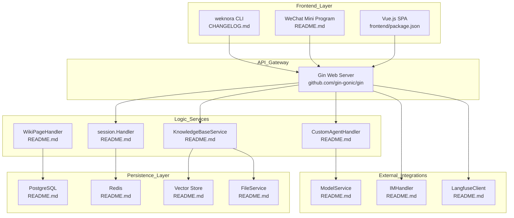
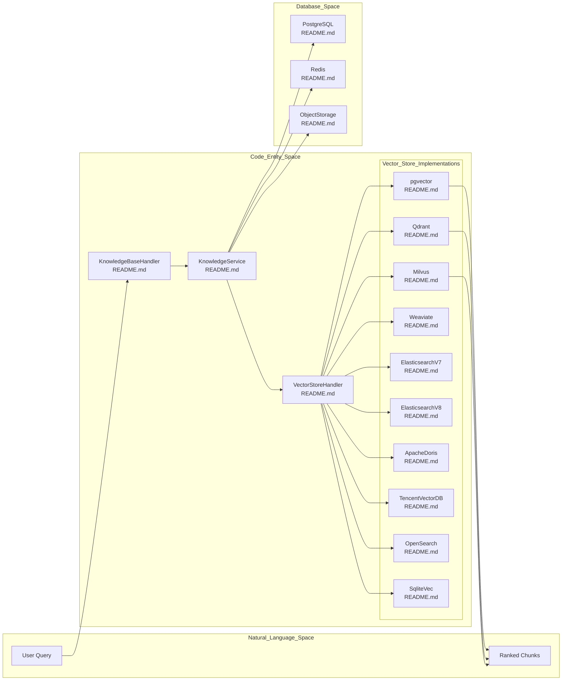

<!-- source: DeepWiki mcp.deepwiki.com · repo Tencent/WeKnora · page 1 WeKnora Overview · fetched 2026-10-29 -->

# WeKnora Overview

Relevant source files

The following files were used as context for generating this wiki page:

- [CHANGELOG.md](CHANGELOG.md)
- [README.md](README.md)
- [README_CN.md](README_CN.md)
- [README_JA.md](README_JA.md)
- [README_KO.md](README_KO.md)
- [VERSION](VERSION)
- [frontend/package-lock.json](frontend/package-lock.json)
- [frontend/package.json](frontend/package.json)
- [helm/Chart.yaml](helm/Chart.yaml)

## Purpose and Scope

This document provides a high-level introduction to WeKnora, explaining its core purpose as an LLM-powered RAG (Retrieval-Augmented Generation) framework, the problems it addresses, and its fundamental architecture. This overview is designed for developers, architects, and technical stakeholders who want to understand what WeKnora is and how its components work together before diving into specific subsystems.

For detailed information about:
- Specific features and capabilities, see [Key Features and Capabilities](#1.1)
- System components and their interactions, see [System Components Overview](#1.2)
- Architecture patterns and design decisions, see [System Architecture](#3)
- Deployment and operations, see [Deployment and Operations](#9)

Sources: [README.md:41-50](), [README_CN.md:41-50]()

---

## What is WeKnora?

WeKnora is an open-source, LLM-powered knowledge framework built for enterprise-grade document understanding, semantic retrieval, and autonomous reasoning [README.md:43-44](). It transforms scattered organizational documents into a queryable, reasoning-capable, and continuously evolving knowledge asset [README.md:43-44]().

At its core, WeKnora integrates three primary interaction modes:

1. **RAG-based Quick Q&A**: Standard retrieval-augmented generation for everyday lookups, enabling fast and accurate question answering over knowledge bases created from diverse document sources [README.md:49-54]().

2. **ReAct Agent**: An autonomous agent engine implementing the ReAct (Reasoning and Acting) pattern. It orchestrates knowledge retrieval, Model Context Protocol (MCP) tools, tenant skill catalogs, and web search to handle complex multi-step tasks [README.md:49-57](), [CHANGELOG.md:9-10]().

3. **Wiki Mode**: A novel agent-driven mode where raw documents are distilled into a self-maintaining, interlinked Markdown wiki knowledge base, enhanced with an interactive knowledge graph visualization and revision history [README.md:49-54]().

Sources: [README.md:41-65](), [CHANGELOG.md:5-25]()

---

## Problems WeKnora Solves

WeKnora addresses several key challenges commonly encountered in enterprise knowledge management and AI-assisted document understanding:

### 1. The "Static Knowledge" Problem

Conventional RAG solutions return individual chunks without synthesizing underlying knowledge effectively. WeKnora solves this via **Wiki Mode**, where autonomous agents synthesize raw input documents into an evolving, structured Markdown wiki supplemented by a dynamic knowledge graph [README.md:51-54]().

### 2. Complex Multi-Step Reasoning

Many enterprise queries require multi-step reasoning and integration of external tools or web search beyond static retrieval. WeKnora's **ReAct Agent** and **Skill Sandbox Runtime** address this by supporting session-persistent sandboxes (Docker, E2B, Cube), parallel tool invocation, and standardized tool protocols [CHANGELOG.md:9-14]().

### 3. Enterprise Governance and Multi-Tenancy

WeKnora supports multi-tenant enterprise environments with robust security controls:
- **Tenant RBAC**: Enforces role-based access control with a four-tier matrix (`Owner`, `Admin`, `Contributor`, `Viewer`) [README.md:64]().
- **Scoped API Keys**: Fine-grained capability-level grants and per-KB restrictions for programmatic integrations [README.md:62]().
- **Audit Logging**: Platform-level and KB-level activity tracking [README.md:64]().

Sources: [README.md:56-65](), [CHANGELOG.md:5-25]()

---

## 1.1. Key Features and Capabilities

WeKnora provides an extensive feature set covering multimodal processing (PDF, Office, images, XMind), advanced hybrid retrieval, cross-session long-term memory, tenant skill catalogs, and flexible deployment options [README.md:60-65](). 

For detailed information about specific capabilities, including multimodal document parsers, agent execution modes, knowledge graph support, skill sandbox runtimes, and deployment configurations, see [Key Features and Capabilities](#1.1).

Sources: [README.md:60-65](), [CHANGELOG.md:5-25]()

---

## 1.2. System Components Overview

The system architecture spans a modular frontend built with Vue.js 3 [frontend/package.json:1-49](), a Go-based backend service layer using the Gin framework, a multi-database persistence tier (PostgreSQL, Redis, vector stores, graph databases, object storage), and external integrations including LLM providers, IM channels, and Langfuse observability [README.md:62-65]().

For a comprehensive breakdown of major system components, frontend architecture, backend services, storage layers, and external integrations, see [System Components Overview](#1.2).

Sources: [README.md:62-65](), [frontend/package.json:1-49]()

---

## Core Architecture Diagrams

### System Layer Map

Sources: [frontend/package.json:1-49](), [README.md:53-65]()

---

### Bridging Natural Language Space to Code Entity Space - Retrieval Flow

Sources: [README.md:60-65]()

---

This overview provides a foundation for understanding WeKnora’s purpose, architecture, and capabilities. For details on specific modules or deployment instructions, consult the child pages linked above.

---

