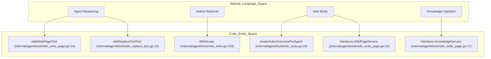
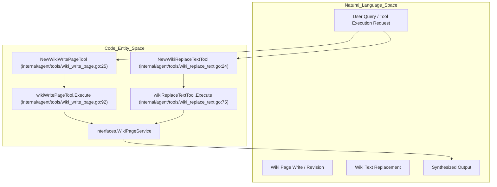

<!-- source: DeepWiki mcp.deepwiki.com · repo Tencent/WeKnora · page 1.1 Key Features and Capabilities · fetched 2026-10-29 -->

# Key Features and Capabilities

Relevant source files

The following files were used as context for generating this wiki page:

- [CHANGELOG.md](CHANGELOG.md)
- [README.md](README.md)
- [README_CN.md](README_CN.md)
- [README_JA.md](README_JA.md)
- [README_KO.md](README_KO.md)
- [VERSION](VERSION)
- [frontend/package-lock.json](frontend/package-lock.json)
- [frontend/package.json](frontend/package.json)
- [helm/Chart.yaml](helm/Chart.yaml)
- [internal/agent/tools/wiki_replace_text.go](internal/agent/tools/wiki_replace_text.go)
- [internal/agent/tools/wiki_replace_text_test.go](internal/agent/tools/wiki_replace_text_test.go)
- [internal/agent/tools/wiki_tools.go](internal/agent/tools/wiki_tools.go)
- [internal/agent/tools/wiki_write_page.go](internal/agent/tools/wiki_write_page.go)
- [website-docs/01-getting-started/01-introduction.md](website-docs/01-getting-started/01-introduction.md)
- [website-docs/03-features/14-wiki.md](website-docs/03-features/14-wiki.md)
- [website-docs/04-api/02-api-agent-mcp.md](website-docs/04-api/02-api-agent-mcp.md)
- [website-docs/06-development/03-extension-points.md](website-docs/06-development/03-extension-points.md)

This page documents the detailed technical capabilities of WeKnora as implemented in its core services, agents, and integration layers. It enumerates key features including multimodal processing, autonomous agent modes, session-persistent sandboxes, tenant skill catalogs, knowledge graph support, hybrid retrieval, and enterprise deployment options, while referencing key code artifacts and data flows.

For a broader architectural perspective, see [1.2 System Components Overview](). For initial setup and feature activation, see [2.3 Quick Start Guide]().

---

## Feature Overview

WeKnora is a modular, open-source knowledge framework empowered by Large Language Models (LLMs). It centers on four major axes:

1.  **Knowledge Ingestion and Indexing**:  
    A versatile ingestion pipeline that parses 10+ formats including PDF, Word, images, Excel, EPUB, MHTML, XMind, and others. Parsing is enhanced by:

    - In-process Office document parsing using the `anydoc` Go library for better performance and integration without external dependencies (`README.md:61]`, `CHANGELOG.md:12`).  
    - Adaptive three-tier chunking strategies (documents → parent chunks → child chunks) preserving semantic and structural context (`README.md:61]`).  
    - Auto-tagging of documents and automatic metadata extraction (`README.md:61]`).  
    - Indexing into multiple vector stores with flexibility to swap providers, supporting efficient semantic retrieval (`README.md:65]`).

2.  **Retrieval and QA**:  
    Implements a hybrid Retrieval-Augmented Generation (RAG) architecture combining:  

    - Vector similarity search for semantic matching (`README.md:43]`).  
    - BM25 keyword search powered by SQL full-text or external engines for exact keyword retrieval (`README_CN.md:61]`).  
    - Knowledge graph traversal when enabled (`README.md:53]`).  

    The retrieval process executes concurrent fan-out queries to multiple vector databases and merges the results. Outputs include source citations and multi-modal document support (`README.md:53]`).

3.  **Autonomous Reasoning & Agents**:  
    The agent subsystem orchestrates intelligent agents with multi-step reasoning and tooling:  

    - Implements a ReAct pattern reasoning loop combining thought, action, and observation to iteratively produce answers (`README.md:53]`).  
    - Supports diverse tools including built-in knowledge search, shell execution, web search, and external Model Context Protocol (MCP) tools (`README.md:56]`).  
    - Agent executions run within session-persistent sandboxes using Docker, E2B, or Cube runtime environments (`CHANGELOG.md:9]`, `README.md:56`).  
    - Agents leverage long-term memory for persistent facts, user profiles, and task traces across sessions (`README.md:56]`).  
    - Web search integration, tool invocation, and multi-modal interactions with Vision-Language Models (VLMs) and ASR models further augment agent capabilities (`README.md:56]`).

4.  **Wiki Mode**:  
    Enables autonomous conversion of documents and raw knowledge chunks into structured wiki pages:  

    - Agents distill content into interlinked Markdown Wiki pages with folders and navigation hierarchy (`README.md:53]`).  
    - A knowledge graph visualizes extracted entities and their relations, enabling semantic exploration (`README.md:53]`).  
    - Wiki pages support line-level diffs, snapshots, link linting, and one-click rollback for revision control (`README.md:53]`, `internal/agent/tools/wiki_write_page.go:34-75]`).  
    - Interactive UI components render the Wiki and graph visualization in the frontend (`README.md:53]`).

Sources: [README.md:43-65](), [CHANGELOG.md:9-12](), [README_CN.md:61](), [internal/agent/tools/wiki_write_page.go:34-75]()

---

### System Functional Spaces and Code Mapping

This diagram maps core natural language features in WeKnora to their main code entities (services, engines, registries) to clarify implementation locations and data flow points.

Sources: [internal/agent/tools/wiki_write_page.go:14-22](), [internal/agent/tools/wiki_replace_text.go:13-21](), [internal/agent/tools/wiki_tools.go:33-113]()

---

## Multimodal Document Processing and Parsing

WeKnora supports advanced multimodal content handling across knowledge ingestion and agent interaction:

- **In-Process anydoc Office Parsing**  
  Office files such as `.docx`, `.pptx`, `.xlsx` are parsed inside the Go app using anydoc without requiring a separate document reader service round-trip, improving efficiency and reliability (`README.md:61]`, `CHANGELOG.md:12`).  

- **Image and OCR Processing**  
  Handles PDFs with scanned pages via built-in OCR override, supports embedded images in documents, and integrates PaddleOCR and vision-language models (VLM) to describe image content automatically, enriching context (`CHANGELOG.md:11-32`).  

- **Automatic Speech Recognition (ASR)**  
  Audio attachments and embedded spoken content get automatically transcribed and indexed for search and retrieval (`README_CN.md:61]`).  

- **Support for Complex Document Formats**  
  EPUB, MHTML, XMind, and other semi-structured formats are parsed with semantic chunking and structure preservation for accurate context retrieval (`CHANGELOG.md:12]`).  

- **Session-Scoped Temporary Attachments**  
  Agents can handle ephemeral attachments linked to single queries with asynchronous parsing and multimodal chunk generation, enabling flexible conversational interactions with media (`CHANGELOG.md:14]`).  

Sources: [README.md:61](), [CHANGELOG.md:11-32](), [README_CN.md:61]()

---

## Agent Modes, Runtimes, and ReAct Engine

WeKnora implements a sophisticated agent execution framework combining reasoning, tooling, and sandboxed execution environments:

### ReAct Reasoning Loop and Memory

- The agent uses the ReAct (Reasoning and Acting) paradigm to decompose user requests iteratively into thoughts and actions invoking tools or sandbox commands (`README.md:53]`).  
- The long-term memory subsystem stores user profiles, facts, preferences, and task history and extracts relevant knowledge dynamically per session (`README.md:56]`).  

### Sandbox Runtimes and Tenant Skill Catalog

- Agent skills run in containerized, session-persistent sandboxes implemented with Docker, E2B, or Cube runtimes (`README.md:56]`, `CHANGELOG.md:9`). This supports isolated execution with runtime network policies enforced per tenant workspace (`README.md:56]`).  
- Skills are managed as tenant-scoped resources installed from ClawHub, SkillHub, Git repositories, or ZIPs with live install progress, direct file browsing/editing, and environment variable injection into runtimes (`README.md:56]`, `CHANGELOG.md:9`).  

### Tool & MCP Protocol Integration

- WeKnora maintains an extensible tool architecture supporting specialized wiki tools such as `wikiWritePageTool` (`[internal/agent/tools/wiki_write_page.go:14]()`) and `wikiReplaceTextTool` (`[internal/agent/tools/wiki_replace_text.go:13]()`), alongside shell execution, web search, and external MCP protocol tools (`README.md:56]`).  
- Model Context Protocol (MCP) support enables integration of remote MCP services with multi-transport layers (Stdio, SSE, HTTP) and mid-conversation OAuth authorization flows (`CHANGELOG.md:19-38`).  

Sources: [README.md:53-56](), [CHANGELOG.md:9-38](), [internal/agent/tools/wiki_write_page.go:14-22](), [internal/agent/tools/wiki_replace_text.go:13-21]()

---

### Diagram: Agent Reasoning Workflow and Code Entities

Sources: [internal/agent/tools/wiki_write_page.go:25-92](), [internal/agent/tools/wiki_replace_text.go:24-75]()

---

## Wiki Mode and Knowledge Graph

WeKnora's Wiki Mode supports organization and structuring of knowledge with the following features:

- **Autonomous Wiki Page Generation**:  
  Agents transform raw document chunks into interlinked Markdown pages with summaries, definitions, and entity extraction to build a semantic knowledge base. This is managed via `wikiWritePageTool` (`[internal/agent/tools/wiki_write_page.go:34]()`) and `renderIndexOverviewForAgent` (`[internal/agent/tools/wiki_tools.go:33]`).  

- **Foldered Wiki Navigation & Tree Structure**:  
  The Wiki supports folder trees and complex directory layouts using `WikiScope` definitions (`[internal/agent/tools/wiki_tools.go:109]`) to scope retrieval and page traversal.  

- **Knowledge Graph Visualization**:  
  Wiki pages render an interactive graph showing entities and their relationships, aiding semantic exploration of knowledge extracted during ingestion (`README.md:53]`).  

- **Wiki Linting, Revision History, and Rollback**:  
  Ingested wiki content is auto-checked for link integrity, slug duplication (`[internal/agent/tools/wiki_write_page.go:120]`), and versioned with diffs, enabling rollback to previous revisions.  

Sources: [README.md:53](), [internal/agent/tools/wiki_write_page.go:34-120](), [internal/agent/tools/wiki_tools.go:33-113]()

---

## Hybrid Retrieval and RAG Pipeline

The retrieval pipeline enhances knowledge access robustness:

- **Multi-Source Fan-out Retrieval**:  
  Queries fan out to multiple configured vector databases (pgvector, Qdrant, Milvus, Weaviate, Tencent VectorDB), returning merged and ranked hits (`README_CN.md:64]`).  

- **Hybrid Semantic and Keyword Search**:  
  Combines semantic vector search with keyword-based BM25 retrieval for improved precision and recall (`README_CN.md:61]`).  

- **Parent-Child Chunk Context**:  
  Maintains logical context by representing document chunks in a parent-child hierarchy; when a parent chunk matches a query, child chunks are also included for detailed context (`README.md:61]`).  

- **Reranking with External Services**:  
  Integrates with reranking services such as Volcengine, Tencent LKEAP, Hugging Face TEI, Pinecone Inference, and Cohere v2 that support request batching transparently (`CHANGELOG.md:18`).  

- **Chunk Editing and Versioning**:  
  Users can edit retrieved chunks directly in the UI with automatic versioning, diff comparisons, and reindexing to keep knowledge bases up to date (`README.md:60]`).  

Sources: [README.md:60-61](), [CHANGELOG.md:18](), [README_CN.md:61-64]()

---

## Deployment, Security, and Observability

- **Multi-Tenancy and RBAC**:  
  Enterprise-level role-based access control features define four roles with per-resource and per-workspace ownership, platform user management, and audit trails (`README.md:64]`, `CHANGELOG.md:15`).  

- **Scoped API Keys and Principal Model**:  
  Fine-grained API keys restrict capabilities and knowledge base scope, integrated with a principal model for automated programmatic access (`CHANGELOG.md:62]`).  

- **Multi-Instance Storage Backend Support**:  
  Each workspace supports multiple storage instances for scalable document, vector, and graph storage, with per-KB bindings (`CHANGELOG.md:64]`).  

- **Observability with Langfuse and OpenTelemetry**:  
  Full Langfuse integration enables tracing of agent reasoning steps, token usage, and retrieval pipelines via OTLP/OTel instrumentation for debugging and optimization (`README.md:64]`, `CHANGELOG.md:64`).  

- **Integration with IM Platforms**:  
  Supports WeCom, Feishu, Slack, Telegram and others with adapters and streaming/full output modes for chat sessions (`README.md:62]`, `CHANGELOG.md:64`).  

- **Flexible Deployment Options**:  
  Deploy with Docker Compose (profiles for optional components like Neo4j graph, MinIO storage, Langfuse tracing), Kubernetes Helm charts (`[helm/Chart.yaml:1-26]()`), or a Lite single binary version for minimal setup with SQLite and in-memory queues (`README.md:95-154`).  

Sources: [README.md:62-154](), [CHANGELOG.md:15-64](), [helm/Chart.yaml:1-26]()

---

This page covers the core feature set and code implementation pointers for WeKnora. For detailed component diagrams and deployment guides, see child pages [1.2 System Components Overview]() and [9.1 Docker Deployment]().

---

