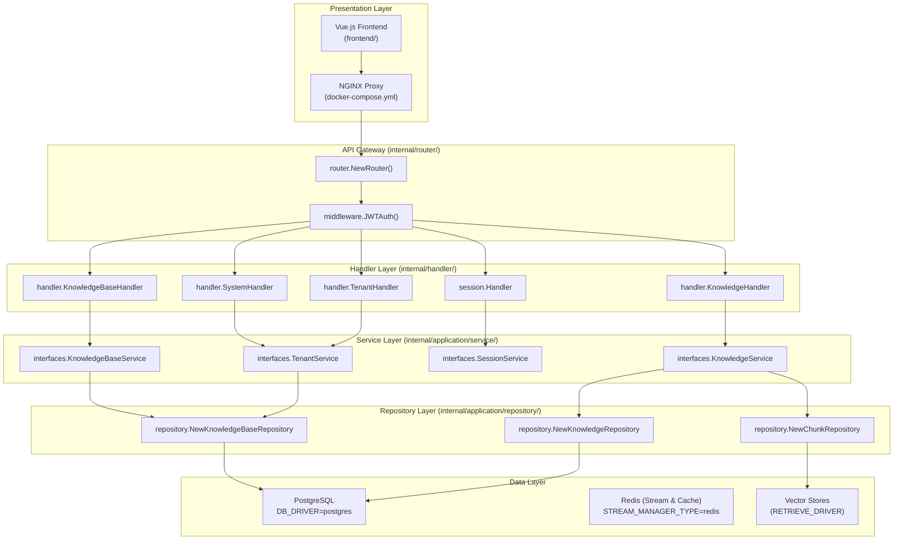

<!-- source: DeepWiki mcp.deepwiki.com · repo Tencent/WeKnora · page 1.2 System Components Overview · fetched 2026-10-29 -->

# System Components Overview

Relevant source files

The following files were used as context for generating this wiki page:

- [.env.example](.env.example)
- [CHANGELOG.md](CHANGELOG.md)
- [README.md](README.md)
- [README_CN.md](README_CN.md)
- [README_JA.md](README_JA.md)
- [README_KO.md](README_KO.md)
- [VERSION](VERSION)
- [config/config.yaml](config/config.yaml)
- [docker-compose.dev.yml](docker-compose.dev.yml)
- [docker-compose.yml](docker-compose.yml)
- [docreader/README.md](docreader/README.md)
- [docreader/config.py](docreader/config.py)
- [docreader/parser/docx_parser.py](docreader/parser/docx_parser.py)
- [docreader/parser/image_preprocess.py](docreader/parser/image_preprocess.py)
- [docreader/preprocess.py](docreader/preprocess.py)
- [docreader/preprocess_worker.py](docreader/preprocess_worker.py)
- [docreader/tests/test_config.py](docreader/tests/test_config.py)
- [docreader/tests/test_docx_tables.py](docreader/tests/test_docx_tables.py)
- [docreader/tests/test_preprocess_runner.py](docreader/tests/test_preprocess_runner.py)
- [frontend/package-lock.json](frontend/package-lock.json)
- [frontend/package.json](frontend/package.json)
- [go.mod](go.mod)
- [go.sum](go.sum)
- [helm/Chart.yaml](helm/Chart.yaml)
- [internal/config/auth_legacy_env_test.go](internal/config/auth_legacy_env_test.go)
- [internal/config/config.go](internal/config/config.go)
- [internal/container/container.go](internal/container/container.go)
- [scripts/dev.sh](scripts/dev.sh)

## Purpose and Scope

This page provides a comprehensive technical overview of WeKnora's major system components, detailing their structure, responsibilities, and interconnections. It thoroughly describes architectural layers from the Vue.js frontend and API routing through backend services, multi-database storage layers, sandbox runtimes, and external integrations. Technical details include implementation, key classes/functions, data flow, and dependency injection. Mermaid diagrams illustrate the mapping between high-level concepts and concrete code entities to guide developers in navigating, extending, and maintaining WeKnora.

Sources: [internal/container/container.go:100-115](), [internal/router/router.go:28-91]()

---

## System Layer Architecture

WeKnora adopts a modular multi-tier architecture with strict separation of concerns across components: presentation, API gateway, handler orchestration, business service layer, data repositories, and persistent storage.

The dependency injection container, constructed by `container.BuildContainer` in `internal/container/container.go`, wires all components and manages lifecycles [internal/container/container.go:100-115]().

### Component Interaction Diagram Linking Natural Language and Code Entities

This architecture outlines the flow of requests from the Vue.js frontend through the NGINX reverse proxy into the Gin router created by `router.NewRouter()`. The router applies middlewares like JWT authentication then dispatches to domain-specific HTTP handlers such as `KnowledgeBaseHandler` or `SessionHandler`. Each handler delegates business logic to service interfaces (e.g., `KnowledgeBaseService`), which interact with repositories backed by PostgreSQL for metadata, Redis for caching and event streams, and various vector stores for embedding search.

Sources: [internal/container/container.go:100-150](), [internal/router/router.go:28-91](), [docker-compose.yml:1-35]()

---

## Frontend Layer

The frontend is built as a Vue.js Single Page Application (SPA) under the `frontend/` directory, delivering user interfaces for knowledge base management, chat, agent configuration, and administrative settings [frontend/package.json:1-17]().

### Frontend Technology Stack

| Component Group       | Implementation       | Description                                                 |
|----------------------|----------------------|-------------------------------------------------------------|
| **Core UI**           | `tdesign-vue-next`   | Enterprise-grade UI component library                        |
| **State Management**  | `Pinia`              | Reactive state stores managing menu, UI, auth, chat state   |
| **Internationalization** | `vue-i18n`         | Multi-language support including `en-US`, `zh-CN`, `ru-RU`, `ko-KR`, `ja-JP`, `zh-TW` |
| **Streaming Support** | `@microsoft/fetch-event-source` | SSE client for real-time chat streaming responses           |
| **Visualization**     | `mermaid`            | Rendering of diagrams and knowledge graphs in chat and docs |

### Frontend Deployment and Config

- The frontend runs as a dedicated container defined in `docker-compose.yml`, proxying API requests to the backend service using environment variables `APP_HOST` and `APP_PORT` [docker-compose.yml:2-34]().

- Multi-stage Docker builds compile the Vue.js app into static assets inside the container image, eliminating the need for Node.js on the host [docker-compose.yml:4-13]().

Sources: [docker-compose.yml:2-34](), [frontend/package.json:1-17]()

---

## Backend Application Layer

The backend is implemented in Go (minimum version 1.26) orchestrating REST APIs, RAG pipelines, agent execution loops, tool registries, and sandbox runtimes [go.mod:1-93]().

### Dependency Injection Container Setup (`internal/container/container.go`)

- WeKnora uses Uber's `dig` as the DI container. The container registers and wires core infrastructure, repositories, services, handlers, and external clients [internal/container/container.go:100-141]().

- Core components registered include:
  - Configuration loader (`config.LoadConfig`)
  - Langfuse tracing initialization (`initLangfuse`)
  - Database connections (`initDatabase` for PostgreSQL, vector stores)
  - Redis client (`initRedisClient`) for stream and cache
  - Goroutine pool through `ants` for background workers
  - Document parser gRPC clients and Ollama LLM service for embedding generation
  - Retrieval engine registry manages vector DB drivers dynamically

### HTTP API Routing (`internal/router/router.go`)

- `router.NewRouter` builds the Gin router instance injecting many handler structs that encapsulate domain behavior, including:
  - Knowledge management (`handler.KnowledgeBaseHandler`, `handler.KnowledgeHandler`)
  - Chat sessions (`session.Handler`)
  - Tenant and RBAC APIs (`handler.TenantHandler`)
  - Model catalog and credential management
  - Skill and sandbox configuration endpoints
  - External integrations including MCP, Web Search, IM platforms

- Middleware is applied for authentication, logging, CORS, and error handling [internal/router/router.go:28-91]().

Sources: [internal/container/container.go:100-145](), [internal/router/router.go:28-91](), [go.mod:1-93]()

---

## Storage and Database Layer

WeKnora employs a multi-backend storage strategy, decoupling relational data, vector embeddings, graph data, and object files.

### Vector Retrieval Engine Registry

- The retrieval system supports multiple vector search backends configurable via `RETRIEVE_DRIVER`, implemented as repository drivers under `internal/application/repository/retriever` [internal/container/container.go:40-51]().

```mermaid
graph TB
    subgraph RetrievalRegistry["RetrieveEngineRegistry"]
        Registry["container.initRetrieveEngineRegistry<br/>(internal/container/container.go)"]
    end
    
    subgraph VectorDrivers["Vector Repository Drivers"]
        PG["postgresRepo.NewRetrieveEngine"]
        QD["qdrantRepo.NewRetrieveEngine"]
        MV["milvusRepo.NewRetrieveEngine"]
        WV["weaviateRepo.NewRetrieveEngine"]
        ES7["elasticsearchRepoV7.NewRetrieveEngine"]
        ES8["elasticsearchRepoV8.NewRetrieveEngine"]
        DR["dorisRepo.NewRetrieveEngine"]
        TV["tencentVectorDBRepo.NewRetrieveEngine"]
        SQ["sqliteRetrieverRepo.NewRetrieveEngine"]
        OS["openSearchRepo.NewRetrieveEngine"]
    end
    
    Registry --> PG
    Registry --> QD
    Registry --> MV
    Registry --> WV
    Registry --> ES7
    Registry --> ES8
    Registry --> DR
    Registry --> TV
    Registry --> SQ
    Registry --> OS
```

- Supported vector stores include PostgreSQL, Qdrant, Milvus, Weaviate, Elasticsearch (v7/v8), Doris, Tencent VectorDB, SQLite, OpenSearch, and more.

### Databases Used

| Database Type      | Purpose                                             | Configuration Key / Notes                           |
|--------------------|-----------------------------------------------------|---------------------------------------------------|
| **Relational DB**  | Metadata storage, users, tenants, RBAC, audit logs  | PostgreSQL (default), GORM ORM [internal/container/container.go:35-37]() |
| **Redis**          | Cache, event streams, task queue (Asynq)            | Redis client handles session caching and pub/sub  |
| **Graph DB**       | Knowledge graph / GraphRAG                            | Neo4j integration supports relation/entity graph  |

### File Storage Backend Providers

- Flexible file storage backends are supported:
  - Local filesystem storage on mounted volumes
  - MinIO for S3-compatible object storage
  - Cloud object storage providers including Tencent COS, Alibaba OSS, and Huawei OBS [docker-compose.yml:47-50]()

Sources: [internal/container/container.go:38-48](), [docker-compose.yml:138-150](), [.env.example:126-160]()

---

## External Integrations & Advanced Subsystems

### Document Processing Pipelines

- **DocReader**: External microservice over gRPC for document parsing, controlled by `DOCREADER_ADDR`. Supports complex office formats like PDF, Word, images, Excel, and XMind [internal/container/container.go:85-86]().

- **AnyDoc**: In-process document parser embedded in Go for Office formats such as doc/docx/ppt/pptx enabled by `WITH_ANYDOC=1` config.

### Sandbox Runtime and Skill Catalog

- Session-persistent sandbox backends run arbitrary user-installed skills securely in Docker, E2B, or Cube sandboxes, exposing protocol-compatible client interfaces for integration [internal/container/container.go:95]().

- The catalog manages skill installation from multiple sources (ClawHub, SkillHub, Git, ZIP), background installation workflows, environment variable declarations, reaping idle sandboxes, and cleanup.

### Agent Tools and Protocols

- **MCP Server**: Implements the Model Context Protocol (MCP), enabling secure external tool integrations with streams and session context [internal/container/container.go:88-89]().

- **Web Search Integration**: Interfaces with DuckDuckGo, Exa, Metaso, Zhipu AI, configurable via environment and API handlers.

- **Data Connectors**: Automated synchronization connectors for popular enterprise sources such as Feishu Docs/Wiki, GitLab, Notion, Yuque, DingTalk Docs, RSS feeds, and web crawlers [internal/container/container.go:58-68]().

### Observability & Tracing

- Full distributed trace collection using Langfuse, built on OpenTelemetry OTLP exporters. Traces cover LLM calls, token use, agent step execution, and pipeline spans [internal/container/container.go:98-99](), [docker-compose.yml:146-150]().

Sources: [internal/container/container.go:58-142](), [docker-compose.yml:47-150](), [go.mod:37-78]()

---

## Summary

WeKnora's architecture integrates several cohesive subsystems:

- **Frontend (Vue.js SPA)**: Responsive UI for knowledge bases, chat interfaces, agent editors, and admin panels with streaming responses and internationalization.

- **Backend (Golang, Gin, Dig)**: Core application orchestrating API gateway, authentication, RAG pipelines, agent reasoning loops, task queues, and microservice clients.

- **Storage Layer**: Modular multi-backend support for relational metadata, session cache, vector embedding stores, graph databases, and file/object storage.

- **Advanced Subsystems**: Document parsers, sandboxed skill runtimes, agent tooling protocols (MCP), data source connectors, and observability integrations.

This design enables extensibility, scalability, and modular replaceability suitable for enterprise knowledge management deployments.

Sources: [internal/container/container.go:100-145](), [docker-compose.yml:1-150](), [go.mod:1-93]()

---

