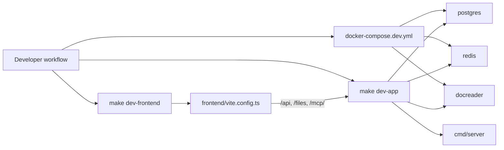
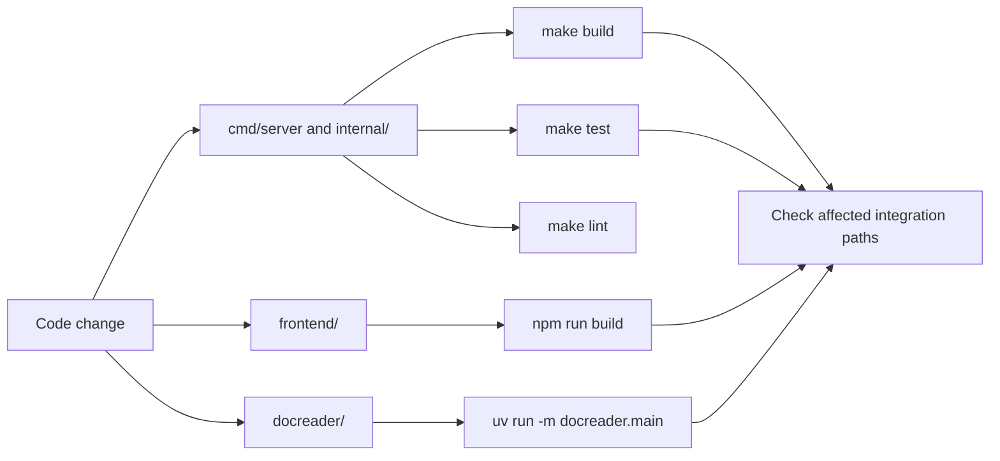
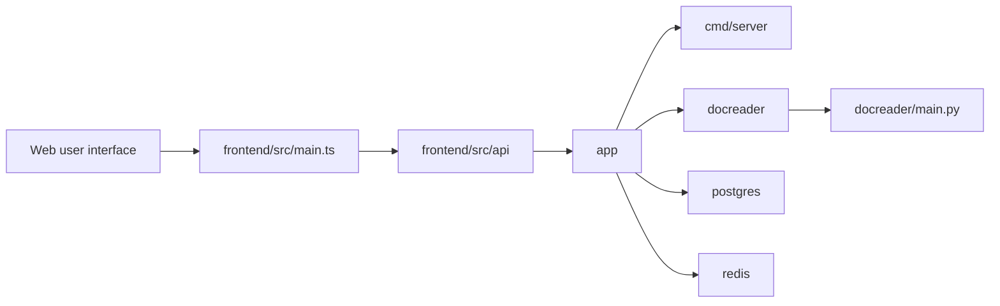
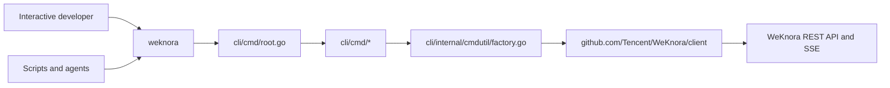

<!-- source: DeepWiki mcp.deepwiki.com · repo Tencent/WeKnora · page 10 Development Guide · fetched 2026-10-29 -->

# Development Guide

Relevant source files

The following files were used as context for generating this wiki page:

- [internal/database/migration_postgres_test.go](internal/database/migration_postgres_test.go)
- [migrations/mysql/README.md](migrations/mysql/README.md)
- [migrations/versioned/000099_pg_search_0226.up.sql](migrations/versioned/000099_pg_search_0226.up.sql)
- [migrations/versioned/000115_pg_search_02511.down.sql](migrations/versioned/000115_pg_search_02511.down.sql)
- [migrations/versioned/000115_pg_search_02511.up.sql](migrations/versioned/000115_pg_search_02511.up.sql)
- [scripts/test_paradedb_upgrade.py](scripts/test_paradedb_upgrade.py)
- [website-docs/01-getting-started/02-installation.md](website-docs/01-getting-started/02-installation.md)
- [website-docs/01-getting-started/06-paradedb-upgrade.md](website-docs/01-getting-started/06-paradedb-upgrade.md)
- [website-docs/02-architecture/01-overview.md](website-docs/02-architecture/01-overview.md)
- [website-docs/05-clients/01-frontend.md](website-docs/05-clients/01-frontend.md)
- [website-docs/05-clients/02-cli.md](website-docs/05-clients/02-cli.md)
- [website-docs/06-development/01-dev-guide.md](website-docs/06-development/01-dev-guide.md)
- [website-docs/06-development/02-database-schema.md](website-docs/06-development/02-database-schema.md)

## Purpose and scope

This page is the parent overview for developers contributing to or extending WeKnora. It connects the local development workflow, build and quality practices, codebase structure, and client tools; detailed setup and implementation guidance lives in the child pages. The development workflow can run infrastructure in Docker Compose while running the Go backend and Vue frontend on the host, and developers can also run the Python DocReader service locally when debugging it. [website-docs/06-development/01-dev-guide.md:3-3]()

Sources: [website-docs/06-development/01-dev-guide.md:3-3]()

| Child page | What it covers |
|---|---|
| [Development Environment Setup](#10.1) | Local prerequisites, development-mode services, hot reload, and DocReader debugging. [website-docs/06-development/01-dev-guide.md:5-13](), [website-docs/06-development/01-dev-guide.md:34-59](), [website-docs/06-development/01-dev-guide.md:101-111]() |
| [Build System and CI/CD](#10.2) | Makefile build, run, test, lint, Docker, and Lite targets; CI/CD and release workflows. [website-docs/06-development/01-dev-guide.md:124-152](), [website-docs/06-development/01-dev-guide.md:113-121]() |
| [Code Organization and Patterns](#10.3) | Core process boundaries, code locations, and architecture patterns. [website-docs/02-architecture/01-overview.md:5-20](), [website-docs/06-development/01-dev-guide.md:7-14]() |
| [Testing and Quality Assurance](#10.4) | Go and frontend checks, test organization, linting, and QA tooling. [website-docs/06-development/01-dev-guide.md:128-140]() |
| [CLI Tool](#10.5) | The `weknora` CLI, its command architecture, and output contracts. [website-docs/05-clients/02-cli.md:1-5](), [website-docs/05-clients/02-cli.md:20-54]() |
| [Client SDK and MCP Server](#10.6) | Client libraries and integration tools for programmatic access. |
| [Documentation Site (website-docs)](#10.7) | The documentation site and contribution workflow. |

For details, see [Development Environment Setup](#10.1), [Build System and CI/CD](#10.2), [Code Organization and Patterns](#10.3), [Testing and Quality Assurance](#10.4), [CLI Tool](#10.5), [Client SDK and MCP Server](#10.6), and [Documentation Site (website-docs)](#10.7).

Sources: [website-docs/06-development/01-dev-guide.md:5-14](), [website-docs/06-development/01-dev-guide.md:34-59](), [website-docs/06-development/01-dev-guide.md:101-152](), [website-docs/02-architecture/01-overview.md:5-20](), [website-docs/05-clients/02-cli.md:1-5](), [website-docs/05-clients/02-cli.md:20-54]()

---

## Development modes

Development Compose runs infrastructure dependencies—PostgreSQL/ParadeDB, Redis, and DocReader—in containers, while developers can run the `app` backend and `frontend` dev server on the host. The frontend dev server proxies API and file requests to the backend; the default backend target is `http://localhost:8080`. For setup and proxy configuration, see [Development Environment Setup](#10.1). [website-docs/06-development/01-dev-guide.md:34-59]()

**Diagram: Local development workflow mapped to code entities**

Sources: [website-docs/06-development/01-dev-guide.md:34-59](), [website-docs/06-development/01-dev-guide.md:78-109]()

Lite mode is a separate development and distribution option: it builds a single binary with SQLite, `sqlite-vec`, FTS5, and in-memory streams. The build guide covers its targets and packaging alongside the standard build workflow. [website-docs/06-development/01-dev-guide.md:113-121](), [website-docs/02-architecture/01-overview.md:37-43]()

Sources: [website-docs/06-development/01-dev-guide.md:113-121](), [website-docs/02-architecture/01-overview.md:37-43]()

---

## Build and quality workflow

The root `Makefile` provides common targets for building, running, testing, formatting, linting, and generating API documentation. It also includes targets for building Docker images and running development services. Use the child page for target details and CI/CD workflows; use [Testing and Quality Assurance](#10.4) for test and quality-check guidance. [website-docs/06-development/01-dev-guide.md:124-152]()

**Diagram: Developer change mapped to validation targets**

Sources: [website-docs/06-development/01-dev-guide.md:3-3](), [website-docs/06-development/01-dev-guide.md:101-109](), [website-docs/06-development/01-dev-guide.md:124-140]()

---

## Codebase and client boundaries

WeKnora’s core development surface comprises the Go `app`, the Vue frontend in `frontend/`, and the Python gRPC DocReader in `docreader/`. The frontend is a Vue 3 and TypeScript single-page application built with Vite; the backend communicates with DocReader over gRPC. For code layout, dependency injection, and patterns, see [Code Organization and Patterns](#10.3). [website-docs/06-development/01-dev-guide.md:7-14](), [website-docs/05-clients/01-frontend.md:1-7](), [website-docs/02-architecture/01-overview.md:73-80]()

**Diagram: Natural-language system roles mapped to code entities**

Sources: [website-docs/05-clients/01-frontend.md:79-96](), [website-docs/02-architecture/01-overview.md:11-20](), [website-docs/02-architecture/01-overview.md:73-80]()

The CLI is an independent Go module under `cli/`, with `cli/cmd/root.go` as its command entry point. Its documentation covers commands, configuration, and machine-readable output. See [CLI Tool](#10.5) for the CLI overview and its child pages. [website-docs/05-clients/02-cli.md:1-5]()

**Diagram: Developer and automation entry points mapped to code entities**

Sources: [website-docs/05-clients/02-cli.md:1-5](), [website-docs/05-clients/02-cli.md:20-54]()

---

## Related development guides

The child pages divide the broader contributor workflow into focused topics. Start with environment setup to bring up the local development services, then consult the build and testing pages for the relevant module. Use the code patterns page when changing architecture or service boundaries, and the client and documentation pages when working outside the core application. [website-docs/06-development/01-dev-guide.md:3-3](), [website-docs/06-development/01-dev-guide.md:34-57]()

Sources: [website-docs/06-development/01-dev-guide.md:3-3](), [website-docs/06-development/01-dev-guide.md:34-57]()

- For local prerequisites, hot reload, and debugging, see [Development Environment Setup](#10.1).
- For Makefile targets, builds, and CI/CD, see [Build System and CI/CD](#10.2).
- For modules, architecture, and code patterns, see [Code Organization and Patterns](#10.3).
- For tests and quality checks, see [Testing and Quality Assurance](#10.4).
- For command-line workflows, see [CLI Tool](#10.5).
- For SDKs and MCP-related client tooling, see [Client SDK and MCP Server](#10.6).
- For authoring and maintaining project documentation, see [Documentation Site (website-docs)](#10.7).

Sources: [website-docs/06-development/01-dev-guide.md:34-59](), [website-docs/06-development/01-dev-guide.md:124-152](), [website-docs/05-clients/02-cli.md:1-5]()

---

