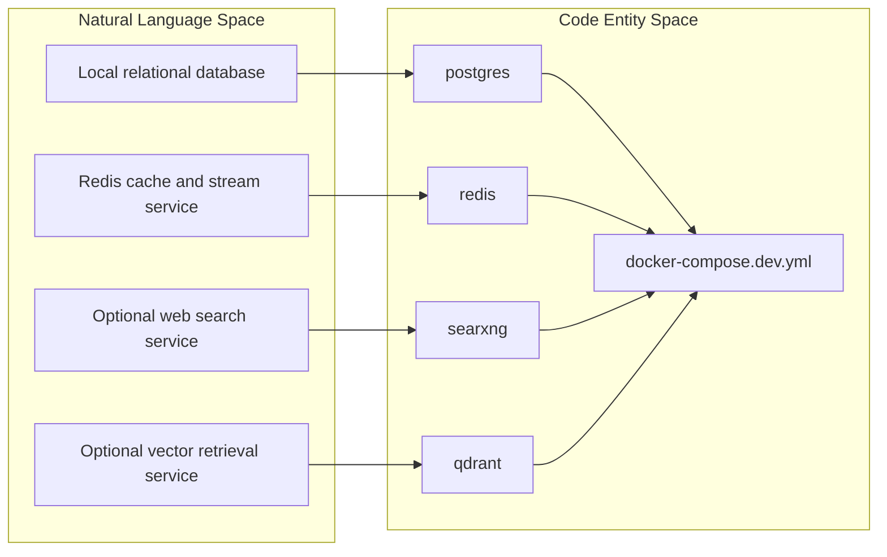
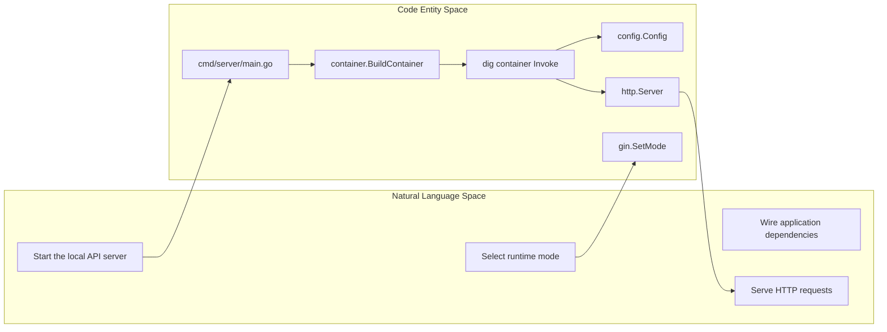
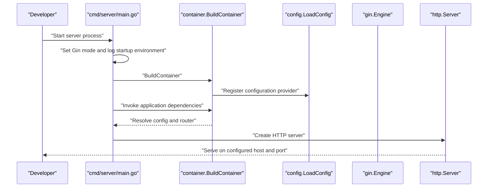

<!-- source: DeepWiki mcp.deepwiki.com · repo Tencent/WeKnora · page 10.1 Development Environment Setup · fetched 2026-10-29 -->

# Development Environment Setup

Relevant source files

The following files were used as context for generating this wiki page:

- [.air.toml](.air.toml)
- [.env.example](.env.example)
- [cmd/desktop/app.go](cmd/desktop/app.go)
- [cmd/desktop/main.go](cmd/desktop/main.go)
- [cmd/desktop/prefs.go](cmd/desktop/prefs.go)
- [cmd/server/main.go](cmd/server/main.go)
- [config/config.yaml](config/config.yaml)
- [docker-compose.dev.yml](docker-compose.dev.yml)
- [docker-compose.yml](docker-compose.yml)
- [docreader/README.md](docreader/README.md)
- [docreader/config.py](docreader/config.py)
- [docreader/parser/docx_parser.py](docreader/parser/docx_parser.py)
- [docreader/parser/image_preprocess.py](docreader/parser/image_preprocess.py)
- [docreader/preprocess.py](docreader/preprocess.py)
- [docreader/preprocess_worker.py](docreader/preprocess_worker.py)
- [docreader/tests/test_config.py](docreader/tests/test_config.py)
- [docreader/tests/test_docx_tables.py](docreader/tests/test_docx_tables.py)
- [docreader/tests/test_preprocess_runner.py](docreader/tests/test_preprocess_runner.py)
- [docs/LITE.md](docs/LITE.md)
- [frontend/src/wailsjs/go/main/App.d.ts](frontend/src/wailsjs/go/main/App.d.ts)
- [frontend/src/wailsjs/go/main/App.js](frontend/src/wailsjs/go/main/App.js)
- [go.mod](go.mod)
- [go.sum](go.sum)
- [internal/common/redis_tls.go](internal/common/redis_tls.go)
- [internal/common/redis_tls_test.go](internal/common/redis_tls_test.go)
- [internal/config/auth_legacy_env_test.go](internal/config/auth_legacy_env_test.go)
- [internal/config/config.go](internal/config/config.go)
- [internal/container/container.go](internal/container/container.go)
- [internal/middleware/recovery.go](internal/middleware/recovery.go)
- [internal/runtime/startup.go](internal/runtime/startup.go)
- [scripts/dev.sh](scripts/dev.sh)
- [website-docs/01-getting-started/05-troubleshooting.md](website-docs/01-getting-started/05-troubleshooting.md)

## Purpose and scope

This page describes a local development workflow for WeKnora: run supporting services in Docker, then run the Go backend and frontend from the host for faster iteration. The provided development Compose file documents the infrastructure-services approach; its opening comment explicitly leaves `app` and `frontend` to run locally. [docker-compose.dev.yml:1-3]()

Sources: [docker-compose.dev.yml:1-3]()

## 1. Prerequisites and technology stack

The repository’s Go module declares Go `1.26.0`. The application entry point is `cmd/server`, and its dependencies are wired through `internal/container`. [go.mod:1-4](), [cmd/server/main.go:43-60](), [internal/container/container.go:113-137]()

For the backend, install a Go toolchain compatible with the module declaration, Docker with Compose, and the project’s dependencies. The development script checks that Docker is installed, that a Compose command is available, and that the Docker daemon is running before starting local infrastructure. [go.mod:1-4](), [scripts/dev.sh:32-49](), [scripts/dev.sh:119-136]()

| Area | Code entity | Development detail |
|---|---|---|
| Backend | `cmd/server/main.go` | Server entry point; sets Gin mode, builds the dependency container, and starts the HTTP server. [cmd/server/main.go:43-80]() |
| Dependency wiring | `container.BuildContainer` | Registers application dependencies into a `dig.Container`. [internal/container/container.go:113-137]() |
| Main database | `postgres` in `docker-compose.dev.yml` | Local PostgreSQL-compatible ParadeDB service, with the host port controlled by `DB_PORT`. [docker-compose.dev.yml:4-24]() |
| Cache and stream backend | `redis` in `docker-compose.dev.yml` | Local Redis service with a persistent data volume and password requirement. [docker-compose.dev.yml:26-37]() |
| Development configuration | `.env.example` | Documents database, Redis, application, frontend, and DocReader settings. [`.env.example`:53-101](), [`.env.example`:131-160]() |
| Go module dependencies | `go.mod` | Declares the module path and Go version used by the backend. [go.mod:1-4]() |

The available files do not establish exact Node.js or Python versions, frontend package-manager commands, or IDE plugin requirements. Check the relevant frontend and DocReader project documentation for those module-specific prerequisites.

Sources: [go.mod:1-4](), [cmd/server/main.go:43-80](), [internal/container/container.go:113-137](), [docker-compose.dev.yml:4-37](), [.env.example:53-101](), [.env.example:131-160](), [scripts/dev.sh:32-49](), [scripts/dev.sh:119-136]()

## 2. Fast development mode architecture

The development Compose file is intended to start infrastructure while the application and frontend run on the host. Its shown services include PostgreSQL, Redis, and optional services such as SearXNG, MinIO, Qdrant, OpenSearch, Milvus, and Neo4j. [docker-compose.dev.yml:1-3](), [docker-compose.dev.yml:4-37](), [docker-compose.dev.yml:38-120](), [docker-compose.dev.yml:122-212]()

The primary database and Redis expose configurable host ports. The example environment file uses `DB_HOST=postgres` and `REDIS_ADDR=redis:6379` for Compose-network service addressing; when the Go process runs on the host, configure its connection addresses for the host-exposed ports instead. [docker-compose.dev.yml:4-16](), [docker-compose.dev.yml:26-36](), [`.env.example`:131-160]()

### Diagram: Natural-language development services mapped to Compose entities

Sources: [docker-compose.dev.yml:1-37](), [docker-compose.dev.yml:38-120]()

### Diagram: Local backend startup mapped to Go code entities

Sources: [cmd/server/main.go:43-80](), [internal/container/container.go:113-137]()

## 3. Infrastructure management with `scripts/dev.sh`

The development script provides a command interface for infrastructure lifecycle tasks. Its help text lists `start`, `stop`, `restart`, `logs`, and `status`, as well as local `app` and `frontend` commands. It also documents optional profiles including MinIO, Qdrant, Neo4j, Dex, Langfuse, OpenDataLoader hybrid, and `--full`. [scripts/dev.sh:52-85]()

Before starting services, the script detects Docker Compose, checks Docker availability, requires a root `.env`, and loads `.env` followed by optional `.env.local` so the latter can override values. [scripts/dev.sh:32-49](), [scripts/dev.sh:88-117](), [scripts/dev.sh:119-136](), [scripts/dev.sh:179-207]()

A minimal local configuration starts with `.env.example` as the template. The template documents PostgreSQL and Redis settings, including `DB_DRIVER`, `DB_HOST`, `DB_PORT`, `DB_USER`, `DB_PASSWORD`, `DB_NAME`, `STREAM_MANAGER_TYPE`, and `REDIS_ADDR`. The development Compose services consume database credentials and Redis password from the environment. [`.env.example`:131-160](), [docker-compose.dev.yml:4-16](), [docker-compose.dev.yml:26-36]()

The script’s shown profile handling adds profiles for options such as MinIO, Qdrant, and Neo4j. SearXNG and OpenSearch are also explicitly declared as profile-enabled services in the Compose file. [scripts/dev.sh:209-231](), [docker-compose.dev.yml:38-82](), [docker-compose.dev.yml:122-175]()

Sources: [scripts/dev.sh:32-49](), [scripts/dev.sh:52-85](), [scripts/dev.sh:88-117](), [scripts/dev.sh:119-136](), [scripts/dev.sh:179-231](), [`.env.example`:131-160](), [docker-compose.dev.yml:4-16](), [docker-compose.dev.yml:26-36](), [docker-compose.dev.yml:38-82](), [docker-compose.dev.yml:122-175]()

## 4. Backend execution and hot reloading (`cmd/server`)

`cmd/server/main.go` is the backend entry point. It selects Gin’s debug or release mode from `GIN_MODE`, logs startup environment information, builds the dependency injection container, and invokes the application with its configuration, router, resource cleaner, system settings service, and model catalog service. It then creates an HTTP server and listens using the configured host and port. [cmd/server/main.go:43-80]()

`container.BuildContainer` initializes the model catalog overlay and registers configuration and infrastructure providers, including `config.LoadConfig` and `initDatabase`. [internal/container/container.go:113-137]()

### Backend startup and dependency flow

Sources: [cmd/server/main.go:43-80](), [internal/container/container.go:113-137]()

### Hot reload with Air

The repository includes `.air.toml`, which configures Air to rebuild `./cmd/server` into `./tmp/main`. Its build command applies `GO_BUILD_TAGS` and linker flags from `scripts/get_version.sh`; watched extensions include Go, template, HTML, and YAML files, while `_test.go` files and several directories are excluded. The configuration also sets a one-second build delay and a two-second kill delay. [`.air.toml`:1-27]()

Air is useful for iterating on backend source without manually rebuilding after every change. The configured watcher does not include frontend files; the frontend development server is a separate workflow. [`.air.toml`:5-27]()

Sources: [.air.toml:1-27]()

## 5. Frontend development server (`frontend/`)

The development script’s help identifies `frontend` as a local-run command. The standard Compose file separately defines a `frontend` container that serves the built UI on a configurable host port and proxies to the `app` service; that production-style container configuration is distinct from the host-run development workflow. [scripts/dev.sh:52-85](), [docker-compose.yml:1-34]()

The files provided for this page do not include the frontend Vite configuration or package manifest. Consequently, the exact development-server port, hot-reload behavior, proxy paths, and package-manager commands cannot be confirmed here. Consult the frontend project configuration before setting frontend run or proxy options.

Sources: [scripts/dev.sh:52-85](), [docker-compose.yml:1-34]()

## 6. IDE integration and debugging

### Go debugging

Configure the IDE to use the repository root as the working directory and ensure the backend process receives the same environment variables as the local development setup. The server reads `GIN_MODE` to select Gin debug or release mode; the example environment file documents `debug` as the development mode with detailed logs and Swagger enabled. [cmd/server/main.go:43-49](), [`.env.example`:53-65]()

For debugger launch configurations, use `cmd/server` as the application entry point and ensure the Go toolchain matches the module’s declared version. The server builds its dependency container at startup, so failures during configuration or dependency initialization may occur before the HTTP listener becomes available. [go.mod:1-4](), [cmd/server/main.go:58-80](), [internal/container/container.go:113-137]()

### Configuration and runtime troubleshooting

- Check that `.env` exists before using the development script; the script treats it as required and optionally loads `.env.local` afterward. [scripts/dev.sh:105-117](), [scripts/dev.sh:188-207]()
- Check host-side database and Redis addresses against the host port mappings in `docker-compose.dev.yml`; Compose service names such as `postgres` and `redis` are the service-side names, while the host process connects through published ports. [docker-compose.dev.yml:4-16](), [docker-compose.dev.yml:26-36](), [`.env.example`:131-160]()
- Review backend startup logs if dependency initialization or server startup fails. `cmd/server/main.go` logs the startup environment before building the container and reports a fatal error if application invocation fails. [cmd/server/main.go:50-60](), [cmd/server/main.go:145-148]()
- Use the `GIN_MODE` setting to distinguish Gin debug and release behavior. [cmd/server/main.go:43-49](), [`.env.example`:53-56]()
- For reload build failures, inspect `build-errors.log`, the log path configured by `.air.toml`. [`.air.toml`:5-27]()

### IDE setup boundaries

The provided files do not define VS Code, GoLand, WebStorm, or browser-debugger project configurations. IDE-specific launch files, frontend source maps, and exact frontend proxy behavior should therefore be verified against the corresponding project configuration rather than inferred from the server or Compose setup.

Sources: [cmd/server/main.go:43-60](), [cmd/server/main.go:145-148](), [internal/container/container.go:113-137](), [go.mod:1-4](), [scripts/dev.sh:105-117](), [scripts/dev.sh:188-207](), [docker-compose.dev.yml:4-16](), [docker-compose.dev.yml:26-36](), [`.env.example`:53-65](), [`.env.example`:131-160](), [.air.toml:5-27]()

---

