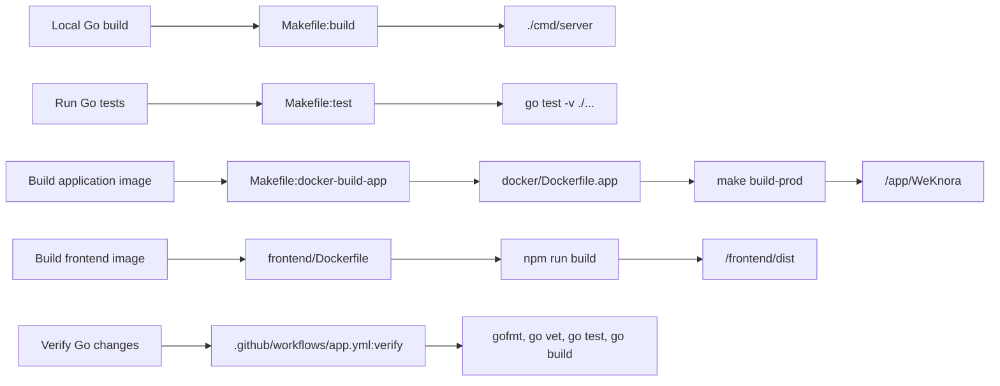
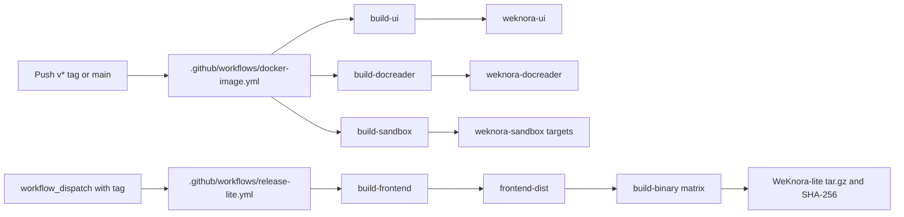
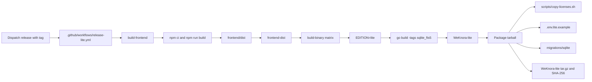

<!-- source: DeepWiki mcp.deepwiki.com · repo Tencent/WeKnora · page 10.2 Build System and CI/CD · fetched 2026-10-29 -->

# Build System and CI/CD

Relevant source files

The following files were used as context for generating this wiki page:

- [.github/workflows/anydoc.yml](.github/workflows/anydoc.yml)
- [.github/workflows/app.yml](.github/workflows/app.yml)
- [.github/workflows/cli.yml](.github/workflows/cli.yml)
- [.github/workflows/docker-image.yml](.github/workflows/docker-image.yml)
- [.github/workflows/docreader.yml](.github/workflows/docreader.yml)
- [.github/workflows/go-lint-cache.yml](.github/workflows/go-lint-cache.yml)
- [.github/workflows/go-lint.yml](.github/workflows/go-lint.yml)
- [.github/workflows/release-lite.yml](.github/workflows/release-lite.yml)
- [.gitignore](.gitignore)
- [.golangci.yml](.golangci.yml)
- [Formula/weknora-lite.rb](Formula/weknora-lite.rb)
- [Makefile](Makefile)
- [cli/internal/cmdutil/errors_doc_test.go](cli/internal/cmdutil/errors_doc_test.go)
- [cli/scripts/check-skill-wire-vocab.sh](cli/scripts/check-skill-wire-vocab.sh)
- [deploy/weknora-lite.service](deploy/weknora-lite.service)
- [docker/Dockerfile.app](docker/Dockerfile.app)
- [docker/Dockerfile.docreader](docker/Dockerfile.docreader)
- [docker/Dockerfile.sandbox](docker/Dockerfile.sandbox)
- [docs/swag.overrides](docs/swag.overrides)
- [frontend/.dockerignore](frontend/.dockerignore)
- [frontend/Dockerfile](frontend/Dockerfile)
- [frontend/src/views/knowledge/settings/chunkingSamples.ts](frontend/src/views/knowledge/settings/chunkingSamples.ts)
- [internal/application/service/knowledgebase_search_partial_test.go](internal/application/service/knowledgebase_search_partial_test.go)
- [internal/application/service/shell_job_followup_test.go](internal/application/service/shell_job_followup_test.go)
- [internal/datasource/connector/yuque/client_test.go](internal/datasource/connector/yuque/client_test.go)
- [internal/logger/logger.go](internal/logger/logger.go)
- [internal/logger/logger_test.go](internal/logger/logger_test.go)
- [scripts/build_frontend_dist.sh](scripts/build_frontend_dist.sh)
- [scripts/build_images.sh](scripts/build_images.sh)
- [scripts/get_version.sh](scripts/get_version.sh)
- [scripts/git-hooks/common.sh](scripts/git-hooks/common.sh)
- [scripts/package-lite.sh](scripts/package-lite.sh)
- [scripts/start_all.sh](scripts/start_all.sh)
- [scripts/test-git-hooks.sh](scripts/test-git-hooks.sh)
- [scripts/test-homebrew.sh](scripts/test-homebrew.sh)
- [scripts/update-homebrew-formula.sh](scripts/update-homebrew-formula.sh)
- [scripts/verify_frontend_pr.sh](scripts/verify_frontend_pr.sh)

## Purpose and scope

This page describes the visible Makefile targets, local and container build paths, the GitHub Actions workflows shown in the supplied files, Lite release packaging, and multi-architecture image builds. It focuses on how those entry points connect to their Dockerfiles and build artifacts. [Makefile:1-74](), [.github/workflows/app.yml:1-147](), [.github/workflows/docker-image.yml:1-210](), [.github/workflows/release-lite.yml:1-220]()

Sources: [Makefile:1-74](), [.github/workflows/app.yml:1-147](), [.github/workflows/docker-image.yml:1-210](), [.github/workflows/release-lite.yml:1-220]()

---

## Build tools overview

| Tool or entry point | Role | Implementation pointers |
|---|---|---|
| `Makefile` | Provides local build, test, image-build, service-management, and Lite-mode targets. [Makefile:1-74]() | `build`, `test`, `docker-build-app`, `build-images`, `build-lite`, `package-lite` |
| `docker/Dockerfile.app` | Builds the BrowserSkill runtime and Go application, then assembles the application runtime image. [docker/Dockerfile.app:1-24](), [docker/Dockerfile.app:26-101](), [docker/Dockerfile.app:104-169]() | `browserskill`, `builder`, final runtime stage |
| `frontend/Dockerfile` | Builds frontend assets with Node and copies them into an Nginx runtime image. [frontend/Dockerfile:20-49](), [frontend/Dockerfile:51-77]() | `builder` stage and Nginx stage |
| `docker/Dockerfile.docreader` | Builds the document-reader Python environment and protobuf outputs, then assembles its runtime image. [docker/Dockerfile.docreader:4-77](), [docker/Dockerfile.docreader:82-170]() | `builder` and `runner` stages |
| GitHub Actions | Runs Go verification, container publishing, and manually dispatched Lite releases. [.github/workflows/app.yml:6-147](), [.github/workflows/docker-image.yml:1-210](), [.github/workflows/release-lite.yml:1-220]() | `verify`, `build-ui`, `build-docreader`, `build-sandbox`, `build-binary` |

Sources: [Makefile:1-74](), [docker/Dockerfile.app:1-169](), [frontend/Dockerfile:20-77](), [docker/Dockerfile.docreader:4-170](), [.github/workflows/app.yml:6-147](), [.github/workflows/docker-image.yml:1-210](), [.github/workflows/release-lite.yml:1-220]()

---

## Build process architecture

The repository exposes several distinct build paths: Makefile targets for local development and image builds, multi-stage Dockerfiles for container artifacts, and GitHub Actions jobs for verification, publication, and Lite release artifacts. The diagram associates those user-facing build activities with the corresponding code entities. [Makefile:75-113](), [Makefile:136-161](), [docker/Dockerfile.app:26-101](), [.github/workflows/app.yml:84-147](), [.github/workflows/docker-image.yml:16-105](), [.github/workflows/release-lite.yml:25-136]()

### Build paths: natural-language activities to code entities

Sources: [Makefile:75-113](), [Makefile:136-161](), [docker/Dockerfile.app:89-101](), [frontend/Dockerfile:20-49](), [.github/workflows/app.yml:84-147]()

### Container and release artifact flow

Sources: [.github/workflows/docker-image.yml:1-210](), [.github/workflows/release-lite.yml:1-136]()

---

## Makefile build targets

The Makefile defines `BINARY_NAME=WeKnora` and `MAIN_PATH=./cmd/server`. The basic `build` target invokes `go build`; `run` depends on `build` and executes the resulting binary. The `test` target runs `go test -v ./...`. [Makefile:75-113]()

| Target | Behavior |
|---|---|
| `build` | Builds `./cmd/server` as `WeKnora`. [Makefile:75-96]() |
| `run` | Depends on `build`, then runs `./WeKnora`. [Makefile:107-109]() |
| `test` | Runs `go test -v ./...`. [Makefile:111-113]() |
| `anydoc-lib` | Invokes `./scripts/build-anydoc-lib.sh` to build the Rust static archive. [Makefile:98-101]() |
| `build-anydoc` | Depends on `anydoc-lib`, then builds with the `anydoc` Go build tag. [Makefile:103-105]() |
| `clean` | Runs `go clean` and removes the `WeKnora` binary. [Makefile:131-134]() |
| `docker-build-app` | Gets version information and builds `docker/Dockerfile.app`, passing version metadata and `WITH_ANYDOC`. [Makefile:136-147]() |
| `docker-build-docreader` | Builds `docker/Dockerfile.docreader` for the detected platform. [Makefile:149-151]() |
| `docker-build-frontend` | Builds `frontend/Dockerfile` and passes `VITE_FRONTEND_COMMIT`. [Makefile:153-158]() |
| `docker-build-all` | Aggregates app, docreader, and frontend image builds. [Makefile:160-161]() |
| `build-images` and component variants | Delegate to `scripts/build_images.sh`, optionally selecting app, docreader, or frontend. [Makefile:192-199]() |

The Makefile chooses `PLATFORM` from `uname -m`: `x86_64` maps to `linux/amd64`, while `aarch64` and `arm64` map to `linux/arm64`; other values fall back to `linux/amd64`. [Makefile:83-92]()

The help output also advertises Lite targets: `build-lite`, `run-lite`, and `package-lite`, plus `package-mac-app`. It describes `build-lite` as building frontend assets into `web/` before building Go, with `SKIP_FRONTEND=1` to skip the frontend; it describes `package-lite` as producing a tarball. Their implementations are not shown in the supplied Makefile excerpt. [Makefile:69-74]()

Sources: [Makefile:69-113](), [Makefile:131-161](), [Makefile:192-199]()

---

## Application and frontend container builds

### Application image: `docker/Dockerfile.app`

The Dockerfile has three stages. The `browserskill` stage uses a pinned Node 24 base, installs build dependencies and Rust, and invokes `scripts/build_browserskill.sh` with the target OS and architecture. [docker/Dockerfile.app:1-24]()

The Go `builder` stage uses `golang:1.26-bookworm`. It installs dependencies, installs the `migrate` tool, downloads Go modules, runs the DuckDB download program, copies the source tree, and generates a license bundle. [docker/Dockerfile.app:26-60]()

Build metadata is accepted through `VERSION_ARG`, `COMMIT_ID_ARG`, `BUILD_TIME_ARG`, and `GO_VERSION_ARG`. The `WITH_ANYDOC` argument defaults to `1`; when enabled, the stage installs Rust and runs `scripts/build-anydoc-lib.sh`, then invokes `make build-prod GO_BUILD_TAGS=anydoc`. With `WITH_ANYDOC=0`, it invokes `make build-prod` without that tag. Both build branches mount Go module and build caches. [docker/Dockerfile.app:62-101]()

The final stage is based on `debian:12.12-slim`. It creates the non-root `appuser`, installs runtime packages, copies the BrowserSkill files, migration tool, configuration, scripts, migrations, samples, DuckDB data, application binary, and license bundle, and exposes port `8080`. [docker/Dockerfile.app:104-169]()

### Frontend image: `frontend/Dockerfile`

The frontend builder uses a pinned Node 24 image on `$BUILDPLATFORM`. It runs `npm ci`, sets `VITE_IS_DOCKER=true`, accepts `VITE_FRONTEND_COMMIT`, and runs `npm run build`. The Dockerfile notes that the static assets are architecture-independent, so multi-architecture builds can compile them on the build platform rather than emulating Node for each target. [frontend/Dockerfile:1-7](), [frontend/Dockerfile:20-49]()

The runtime stage uses a pinned Nginx image and copies `/frontend/dist` into `/usr/share/nginx/html`, along with Nginx configuration and the Docker entrypoint. [frontend/Dockerfile:51-77]()

Sources: [docker/Dockerfile.app:1-24](), [docker/Dockerfile.app:26-101](), [docker/Dockerfile.app:104-169](), [frontend/Dockerfile:1-7](), [frontend/Dockerfile:20-77]()

---

## Document-reader container build

`docker/Dockerfile.docreader` uses a Python 3.10 Bookworm builder stage. It installs compilation and image-processing dependencies, then resolves the `protoc` archive for `TARGETARCH`; if the matching archive exists under `packages/`, it installs it locally, otherwise it downloads it. [docker/Dockerfile.docreader:4-64]()

The builder installs locked Python dependencies with `uv sync --locked --no-dev`, copies `docreader`, and runs `docreader/scripts/generate_proto.sh` to generate protobuf code. [docker/Dockerfile.docreader:66-77]()

The `runner` stage installs runtime dependencies including Java 17 and LibreOffice, downloads the architecture-specific `grpc_health_probe`, copies the virtual environment and generated source from the builder, installs Playwright WebKit and its dependencies, and exposes gRPC port `50051`. The container entrypoint is `docreader.container_entrypoint`; its default command runs `docreader.main`. [docker/Dockerfile.docreader:82-170]()

Sources: [docker/Dockerfile.docreader:4-77](), [docker/Dockerfile.docreader:82-170]()

---

## GitHub Actions workflows

### Go application verification: `.github/workflows/app.yml`

The `App` workflow runs on pushes to `main` and pull requests when selected Go, module, configuration, migration, Dockerfile, license, model-catalog, and related paths change; it can also be started with `workflow_dispatch`. The workflow uses Go `1.26`, sets `GOPROXY`, and clears `WEKNORA_LOG_FORMAT` to keep tests independent of a developer-specific log template. [ .github/workflows/app.yml:1-83]()

Its `verify` job downloads modules, checks the third-party license bundle, checks formatting on changed Go files, verifies the generated model catalog and Git hook test coverage, runs `go vet` and tests for packages excluding `/docreader/`, runs the desktop-tagged container test, and builds `./cmd/server`. [ .github/workflows/app.yml:84-148]()

### Docker image publishing: `.github/workflows/docker-image.yml`

The Docker workflow triggers on `v*` tags and pushes to `main`. Its visible jobs build and push UI, docreader, and sandbox images using Docker Buildx. The UI and docreader jobs target `linux/amd64` and `linux/arm64`; they use separate GitHub Actions cache scopes. [ .github/workflows/docker-image.yml:1-11](), [.github/workflows/docker-image.yml:16-105]()

The `build-sandbox` job also targets both architectures. It builds multiple Dockerfile targets: `sandbox`, `cube`, `desktop`, and `desktop-cube`; the Cube variant receives a `-cube` tag suffix, while the desktop variants use their corresponding suffixes. Each variant uses a distinct cache scope. [ .github/workflows/docker-image.yml:107-204]()

The excerpt identifies an `build-app` job and begins its architecture matrix at line 206, but does not show the remainder of that job. This page therefore does not infer its full build or publishing behavior. [.github/workflows/docker-image.yml:206-210]()

Sources: [.github/workflows/app.yml:1-147](), [.github/workflows/docker-image.yml:1-11](), [.github/workflows/docker-image.yml:16-105](), [.github/workflows/docker-image.yml:107-210]()

---

## Lite release packaging

The `Release Lite Binaries` workflow is configured for manual dispatch with a required `tag` input; its tag-push trigger is commented out. It grants `contents: write` and sets Go `1.24` and Node `22` for the shown jobs. [.github/workflows/release-lite.yml:1-23]()

The workflow first builds the frontend using `npm ci` and `npm run build`, then uploads `frontend/dist/` as a short-lived `frontend-dist` artifact. The binary job depends on that frontend job and downloads the artifact into `web/`. [.github/workflows/release-lite.yml:25-49](), [.github/workflows/release-lite.yml:50-84]()

The binary matrix includes Linux `amd64` and `arm64`, and macOS `amd64` and `arm64`. Each job sets `CGO_ENABLED=1`, resolves the release version from the dispatch input or Git ref, sets `EDITION=lite`, obtains build metadata, and builds `./cmd/server` with the `sqlite_fts5` tag as `WeKnora-lite`. [.github/workflows/release-lite.yml:50-107]()

Packaging creates a platform-specific directory containing the binary, licenses, frontend files under `web/`, `.env.lite.example`, `docs/LITE.md` renamed to `README.md`, and—when present—configuration, SQLite migrations, and the Lite systemd service file. It archives that directory as `.tar.gz`, writes a SHA-256 checksum file, and uploads both as workflow artifacts. [.github/workflows/release-lite.yml:108-136]()

The supplied Homebrew formula declares platform-specific release archives for macOS and Linux on ARM and Intel. Its installer places the binary and supporting files, creates configuration and data directories, and provides a `weknora-lite` wrapper that loads `.env.lite` before executing the binary. [Formula/weknora-lite.rb:1-73]()

### Lite release flow: natural-language activities to code entities

Sources: [.github/workflows/release-lite.yml:25-49](), [.github/workflows/release-lite.yml:50-107](), [.github/workflows/release-lite.yml:108-136]()

Sources: [.github/workflows/release-lite.yml:1-136](), [Formula/weknora-lite.rb:1-73]()

---

## Multi-architecture image creation

The Docker workflow configures Buildx in the visible UI, docreader, and sandbox jobs, then requests `linux/amd64` and `linux/arm64` from `docker/build-push-action`. Each visible job pushes its image and uses a dedicated GitHub Actions cache scope. [.github/workflows/docker-image.yml:29-56](), [.github/workflows/docker-image.yml:80-105](), [.github/workflows/docker-image.yml:113-139]()

The frontend Dockerfile builds static assets on `$BUILDPLATFORM` and copies the result into the runtime image. Its comments explain that this avoids running the Node build under QEMU for each target architecture because the built frontend distribution is architecture-independent. [frontend/Dockerfile:1-7](), [frontend/Dockerfile:20-49]()

The docreader Dockerfile uses `TARGETARCH` to select the `protoc` and `grpc_health_probe` artifacts. It falls back to `uname -m` detection when `TARGETARCH` is empty and rejects unsupported architectures in the shown selection logic. [docker/Dockerfile.docreader:29-64](), [docker/Dockerfile.docreader:114-136]()

The Makefile’s local image targets are not equivalent to the CI multi-architecture matrix: they derive a single `PLATFORM` from the host architecture and pass it to Docker builds. [Makefile:79-92](), [Makefile:136-158]()

Sources: [.github/workflows/docker-image.yml:29-56](), [.github/workflows/docker-image.yml:80-105](), [.github/workflows/docker-image.yml:113-139](), [frontend/Dockerfile:1-7](), [frontend/Dockerfile:20-49](), [docker/Dockerfile.docreader:29-64](), [docker/Dockerfile.docreader:114-136](), [Makefile:79-92](), [Makefile:136-158]()

---

