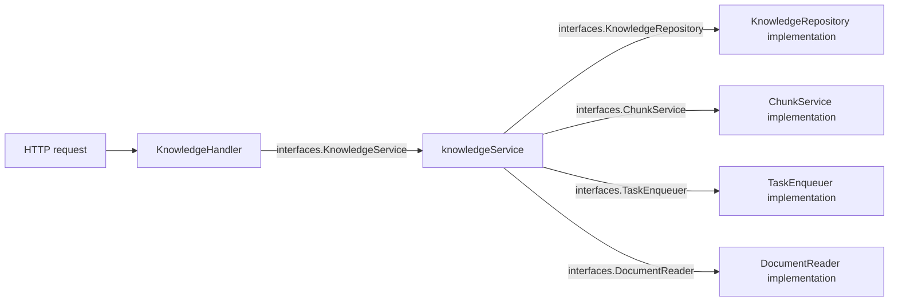
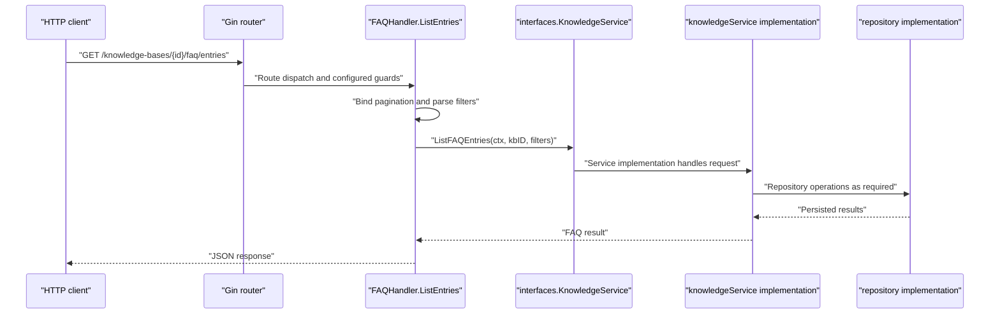
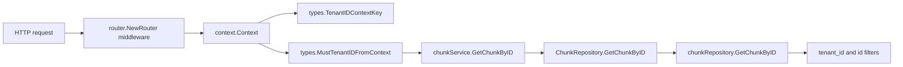
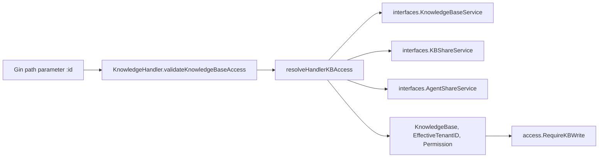
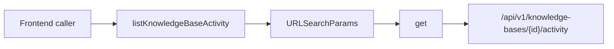

<!-- source: DeepWiki mcp.deepwiki.com · repo Tencent/WeKnora · page 10.3 Code Organization and Patterns · fetched 2026-10-29 -->

# Code Organization and Patterns

Relevant source files

The following files were used as context for generating this wiki page:

- [client/faq.go](client/faq.go)
- [frontend/src/api/knowledge-base/index.ts](frontend/src/api/knowledge-base/index.ts)
- [internal/application/repository/chunk.go](internal/application/repository/chunk.go)
- [internal/application/service/chunk.go](internal/application/service/chunk.go)
- [internal/application/service/knowledge.go](internal/application/service/knowledge.go)
- [internal/handler/faq.go](internal/handler/faq.go)
- [internal/handler/knowledge.go](internal/handler/knowledge.go)
- [internal/router/router.go](internal/router/router.go)
- [internal/types/const.go](internal/types/const.go)
- [internal/types/context_clone.go](internal/types/context_clone.go)
- [internal/types/context_helpers.go](internal/types/context_helpers.go)
- [internal/types/context_helpers_test.go](internal/types/context_helpers_test.go)
- [internal/types/faq.go](internal/types/faq.go)
- [internal/types/interfaces/chunk.go](internal/types/interfaces/chunk.go)
- [internal/types/interfaces/knowledge.go](internal/types/interfaces/knowledge.go)

## Purpose and Scope

This page describes the code organization and implementation patterns visible in the provided Go and TypeScript files: the handler–service–repository boundary, interface-based dependency injection, request-context conventions, and the frontend API module’s role. It uses knowledge and chunk operations as concrete examples. It does not infer unshown container wiring or repository structure.

Sources: [internal/handler/knowledge.go:31-44](), [internal/application/service/knowledge.go:48-87](), [internal/application/repository/chunk.go:26-34](), [internal/types/interfaces/knowledge.go:12-26](), [frontend/src/api/knowledge-base/index.ts:1-6]()

---

## Package Structure

The supplied files show a Go application split across `internal/handler`, `internal/application/service`, `internal/application/repository`, and `internal/types/interfaces`. The handler package adapts HTTP requests to application operations; the service package implements business logic and depends on interfaces; repository implementations persist data. Shared domain types and contracts are exposed through `internal/types` and `internal/types/interfaces`. The frontend has a separate API module under `frontend/src/api`. [internal/handler/knowledge.go:1-44](), [internal/application/service/knowledge.go:1-27](), [internal/application/repository/chunk.go:1-15](), [internal/types/interfaces/knowledge.go:1-13](), [frontend/src/api/knowledge-base/index.ts:1-6]()

### Package Organization Principles

| Area | Example in the supplied files | Responsibility evidenced by the code |
|---|---|---|
| HTTP handler | `handler.KnowledgeHandler` | Holds service dependencies and performs request-level access checks. [internal/handler/knowledge.go:31-44](), [internal/handler/knowledge.go:120-185]() |
| Application service | `service.knowledgeService` | Coordinates knowledge-related interfaces and implements `interfaces.KnowledgeService`. [internal/application/service/knowledge.go:48-87](), [internal/application/service/knowledge.go:95-154]() |
| Service contract | `interfaces.KnowledgeService` | Defines operations such as file, URL, passage, and manual knowledge creation. [internal/types/interfaces/knowledge.go:12-55]() |
| Repository contract | `interfaces.ChunkRepository` | Defines chunk persistence operations independently of the service implementation. [internal/types/interfaces/chunk.go:15-43]() |
| Repository implementation | `chunkRepository` | Implements chunk persistence using `*gorm.DB`. [internal/application/repository/chunk.go:26-34]() |
| Frontend API module | `frontend/src/api/knowledge-base/index.ts` | Wraps HTTP requests for knowledge-base operations using shared request helpers. [frontend/src/api/knowledge-base/index.ts:1-6](), [frontend/src/api/knowledge-base/index.ts:18-30]() |

Sources: [internal/handler/knowledge.go:31-44](), [internal/application/service/knowledge.go:48-87](), [internal/types/interfaces/knowledge.go:12-55](), [internal/types/interfaces/chunk.go:15-43](), [internal/application/repository/chunk.go:26-34](), [frontend/src/api/knowledge-base/index.ts:1-30]()

---

## Dependency Injection Architecture

The supplied files demonstrate constructor injection: constructors accept dependencies as parameters and store them on concrete implementations. `NewKnowledgeService` accepts interface-typed repositories and services, then returns the `interfaces.KnowledgeService` contract. `NewChunkService` follows the same pattern for chunk operations. This makes service dependencies explicit at construction time and allows callers to provide implementations through interfaces. [internal/application/service/knowledge.go:95-154](), [internal/application/service/chunk.go:41-68]()

The router’s `RouterParams` uses `dig.In` and lists handler and service dependencies as fields. This shows that the router parameter structure is designed to receive dependencies through `dig`; the supplied excerpt does not show the container’s registration or invocation code. [internal/router/router.go:30-101]()

### Constructor Injection and Runtime Dependency Flow

**Diagram: `KnowledgeHandler` to `knowledgeService` dependency flow**

The handler stores `interfaces.KnowledgeService`, while `NewKnowledgeService` accepts interfaces for repository, document reader, chunk service, task enqueuer, retrieval, storage, and other collaborators. The diagram shows representative dependencies, not a complete runtime registration graph. [internal/handler/knowledge.go:31-44](), [internal/handler/knowledge.go:87-118](), [internal/application/service/knowledge.go:95-123]()

Sources: [internal/handler/knowledge.go:31-44](), [internal/handler/knowledge.go:87-118](), [internal/application/service/knowledge.go:95-123]()

### Router Parameter Injection

`RouterParams` embeds `dig.In` and groups configuration, service interfaces, concrete handlers, and infrastructure-facing dependencies such as `*redis.Client`. `NewRouter` accepts this struct as its input. This is evidence of a dependency-injection boundary at router construction; the code excerpt does not establish how each field is provided. [internal/router/router.go:30-104]()

Sources: [internal/router/router.go:30-104]()

---

## Layered Architecture Pattern

The demonstrated request path follows a handler → service → repository pattern. The handler receives HTTP input, applies access validation, and calls a service interface. A service implementation coordinates domain operations through interfaces. Repository implementations handle persistence; for example, `chunkRepository` uses GORM, while `chunkService` validates writes before calling its repository. [internal/handler/knowledge.go:144-185](), [internal/application/service/chunk.go:82-104](), [internal/application/repository/chunk.go:26-34]()

### Layer Responsibilities and Data Flow

| Layer | Example | Responsibilities shown |
|---|---|---|
| HTTP | `KnowledgeHandler`, `FAQHandler` | Reads request values, validates/binds input, checks or relies on route-level access controls, calls service methods, and formats responses. [internal/handler/knowledge.go:120-185](), [internal/handler/faq.go:17-38](), [internal/handler/faq.go:85-127]() |
| Service | `knowledgeService`, `chunkService` | Implements application operations and coordinates dependencies. `chunkService.CreateChunks` validates writes before persistence. [internal/application/service/knowledge.go:48-87](), [internal/application/service/chunk.go:82-104]() |
| Contract | `KnowledgeService`, `ChunkRepository` | Specifies operations independently of their implementations. [internal/types/interfaces/knowledge.go:12-55](), [internal/types/interfaces/chunk.go:15-43]() |
| Persistence | `chunkRepository` | Uses GORM and a transaction for batch chunk creation. [internal/application/repository/chunk.go:26-34](), [internal/application/repository/chunk.go:48-95]() |

**Diagram: `ListEntries` request path**

`FAQHandler.ListEntries` binds pagination and query filters, calls `knowledgeService.ListFAQEntries`, and returns a JSON response. The repository interaction is shown as a possible service-layer responsibility, not as a specific call demonstrated in the supplied excerpt. Route-level guards are described by the handler’s comment; route registration itself is not shown here. [internal/handler/faq.go:17-23](), [internal/handler/faq.go:85-127]()

Sources: [internal/handler/faq.go:17-23](), [internal/handler/faq.go:85-127]()

### Repository Contracts and Implementations

`ChunkRepository` defines persistence operations such as creating, retrieving, listing, updating, and deleting chunks. `NewChunkRepository` returns that interface while constructing the unexported `chunkRepository` implementation. The implementation’s `CreateChunks` cleans invalid UTF-8, defaults an empty index status, and inserts batches inside a database transaction. [internal/types/interfaces/chunk.go:15-43](), [internal/application/repository/chunk.go:26-34](), [internal/application/repository/chunk.go:48-95]()

The service layer adds application-level behavior around the contract. For example, `chunkService.CreateChunks` invokes `validateChunkWrites` before delegating to `chunkRepository.CreateChunks`, then logs the result. [internal/application/service/chunk.go:82-104]()

Sources: [internal/types/interfaces/chunk.go:15-43](), [internal/application/repository/chunk.go:26-34](), [internal/application/repository/chunk.go:48-95](), [internal/application/service/chunk.go:82-104]()

---

## Multi-Tenancy and Context Patterns

The code defines a named `ContextKey` type and typed constants for request-scoped values. The provided keys include tenant identity, caller and principal information, authorization grants, request ID, language, session identity, sandbox ownership, and background-task metadata. These constants give context values stable, code-defined names rather than relying on untyped string literals at each use site. [internal/types/const.go:1-18](), [internal/types/const.go:19-47](), [internal/types/const.go:48-75](), [internal/types/const.go:76-116]()

Service and repository calls accept `context.Context`. For example, `chunkService.GetChunkByID` obtains the tenant ID from context with `types.MustTenantIDFromContext` and passes that ID to the repository lookup. The repository query filters by both `tenant_id` and chunk ID. [internal/application/service/chunk.go:106-129](), [internal/application/repository/chunk.go:98-107]()

| Context key | Purpose stated in its definition |
|---|---|
| `TenantIDContextKey` | Scopes execution, including repository and model queries. [internal/types/const.go:6-8]() |
| `CallerContextKey` | Captures the authenticated resource caller. [internal/types/const.go:9-10]() |
| `KBGrantsContextKey` | Carries immutable operation grants. [internal/types/const.go:11-12]() |
| `RequestIDContextKey` | Carries the request ID. [internal/types/const.go:19-20]() |
| `SessionTenantIDContextKey` | Carries the session owner’s tenant ID for session/message lookup scoping. [internal/types/const.go:41-43]() |
| `SessionIDContextKey` | Carries the current session ID through the chat pipeline. [internal/types/const.go:44-47]() |
| `SandboxTenantIDContextKey` | Carries the tenant that owns the addressed session sandbox; its definition distinguishes this from session lookup scoping. [internal/types/const.go:48-60]() |
| `BackgroundTaskContextKey` | Marks model calls originating from background workers. [internal/types/const.go:97-101]() |
| `LanguageContextKey` | Carries user language preference. [internal/types/const.go:75-76]() |
| `LangfuseTraceContextKey` | Carries an active Langfuse trace across the request lifecycle. [internal/types/const.go:90-93]() |

### Bridging Request and Tenant Concepts to Code Entities

**Diagram: request-scoped tenant lookup**

This diagram connects the request and tenant-scoping concepts to the named code entities. The shown service lookup extracts the tenant ID from context and passes it to the repository; the repository uses it in the database filter. The supplied router excerpt shows middleware installation but does not show a specific tenant-setting middleware, so that step is represented only as the context boundary, not as a named implementation. [internal/router/router.go:141-146](), [internal/types/const.go:6-8](), [internal/application/service/chunk.go:116-124](), [internal/application/repository/chunk.go:98-107]()

Sources: [internal/router/router.go:141-146](), [internal/types/const.go:6-8](), [internal/application/service/chunk.go:116-124](), [internal/application/repository/chunk.go:98-107]()

### Bridging Access Policy to Handler Entities

**Diagram: knowledge-base access decision**

`validateKnowledgeBaseAccess` obtains the `:id` path parameter and delegates to `validateKnowledgeBaseAccessWithKBID`, which calls `resolveHandlerKBAccess`. The write-access variant requests editor-level access and then calls `access.RequireKBWrite`. The diagram identifies the relevant code entities and the access flow shown in the handler. [internal/handler/knowledge.go:144-164](), [internal/handler/knowledge.go:166-185]()

Sources: [internal/handler/knowledge.go:144-185]()

---

## Frontend API Boundary

The frontend knowledge-base API module imports shared request helpers (`get`, `post`, `put`, `del`, `postUpload`, and `getDown`) and exports functions for backend operations. For instance, `listKnowledgeBaseActivity` builds query parameters and invokes `get` with a `/api/v1/knowledge-bases/{id}/activity` path. This keeps endpoint construction and query serialization in the API module rather than in the calling UI component. [frontend/src/api/knowledge-base/index.ts:1-6](), [frontend/src/api/knowledge-base/index.ts:18-30]()

**Diagram: frontend function to HTTP endpoint**

Sources: [frontend/src/api/knowledge-base/index.ts:18-30]()

---

## Design Principles Evidenced by the Code

- **Depend on contracts at service boundaries.** `knowledgeService` and `chunkService` receive interface-typed collaborators, while repository constructors return interface types. [internal/application/service/knowledge.go:95-124](), [internal/application/service/chunk.go:48-57](), [internal/application/repository/chunk.go:31-34]()
- **Keep HTTP adaptation in handlers.** `FAQHandler.ListEntries` parses query values, invokes a service operation, and writes the HTTP response. [internal/handler/faq.go:85-127]()
- **Keep persistence mechanics in repositories.** `chunkRepository.CreateChunks` performs database-specific transaction and batch-insert work. [internal/application/repository/chunk.go:48-95]()
- **Use context for request-scoped identity and execution metadata.** The code defines typed keys for tenant, principal, request, session, trace, and background-task values. [internal/types/const.go:1-18](), [internal/types/const.go:19-47](), [internal/types/const.go:90-107]()
- **Use typed error sentinels across layers.** `service.ErrChunkNotFound` aliases `repository.ErrChunkNotFound`; service code uses `errors.Is` to preserve matching through wrapping. [internal/application/service/knowledge.go:29-46](), [internal/application/repository/chunk.go:17-24](), [internal/application/service/chunk.go:131-143]()
- **Provide explicit fallbacks for optional collaborators.** `knowledgeService.tracker` returns `noopSpanTracker{}` when no tracker is configured, allowing callers to use the tracker without repeating nil checks. [internal/application/service/knowledge.go:156-164]()

Sources: [internal/application/service/knowledge.go:29-46](), [internal/application/service/knowledge.go:95-164](), [internal/application/service/chunk.go:48-68](), [internal/application/service/chunk.go:131-143](), [internal/application/repository/chunk.go:17-24](), [internal/application/repository/chunk.go:48-95](), [internal/handler/faq.go:85-127](), [internal/types/const.go:1-47](), [internal/types/const.go:90-107]()

---

## Summary

The provided code illustrates an interface-driven, layered design: handlers adapt HTTP requests and enforce or rely on access checks; services coordinate application behavior through contracts; and repository implementations encapsulate persistence. Constructor parameters make service dependencies explicit, `dig.In` appears in the router’s dependency parameter structure, and typed context keys carry request-scoped tenant and execution metadata. The frontend API module forms a separate boundary for endpoint paths and request construction. [internal/handler/knowledge.go:31-44](), [internal/application/service/knowledge.go:95-154](), [internal/application/repository/chunk.go:26-34](), [internal/router/router.go:30-104](), [internal/types/const.go:1-18](), [frontend/src/api/knowledge-base/index.ts:1-30]()

Sources: [internal/handler/knowledge.go:31-44](), [internal/application/service/knowledge.go:95-154](), [internal/application/repository/chunk.go:26-34](), [internal/router/router.go:30-104](), [internal/types/const.go:1-18](), [frontend/src/api/knowledge-base/index.ts:1-30]()

---

